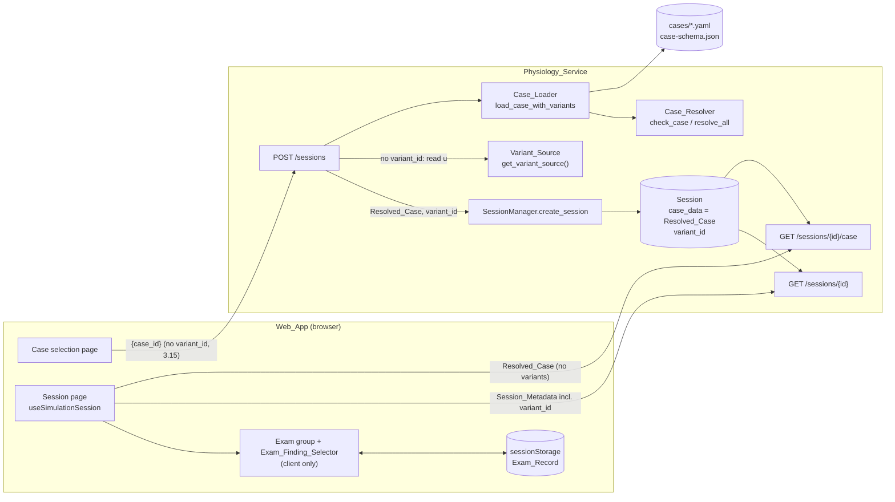

# Design Document: Bedside exam

## Overview

Bedside exam makes the player find the side of the tension pneumothorax before treating it. The design has three parts:

1. The Physiology_Service resolves the case file's side Variants, picks one per Session, and serves only that Variant's Resolved_Case.
2. The Play_View gets a client-only exam group ("Check on him"), a Findings_List and an Exam_Record. Exam_Buttons never call the service and take no Simulation_Time.
3. The Avatar, Hints and Ending_Screen stop giving the side away before an Ending and name it after one.

This document covers requirements 1 to 14 of `.kiro/specs/bedside-exam/requirements.md` (accepted at commit `7f974eb`). It builds on the play-mode design (`.kiro/specs/play-mode/design.md`) and the core-simulation-loop design, and edits neither.

### Scope boundary

The play-mode design states "Nothing under `services/physiology/` changes". This spec lifts that boundary in one place only: session creation, case loading and validation, Session metadata, and their pytest tests. Files changed or added:

- `services/physiology/`: `case_resolver.py` (new), `case_loader.py`, `models.py`, `main.py`, `session_manager.py` (one field and one keyword argument), `requirements.txt` (Hypothesis), `pytest.ini` (one marker), new and updated `test_*.py`.
- `cases/case-schema.json`, `cases/adult-tension-pneumothorax.yaml`, `scripts/validate-case.py`.
- `apps/web/**` (detailed in "Components and Interfaces").

Not changed: `pulse_wrapper.py` (it already maps `"Right"` to `eSide.Right`), every Pulse action, every Intervention, the insult time, type and severity, `docker-compose.yml`, the Dockerfile, and the play-mode and core-simulation-loop spec files.

### Findings from the current code

These facts come from reading `main` at commit `7f974eb`:

| Fact | Source | Consequence |
|---|---|---|
| `POST /sessions` calls `load_case`, maps any `CaseLoadError` to 404, then calls `session_manager.create_session(case_id, case_data)`. The Pulse engine is created inside `create_session`. | `main.py`, `session_manager.py` | Variant selection fits between loading and `create_session`, so a 400 starts no engine (3.4, 3.5). |
| `session_manager = SessionManager()` is a module global in `main.py`. Tests reach it as `main.session_manager`. | `main.py`, `test_clock_task.py`, `test_vitals_socket.py` | A Variant_Source passed to the SessionManager constructor could only be stubbed by replacing that global. A FastAPI dependency avoids this (D4). |
| `GET /sessions/{id}/case` returns `session.case_data` as stored. `session.scheduled_insults` is read from `case_data["timeline"]["scheduledInsults"]` at creation. | `main.py`, `session_manager.py` | Storing the Resolved_Case as `case_data` is enough for 3.7 and 3.8. |
| `fork_branch` adds a Branch to the same `Session` object. `case_data` and `scheduled_insults` are Session fields that no fork, tick or intervention writes. | `session_manager.py` | Forks keep the Variant with no extra code (3.10). |
| Service-created Checkpoint descriptions are `"Initial state"`, `"After <intervention label>"`, `"Forked from <branch id prefix>"` or none. | `session_manager.py` | No service text names the insult side (10.5). |
| `load_case` returns only `e.message` on a schema failure, without the field path. | `case_loader.py` | 1.13 keeps that exact message for Base_Cases without Variants. Cases with Variants get the new message with Variant_Id and path. |
| `scripts/validate-case.py` prints the first `ValidationError` and its dotted path. The host Python on the author's Mac has no `yaml` module. | `scripts/validate-case.py`, host check | The script imports the shared resolver and runs inside the physiology container (D10). |
| The Dockerfile copies `services/physiology/` into `/app` at build time. Compose mounts only `./cases` at `/app/cases:ro`. | `Dockerfile`, `docker-compose.yml` | Python changes need an image rebuild. Case-file changes do not. |
| At 1280 × 720 the play-mode action column uses 423.75 of 566 px with three Hints and disabled Intervention buttons. | `PlayView.tsx` file comment, play-mode design "Play view" | Confirmed by recomputing each element from the component classes (see "Layout"). |
| The Ending_Screen content is 656 px of the 664 px below the Safety_Notice. | `EndingScreen.tsx` `ENDING_OVERHEAD`, play-mode design "Ending screen" | A Side_Reveal_Text line does not fit without shrinking the Avatar (see "Layout"). |

### Design decisions

**D1. Three columns at 1280 px and wider when the case has an Exam_Section.** The play-mode action column cannot also hold the exam group and the Findings_List: the total is 776.5 px against 566 px (see "Layout"). The patient column has spare width, because the Avatar is height-limited to 257 px inside a 490 px column. The exam layout narrows the patient column to 400 px and splits the rest into two columns: the Goal, the exam group, "What can you do?" and the Intervention buttons in the middle; the Findings_List and the Hint row on the right. The exam group stays above "What can you do?" (6.1), and DOM order equals visual order (6.11, play-mode 11.2). Alternatives rejected: a height-capped Findings_List inside the single action column still overflows by about 130 px; shrinking the Avatar to about 180 px makes the cartoon hard to read for a visitor; an exam column to the left of "What can you do?" breaks 6.1. A Case without an Exam_Section keeps the play-mode two-column layout unchanged (4.6).

**D2. One pure Case_Resolver module shared by the service and `scripts/validate-case.py`.** `case_resolver.py` imports only the standard library and `jsonschema`, so the script can import it without the Pulse package or the service settings. One implementation means the loader and the script cannot disagree on what a valid Variant is (1.8 to 1.11).

**D3. The Case_Loader resolves and validates every Variant on every load.** `load_case_with_variants` returns the Base_Case and all Resolved_Cases. A create request therefore fails with the existing case-load error if any Variant is invalid, even when it names a valid one (1.8, 1.9). Loading already happens per request today, and resolving two Variants is a deep copy plus four assignments each.

**D4. The Variant_Source is a FastAPI dependency.** `get_variant_source()` returns `random.random`. Tests set `app.dependency_overrides[get_variant_source]`, the documented FastAPI override mechanism, and patch no module global (3.11). Selection is request validation that must finish before any engine starts (3.4), so it belongs in the endpoint, not in the SessionManager.

**D5. Each Variant owns the interval between the float boundaries `k / n`.** `variant_index(u, n)` returns `bisect_right([k / n for k in 1..n-1], u)`. In exact arithmetic this is `floor(u × n)` (3.2). Unlike `math.floor(u * n)` in floating point, it cannot round a value one step below a boundary up into the next interval. So the stub values "at `k/n`" and "just below `k/n`" of 14.8 select `k` and `k - 1` without any rounding exception.

**D6. The Session stores the Resolved_Case and the Variant_Id.** `Session.case_data` holds the Resolved_Case and a new `Session.variant_id` holds the id, or `None`. Forks and page reloads read the same Session, so the Variant never changes during a Session (3.8, 3.10).

**D7. "The Base_Case equals the left Variant" is a case-content test, not a loader rule.** Requirement 2.5 is about this one case file. A loader rule would reject a future case whose Base_Case is not one of its Variants. The Vitest case-content tests (14.6) and one pytest check on the shipped file cover it.

**D8. Session_API selection tests use a fake engine.** The boundary tests of 14.8 create about ten Sessions. They replace `session_manager.PulseEngineWrapper` with a fake, as `test_fork.py` already does for `load_from_checkpoint`, so they start no Pulse engine. Requirement 3.11 forbids patching only for the Variant_Source. One real-engine test per Variant remains (3.13, 14.12).

**D9. A `pulse` pytest marker separates slow tests.** `pytest.ini` registers `pulse: starts a real Pulse engine`. Every test that starts a real engine carries it, so `-m "not pulse"` runs the fast suite. New test files are either all fast or all `pulse`.

**D10. `scripts/validate-case.py` runs in the physiology container with the repository mounted.** The host has no `yaml` module, and the image has `pyyaml` and `jsonschema==4.20.0`. Mounting the repository at `/repo` lets the script find `services/physiology/case_resolver.py` by its repository path, the same way it would on a host with the dependencies installed.

**D11. Author default for open question 2: the windpipe finding stays side-neutral.** No Exam_Finding contains a Side_Word (decision 7 of the requirements). If the author later wants "pushed to the right", the mechanism is a fifth Variant_Overrides key, `examSentences`, mapping an Exam_Action id and an optional Exam_Rule `id` to the per-Variant sentence. The Case_Resolver would write it into the Resolved_Case, so the Exam_Finding_Selector stays blind to the Variant_Id (5.1), and the side-word check of 8.6 would get an exception for that one action. Run B describes where this slots in. Nothing of it is built now.

**D12. Author default for open question 5: the last Hint does not add the side to Found_Sides.** Only an Abnormal_Finding from a sided Exam_Button does (decision 14 of the requirements).

**D13. Author default for open question 8: the Casual_Player threat model is accepted.** A player with developer tools may read the side from the Resolved_Case, the Session_Metadata or sessionStorage (decision 12 of the requirements).

**D14. Author default for open question 11: Hints keep play-mode 9.4.** The Hint_Record lives for one page load and is not stored. Only the Exam_Record persists in sessionStorage.

**D15. All other open questions keep the requirements' drafts.** Open questions 1, 3, 4, 6, 7, 9, 10 and 12 keep the draft content and rules of the requirements, each with its `TODO(author)` marker in the case file.

### Run order and follow-up

These tasks run before play-mode task group 12 (calibration). Play-mode tasks 12.1 to 12.3 assume a left-only case and must request each Variant by `variant_id` (Requirement 13). After this design is accepted, the user will update play-mode Requirement 13 and tasks 12.1 to 12.3 from bedside-exam Requirement 13. This spec does not edit them.

## Architecture



The create request flows as follows:

1. The case selection page sends `{case_id}` with no `variant_id` (3.15).
2. `POST /sessions` loads the case. An unknown `case_id` or an invalid case returns 404 (3.6, existing behaviour).
3. `choose_variant` validates a named `variant_id`, or reads one value from the Variant_Source when none is named. A bad `variant_id` returns 400 before any engine starts.
4. `SessionManager.create_session` starts the Pulse engine and schedules the insults from the Resolved_Case, and stores the Resolved_Case and `variant_id` on the Session.
5. The browser loads the Resolved_Case and the Session_Metadata as it does today. Every exam action after that runs in the browser: the Exam_Finding_Selector reads the Resolved_Case, the latest VitalSigns sample and the Active_Interventions, and the Exam_Record is written to sessionStorage. No exam action sends a request (6.4).

### Modules

Physiology_Service (detailed in "Physiology_Service (Python)"):

- New `case_resolver.py`: override keys, `resolve_variant`, `check_case`, `resolve_all`, `variant_index`, `choose_variant`, error types.
- Changed `case_loader.py`: `LoadedCase`, `load_case_with_variants`, `load_resolved_case`. `load_case` keeps its signature.
- Changed `models.py`: `SessionRequest.variant_id`, `SessionMetadata.variant_id`.
- Changed `main.py`: `get_variant_source` dependency, the new create flow, one `session_metadata(session)` helper for both metadata endpoints.
- Changed `session_manager.py`: `Session.variant_id`, `create_session(..., variant_id=None)`.
- Changed `requirements.txt` (Hypothesis) and `pytest.ini` (`pulse` marker).
- New tests: `test_case_resolver.py`, `test_case_loader_variants.py`, `test_session_variants.py` (all fast), `test_variant_engine.py` (`pulse`). Existing tests that create a Session of `adult-tension-pneumothorax` request the `left` Variant (3.14).

Repository files: `cases/case-schema.json` (`variants`, `play.exam`, `play.sideRevealText`), `cases/adult-tension-pneumothorax.yaml` (Variants, exam content, side-neutral Hints 1 and 2), `scripts/validate-case.py` (imports `case_resolver`).

Web_App (detailed in "Components and Interfaces"):

- New pure modules in `src/lib/`: `examFinding.ts` (the Exam_Finding_Selector) and `examRecord.ts` (Exam_Record entries and the sessionStorage round trip).
- Changed `src/lib/branchLineage.ts` for Active_Exam_Entries; `src/lib/sides.ts` for Found_Sides and Shown_Swollen_Sides; `src/lib/avatarMapper.ts` for the swollen-side gate; `src/lib/statusSelector.ts` (one export); `src/lib/sessionState.ts` and `src/hooks/useSimulationSession.ts` for exam state; `src/types/index.ts` for the new case fields and `variant_id`.
- New components `ExamPanel.tsx` and `FindingsList.tsx`; `InterventionPanel.tsx` exports its lock icon and play button classes. Changed `PlayView.tsx` (exam layout, see "Layout") and `EndingScreen.tsx` (Side_Reveal_Text, Avatar from ungated Swollen_Sides).
- Changed `src/lib/caseContent.test.ts` for per-Variant content checks (14.6).

## Layout

All numbers are CSS pixels at 1280 × 720 and 100% zoom, with `1rem = 16 px`. Text widths use the same estimate as the play-mode arithmetic: 0.5 em per character for regular text (8 px at 16 px, 9 px at 18 px) and 8.5 px per character for 16 px semibold button text. Line heights: `text-base` 24 px, `text-lg leading-snug` 24.75 px, `text-lg` headings 28 px. Requirement 6.13 is checked manually during acceptance, so the budgets below keep spare height for estimate error.

### Fixed rows (unchanged from play-mode)

| Item | Height |
|---|---|
| Viewport | 720 |
| Safety_Notice (`--notice-h` = 3.5rem) | 56 |
| Play_View `py-2` | 16 |
| Toolbar row (View_Switcher 50 and playback controls 74 share one row) | 74 |
| `gap-2` below the toolbar | 8 |
| **Height left for the columns** | **566** |

Width: 1280 − `px-4` (2 × 16) = 1248 px for the grid.

### Play-mode baseline, verified

Play-mode columns are `minmax(0,2fr) minmax(0,3fr)` with `gap-6`: (1248 − 24) × 2/5 = 489.6 px and × 3/5 = 734.4 px.

Patient column: the Avatar width is `min(100%, 28rem, calc((100vh − var(--notice-h) − 10.5rem − 8.5rem) × 200 / 280))` = (664 − 168 − 136) × 200/280 = 257.14 px. The Avatar is 136 (speech band) + 360 (drawing) = 496 px, and the StatusLine adds 12 + 2 × 24.75 = 61.5 px, so the column is 557.5 of 566 px.

Action column, recomputed from the component classes:

| Element | Classes | Height |
|---|---|---|
| GoalBar | Goal line `text-lg leading-snug` 24.75 + `mt-2` 8 + time row 24 | 56.75 |
| "What can you do?" | `h2 text-lg` | 28 |
| InterventionPanel, play variant, disabled | 2 × (border 4 + `py-2` 16 + label 24 + "Not available right now" 24) + `gap-2` 8 | 144 |
| Hint row | Hint button 44 + `gap-3` 12 + three Hints in four lines (4 × 24.75 + `space-y-2` 16) | 171 |
| Column gaps | 3 × `gap-2` | 24 |
| **Total** | | **423.75** |

This matches the 423.75 of 566 px in the requirements and in the `PlayView.tsx` file comment.

### Why the exam group does not fit in the play-mode action column

The new Hints are longer: 92, 70 and 85 characters. At the Hint list width of 734.4 − 24 = 710 px, about 78 characters fit on a line, so they take 2 + 1 + 2 = 5 lines and the Hint row grows to 44 + 12 + 5 × 24.75 + 16 = 195.75 px. Adding the exam group and the smallest useful Findings_List to the same column gives:

| Element | Height |
|---|---|
| GoalBar | 56.75 |
| "Check on him" heading + `gap-2` | 36 |
| Exam_Button rows (one row per Exam_Action, four rows of 44, three gaps of 8) | 200 |
| Findings_List with one two-line item (48 + `p-3` 24 + border 4) | 76 |
| "What can you do?" | 28 |
| Intervention buttons, disabled | 144 |
| Hint row with three revealed Hints | 195.75 |
| Column gaps (6 × 8) | 48 |
| **Total** | **776.5 against 566** |

The column is 210.5 px too tall. Capping the Findings_List cannot help, because the 76 px list is already the smallest that shows one item. The rearrangement is D1.

### Exam layout at 1280 × 720

When the Resolved_Case's Play_Section has an Exam_Section, the grid below the toolbar is `minmax(0,5fr) minmax(0,6fr) minmax(0,4fr)` with `gap-6`: (1248 − 48) = 1200 px gives 400 / 480 / 320 px.

```
┌──────────────────────────────── Safety_Notice (sticky) ─────────────────────────────────┐
│ [Play | Clinician]                                               ▶ Pause   1x 2x 4x      │
├────────────────────────┬──────────────────────────────────┬─────────────────────────────┤
│ (speech-bubble band)   │ Goal: <Goal_Text>                │ ┌ Findings_List ──────────┐ │
│                        │ [■■■■■■□□□□] 3:20 left           │ │ 1:42 Listen … left side │ │
│    StitchedPatient     │ Check on him                     │ │ You hear clear …        │ │
│      (257 px)          │ [ Look at his chest            ] │ │ 1:30 Look at his chest  │ │
│                        │ [ Listen…left ] [ Listen…right ] │ │ One side of his …       │ │
│                        │ [ Feel the position of his …   ] │ └─────────────────────────┘ │
│                        │ [ Look at his neck veins       ] │ [ No hints left ] [⟲ Rewind]│
│ [▲ Worried] <Status>   │ What can you do?                 │ 1. Hint 1 …                 │
│                        │ [ Let the trapped air out - left]│ 2. Hint 2 …                 │
│                        │ [ Let the trapped air out - rig…]│ 3. Hint 3 …                 │
└────────────────────────┴──────────────────────────────────┴─────────────────────────────┘
```

DOM order and visual order are the same: toolbar, patient column, middle column (Goal, exam group, "What can you do?", Intervention buttons), right column (Findings_List, Hint button, Hints, Rewind button). Tab order is therefore View_Switcher, playback controls, Exam_Buttons, Intervention buttons, Hint button, Rewind button. This satisfies 6.11 and play-mode 11.2 without `tabindex` values. The finding live region (6.10) is visually hidden (`sr-only`) and takes no height.

**Patient column (400 × 566), unchanged content and formula.** The Avatar is min(400, 448, 257.14) = 257.14 px wide and 496 px tall, as in play-mode. The StatusLine sentence has 400 − badge (115.5 for "Worried") − `gap-3` 12 = 272.5 px, about 30 characters per line. The longest case Status_Sentence (56 characters) wraps to two lines, so the column stays at 557.5 of 566 px. The text width is narrower than play-mode's 358 px, so the acceptance check should confirm the two lines.

**Middle column (480 × 566).**

| Element | Calculation | Height |
|---|---|---|
| GoalBar | the Goal line (51 characters, about 459 px) budgeted at two lines: 2 × 24.75 + 8 + 24 | 81.5 |
| `gap-2` | | 8 |
| "Check on him" heading + `gap-2` | `h2 text-lg` 28 + 8 | 36 |
| `look-chest` button | full width, 1 line | 44 |
| `listen` Left and Right buttons | one row of two 236 px buttons; the 31 to 32 character labels wrap to 2 lines (border 4 + `py-2` 16 + 48) | 68 |
| `windpipe` button | full width, inner 416 px with the lock icon, 33 characters (about 281 px): 1 line | 44 |
| `neck-veins` button | full width, 1 line | 44 |
| Gaps between button rows | 3 × 8 | 24 |
| `gap-2` | | 8 |
| "What can you do?" | `h2 text-lg` | 28 |
| `gap-2` | | 8 |
| Intervention buttons, disabled | inner 480 − 36 − 28 (lock) = 416 px; the 45-character Play_Labels (about 383 px) fit on 1 line, plus "Not available right now": 2 × 68 + 8 | 144 |
| **Total** | | **537.5 of 566** |

With a one-line Goal the column is 512.75 px. With enabled Intervention buttons (44 each) it is 48 px less. An Exam_Button is 44 px when disabled too, because it shows a lock icon and a dashed border, not an extra text line (6.12). Each Exam_Action takes one row: a Side_Neutral_Action has one full-width button, and a Sided_Action has its Left and Right buttons side by side. The listen pair therefore stays together, and rows follow Case_Definition order.

**Right column (320 × 566).**

| Element | Calculation | Height |
|---|---|---|
| Findings_List | bordered box `border-2 p-3`, `max-h-[12.5rem]`, `overflow-y-auto`; inner width 292 px | at most 200 |
| `gap-2` | | 8 |
| Hint button (and Rewind button in the same row) | 44 | 44 |
| `gap-3` | | 12 |
| Three revealed Hints | list width 296 px, about 32 characters per line: Hint 1 (92 characters) 4 lines, Hint 2 (70) 3 lines, Hint 3 (85) 3 lines; 10 × 24.75 + `space-y-2` 16 | 263.5 |
| **Total** | | **527.5 of 566** |

The 38.5 px left over covers one extra wrapped Hint line. The Hint row fits its width: "Hint (3 left)" is about 146 px and "No hints left" with its lock about 174 px, in the 320 − 12 − 111 (Rewind) = 197 px first column.

Findings_List item: line 1 is the `M:SS` time and the Exam_Button text in semibold, and the next lines are the finding sentence (6.6). For this case the longest item is "1:42 Feel the position of his windpipe" (2 lines at 292 px) and a sentence of at most 52 characters (2 lines), so 96 px. The schema maximum (60-character label and 100-character sentence) takes 7 lines, 168 px. Both fit in the 172 px inner height of the 200 px box, so the newest item is always fully visible (6.13). Older items scroll inside the list. When an entry is added, the Web_App scrolls the newest item into view (`block: 'nearest'`; no smooth scrolling under `prefers-reduced-motion`). This also brings the list back to the top if the player had scrolled it down. The empty-list text "You haven't checked anything yet." is one line, so the box is 52 px before the first exam.

### Breakpoints for the exam layout

| Viewport | Layout | Page height |
|---|---|---|
| width ≥ 1280 and height ≥ 720 | three columns as above | fixed to `calc(100vh − var(--notice-h))`, `overflow: hidden`, as play-mode does at `lg` |
| width ≥ 1280 and height < 720 | three columns | page scrolls; nothing is clipped |
| width < 1280 | one stacked column | page scrolls |

The fixed-height rule uses the arbitrary Tailwind variant `[@media(min-width:1280px)_and_(min-height:720px)]:` (Tailwind 3.3 supports arbitrary variants), so no Tailwind config change is needed. Play-mode fixes the height at every width of 1024 px and more. The exam layout does not, because its three columns are too narrow at 1024 px (315 / 378 / 252 px) and fixed height would clip content. A case without an Exam_Section keeps the play-mode classes exactly (4.6).

Avatar size: the formula of `PlayView.tsx` is unchanged and gives 257.14 px at 1280 × 720. In the exam layout its wide-screen class moves from `lg:` to `xl:` (1280 px). Below 1280 px the Avatar uses the existing stacked width `min(100%, 20rem)`.

### Stacked layout below 1280 px, down to 320 px

Order (equal to DOM order): toolbar (wraps, as in play-mode), Avatar, StatusLine, GoalBar, "Check on him" with the Exam_Button rows, "What can you do?" with the Intervention buttons, Findings_List, Hint row.

- The listen pair sits side by side from 640 px (`sm:`) and stacks into two full-width rows below that.
- At 320 px the content width is 288 px. Full-width Exam_Buttons have 252 px for text (224 px with the lock icon), so the longest labels wrap to two lines. The longest word in any label is "position" or "windpipe", about 68 px, so no label forces horizontal overflow. Every button and list item also has `break-words` and `min-w-0` as a guard for future labels.
- Below 1280 px the Findings_List cap is `max-h-[16rem]` (256 px, inner 228 px), so the schema-maximum item (7 lines at a 260 px inner width, 168 px) is fully visible (6.15).
- The Findings_List comes after the Intervention buttons in stacked order, because DOM order must match the wide layout. After an exam the newest item is scrolled into view (`block: 'nearest'`), so a phone player sees the finding without searching for it.
- No element has a fixed width above 288 px, so the page has no horizontal scrolling at 320 px.

### Ending_Screen with a Side_Reveal_Text

The Ending_Screen shows the Side_Reveal_Text below the heading and the rescued sentence, above the Avatar (12.2). Its content is 656 of 664 px today, so the extra line must come out of the Avatar. When `sideRevealText` is present, `ENDING_OVERHEAD` grows from 11rem to 14.75rem: a two-line `text-base` budget (3rem) plus one `gap-3` (0.75rem). The Avatar width becomes min(22rem, (664 − 236) × 200/280) = 305.7 px instead of 348.6 px. Content height with the rescued sentence: `p-4` 32 + heading 32 + 12 + sentence 24 + 12 + Side_Reveal_Text 48 (budget) + 12 + drawing 428 + 12 + buttons 44 = 656 of 664 px. The drafted texts (51 characters at the 480 px content width) take one line, so the real height is 632 px. Without `sideRevealText` the overhead stays 11rem (12.3).

### Final numbers at 1280 × 720

| Quantity | Play-mode | Exam layout |
|---|---|---|
| Column widths | 489.6 / 734.4 | 400 / 480 / 320 |
| Avatar width (Play_View) | 257.14 | 257.14 (formula unchanged) |
| Patient column height | 557.5 / 566 | 557.5 / 566 |
| Action content height | 423.75 / 566 (one column) | middle 537.5 / 566, right 527.5 / 566 |
| Same content in one column | 776.5 / 566 | n/a |
| Findings_List cap | n/a | 200 (12.5rem); 256 (16rem) below 1280 px |
| Ending_Screen Avatar width | 348.6 | 305.7 with `sideRevealText`, 348.6 without |
| Ending_Screen content height | 656 / 664 | 656 / 664 (budget), 632 (drafted text) |

## Physiology_Service (Python)

### Case_Resolver (`services/physiology/case_resolver.py`)

The module imports only `bisect`, `copy`, `dataclasses`, `typing` and `jsonschema`. No function reads files, the clock, the environment or randomness.

```python
OVERRIDE_KEYS: Tuple[str, ...] = ("insultSide", "requiredInterventions", "hints", "sideRevealText")
TENSION_PNEUMOTHORAX_ACTION = "SETensionPneumothorax"


@dataclass(frozen=True)
class CaseProblem:
    document: Literal["base", "resolved"]   # where `path` points
    path: str                               # dotted field path, "(root)" for the whole document
    message: str
    variant_id: Optional[str] = None        # set for every problem that belongs to one Variant

    def __str__(self) -> str: ...


class CaseVariantError(ValueError):
    """Raised by resolve_all; `problems` holds every problem, str() joins them with '; '."""
    problems: Tuple[CaseProblem, ...]


class VariantSelectionError(ValueError):
    """A create request named a variant_id that the Case cannot accept (HTTP 400)."""


def resolve_variant(base: Mapping[str, Any], variant: Mapping[str, Any]) -> Dict[str, Any]: ...
def check_case(base: Mapping[str, Any], schema: Optional[Mapping[str, Any]]) -> List[CaseProblem]: ...
def resolve_all(base: Mapping[str, Any], schema: Optional[Mapping[str, Any]]) -> Dict[str, Dict[str, Any]]: ...
def variant_index(u: float, n: int) -> int: ...
def choose_variant(
    case_id: str,
    variant_ids: Sequence[str],
    requested: Optional[str],
    source: Callable[[], float],
) -> Optional[str]: ...
```

**`resolve_variant(base, variant)`** deep-copies `base`, deletes `variants`, and applies each key of `variant["overrides"]` to its Override_Target:

| Key | Target in the copy |
|---|---|
| `insultSide` | `parameters["side"]` of every item of `timeline.scheduledInsults` whose `action` is `SETensionPneumothorax` |
| `requiredInterventions` | `play.endings.rescued.requiredInterventions` (created under `play` if absent) |
| `hints` | `play.hints` |
| `sideRevealText` | `play.sideRevealText` |

Values are deep-copied, so the Resolved_Case shares no list with the Base_Case or the Variant. The function never mutates its arguments and returns equal results for equal inputs (1.4, 1.5). It assumes a Variant that `check_case` accepted.

**`check_case(base, schema)`** returns every problem, in this order. Each step runs only when the previous steps found nothing, because later steps assume the earlier shape.

1. **Schema on the Base_Case** (1.8), when `schema` is not `None`. It collects `Draft7Validator(schema).iter_errors(base)`, sorted by path. When an error path starts with `variants.<i>` and that item has a string `id`, the problem gets that `variant_id`.
2. **No Variants.** If `base` has no `variants` key, it returns the problems so far (1.13).
3. **Variant shape**, always, also without a schema (1.10). `variants` must be a list of objects, each with a string `id` and an object `overrides`.
4. **Unique ids** (1.7). A repeated `id` is a problem at `variants.<i>.id`.
5. **Allowed keys** (1.10). Any `overrides` key outside `OVERRIDE_KEYS` is a problem at `variants.<i>.overrides.<key>`.
6. **Targets exist** (1.6). `insultSide` needs at least one `SETensionPneumothorax` Scheduled_Insult. The other three keys need a `play` object.
7. **Resolve each Variant and validate each Resolved_Case against the schema** (1.8, 1.9), when `schema` is not `None`. The problems have `document="resolved"` and the Resolved_Case path.

The check "the Base_Case equals the left Variant" is not part of `check_case` (D7). It is a test on the shipped case file, run after the steps above.

**`resolve_all(base, schema)`** calls `check_case`. If there is a problem it raises `CaseVariantError`. Otherwise it returns `{variant_id: resolve_variant(base, v)}` in Case_Definition order, or `{}` for a Base_Case without Variants.

**Error messages.** `str(CaseProblem)` is `"<where> at <path>: <message>"`, where `<where>` is `base case`, `base case (variant '<id>')` or `resolved case of variant '<id>'`. The messages are:

| Rule | Example `str(problem)` |
|---|---|
| Base schema, inside a Variant (1.9) | `base case (variant 'right') at variants.1.overrides: Additional properties are not allowed ('goalText' was unexpected)` |
| Duplicate id (1.7) | `base case (variant 'left') at variants.1.id: duplicate variant id 'left' (first used at variants.0.id)` |
| Unknown key (1.10) | `base case (variant 'right') at variants.1.overrides.goalText: unknown override key 'goalText'; allowed keys: insultSide, requiredInterventions, hints, sideRevealText` |
| Missing insult target (1.6) | `base case (variant 'right') at variants.1.overrides.insultSide: override 'insultSide' has no target: the base case has no scheduled insult with action SETensionPneumothorax` |
| Missing play target (1.6) | `base case (variant 'right') at variants.1.overrides.hints: override 'hints' has no target: the base case has no play section` |
| Resolved schema (1.9) | `resolved case of variant 'right' at play.hints.2.text: '' is too short` |

The schema message text is `jsonschema`'s own `ValidationError.message`. The path is `".".join(str(p) for p in error.absolute_path)`, the dotted style that `validate-case.py` already prints.

**`variant_index(u, n)`** raises `ValueError` unless `n >= 1` and `0 <= u < 1`. It returns `bisect.bisect_right([k / n for k in range(1, n)], u)`, a value in `0 .. n-1` (D5).

**`choose_variant(case_id, variant_ids, requested, source)`** handles the create request:

| Input | Result |
|---|---|
| `requested` is `None`, `variant_ids` empty | `None`; `source` not called (3.12) |
| `requested` is `None`, `n = len(variant_ids) > 0` | `variant_ids[variant_index(source(), n)]`; `source` called exactly once (3.2) |
| `requested` in `variant_ids` | `requested`; `source` not called (3.3) |
| `requested` not in a non-empty `variant_ids` | `VariantSelectionError("Unknown variant_id: 'middle'. Valid variant ids: left, right")` (3.4, in the style of core-simulation-loop 6.11: `Unknown intervention: 'x'. Valid ids: a, b`) |
| `requested` is a string, `variant_ids` empty | `VariantSelectionError("Case 'other-case' has no variants; omit variant_id or send null (got 'left')")` (3.5) |

An empty string is a string that matches no id, so it gets the 400 of its row.

### Case_Loader (`services/physiology/case_loader.py`)

```python
@dataclass(frozen=True)
class LoadedCase:
    case_id: str
    base: Dict[str, Any]                  # the parsed file, `variants` included
    resolved: Dict[str, Dict[str, Any]]   # Variant_Id -> Resolved_Case, Case_Definition order; {} without Variants

    @property
    def variant_ids(self) -> List[str]: ...


def load_case_with_variants(case_id: str) -> LoadedCase: ...
def load_case(case_id: str) -> Dict[str, Any]: ...                    # unchanged signature
def load_resolved_case(case_id: str, variant_id: str) -> Dict[str, Any]: ...
```

`load_case_with_variants` keeps today's steps and messages for the missing file and invalid YAML. It then reads the schema; a missing schema file gives `schema = None`, as today.

- **No `variants` key:** validation is today's code exactly (`jsonschema.validate`, message `Case validation failed for <case_id>: <e.message>`), and `resolved` is `{}` (1.13).
- **With `variants`:** it calls `check_case(base, schema)`. Any problem raises `CaseLoadError(f"Case validation failed for {case_id}: " + "; ".join(str(p) for p in problems))`, the existing case-load error with the Variant_Id and path added (1.6, 1.7, 1.9, 1.10). Without problems it calls `resolve_all`.

`load_case(case_id)` returns `load_case_with_variants(case_id).base`, so existing callers keep working and also get the Variant checks. `load_resolved_case(case_id, variant_id)` returns one Resolved_Case and raises `CaseLoadError` for an unknown id. Manager-level tests use it to request the `left` Variant (3.14).

### Variant_Source injection (`main.py`)

```python
VariantSource = Callable[[], float]


def get_variant_source() -> VariantSource:
    """Default Variant_Source: the module-level generator of `random`, seeded from OS entropy at import (3.11)."""
    return random.random
```

`create_session` declares `variant_source: VariantSource = Depends(get_variant_source)`. A test replaces it like this:

```python
class StubSource:
    def __init__(self, values): self.values, self.reads = list(values), 0
    def __call__(self) -> float:
        self.reads += 1
        return self.values.pop(0)

@pytest.fixture
def stub_source():
    stub = StubSource([0.0])
    main.app.dependency_overrides[main.get_variant_source] = lambda: stub
    yield stub
    main.app.dependency_overrides.pop(main.get_variant_source, None)
```

`stub.reads == 0` proves that a named `variant_id` does not read the source (3.3). The test of 14.11 calls `choose_variant` 200 times with `main.get_variant_source()` and the ids from `load_case_with_variants("adult-tension-pneumothorax")`, so it starts no engine.

A constructor argument on `SessionManager` was rejected: `main.session_manager` is created at import, so a test could only stub the source by replacing that global or one of its attributes, which 3.11 forbids. Selection also has to finish before `create_session` starts an engine.

### Request, metadata and the create flow

`models.py`:

```python
class SessionRequest(BaseModel):
    case_id: str
    variant_id: Optional[str] = None      # string or null (3.1); no pattern, so a bad id gets 400, not 422


class SessionMetadata(BaseModel):
    session_id: str
    case_id: str
    variant_id: Optional[str] = None      # always serialised, null for a Case without Variants (3.9)
    created_at: str
    current_branch_id: str
    branches: List[BranchMetadata]
```

`session_manager.py`: `Session` gains `variant_id: Optional[str] = None`. `create_session(self, case_id, case_data, variant_id: Optional[str] = None)` stores both and otherwise works as today. `case_data` is the Resolved_Case, so the engine's starting state and `scheduled_insults` come from it (3.7). Existing two-argument callers keep working.

`main.py`:

```python
@app.post("/sessions", response_model=SessionMetadata)
async def create_session(
    request: SessionRequest,
    variant_source: VariantSource = Depends(get_variant_source),
) -> SessionMetadata:
    try:
        loaded = load_case_with_variants(request.case_id)          # 404 first, whatever the variant_id (3.6)
    except CaseLoadError as e:
        raise HTTPException(status_code=404, detail=str(e))
    try:
        variant_id = choose_variant(request.case_id, loaded.variant_ids, request.variant_id, variant_source)
    except VariantSelectionError as e:
        raise HTTPException(status_code=400, detail=str(e))       # no Session, no engine (3.4, 3.5)
    case_data = loaded.base if variant_id is None else loaded.resolved[variant_id]
    try:
        session = session_manager.create_session(request.case_id, case_data, variant_id=variant_id)
    except Exception as e:                                         # unchanged 500 path
        raise HTTPException(status_code=500, detail=f"Failed to create session: {e}")
    return session_metadata(session)
```

A `ValueError` from a misbehaving Variant_Source (a value outside [0, 1)) falls into a 500 with the same "Failed to create session" prefix. `session_metadata(session)` builds the `SessionMetadata`, including `variant_id`, for both `POST /sessions` and `GET /sessions/{id}`, so the two cannot drift apart (3.9).

`loaded.base` is used only for a Case without Variants, where it is the Base_Case unchanged (3.12). An invalid case file still returns 404, which is today's mapping of every `CaseLoadError`. This spec does not change that mapping.

### Storage, forks and reloads

- `GET /sessions/{id}/case` keeps returning `session.case_data`, which is now the Resolved_Case without `variants` (3.8). The Resolved_Case is a fresh deep copy owned by the Session, and no code path writes into `case_data` (`apply_intervention` copies its parameters; `_advance_tick` only reads `scheduled_insults`). So every call returns an equal document.
- Forks add a Branch to the same Session. `case_data`, `scheduled_insults` and `variant_id` stay as they are, and the new Branch replays the insults from the Session's Resolved_Case (3.10).
- A page reload calls `GET /sessions/{id}` and `GET /sessions/{id}/case` on the same Session and gets the same Variant.
- The Web_App's `createSession` already sends only `{case_id}` (`apps/web/src/lib/api.ts`), which 3.15 requires.

### `scripts/validate-case.py`

The script inserts `Path(__file__).resolve().parents[1] / "services" / "physiology"` at the front of `sys.path` and imports `case_resolver`.

- A Base_Case without Variants keeps today's output and exit codes.
- With Variants it prints one `✗ <problem>` line per `CaseProblem` from `check_case` and exits 1 (1.11).
- On success it prints `✓ Base case is valid` and one `✓ Resolved case of variant '<id>' is valid` line per Variant, and exits 0 (1.12).

### Tests that need a Pulse engine

The image runs `pytest` from `/app` with `pytest.ini` there. Engine use per existing test, checked by reading each file:

| File | Fast (no Pulse engine) | Slow (real Pulse engine) |
|---|---|---|
| `test_config.py` | all | none |
| `test_insult_algorithm.py` | all (FakeEngine) | none |
| `test_clock_task.py` | all (fake engines) | none |
| `test_case_actions.py` | the four `apply_action` tests (fake engine in the wrapper) | `test_case_needle_decompression_beats_untreated_fork` |
| `test_fork.py` | all tests that use the patched `loader` fixture | `test_real_fork_vitals_match_parent_at_checkpoint`, `test_http_fork_unknown_checkpoint_returns_404`, `test_http_fork_valid_checkpoint_returns_new_branch` |
| `test_checkpoints_interventions.py` | the six checkpoint-cap tests | `test_unknown_intervention_and_bad_parameter_return_400`, `test_engine_action_failure_returns_500_and_service_survives`, `test_successful_intervention_saves_manual_checkpoint` |
| `test_vitals_socket.py` | `test_unknown_session_closed_with_1008` (creates no Session) | `test_pause_only_on_last_disconnect` |
| `test_determinism.py` | none | `test_determinism` (engine only, no case; not affected by 3.14) |

The nine slow tests get `@pytest.mark.pulse` (D9). The slow tests that create a Session of `adult-tension-pneumothorax` change for 3.14. HTTP tests send `{"case_id": CASE_ID, "variant_id": "left"}`, and manager-level tests use `load_resolved_case(CASE_ID, "left")`.

New test files:

| File | Speed | Covers |
|---|---|---|
| `test_case_resolver.py` | fast | resolver rules and messages, Hypothesis properties for 1.4, 1.5 and 3.2 (14.9, 14.10) |
| `test_case_loader_variants.py` | fast | loader rejections with Variant_Id and path, unchanged no-Variant result, the shipped case (14.9, D7) |
| `test_session_variants.py` | fast | Session_API and Case_API with a stub Variant_Source and a fake engine (14.8, D8), 200 default picks (14.11) |
| `test_variant_engine.py` | slow (`pulse`) | determinism of the `right` Variant (3.13, 14.12) |

Hypothesis is added to `services/physiology/requirements.txt` with a pinned 6.x release that supports the image's Python 3.9 (Debian 11), for example `hypothesis==6.100.0`. The task verifies the pin with `pip3 install` during the image build.

### Build and test commands

Run all commands from the repository root. The physiology code is baked into the image (`COPY . /app`), and only `./cases` is mounted (`/app/cases`, read-only). So:

- Any change under `services/physiology/` needs a rebuild.
- A change under `cases/` needs none.

```sh
# Rebuild the physiology image after Python or requirements changes (linux/amd64 comes from docker-compose.yml)
docker compose build physiology

# Fast suite: no Pulse engine
docker compose run --rm --no-deps physiology python3 -m pytest -m "not pulse"

# Only the new fast files
docker compose run --rm --no-deps physiology python3 -m pytest test_case_resolver.py test_case_loader_variants.py test_session_variants.py

# Slow suite: real Pulse engine (slow under amd64 emulation on Apple Silicon)
docker compose run --rm --no-deps physiology python3 -m pytest -m pulse

# Case validation with the shared resolver (the repository mounted read-only at /repo)
docker compose run --rm --no-deps -v "$PWD:/repo:ro" -w /repo physiology python3 scripts/validate-case.py cases/adult-tension-pneumothorax.yaml
```

Notes:

- `docker compose run` publishes no ports unless `--service-ports` is given. It therefore does not clash with the container already on port 8000, which belongs to another session. Never run `docker compose up`, `down`, `stop` or `restart` for this work, and do not touch that container.
- `--no-deps` keeps Compose from starting any other service. The physiology service declares no `depends_on`, so the flag is a safeguard.
- Rebuilding the image does not change the running container on port 8000. That container keeps its old image until someone recreates it.
- `--rm` removes only the one-off test container.
- On a host with `pyyaml` and `jsonschema` installed, `python3 scripts/validate-case.py cases/adult-tension-pneumothorax.yaml` works the same way. The author's Mac has no `yaml` module today, so the container command is the default.

## Components and Interfaces

This section covers the Web_App. The Physiology_Service interfaces are in "Physiology_Service (Python)" above.

### File layout

```
apps/web/src/
├── lib/
│   ├── examFinding.ts        NEW      Exam_Finding_Selector, Exam_Button list, button text
│   ├── examRecord.ts         NEW      Exam_Record entries, sessionStorage round trip, Findings_List order
│   ├── branchLineage.ts      CHANGED  generic activeEntries; activeInterventions and activeExamEntries use it
│   ├── sides.ts              CHANGED  affectedInsult, foundSides, shownSwollenSides
│   ├── statusSelector.ts     CHANGED  exports the existing item matcher as statusItemMatches
│   ├── avatarMapper.ts       CHANGED  AvatarInput.revealedSides gates swollenSides
│   └── sessionState.ts       CHANGED  examRecord state, two actions, gating in withSides, onSample, onFork
├── hooks/
│   └── useSimulationSession.ts  CHANGED  restore and persist the Exam_Record, performExam, forkPendingRef
├── components/
│   ├── ExamPanel.tsx         NEW      "Check on him" heading and the Exam_Buttons
│   ├── FindingsList.tsx      NEW      Findings_List, empty text, newest item scrolled into view
│   ├── InterventionPanel.tsx CHANGED  exports PlayLockIcon and the play button classes (no behaviour change)
│   ├── PlayView.tsx          CHANGED  exam layout, exam live region, exam disabled state, Side_Reveal_Text prop
│   └── EndingScreen.tsx      CHANGED  Side_Reveal_Text and its overhead
└── types/index.ts            CHANGED  exam types, sideRevealText, ExamRecordEntry, SessionMetadata.variant_id
```

Not changed: `api.ts`, `playCase.ts`, `endingEvaluator.ts`, `vitalBands.ts`, `vitals.ts`, `timeFormat.ts`, `StitchedPatient.tsx`, `HintPanel.tsx`, `RewindPanel.tsx`, `ClinicianView.tsx`, `SessionScreen.tsx`, `app/layout.tsx`, `app/page.tsx`, `app/session/[sessionId]/page.tsx`.

All `src/lib/` functions below are synchronous and side-effect free, like the play-mode modules. None reads `Date`, `window`, `fetch`, storage or randomness, and none reads the Variant_Id. Wall-clock values enter as arguments.

### `examFinding.ts` (Exam_Finding_Selector)

```ts
import { statusItemMatches } from './statusSelector';
import { DECOMPRESSION_ACTION, affectedInsult } from './sides';
import type {
  AlarmThresholds, CaseData, ExamAction, ExamFinding, ExamSection, ExamWhen,
  InterventionRecordEntry, Side, SidedExamAction, VitalSigns,
} from '@/types';

/** The facts that Exam_Rules test, computed once per Exam_Button activation. */
export interface ExamContext {
  /** Affected_Side, or null when no SETensionPneumothorax insult with a valid side exists. */
  affectedSide: Side | null;
  /** Insult_Started at the given Simulation_Time. */
  insultStarted: boolean;
  /** Affected_Side_Decompressed at the given Simulation_Time. */
  affectedSideDecompressed: boolean;
  /** Most recent VitalSigns sample of the current Branch, or null. */
  sample: Partial<VitalSigns> | null;
  alarms: AlarmThresholds;
}

/** Inputs of Requirement 5.1. There is no Variant_Id, clock or network input. */
export interface ExamFindingInput {
  action: ExamAction;
  /** Exam_Button side; null for a Side_Neutral_Action. */
  side: Side | null;
  caseData: Pick<CaseData, 'timeline' | 'alarms'>;   // the Resolved_Case
  simulationTime: number;
  sample: Partial<VitalSigns> | null;
  activeInterventions: readonly InterventionRecordEntry[];
}

export function examContext(
  caseData: Pick<CaseData, 'timeline' | 'alarms'>,
  simulationTime: number,
  sample: Partial<VitalSigns> | null,
  activeInterventions: readonly InterventionRecordEntry[],
): ExamContext;

export function examWhenMatches(when: ExamWhen, side: Side | null, ctx: ExamContext): boolean;
export function selectExamFinding(action: ExamAction, side: Side | null, ctx: ExamContext): ExamFinding;

/** The Exam_Finding_Selector: selectExamFinding(action, side, examContext(...)) (5.1). */
export function examFinding(input: ExamFindingInput): ExamFinding;

export function isSidedAction(action: ExamAction): action is SidedExamAction;

export interface ExamButtonSpec {
  key: string;            // "<actionId>" or "<actionId>:<Side>", for React keys
  actionId: string;
  side: Side | null;
  text: string;           // label, labels.Left or labels.Right, unchanged (6.2)
}

/** Exam_Buttons grouped by Exam_Action, in Case_Definition order; Left before Right (6.1). */
export function examButtons(exam: ExamSection): ExamButtonSpec[][];

/** Button text for a recorded entry; the action id when the action is not in the case. */
export function examButtonText(exam: ExamSection | undefined, actionId: string, side: Side | null): string;
```

**`examContext`.** `affectedInsult(caseData.timeline?.scheduledInsults ?? [])` gives the first `SETensionPneumothorax` insult in list order, with its `side` and `timeSeconds`, or `null` (glossary Affected_Side). Then:

- `insultStarted` is `insult !== null && simulationTime >= insult.timeSeconds` (glossary Insult_Started, play-mode decision 1).
- `affectedSideDecompressed` is true when `activeInterventions` holds an entry with `action === DECOMPRESSION_ACTION`, `side === insult.side` and `insult.timeSeconds <= entry.simulationTime <= simulationTime` (glossary Affected_Side_Decompressed). `activeInterventions` is the output of `activeInterventions(record, lineage)`, so a Decompression on a Branch that is not on the lineage never counts. A Decompression on the Other_Side never counts, which is the draft answer to open question 10.

**`examWhenMatches`.** Every present condition must hold (5.2). An absent condition is not tested.

| Condition | Matches when |
|---|---|
| `side: affected` | `side !== null && side === ctx.affectedSide` (5.4) |
| `side: other` | `side !== null && side !== ctx.affectedSide`, so also when `affectedSide` is null (5.4) |
| `insult: started` / `notStarted` | `ctx.insultStarted` / `!ctx.insultStarted` (5.5) |
| `decompressed: true` / `false` | `ctx.affectedSideDecompressed` / `!ctx.affectedSideDecompressed` (5.6) |
| `vitals: [...]` | `ctx.sample !== null` and every item gives `statusItemMatches(ctx.sample, ctx.alarms, item)` (5.7) |

`statusItemMatches` is today's private `itemMatches` of `statusSelector.ts`, exported under that name with no change to its body. So an exam `vitals` item and a Status_Rule `when` item cannot disagree: both need thresholds for the vital and a finite value, compare the band from `getVitalBand`, and compare `direction` only when it is given. A vital without thresholds in the case never matches, which is also what the 8.10 content check prevents.

**`selectExamFinding`.** It walks `action.rules` in Case_Definition order and returns `{ sentence: rule.sentence, abnormal: rule.abnormal === true }` for the first rule whose `when` matches. With no match or an empty `rules` list it returns `{ sentence: action.defaultSentence, abnormal: false }` (5.3). It returns the string object from the case unchanged and builds no text (5.8). Equal inputs give equal results (5.9). This is the Status_Rules pattern of play-mode `selectStatus`, with an abnormal flag added.

Side-neutral actions get `side = null`, so a `side` condition in their rules could never match. The schema rejects such a rule anyway (4.4).

**Mirror symmetry (14.3).** The context holds only side-relative facts: which side is affected, and whether that side is decompressed. Swapping `Left` and `Right` in the insult, the button side and every Active_Intervention leaves `insultStarted` and `affectedSideDecompressed` unchanged and maps `side === affectedSide` to itself, so the finding is the same. The design needs no special code for this.

**Where a later `examSentences` override would plug in (D11).** Only the Case_Resolver changes. A fifth `OVERRIDE_KEYS` entry would write the per-Variant sentence into `play.exam.actions[id = <actionId>].rules[...].sentence` (or `defaultSentence`) of the Resolved_Case. That needs an optional Exam_Rule `id` in the schema, which 4.3 does not allow today. `examFinding.ts` reads the Resolved_Case only, so it would stay unchanged and still never see the Variant_Id (5.1). The Vitest side-word check of 8.6 would get an exception for that one action. Nothing of this is built now.

**`examButtons`.** One inner array per Exam_Action: one spec for a Side_Neutral_Action (`side: null`, `text: label`), two for a Sided_Action (`Left` then `Right`, `text: labels.Left` and `labels.Right`). `ExamPanel` renders one row per inner array (see "Layout").

### `examRecord.ts` (Exam_Record storage)

The module mirrors `interventionRecord.ts`.

```ts
const EXAM_RECORD_VERSION = 1;

/** sessionStorage key; contains the session_id and nothing else that varies (7.4, 10.6). */
export const examRecordKey = (sessionId: string): string =>
  `stitched-patient:exam-record:${sessionId}`;

export function buildExamEntry(e: {
  actionId: string;
  side: Side | null;
  simulationTime: number;
  branchId: string;
  finding: ExamFinding;
  wallClockTime: string;
}): ExamRecordEntry;                       // `side` left out when null

export function serializeExamRecord(record: readonly ExamRecordEntry[]): string;   // {"v":1,"entries":[...]}
export function parseExamRecord(raw: string | null): ExamRecordEntry[];            // never throws
export function loadExamRecord(storage: Pick<Storage, 'getItem'>, sessionId: string): ExamRecordEntry[];
export function saveExamRecord(storage: Pick<Storage, 'setItem'>, sessionId: string, record: readonly ExamRecordEntry[]): void;

/** Findings_List order: Simulation_Time descending; equal times, the later-recorded entry first (6.6). */
export function findingsNewestFirst(active: readonly ExamRecordEntry[]): ExamRecordEntry[];
```

- **Stored format.** `{"v":1,"entries":[...]}`, each entry with only the seven fields of `ExamRecordEntry`.
- **Strict reading.** `parseExamRecord` returns `[]` for `null`, a non-string, bad JSON, a wrong `v`, a non-array `entries`, or any invalid entry. An entry is valid when `actionId`, `branchId`, `sentence` and `wallClockTime` are strings, `simulationTime` is a finite number ≥ 0, `abnormal` is a boolean, and `side`, if present, is `'Left'` or `'Right'`. One bad entry drops the whole record, as in the Intervention_Record, so a corrupted record cannot produce a wrong Found_Side (7.6).
- **Storage errors.** `loadExamRecord` returns `[]` when `getItem` throws. `saveExamRecord` swallows `setItem` errors (private mode, quota), and the in-memory record stays in use (7.6, play-mode 8.14).
- **No recomputation.** A restored entry keeps its stored `sentence` and `abnormal` (7.7). Nothing calls the Exam_Finding_Selector for a stored entry.
- **Order.** The record is append-only, so record index equals recording order. `findingsNewestFirst` sorts by `(simulationTime desc, index desc)`.

### Active_Exam_Entries, Found_Sides and Shown_Swollen_Sides

`branchLineage.ts`: the body of `activeInterventions` moves unchanged into a generic function, and both record types use it.

```ts
export function activeEntries<T extends { branchId: string; simulationTime: number }>(
  record: readonly T[],
  lineage: LineageSegment[],
): T[];

export function activeInterventions(record: InterventionRecordEntry[], lineage: LineageSegment[]): InterventionRecordEntry[];   // = activeEntries
export function activeExamEntries(record: readonly ExamRecordEntry[], lineage: LineageSegment[]): ExamRecordEntry[];          // = activeEntries
```

Active_Exam_Entries are the entries whose `branchId` is on the lineage and whose `simulationTime` is ≤ that Branch's upper bound: infinity for the current Branch, and the child's fork time for an ancestor (7.3, play-mode 10.9). This is the same `<=` rule as for Interventions.

`sides.ts`:

```ts
export type RevealedSides = readonly Side[] | 'all';

/** First SETensionPneumothorax insult in list order with a valid side and a finite time, else null. */
export function affectedInsult(insults: readonly ScheduledInsult[]): { side: Side; timeSeconds: number } | null;

/** Found_Sides: sides of Active_Exam_Entries with abnormal === true and a side; ['Left', 'Right'] order. */
export function foundSides(active: readonly ExamRecordEntry[]): Side[];

/** Shown_Swollen_Sides: `swollen` itself for 'all', else the sides in both lists, in `swollen` order. */
export function shownSwollenSides(swollen: readonly Side[], revealed: RevealedSides): Side[];
```

An entry has a `side` only when it came from a Sided_Action's Exam_Button, because the reducer refuses a side for a Side_Neutral_Action. So `foundSides` matches the glossary without reading the case. A Hint never creates an entry, so the last Hint adds no side (D12). A Decompression never creates one either (requirements decision 14).

`sessionState.ts` decides which sides are revealed:

```ts
function revealedSidesFor(
  caseData: CaseData | null,
  ending: Ending,
  examRecord: readonly ExamRecordEntry[],
  lineage: LineageSegment[],
): RevealedSides {
  if (caseData?.play?.exam === undefined) return 'all';   // no Exam_Section: play-mode behaviour (4.6)
  if (ending !== 'none') return 'all';                     // after an Ending: ungated (9.5)
  return foundSides(activeExamEntries(examRecord, lineage));   // Swollen_Sides ∩ Found_Sides (9.1)
}
```

The first line reads Requirement 4.6 as taking priority over 9.1 for a Case without an Exam_Section. Such a Case has no way to fill Found_Sides, so gating would hide its swelling for good and change play-mode behaviour.

### `avatarMapper.ts`

```ts
export interface AvatarInput {
  // ... all play-mode fields unchanged ...
  /** Which Swollen_Sides may be drawn; 'all' keeps play-mode behaviour. Required, so no caller forgets the gate. */
  revealedSides: RevealedSides;
}
```

`mapAvatar` keeps computing `computeSides(...)` as today. It then sets `swollenSides: shownSwollenSides(sides.swollenSides, input.revealedSides)` (9.1) and leaves `decompressedSides` ungated (9.3, play-mode 4.15 and 4.23). Every other field is computed exactly as before. Existing mapper tests pass `revealedSides: 'all'` and keep their expected values.

`StitchedPatient` is not changed. It already draws a swollen half only for a side in `params.swollenSides`, and needles and bandages for `params.decompressedSides`. Breathing is one animation for the whole chest, so 9.6 holds already. The 9.7 and 10.9 tests check it.

### `sessionState.ts`

New state fields and actions:

```ts
export interface SessionUiState {
  // ... play-mode fields unchanged ...
  /** Every Exam_Record entry of the Session, in recording order (7.2). */
  examRecord: ExamRecordEntry[];
  /** True after examRecordRestored. The hook persists the record only after this. */
  examRecordLoaded: boolean;
}

export type SessionAction =
  // ... play-mode actions unchanged ...
  | { type: 'examRecordRestored'; record: ExamRecordEntry[] }
  | { type: 'examPerformed'; actionId: string; side: Side | null; wallClockTime: string };
```

`initialSessionState()` adds `examRecord: []` and `examRecordLoaded: false`.

`withSides(state)` no longer takes the Intervention_Record as an argument. It recomputes `swollenSides` and `decompressedSides` from `state.interventionRecord`, `state.examRecord`, `state.lineage` and `state.ending.ending` at `currentSimulationTime(state)`. It applies `shownSwollenSides` with `revealedSidesFor(...)`, and returns the same state object when both side lists are unchanged. Without a loaded Play_Section it returns the state unchanged, as today.

| Reducer case | Change |
|---|---|
| `caseLoaded`, `caseFailed`, `connectionChanged`, `playbackChanged`, `hintRevealed` | none (D12 for `hintRevealed`) |
| `viewSelected` | none; the Exam_Record stays as it is (6.14) |
| `sessionLoaded`, `checkpointsLoaded` | also `withSides`: a longer lineage can make restored ancestor entries active and add a Found_Side (9.2). Play-mode recomputed sides only on a sample or record change. |
| `sampleReceived` (`onSample`) | The Ending is stepped before the Avatar. `stepEnding` does not read the Avatar, so the order is free. The Avatar is then mapped with `revealedSidesFor(caseData, ending.ending, ...)`. The sample that changes the Ending is therefore drawn ungated, and the `endingSnapshot` rule ("avatar of the sample that left `none`") gives the ungated Swollen_Sides that 9.5 needs. |
| `interventionRecordRestored`, `interventionSucceeded` | set the record, then `withSides(state)` with the gate |
| `forkSucceeded` (`onFork`) | `mapAvatar` for the fork point gets `revealedSidesFor(caseData, 'none', examRecord, newLineage)`, so a side found only after the fork time stops being drawn (9.4). `examRecord` is kept whole (7.2). |
| `examRecordRestored` | NEW. Replaces `examRecord` with `action.record`, sets `examRecordLoaded: true`, then `withSides` (7.5, 9.2). Replacing rather than merging makes a second dispatch (React Strict Mode runs effects twice) harmless. |
| `examPerformed` | NEW, below |

`examPerformed` returns the same state, adding nothing, when any of these holds: no `caseData.play.exam`; `currentBranchId === null`; `state.ending.ending !== 'none'` (6.9); no Exam_Action with `actionId`; or a side that does not fit the action (`null` for a Sided_Action, non-null for a Side_Neutral_Action). Otherwise it:

1. takes `t = currentSimulationTime(state)`, the Hint time rule of play-mode 9.5 (6.3);
2. computes `examFinding({ action, side, caseData, simulationTime: t, sample: state.latestSample, activeInterventions: activeInterventions(state.interventionRecord, state.lineage) })`. `latestSample` is `null` right after a fork, which is "no sample" for 5.7;
3. appends `buildExamEntry({ actionId, side, simulationTime: t, branchId: currentBranchId, finding, wallClockTime })` (7.1);
4. returns `withSides({ ...state, examRecord })`, so the Avatar shows a new Found_Side in the same render (9.2).

Only `examRecord` and the Avatar's side lists change. `playing`, `speed`, `latestSample`, `history`, `connected`, `ending`, `interventionRecord`, `hintRecord` and `hintsRevealed` are untouched (6.5). The reducer stays pure: the wall-clock time comes in the action, as for `hintRevealed`.

### `useSimulationSession.ts`

- **Restore.** A new effect next to the Intervention_Record restore dispatches `{ type: 'examRecordRestored', record: storage === null ? [] : loadExamRecord(storage, sessionId) }`. It runs on mount, before any user input, so Found_Sides and the Findings_List never use an unrestored record (7.5).
- **Persist.** One effect on `[state.examRecord, state.examRecordLoaded, sessionId]` calls `saveExamRecord(storage, sessionId, state.examRecord)` once `examRecordLoaded` is true (7.4). The guard keeps the initial empty record from overwriting the stored one before the restore. The reducer appends entries synchronously, so two quick clicks cannot lose an entry the way a `stateRef`-based save could.
- **`performExam(actionId: string, side: Side | null): void`**, a new member of `SimulationSessionActions`. It returns without dispatching while `forkPendingRef.current` is true or `currentBranchId` is null. Otherwise it dispatches `examPerformed` with `new Date().toISOString()`. It calls no `api` function, opens no socket and does not touch `pendingRef`, so a pending Intervention does not block an exam (6.4, 6.9).
- **`forkPendingRef`**, new. `fork` sets it with `pendingRef` and clears it in the same `finally`. Interventions keep using `pendingRef` alone.
- **Variant_Id.** `getSession` already returns the metadata object, which now includes `variant_id`. It stays in `state.session` and no code reads it, so no page, title, URL, storage key or accessible name contains it (10.6). The Casual_Player threat model accepts that developer tools can read it (D13).

Test fakes of `SimulationSessionActions` (`stubActions()` in `PlayView.test.tsx`, `ClinicianView.test.tsx` and `SessionScreen.test.tsx`) gain a `performExam` stub.

### `api.ts`

No change. `createSession(caseId)` already sends `{ case_id }` with no `variant_id` (3.15), and the case selection page (`app/page.tsx`) calls only that. `getSession` and `getCaseData` return the new `variant_id` and the Resolved_Case without code changes.

### `ExamPanel.tsx` (new)

```ts
export const EXAM_HEADING_TEXT = 'Check on him';   // UI text, not clinical

export interface ExamPanelProps {
  exam: ExamSection;
  /** Ending set, or a fork pending from the Play_View (6.9). */
  disabled: boolean;
  onExamine: (actionId: string, side: Side | null) => void;
}
```

- **Markup.** `<section data-part="exam-panel">` with `<h2 className="text-lg font-semibold">Check on him</h2>`, the same style as "What can you do?". Then one `<div data-part="exam-row">` per `examButtons(exam)` group. A Sided_Action row is `grid grid-cols-1 gap-2 sm:grid-cols-2`, with Left before Right in DOM order. A Side_Neutral_Action row holds one full-width button.
- **Buttons.** Each is a `<button type="button" data-control="exam">` with the play button classes exported from `InterventionPanel.tsx` (`border-2`, `px-4 py-2`, `text-base font-semibold`, `break-words`, `text-left`) plus `min-w-0`. The visible text is the `ExamButtonSpec.text`, and it is also the accessible name (6.2).
- **Disabled state.** It uses the native `disabled` attribute and the Intervention buttons' disabled drawing: `border-dashed` and the `PlayLockIcon` (`aria-hidden`), with no extra text line (6.12, "Layout"). A native disabled button is skipped by Tab. It is disabled only while the Ending_Screen or the Rewind_Panel holds the focus trap, so 6.11 holds in every state where the buttons are reachable.
- **Keyboard and focus.** Enter and Space activate a native button (6.11). The focus ring is the shared `.sp-play` focus style of play-mode 11.4.
- **Data attributes.** The buttons carry no `data-*` attribute that names the Affected_Side or the Variant. The listen buttons' own side is already in their text.

### `FindingsList.tsx` (new)

```ts
export const FINDINGS_EMPTY_TEXT = "You haven't checked anything yet.";   // UI text, not clinical

export interface FindingsListProps {
  /** Active_Exam_Entries, newest first (findingsNewestFirst). */
  entries: readonly ExamRecordEntry[];
  exam: ExamSection;
}
```

- **Box.** `<div data-part="findings-list" className="min-w-0 overflow-y-auto rounded-lg border-2 p-3 max-h-[16rem] xl:max-h-[12.5rem]">`. The caps come from "Layout".
- **Empty list.** With no entries it shows `<p>` with `FINDINGS_EMPTY_TEXT` (6.7).
- **Items.** Otherwise it renders `<ol aria-label="Your findings">` with one `<li>` per entry. Line 1 is `formatMSS(entry.simulationTime)` and `examButtonText(exam, entry.actionId, entry.side ?? null)` in semibold. Below it is `entry.sentence`. All text is `text-base` (16 px) with `break-words` (6.6, 6.12).
- **Scrolling.** When the number of entries grows after mount, an effect calls `scrollIntoView({ block: 'nearest', behavior: 'auto' })` on the first item. `'auto'` is instant, so there is no smooth scrolling under any motion setting. A restored list on page load is not scrolled.

### `PlayView.tsx`

- **Choice of layout.** `const exam = play.exam`. With `exam === undefined`, the markup, classes and DOM are exactly today's (4.6).
- **Exam layout.** These classes come from "Layout":
  - The root uses `[@media(min-width:1280px)_and_(min-height:720px)]:h-[calc(100vh-var(--notice-h))]` and `...:overflow-hidden` in place of the two `lg:` classes.
  - The grid is `grid grid-cols-1 gap-6 xl:min-h-0 xl:flex-1 xl:grid-cols-[minmax(0,5fr)_minmax(0,6fr)_minmax(0,4fr)]`.
  - The Avatar wrapper uses `xl:w-[var(--sp-avatar-w-lg)]` in place of the `lg:` class. `AVATAR_WRAPPER_STYLE` is unchanged.
  - Columns in DOM order:
    - `patient-column`: Avatar and StatusLine, unchanged.
    - `action-column`: GoalBar, `ExamPanel`, "What can you do?" and InterventionPanel. The exam group is above the heading (6.1).
    - New `findings-column`: `FindingsList`, then today's Hint and Rewind row, unchanged.
- **Derived data.** A `useMemo` placed before the early `return null` computes `findingsNewestFirst(activeExamEntries(state.examRecord, state.lineage))`. PlayView reads no storage and calls no `api` function.
- **Disabled state.** An exported pure helper `examButtonsDisabled({ ending, forkPending }) = ending !== 'none' || forkPending` uses PlayView's existing `forkPending` state (6.9). It does not depend on `connected`, `interventionPending` or `playing`.
- **Activation.** `onExamine = (id, side) => actions.performExam(id, side)`. There is no toast, no playback call and no pause (6.4, 6.5).
- **Live region (6.10).** `<div data-part="exam-live" className="sr-only" aria-live="polite" aria-atomic="true">` sits after the columns, separate from the StatusLine's region. A ref holds the Exam_Record length at mount. When `state.examRecord.length` grows past it, the region renders the newest entry's `sentence` in a child keyed by that length. A new child node is announced even when the sentence repeats an earlier one. Restored entries are not announced. The region is visually hidden and takes no layout height.
- **Ending_Screen.** It gets the new prop `sideRevealText={play.sideRevealText}`. `params` stays `state.endingSnapshot ?? state.avatar`, and both are ungated once the Ending is set (see `onSample`).

### `EndingScreen.tsx`

```ts
export interface EndingScreenProps {
  // ... unchanged props ...
  /** play.sideRevealText of the Resolved_Case; shown in full when present (12.2, 12.3). */
  sideRevealText?: string;
}
const ENDING_OVERHEAD = '11rem';
const ENDING_OVERHEAD_WITH_SIDE = '14.75rem';   // + two text-base lines (3rem) + one gap-3 (0.75rem)
```

When `sideRevealText` contains a non-whitespace character, the screen renders `<p data-part="side-reveal" className="text-base">` after the heading and the rescued sentence and before the Avatar. The Avatar width then uses `ENDING_OVERHEAD_WITH_SIDE`. The text is not truncated (no `line-clamp`, no `overflow: hidden`), and the screen scrolls (`overflow-y-auto`, as today) if it wraps past the budget. Without the prop, the markup and overhead are today's. The Avatar is drawn from `params`, which hold the ungated Swollen_Sides (9.5).

### What does not change (giveaway review)

- **`ClinicianView.tsx`.** It gets no Exam_Button and no Findings_List (decision 9). It shows no Scheduled_Insult and no Variant_Id, and its Ending banner keeps its content (10.4, 12.6). Its title and patient summary are shared fields, equal in both Variants (10.3).
- **`HintPanel.tsx`.** The Hint texts come from the Resolved_Case. Hints 1 and 2 have no Side_Word (11.1), and the last Hint is only shown when requested (D12).
- **Page title and URL.** The title stays `'Stitched Patient'` (`app/layout.tsx`) and the URL stays `/session/<session_id>` (10.7). sessionStorage keys contain only the session_id (10.6).
- **Speech_Bubble_Slot.** It stays empty (10.8).
- **`StitchedPatient`'s `data-variant`.** This attribute holds the Avatar variant (`live`, `rescued`, `lost`), not the case Variant. It is the same for both Resolved_Cases.

## Data Models

### TypeScript types (`src/types/index.ts`)

```ts
export type ExamSideRole = 'affected' | 'other';

export interface ExamWhen {
  side?: ExamSideRole;
  insult?: 'started' | 'notStarted';
  decompressed?: boolean;
  /** Same item shape as a Status_Rule `when` item (play-mode 2.9). */
  vitals?: StatusWhen[];
}

export interface ExamRule {
  when: ExamWhen;
  sentence: string;
  /** Absent means false. */
  abnormal?: boolean;
}

interface ExamActionBase {
  id: string;
  rules: ExamRule[];
  defaultSentence: string;
  references?: string[];
}

export interface SideNeutralExamAction extends ExamActionBase {
  label: string;
  labels?: never;
}

export interface SidedExamAction extends ExamActionBase {
  labels: Record<Side, string>;
  label?: never;
}

export type ExamAction = SideNeutralExamAction | SidedExamAction;

export interface ExamSection {
  actions: ExamAction[];
  references?: string[];
}

export interface PlaySection {
  // ... play-mode fields unchanged ...
  exam?: ExamSection;
  sideRevealText?: string;
}

/** Exam_Finding_Selector result. */
export interface ExamFinding {
  sentence: string;
  abnormal: boolean;
}

/** One Exam_Button activation (7.1). */
export interface ExamRecordEntry {
  actionId: string;
  /** Exam_Button side; absent for a Side_Neutral_Action. */
  side?: Side;
  simulationTime: number;
  branchId: string;
  /** The finding as shown; never recomputed (7.7). */
  sentence: string;
  abnormal: boolean;
  /** ISO 8601, passed in by the hook. */
  wallClockTime: string;
}

export interface SessionMetadata {
  // ... unchanged fields ...
  /** Selected Variant_Id, or null for a Case without Variants (3.9). Never rendered. */
  variant_id?: string | null;
}
```

`CaseData` stays the type of the Resolved_Case, which has no `variants`. The Base_Case types (`CaseVariant`, `VariantOverrides`) are needed only by tests and are declared in the test-only module `src/test/caseFixtures.ts`, so no app code can read another Variant.

Stored Exam_Record example (`stitched-patient:exam-record:<session_id>`):

```json
{"v":1,"entries":[
  {"actionId":"look-chest","simulationTime":90,"branchId":"b1","sentence":"One side of his chest hardly moves when he breathes.","abnormal":true,"wallClockTime":"2026-11-21T10:01:30.000Z"},
  {"actionId":"listen","side":"Left","simulationTime":102,"branchId":"b1","sentence":"You can barely hear any breathing on this side.","abnormal":true,"wallClockTime":"2026-11-21T10:01:36.000Z"}
]}
```

### State ownership (additions to the play-mode table)

| State | Owner | Lifetime | Reset on fork |
|---|---|---|---|
| Exam_Record | `sessionReducer` (`examRecord`), mirrored to sessionStorage by the hook | Session, in this browser tab | No (7.2) |
| Active_Exam_Entries, Found_Sides | derived by `activeExamEntries` and `foundSides`; not stored | each render or reducer step | Recomputed from the new lineage |
| Shown_Swollen_Sides | `avatar.swollenSides`, written by `mapAvatar` and `withSides` | as the Avatar | Recomputed (9.4) |
| Hint_Record | unchanged (play-mode 9.4, D14) | one page load | No |

### Case file additions (`cases/adult-tension-pneumothorax.yaml`)

The YAML key names are the ones in requirements 1.3, 4.1 to 4.3 and 12.1, and in `OVERRIDE_KEYS`:

- `variants[].id` and `variants[].overrides` with `insultSide`, `requiredInterventions`, `hints` and `sideRevealText`;
- `play.sideRevealText`;
- `play.exam.actions[]` with `id`, `label` or `labels.Left` and `labels.Right`, `rules[]` (`when.side`, `when.insult`, `when.decompressed`, `when.vitals`, `sentence`, `abnormal`) and `defaultSentence`.

Every text below is taken from the requirements' table "Draft content for the author". The rule conditions follow 8.2 to 8.4. Every label, sentence, Hint, Side_Reveal_Text and `when.vitals` list carries a `TODO(author)` marker on the line directly above, and each open question of D15 carries one at its rule.

**No `references` on the Exam_Section yet.** The only reference in the file is the ATLS 10th edition manual, which already carries its own `TODO(author)`, and no exam sentence has been checked against a specific part of it. A non-empty `references` list would exempt the exam items from their markers (8.5). So the citation waits for the author. The markers name ATLS as the candidate source and ask the author to verify it.

Unchanged: `id`, `title`, `patient`, `engine`, `timeline` (the Base_Case insult stays `side: Left`, 2.5), `alarms`, `interventions`, `goalText`, `diagnosisTerms`, `avatar`, `endings` (with its decision comment and `["needle-decompression-left"]`), `status` and `references`.

**`play.hints` (replaces the three play-mode Hints; equal to the `left` Variant, 2.5, 11.4):**

```yaml
  hints:
    # TODO(author): hint 1 text (points to the exam) - draft from the bedside-exam spec, pending author review
    - text: 'Something is wrong with his breathing. Use the buttons under "Check on him" to examine him.'
    # TODO(author): hint 2 text (compare both sides) - draft from the bedside-exam spec, pending author review; cite a source for comparing breath sounds (candidate: ATLS 10th ed., verify)
    - text: "Listen to both sides of his chest. Is one side quieter than the other?"
    # TODO(author): hint 3 text, equal to the left variant - draft from the bedside-exam spec, pending author review (open question 5)
    - text: 'His left side is the quiet one. Press "Let the trapped air out - left side (needle)".'
```

**`play.sideRevealText` and `play.exam` (new, after `status`):**

```yaml
  # TODO(author): side reveal text, equal to the left variant - draft from the bedside-exam spec, pending author review (open question 6)
  sideRevealText: "The trapped air was in the left side of his chest."
  exam:
    actions:
      - id: look-chest
        # TODO(author): exam button label - draft from the bedside-exam spec, pending author review
        label: "Look at his chest"
        rules:
          # TODO(author): is the chest sign visible from the insult start or only later, and is it reduced movement, a bigger side or both? Cite a source (open question 4)
          - when: { insult: started, decompressed: false }
            # TODO(author): chest look finding - draft from the bedside-exam spec, verify and cite a source (candidate: ATLS 10th ed.) (open question 4)
            sentence: "One side of his chest hardly moves when he breathes."
            abnormal: true
        # TODO(author): normal chest look finding - draft from the bedside-exam spec, verify and cite a source
        defaultSentence: "Both sides of his chest rise and fall evenly."

      - id: listen
        labels:
          # TODO(author): exam button label, left - draft from the bedside-exam spec, pending author review
          Left: "Listen to his chest - left side"
          # TODO(author): exam button label, right - draft from the bedside-exam spec, pending author review
          Right: "Listen to his chest - right side"
        rules:
          # TODO(author): should reduced breath sounds show from the insult start or only after a Vital_Band changes? Cite a source (open question 12)
          - when: { side: affected, insult: started, decompressed: false }
            # TODO(author): breath sounds on the affected side - draft from the bedside-exam spec, verify and cite a source (candidate: ATLS 10th ed.)
            sentence: "You can barely hear any breathing on this side."
            abnormal: true
          # TODO(author): breath sounds on the affected side after the needle - wording, abnormal flag and any Vital_Band gate; cite a source (open question 1)
          - when: { side: affected, decompressed: true }
            # TODO(author): breath sounds after the needle - draft from the bedside-exam spec, verify and cite a source (open question 1)
            sentence: "Breathing sounds are coming back on this side."
        # TODO(author): normal breath sounds, also shown for a needled other side (open question 10) - draft from the bedside-exam spec, verify and cite a source
        defaultSentence: "You hear clear breathing on this side."

      - id: windpipe
        # TODO(author): exam button label - draft from the bedside-exam spec, pending author review
        label: "Feel the position of his windpipe"
        rules:
          - when:
              insult: started
              decompressed: false
              # TODO(author): PLACEHOLDER condition, not a clinical decision - choose the Vital_Bands that gate this late sign and cite a source (open question 2)
              vitals: [{ vital: "spO2", band: "critical" }]
            # TODO(author): tracheal finding, kept side-neutral (decision 7, D11) - draft from the bedside-exam spec, verify and cite a source (open question 2)
            sentence: "His windpipe feels pushed off to one side."
            abnormal: true
        # TODO(author): normal tracheal position finding - draft from the bedside-exam spec, verify and cite a source
        defaultSentence: "His windpipe is in the middle of his neck."

      - id: neck-veins
        # TODO(author): exam button label - draft from the bedside-exam spec, pending author review
        label: "Look at his neck veins"
        rules:
          # TODO(author): early or late sign? Gate by a Vital_Band (for example a low blood pressure band)? Absent in some patients? Cite a source (open question 3)
          - when: { insult: started, decompressed: false }
            # TODO(author): neck vein finding - draft from the bedside-exam spec, verify and cite a source (candidate: ATLS 10th ed.) (open question 3)
            sentence: "The veins in his neck are bulging."
            abnormal: true
        # TODO(author): normal neck vein finding - draft from the bedside-exam spec, verify and cite a source
        defaultSentence: "His neck veins look normal."
```

The `spO2` `critical` item in the windpipe rule is only a placeholder. Requirement 8.4 needs at least one `vitals` item, and `spO2` is a vital with thresholds in `alarms` (8.10). The requirements leave the choice of Vital_Bands to the author, and the marker says so. No rule or label contains "left" or "right" except the two `labels` entries of `listen` (8.6, 8.7). The `listen` rules list `side: affected` on every rule with `abnormal: true`, so Found_Sides can only ever hold the Affected_Side (8.9).

**`variants` (new top-level key, after `play` and before `references`):**

```yaml
# Author's game-rule decision recorded in the bedside-exam spec (Requirements 2.1-2.6): the side variants and their insultSide and requiredInterventions values
variants:
  - id: left
    overrides:
      insultSide: Left
      requiredInterventions: ["needle-decompression-left"]
      hints:
        # TODO(author): hint 1 text, left variant (points to the exam) - draft from the bedside-exam spec, pending author review
        - text: 'Something is wrong with his breathing. Use the buttons under "Check on him" to examine him.'
        # TODO(author): hint 2 text, left variant (compare both sides) - draft from the bedside-exam spec, pending author review; cite a source (candidate: ATLS 10th ed., verify)
        - text: "Listen to both sides of his chest. Is one side quieter than the other?"
        # TODO(author): hint 3 text, left variant - draft from the bedside-exam spec, pending author review (open question 5)
        - text: 'His left side is the quiet one. Press "Let the trapped air out - left side (needle)".'
      # TODO(author): side reveal text, left variant - draft from the bedside-exam spec, pending author review (open question 6)
      sideRevealText: "The trapped air was in the left side of his chest."
  - id: right
    overrides:
      insultSide: Right
      requiredInterventions: ["needle-decompression-right"]
      hints:
        # TODO(author): hint 1 text, right variant (points to the exam) - draft from the bedside-exam spec, pending author review
        - text: 'Something is wrong with his breathing. Use the buttons under "Check on him" to examine him.'
        # TODO(author): hint 2 text, right variant (compare both sides) - draft from the bedside-exam spec, pending author review; cite a source (candidate: ATLS 10th ed., verify)
        - text: "Listen to both sides of his chest. Is one side quieter than the other?"
        # TODO(author): hint 3 text, right variant - draft from the bedside-exam spec, pending author review (open question 5)
        - text: 'His right side is the quiet one. Press "Let the trapped air out - right side (needle)".'
      # TODO(author): side reveal text, right variant - draft from the bedside-exam spec, pending author review (open question 6)
      sideRevealText: "The trapped air was in the right side of his chest."
```

Hints are written out in full in each Variant, not shared through YAML anchors, so that each Hint line has its own `TODO(author)` line (2.7) and the case-content tests can map each value to its source line. The `insultSide` and `requiredInterventions` values have no marker. The decision comment above `variants` covers them (2.6).

### JSON Schema changes (`cases/case-schema.json`)

Two existing inline definitions move into `definitions` so that Variant_Overrides can reuse them. Draft-07 ignores keywords next to a `$ref`, so each `$ref` stands alone. Validation results and `jsonschema` messages do not change, because `$ref` does not change instance paths (1.13).

| Place | Before | After |
|---|---|---|
| `properties.play.properties.hints` | inline array schema | `{ "$ref": "#/definitions/hintList" }` |
| `properties.play.properties.endings.properties.rescued.properties.requiredInterventions` | inline array schema | `{ "$ref": "#/definitions/requiredInterventionList" }` |
| `properties.play.properties` | — | adds `"exam": { "$ref": "#/definitions/examSection" }` and `"sideRevealText": { "$ref": "#/definitions/sideRevealText" }` |
| `properties` (root) | — | adds `"variants"` (below) |

The root object has no `additionalProperties: false` today, and this spec adds none. `play` keeps its `additionalProperties: false`, which is why `exam` and `sideRevealText` must be declared there.

```json
"variants": {
  "type": "array",
  "minItems": 2,
  "maxItems": 10,
  "items": { "$ref": "#/definitions/variant" }
}
```

New entries in `definitions`:

```json
"hintList": {
  "type": "array",
  "minItems": 1,
  "maxItems": 3,
  "items": {
    "type": "object",
    "additionalProperties": false,
    "required": ["text"],
    "properties": {
      "text": { "type": "string", "minLength": 1, "maxLength": 160 },
      "references": { "$ref": "#/definitions/citationList" }
    }
  }
},
"requiredInterventionList": {
  "type": "array",
  "minItems": 1,
  "uniqueItems": true,
  "items": { "type": "string", "minLength": 1 }
},
"sideRevealText": { "type": "string", "minLength": 1, "maxLength": 120 },
"kebabId": { "type": "string", "minLength": 1, "maxLength": 40, "pattern": "^[a-z0-9-]+$" },

"variant": {
  "type": "object",
  "additionalProperties": false,
  "required": ["id", "overrides"],
  "properties": {
    "id": { "$ref": "#/definitions/kebabId" },
    "overrides": { "$ref": "#/definitions/variantOverrides" }
  }
},
"variantOverrides": {
  "type": "object",
  "additionalProperties": false,
  "minProperties": 1,
  "properties": {
    "insultSide": { "type": "string", "enum": ["Left", "Right"] },
    "requiredInterventions": { "$ref": "#/definitions/requiredInterventionList" },
    "hints": { "$ref": "#/definitions/hintList" },
    "sideRevealText": { "$ref": "#/definitions/sideRevealText" }
  }
},

"examSection": {
  "type": "object",
  "additionalProperties": false,
  "required": ["actions"],
  "properties": {
    "actions": {
      "type": "array",
      "minItems": 1,
      "maxItems": 7,
      "items": { "$ref": "#/definitions/examAction" }
    },
    "references": { "$ref": "#/definitions/citationList" }
  }
},
"examLabel": { "type": "string", "minLength": 1, "maxLength": 60 },
"examAction": {
  "type": "object",
  "additionalProperties": false,
  "required": ["id", "rules", "defaultSentence"],
  "properties": {
    "id": { "$ref": "#/definitions/kebabId" },
    "label": { "$ref": "#/definitions/examLabel" },
    "labels": {
      "type": "object",
      "additionalProperties": false,
      "required": ["Left", "Right"],
      "properties": {
        "Left": { "$ref": "#/definitions/examLabel" },
        "Right": { "$ref": "#/definitions/examLabel" }
      }
    },
    "rules": {
      "type": "array",
      "minItems": 0,
      "maxItems": 10,
      "items": { "$ref": "#/definitions/examRule" }
    },
    "defaultSentence": { "type": "string", "minLength": 1, "maxLength": 100 },
    "references": { "$ref": "#/definitions/citationList" }
  },
  "oneOf": [
    { "required": ["label"] },
    { "required": ["labels"] }
  ],
  "if": { "required": ["label"] },
  "then": {
    "properties": {
      "rules": { "items": { "properties": { "when": { "not": { "required": ["side"] } } } } }
    }
  }
},
"examRule": {
  "type": "object",
  "additionalProperties": false,
  "required": ["when", "sentence"],
  "properties": {
    "when": { "$ref": "#/definitions/examWhen" },
    "sentence": { "type": "string", "minLength": 1, "maxLength": 100 },
    "abnormal": { "type": "boolean" }
  }
},
"examWhen": {
  "type": "object",
  "additionalProperties": false,
  "minProperties": 1,
  "properties": {
    "side": { "enum": ["affected", "other"] },
    "insult": { "enum": ["started", "notStarted"] },
    "decompressed": { "type": "boolean" },
    "vitals": {
      "type": "array",
      "minItems": 1,
      "maxItems": 6,
      "items": { "$ref": "#/definitions/statusWhen" }
    }
  }
}
```

How the fragments map to the requirements:

- `oneOf` on `examAction` gives "exactly one of `label` or `labels`" (4.2). An action with both or neither fails.
- The `if`/`then` rejects `when.side` in a Side_Neutral_Action (4.4). An action with both keys already fails the `oneOf`.
- `minProperties: 1` on `examWhen` and `variantOverrides` gives "at least one property" (4.3, 1.3).
- `kebabId` is shared by `variants[].id` and `exam.actions[].id` (1.2, 4.2).
- `statusWhen` is reused unchanged for `when.vitals` items (4.3).

### Checks that the schema cannot express

| Check | Requirement | Where |
|---|---|---|
| Variant ids unique within the Base_Case | 1.7 | Case_Resolver `check_case` step 4 (`uniqueItems` compares whole items, not one property) |
| Unknown override key, also without a schema file | 1.10 | Case_Resolver step 5 |
| Override target exists (a `SETensionPneumothorax` insult for `insultSide`, a `play` object for the other keys) | 1.6 | Case_Resolver step 6 |
| Each Resolved_Case validates | 1.8, 1.9 | Case_Resolver step 7 |
| Both Variants set all four keys; ids `left` and `right` in that order | 2.1 to 2.4 | `caseContent.test.ts` (a schema `required` would bind every future case) |
| `left` Resolved_Case equals the Base_Case without `variants` | 2.5, D7 | `caseContent.test.ts` and one pytest check |
| Needle Required_Intervention side equals `insultSide`; every `requiredInterventions` id names an Intervention | 2.8, play-mode 2.22 | `caseContent.test.ts`, per Resolved_Case |
| `TODO(author)` markers on Variant Hints, Side_Reveal_Texts and exam items | 2.7, 8.5 | `caseContent.test.ts` (source lines via `LineCounter`) |
| Exact Exam_Action ids and order; the required rules of `listen`, `look-chest`, `neck-veins` and `windpipe` | 8.1 to 8.4 | `caseContent.test.ts` |
| No Side_Word in exam sentences, `defaultSentence`s and side-neutral labels; `labels.Left` and `labels.Right` hold only their own Side_Word | 8.6, 8.7 | `caseContent.test.ts` |
| No Diagnosis_Term in exam text or `sideRevealText` | 8.8, 12.5 | `caseContent.test.ts` |
| `abnormal: true` only with `insult: started`, and with `side: affected` on a Sided_Action | 8.9 | `caseContent.test.ts` |
| Unique Exam_Action ids; `when.vitals` names only vitals with thresholds in `alarms` | 8.10 | `caseContent.test.ts`. At run time a vital without thresholds simply never matches (`statusItemMatches`). |
| No Side_Word in Status sentences, `defaultSentence`, Goal_Text, and in Hints other than the last | 10.1, 10.2, 11.1 | `caseContent.test.ts`, per Resolved_Case |
| Fields outside the four Override_Targets equal across Variants | 10.3 | true by construction of `resolve_variant`; `caseContent.test.ts` checks the shipped file |
| Hints before the last contain no Play_Label or `label`; the last Hint contains the required Intervention's Play_Label | 11.2, 11.3 | `caseContent.test.ts`, per Resolved_Case |
| `sideRevealText` holds its own Variant's Side_Word only | 12.4 | `caseContent.test.ts` |

`caseContent.test.ts` builds each Resolved_Case the way 14.6 states: each Override_Target's value comes from the Variant_Overrides or, when absent, from the Base_Case. Each failure message names the Variant_Id, the field path and the text. The test resolver in `src/test/caseFixtures.ts` is independent of `case_resolver.py`, so the two implementations check each other.

## Correctness Properties

*A property is a characteristic or behavior that should hold true across all valid executions of a system-essentially, a formal statement about what the system should do. Properties serve as the bridge between human-readable specifications and machine-verifiable correctness guarantees.*

This feature suits property-based testing because its core is pure logic with a large input space: the Case_Resolver, the Variant pick, the Exam_Finding_Selector, the Exam_Record round trip, the lineage filter and the swollen-side gate. The service wiring, the Pulse engine and the shipped case file are checked with examples instead. Those properties say "example-based" in their test line.

Web property tests use fast-check with `PBT_PARAMS` from `apps/web/src/test/pbt.ts` (seed 20261031, 100 runs). Python property tests use Hypothesis with `HYPOTHESIS_SETTINGS` (see "Testing Strategy").

### Property 1: The Case_Resolver changes only the Override_Targets

*For any* Base_Case (generated from the shipped case with random extra fields, zero to three Scheduled_Insults of random actions and sides, and with or without a Play_Section) and any Variant that `check_case` accepts, `resolve_variant(base, variant)` returns a document that has no `variants` property. In that document each Variant_Overrides key's Override_Target equals the override value, and every other field deep-equals the Base_Case. A `SETensionPneumothorax` insult's other parameters and every other insult are unchanged. The Base_Case and the Variant deep-equal their copies taken before the call. A second call returns an equal document. Mutating the result leaves the Base_Case unchanged, so no list is shared. As a consequence, two Resolved_Cases of one Base_Case differ only at the four Override_Targets.

**Validates: Requirements 1.4, 1.5, 10.3**

Test: pytest with Hypothesis, `services/physiology/test_case_resolver.py`.

### Property 2: The Case_Resolver rejects bad Variants by id and path

*For any* valid Base_Case with Variants and any one injected fault, `check_case` returns at least one `CaseProblem` whose `variant_id` and `path` name the faulty Variant and field, with or without a schema (`schema=None`). The faults are: a repeated `id`, an `overrides` key outside `OVERRIDE_KEYS` (any generated key name), `insultSide` without a `SETensionPneumothorax` insult, or another key without a `play` object. With a schema, a Resolved_Case that breaks the schema gives a `document="resolved"` problem with the Resolved_Case path. `resolve_all` raises `CaseVariantError` for every such input. For a Base_Case without `variants`, `check_case` returns the same problems as validating it against the schema alone.

**Validates: Requirements 1.6, 1.7, 1.9, 1.10, 1.13**

Test: pytest with Hypothesis, `services/physiology/test_case_resolver.py`. The exact messages of the "Error messages" table get one example each in the same file.

### Property 3: Both shipped Variants resolve and validate, and the left Variant equals the Base_Case

*For each* Variant of `cases/adult-tension-pneumothorax.yaml`, the Resolved_Case validates against `cases/case-schema.json`. The `left` Resolved_Case deep-equals the Base_Case without `variants`. The Variants are `left` and `right` in that order and set all four keys. Each needle Required_Intervention's `side` equals the Variant's `insultSide`.

**Validates: Requirements 1.8, 1.12, 2.1, 2.2, 2.3, 2.4, 2.5, 2.8**

Test: example-based. pytest in `services/physiology/test_case_loader_variants.py`, and Vitest in `apps/web/src/lib/caseContent.test.ts` through the independent test resolver (D7).

### Property 4: The Variant pick is `floor(u × n)`, and each Variant owns an interval of width 1/n

*For any* `n` from 2 to 10 and any float `u` in [0, 1), `variant_index(u, n)` lies in `0 .. n-1` and equals the largest `k` with `k / n <= u` (in float arithmetic, `k / n` as Python computes it). *For any* `k` from 1 to `n - 1`, `u = k / n` selects `k`, and `math.nextafter(k / n, 0)` selects `k - 1`. `u = 0` selects 0, and the largest float below 1 selects `n - 1`. *For any* `u`, `choose_variant(case_id, ids, None, source)` reads `source` exactly once and returns `ids[variant_index(u, n)]`.

**Validates: Requirements 3.2, 3.11**

Test: pytest with Hypothesis, `services/physiology/test_case_resolver.py`. The HTTP boundary examples of 14.8 (stub values 0, just below and at each `k/n`, just below 1) are in `test_session_variants.py`.

### Property 5: A named `variant_id` is used as given, and a bad one is refused

*For any* list of distinct kebab-case Variant_Ids (empty or not) and any requested string, `choose_variant` returns the requested id without reading the source when it is in the list. When it is not in a non-empty list, it raises `VariantSelectionError` with the message `Unknown variant_id: '<id>'. Valid variant ids: <ids joined by ", " in list order>`. With an empty list it raises `Case '<case_id>' has no variants; omit variant_id or send null (got '<id>')`. With `requested=None` and an empty list it returns `None` and does not read the source. A source that is never read is a stub that fails the test when called.

**Validates: Requirements 3.3, 3.4, 3.5, 3.12**

Test: pytest with Hypothesis, `services/physiology/test_case_resolver.py`.

### Property 6: The Variant stays fixed for the life of the Session

*For any* of the stub values and named ids of 14.8, the Session created by `POST /sessions` keeps one Variant. `variant_id` in the `POST /sessions` response equals `variant_id` from `GET /sessions/{id}`. `GET /sessions/{id}/case` returns the same Resolved_Case, without `variants`, before and after a fork and on repeated calls. The Session's `scheduled_insults` are those of that Resolved_Case. An unknown `case_id` returns 404 whatever the `variant_id`. A 400 leaves the Session count unchanged and starts no engine. A Case without Variants gives `variant_id: null` and its Base_Case unchanged.

**Validates: Requirements 3.6, 3.7, 3.8, 3.9, 3.10, 3.12**

Test: example-based, pytest with a stub Variant_Source and a fake engine (D8), `services/physiology/test_session_variants.py`.

### Property 7: Each Variant is deterministic in the Pulse engine

*For each* Variant (`right` added to the existing left determinism test), two Branches started from the same Checkpoint with the same Interventions at the same Simulation_Times give VitalSigns whose fields differ by no more than 0.001.

**Validates: Requirements 3.13**

Test: example-based, pytest marked `pulse`, `services/physiology/test_variant_engine.py`.

### Property 8: The Exam_Finding_Selector returns the first matching rule, else the default

*For any* Exam_Action (0 to 10 generated rules with every combination of `side`, `insult`, `decompressed` and `vitals` conditions, sided or side-neutral), button side, Scheduled_Insult list (from `arbInsults`, including none and invalid sides), Simulation_Time (often equal to, just below or just above an insult time), sample or `null` (from `arbSample`), thresholds and Active_Interventions (from `arbActiveInterventions`, including Other_Side and pre-insult Decompressions), `examFinding` returns the `sentence` and `abnormal === true` of the first rule that a reference matcher accepts. The reference matcher uses the glossary definitions of Affected_Side, Insult_Started and Affected_Side_Decompressed directly, and the play-mode reference item matcher for `vitals`. With no match it returns `defaultSentence` with `abnormal: false`. The returned sentence is the same string as one `rules[].sentence` or the `defaultSentence` of the action.

**Validates: Requirements 5.2, 5.3, 5.4, 5.5, 5.6, 5.7, 5.8**

Test: Vitest and fast-check with `PBT_PARAMS`, `apps/web/src/lib/examFinding.test.ts`.

### Property 9: The Exam_Finding_Selector is deterministic and pure

*For any* `ExamFindingInput`, calling `examFinding` on a deep-frozen input and on a structured clone of it returns deep-equal results. The clone deep-equals the input afterwards. No call reads `Date`, `fetch` or storage: the test replaces `globalThis.fetch` and `Date.now` with functions that throw.

**Validates: Requirements 5.1, 5.9**

Test: Vitest and fast-check with `PBT_PARAMS`, `apps/web/src/lib/examFinding.test.ts`.

### Property 10: Findings are side-relative

*For any* Exam_Action from the shipped Exam_Section or from the Property 8 generator, Simulation_Time, sample, thresholds and Active_Interventions, the finding for the `left` Resolved_Case and button side S equals the finding for the `right` Resolved_Case with the mirrored side of S and the Active_Interventions with every `side` mirrored. For a Side_Neutral_Action the side stays `null`. The `left` and `right` Resolved_Cases come from `src/test/caseFixtures.ts`. A second check uses generated insult lists: mirroring every insult side gives the same result.

**Validates: Requirements 5.4, 5.6, 14.3**

Test: Vitest and fast-check with `PBT_PARAMS`, `apps/web/src/lib/examFinding.test.ts`.

### Property 11: An exam changes only the Exam_Record and the drawn sides

*For any* state reached by a generated sequence of `sampleReceived`, `interventionSucceeded`, `hintRevealed`, `viewSelected`, `playbackChanged`, `forkSucceeded` and `examPerformed` actions on a case with the shipped Exam_Section, each `examPerformed` behaves in one of two ways. When the Ending is not `none`, the action id is unknown or the side does not fit the action, it returns the same state object. Otherwise it appends exactly one entry, with the action id, side, `currentSimulationTime(state)`, the current branch id, the finding computed by `examFinding` for that state, and the given wall-clock time. All other fields stay `===` to the previous ones: `playing`, `speed`, `latestSample`, `history`, `connected`, `ending`, `interventionRecord`, `hintRecord`, `hintsRevealed` and `view`. Only `avatar.swollenSides` may differ in the Avatar. No other action removes an Exam_Record entry, so the record only grows, also across forks and view switches.

**Validates: Requirements 6.3, 6.5, 6.8, 6.9, 6.14, 7.1, 7.2**

Test: Vitest and fast-check with `PBT_PARAMS`, `apps/web/src/lib/sessionState.test.ts`. The "no request" part (6.4) is an example test in `apps/web/src/lib/examFlow.test.ts`.

### Property 12: Active_Exam_Entries follow the Branch_Lineage like the Intervention_Record

*For any* lineage case from `arbLineage` and any Exam_Record whose entries use the lineage's branch ids, other branch ids, and times at, below and above each fork time, `activeExamEntries(record, lineage)` returns exactly the entries a reference filter keeps: the branch is on the lineage and the time is at most that Branch's upper bound. The entries keep their record order. Mapping each exam entry to an Intervention entry with the same `branchId` and `simulationTime` and calling `activeInterventions` keeps the same indexes.

**Validates: Requirements 7.3**

Test: Vitest and fast-check with `PBT_PARAMS`, `apps/web/src/lib/branchLineage.test.ts`.

### Property 13: The Exam_Record storage round trip, and malformed data gives an empty record

*For any* valid Exam_Record (0 to 30 entries, with and without `side`), `parseExamRecord(serializeExamRecord(record))` deep-equals the record. `saveExamRecord` followed by `loadExamRecord` on a memory storage does the same under the key `stitched-patient:exam-record:<sessionId>`, and the stored sentences come back unchanged. *For any* arbitrary string, `null`, a wrong `v`, or a valid record with one entry corrupted (a field removed, a wrong type, a negative or non-finite time, a side other than `'Left'` or `'Right'`), `parseExamRecord` returns `[]` and does not throw. A storage whose `getItem` or `setItem` throws makes `loadExamRecord` return `[]` and `saveExamRecord` return normally.

**Validates: Requirements 7.4, 7.5, 7.6, 7.7, 10.6**

Test: Vitest and fast-check with `PBT_PARAMS`, `apps/web/src/lib/examRecord.test.ts`.

### Property 14: The Findings_List is newest first

*For any* list of Exam_Record entries with repeated Simulation_Times, `findingsNewestFirst` returns a permutation of its input. The result is ordered by Simulation_Time from newest to oldest, and entries with equal times appear from the latest recorded to the earliest.

**Validates: Requirements 6.6**

Test: Vitest and fast-check with `PBT_PARAMS`, `apps/web/src/lib/examRecord.test.ts`.

### Property 15: Before an Ending, only found sides are drawn swollen

*For any* generated action sequence as in Property 11, plus `examRecordRestored` and `checkpointsLoaded`, on the `left` or the `right` Resolved_Case, the following holds after every step. While the Ending is `none`, `avatar.swollenSides` equals the ungated `computeSides(...)` Swollen_Sides filtered to `foundSides(activeExamEntries(examRecord, lineage))`, in the ungated order. So it is a subset of Swollen_Sides ∩ Found_Sides, and Found_Sides holds only the Affected_Side. `avatar.decompressedSides` equals the ungated Decompressed_Sides, whatever Found_Sides holds. A `hintRevealed` step, including the last Hint, never changes `avatar.swollenSides`. When the Ending changes from `none`, the `endingSnapshot` holds the ungated Swollen_Sides of that sample. After a fork, a side found only after the fork time is no longer drawn. On a case whose Play_Section has no `exam`, `avatar.swollenSides` equals the ungated Swollen_Sides at every step.

**Validates: Requirements 4.6, 8.9, 9.1, 9.2, 9.3, 9.4, 9.5**

Test: Vitest and fast-check with `PBT_PARAMS`, `apps/web/src/lib/sessionState.test.ts`.

### Property 16: The Avatar is the same in both Variants until a side is found or a needle is used

*For any* sample, thresholds and Play_Section with an Exam_Section, and any Exam_Record holding only side-neutral entries (abnormal or not), `mapAvatar` returns equal Avatar_Parameters for the `left` and the `right` Resolved_Case's insults while the Ending is `none`. The inputs have no Decompression in the Active_Interventions and use `revealedSides` from `foundSides` of that record. The same holds for the reducer state's `avatar` after the same generated action sequence (no `interventionSucceeded` and no sided exam) on both Resolved_Cases.

**Validates: Requirements 9.7**

Test: Vitest and fast-check with `PBT_PARAMS`, `apps/web/src/lib/avatarMapper.test.ts` (mapper) and `apps/web/src/lib/sessionState.test.ts` (reducer).

### Property 17: Both views render the same markup in both Variants before the side is found

*For any* generated sequence of samples, side-neutral exams, view switches, playback changes, forks and fewer Hint reveals than the Play_Section defines, without an Ending and without an Intervention, the `PlayView` and `ClinicianView` markup from `renderToStaticMarkup` is the same string for the `left` and the `right` Resolved_Case. The two runs use Session_Metadata that differs only in `variant_id` (`'left'` and `'right'`), so the test also shows that the Variant_Id is not rendered. The markup contains no Variant_Id and no Side_Reveal_Text. Its only Side_Words are those of the Exam_Button and Intervention texts, which are equal in both Variants, and the app's fixed "remaining" wording, which is also equal in both Variants and names no side: the Goal bar time label `M:SS left`, its `aria-label="Time left"`, the Hint button text from `hintButtonText` (`Hint (N left)`) and `NO_HINTS_LEFT_TEXT` (`No hints left`).

**Validates: Requirements 10.4, 10.6, 10.9, 12.6**

Test: Vitest and fast-check with `PBT_PARAMS`, `apps/web/src/components/sideSymmetry.test.tsx`. Rendering is slower than the pure checks, so the generated sequences hold at most 12 actions.

### Property 18: The shipped case names no side early and no diagnosis in its exam and reveal text

*For each* Resolved_Case of `cases/adult-tension-pneumothorax.yaml`, the following holds:

- No Side_Word appears in any Status_Rule sentence, the status `defaultSentence`, the Goal_Text, Hints 1 and 2, any Exam_Rule `sentence`, any exam `defaultSentence` or any Side_Neutral_Action `label`.
- `labels.Left` and `labels.Right` hold only their own Side_Word.
- Hints 1 and 2 contain no Intervention `label` or Play_Label, and are equal in both Variants. The last Hint contains the Play_Label of the single Required_Intervention.
- The `sideRevealText` holds only its own Variant's Side_Word.
- No Diagnosis_Term appears in any exam label, exam sentence or `sideRevealText`.
- `abnormal: true` appears only with `insult: started`, and on `listen` also with `side: affected`.
- Exam_Action ids are unique and in the order of 8.1, and `when.vitals` names only vitals with thresholds.
- Every required `TODO(author)` marker is present.

Each check also fails on a broken copy that breaks exactly that rule.

**Validates: Requirements 2.6, 2.7, 8.1, 8.2, 8.3, 8.4, 8.5, 8.6, 8.7, 8.8, 8.9, 8.10, 10.1, 10.2, 11.1, 11.2, 11.3, 11.4, 12.4, 12.5**

Test: example-based, Vitest, `apps/web/src/lib/caseContent.test.ts` (14.6, 14.7).

### Property 19: The Side_Reveal_Text appears only on the Ending_Screen, in full

*For any* non-blank string of 1 to 120 characters used as `sideRevealText`, the `EndingScreen` markup for `rescued` and for `lost` contains the HTML-escaped string once, inside `data-part="side-reveal"`, with no `line-clamp` or `overflow-hidden` class on that element. The `PlayView` markup while the Ending is `none` contains no `data-part="side-reveal"`. A blank or absent `sideRevealText` renders no `side-reveal` element and the play-mode Ending_Screen markup. The Clinician_View's Ending banner contains no `side-reveal` element.

**Validates: Requirements 12.2, 12.3, 12.6**

Test: Vitest and fast-check with `PBT_PARAMS`, `apps/web/src/components/EndingScreen.test.tsx` and `apps/web/src/components/PlayView.test.tsx`.

## Error Handling

The exam runs in the browser and never calls the service, so the web side has no new network error path. Each error below either leaves the state unchanged or falls back to an empty record, and none shows a new message. The service side adds one new status (400) and keeps every existing one.

### Physiology_Service

The create flow checks in this order, so an earlier failure hides later ones:

| Situation | Response | Message (`detail`) | Engine started |
|---|---|---|---|
| Unknown `case_id` (file missing) | 404, existing (3.6) | `Case file not found: <case_id>`, today's `CaseLoadError` text | no |
| Case file with invalid YAML | 404, existing | `Invalid YAML in <case_id>: <error>`, unchanged | no |
| Base_Case without Variants fails the schema | 404, existing | `Case validation failed for <case_id>: <e.message>`, unchanged (1.13) | no |
| Base_Case with Variants has any `check_case` problem | 404, existing mapping | `Case validation failed for <case_id>: ` followed by every `str(CaseProblem)` joined with `; ` (examples in "Error messages"). This also happens when the request names a valid Variant (D3). | no |
| `variant_id` not an id of the Case | 400, new (3.4) | `Unknown variant_id: '<id>'. Valid variant ids: <ids in case order, joined by ", ">`, for example `Unknown variant_id: 'middle'. Valid variant ids: left, right` | no |
| `variant_id` string for a Case without Variants | 400, new (3.5) | `Case '<case_id>' has no variants; omit variant_id or send null (got '<id>')` | no |
| `variant_id` that is neither a string nor `null` (number, list, object) | 422, FastAPI request validation | Pydantic 2's validation error body. Pydantic 2.5.3 does not coerce a number to a string. | no |
| `variant_id` is `""` | 400 | the unknown-id or no-variants message of its row | no |
| Variant_Source returns a value outside [0, 1) | 500 | See the note below. | no |
| Engine start or anything else in `create_session` fails | 500, existing | `Failed to create session: <error>`, unchanged | failed |

Notes:

- **A misbehaving Variant_Source.** `variant_index` raises a plain `ValueError`. "Request, metadata and the create flow" says that this ends in a 500 with the `Failed to create session` prefix. The code sketch there calls `choose_variant` inside a `try` that catches only `VariantSelectionError`, so a plain `ValueError` would escape as FastAPI's generic 500. The implementation follows the prose: after `except VariantSelectionError`, it maps any other `ValueError` from `choose_variant` to `HTTPException(500, f"Failed to create session: {e}")`. The default source, `random.random`, never returns such a value. Only a broken test stub can.
- **No partial Session.** Every 4xx is raised before `session_manager.create_session`, so no Session is stored and no engine starts (3.4, 3.5). `test_session_variants.py` checks that the Session count is unchanged.
- **Missing schema file.** As today, the loader continues with `schema = None`. `check_case` skips steps 1 and 7 (schema checks) but still runs steps 3 to 6, so duplicate ids, unknown override keys and missing targets are still refused with the same messages (1.10).
- **`load_resolved_case` with an unknown id.** It raises `CaseLoadError`. Only tests call it.
- **`scripts/validate-case.py`.** It prints one `✗ <problem>` line per problem and exits 1 (1.11). A Base_Case without Variants keeps today's output and exit codes.

### Web_App

| Situation | Behaviour |
|---|---|
| Stored Exam_Record is missing, not JSON, has a wrong `v`, or has any invalid entry | `parseExamRecord` returns `[]`. The page starts with an empty Exam_Record and shows no message (7.6). The next exam overwrites the stored value with the valid in-memory record, as for the Intervention_Record. |
| `sessionStorage` is unavailable (`storage === null`), or `getItem` throws | The restore dispatches `examRecordRestored` with `[]`, so `examRecordLoaded` becomes true and exams work. |
| `setItem` throws (private mode, quota) | `saveExamRecord` swallows the error. The in-memory record stays in use for this page load, and a reload starts empty (7.6, play-mode 8.14). |
| Restored entry whose `actionId` is not in the current Exam_Section | `FindingsList` shows the action id as the button text (`examButtonText` fallback), with the stored sentence. A sided abnormal entry still counts for Found_Sides, because the record is trusted as written. This happens only if the case file changed during a Session. |
| Resolved_Case has no Exam_Section | No exam group, the play-mode two-column layout, no gate (`revealedSidesFor` returns `'all'`), and `examPerformed` returns the same state (4.6). |
| Exam_Button activated while the Ending is `rescued` or `lost` | The button is disabled (`examButtonsDisabled`), and the reducer also returns the same state (6.9). |
| Exam_Button activated while a fork is pending | The button is disabled, and `performExam` returns early on `forkPendingRef.current` (6.9). |
| `examPerformed` with an unknown `actionId`, a side for a Side_Neutral_Action, no side for a Sided_Action, or no current Branch | The reducer returns the same state, and no entry is added. |
| Exam while paused, while the Vitals_Stream is disconnected, or while an Intervention request is pending | Allowed (6.9, decision 15). The finding uses the latest sample and `currentSimulationTime`. |
| Exam with no VitalSigns sample on the current Branch (right after a fork, or before the first sample) | `sample` is `null`, so every `vitals` condition fails (5.7). The windpipe action then shows its `defaultSentence`. |
| Resolved_Case with no `SETensionPneumothorax` insult, or one with an invalid side | `affectedSide` is `null`. `side: affected` never matches, `side: other` matches every sided button, and `insult: started` never matches (5.4, 5.5). |
| `play.sideRevealText` is blank or absent | No `side-reveal` element, and the play-mode Ending_Screen overhead is used (12.3). |
| Session_Metadata without `variant_id` (an older service) or with fields the type does not list | Nothing reads `variant_id` or the extra fields, and nothing renders them. `variant_id` is optional in the type. |
| Case without Variants | `variant_id` is `null`, and the Web_App behaves as with any other case. The exam depends only on the Resolved_Case. |
| Case document that still has a `variants` property (an older service returning the Base_Case) | The Web_App's `CaseData` type has no `variants`, and no app code reads it. The Base_Case is the left Variant (2.5), so play works as the `left` Variant. |
| Two exam clicks in one frame | The reducer appends synchronously, so both entries are kept and persisted (see `useSimulationSession.ts`). |

## Testing Strategy

The feature uses both test kinds. Property tests cover the pure logic (Properties 1, 2, 4, 5, 8 to 17 and 19). Example tests cover the service wiring, the engine, the shipped case file, the rendered markup and the error rows above. Nothing in the web suite needs a running service or engine (14.13).

### Property test settings

- **Web.** fast-check (`^3.23.2`, already a dev dependency). Every `fc.assert` gets `PBT_PARAMS` from `src/test/pbt.ts` (`{ seed: 20261031, numRuns: 100 }`), so each run uses the same 100 generated inputs (14.2). Generators reuse `src/test/generators.ts` (`arbInsults`, `arbActiveInterventions`, `arbSample`, `arbThreshold`, `arbLineage`, `arbPlaySection`). New exam generators (`arbExamAction`, `arbExamRecordEntry`) go into the same file.
- **Python.** Hypothesis, pinned in `services/physiology/requirements.txt` (run A proposes `hypothesis==6.100.0`). `test_case_resolver.py` defines `HYPOTHESIS_SETTINGS = settings(max_examples=100, derandomize=True, deadline=None)` and applies it to every property. `derandomize=True` makes each run use the same examples. `deadline=None` avoids timing failures under amd64 emulation (14.10).
- **One test per property.** Each property in "Correctness Properties" is implemented by exactly one property test, or one example-based test group where its test line says so. Each test carries a tag comment with the property number and title:

```ts
// Feature: bedside-exam, Property 8: The Exam_Finding_Selector returns the first matching rule, else the default
```

```python
# Feature: bedside-exam, Property 4: The Variant pick is floor(u × n), and each Variant owns an interval of width 1/n
```

### Files to add

| File | Kind | Covers |
|---|---|---|
| `apps/web/src/lib/examFinding.test.ts` | Vitest unit and property | Fixed cases of 14.1: `side: affected`/`other` with both Affected_Sides; `insult` at, just before and after `timeSeconds`; `decompressed` with an Other_Side and a pre-insult Decompression; `vitals` with and without `direction`; no sample; the first of two matching rules; the default. Also `examButtons` order and texts (6.1, 6.2). Properties 8, 9 and 10. |
| `apps/web/src/lib/examRecord.test.ts` | Vitest unit and property | `examRecordKey`, the stored example of "Data Models", the error rows of "Error Handling". Properties 13 and 14. |
| `apps/web/src/lib/examFlow.test.ts` | Vitest unit | With `vi.mock('@/lib/api')`, as in `useSimulationSession.test.ts`: it drives `sessionReducer` with `examPerformed`, `forkSucceeded` and `viewSelected`, and calls `saveExamRecord` and `loadExamRecord` on a memory storage. It asserts that no `api` function was called (6.4), that exactly one entry was added, that the fields of 6.5 are `===`, and that the record survives a fork and a view switch (6.14, 7.2, 14.4). It also checks `examButtonsDisabled` for every Ending and `forkPending` value, with `connected`, `playing` and `interventionPending` varied (6.9). |
| `apps/web/src/components/ExamPanel.test.tsx` | Vitest markup | The heading text and an `h2`; five buttons for the shipped case in the order of 8.1, Left before Right; `data-control="exam"`; disabled markup with `disabled=""`, `border-dashed` and the lock icon; no `tabindex`; no `data-*` attribute containing `left`, `right` or a Variant_Id (6.1, 6.2, 6.11, 6.12). |
| `apps/web/src/components/FindingsList.test.tsx` | Vitest markup | The empty text (6.7); items newest first with `M:SS` time, the button text and the sentence (6.6); the `examButtonText` fallback for an unknown action id; `text-base` on all text (6.12). |
| `apps/web/src/components/sideSymmetry.test.tsx` | Vitest property | Property 17. |
| `services/physiology/test_case_resolver.py` | pytest, fast | One example per message of the "Error messages" table; `resolve_variant` on the shipped case. Properties 1, 2, 4 and 5. |
| `services/physiology/test_case_loader_variants.py` | pytest, fast | Loader rejections through `load_case_with_variants` with `monkeypatch.setattr(case_loader, "CASES_DIR", tmp_path)` and broken copies of the shipped case (with and without a copied `case-schema.json`, for 1.10). Also an unchanged message for a Base_Case without Variants (1.13), `load_resolved_case`, and Property 3 (pytest half). |
| `services/physiology/test_session_variants.py` | pytest, fast | Property 6. The boundary stub values of 14.8, at least 200 default picks with `main.get_variant_source()` and no engine (14.11), and the 400, 404 and 422 rows of "Error Handling". Engines are replaced by the fake of D8. |
| `services/physiology/test_variant_engine.py` | pytest, `pulse` | Property 7 for the `right` Variant, with the tolerance and failure message of `test_determinism.py` (core-simulation-loop 9.6 to 9.8). |

Web tests extended in existing files: `branchLineage.test.ts` (Property 12, and `activeEntries` gives the same result as before for Interventions), `sides.test.ts` (`affectedInsult`, `foundSides`, `shownSwollenSides`, and the play-mode 12.2 cases mirrored with a `Right` insult, 14.12), `avatarMapper.test.ts` (Property 16 mapper half; `revealedSides` gates only `swollenSides`), `sessionState.test.ts` (Properties 11, 15 and 16 reducer half; `examRecordRestored` replaces rather than merges), `statusSelector.test.ts` (`statusItemMatches` agrees with the local `refItemMatches` for generated items), `caseContent.test.ts` (Property 18), `PlayView.test.tsx` (exam group above "What can you do?", three columns only with an Exam_Section, the exam live region separate from the StatusLine region and empty for restored entries, Property 19 PlayView half), `EndingScreen.test.tsx` (Property 19), and `ClinicianView.test.tsx` (no `data-control="exam"` and no Findings_List for the shipped case, decision 9).

### Case-content and schema checks

- **Per Resolved_Case.** `caseContent.test.ts` builds the Base_Case and both Resolved_Cases with the test resolver in `src/test/caseFixtures.ts`. Each Override_Target comes from the Variant_Overrides, or from the Base_Case when absent (14.6). Every check runs once per Resolved_Case. A wrapper prefixes each failure with `variant '<id>': `, followed by the field path and the text.
- **No empty pass (14.7).** The first test asserts that `variants` has two entries and that `play.exam.actions` is non-empty. Every per-Variant check fails with `no variants to check` or `no exam section to check` when the list is empty.
- **Broken copies.** Each checker gets one test on a `structuredClone` of the parsed file that breaks exactly its rule. Examples: a Side_Word in a `defaultSentence`, `abnormal: true` without `insult: started`, the right Variant's last Hint naming the left Play_Label, and a missing `TODO(author)` above a Variant Hint. The test asserts the exact failure text.
- **Schema.** `test_case_loader_variants.py` validates the shipped Base_Case and both Resolved_Cases against `cases/case-schema.json` with `Draft7Validator`. It also checks that broken copies fail at the expected path. The copies have: both `label` and `labels`; `when.side` in a Side_Neutral_Action; an empty `when`; an `overrides` key `goalText`; one Variant; 11 Variants; a `sideRevealText` of 121 characters; and an Exam_Action id with an uppercase letter.
- **Script.** The case validation command below must print `✓ Base case is valid` and one line per Variant, and exit 0 (1.12).

### Commands

Physiology, from the repository root (copied from "Build and test commands"):

```sh
# Rebuild the physiology image after Python or requirements changes (linux/amd64 comes from docker-compose.yml)
docker compose build physiology

# Fast suite: no Pulse engine
docker compose run --rm --no-deps physiology python3 -m pytest -m "not pulse"

# Only the new fast files
docker compose run --rm --no-deps physiology python3 -m pytest test_case_resolver.py test_case_loader_variants.py test_session_variants.py

# Slow suite: real Pulse engine (slow under amd64 emulation on Apple Silicon)
docker compose run --rm --no-deps physiology python3 -m pytest -m pulse

# Case validation with the shared resolver (the repository mounted read-only at /repo)
docker compose run --rm --no-deps -v "$PWD:/repo:ro" -w /repo physiology python3 scripts/validate-case.py cases/adult-tension-pneumothorax.yaml
```

The fast and slow split follows "Tests that need a Pulse engine". All of `test_config.py`, `test_insult_algorithm.py` and `test_clock_task.py` are fast. `test_case_actions.py` has 1 slow test, `test_fork.py` 3, `test_checkpoints_interventions.py` 3, `test_vitals_socket.py` 1, and `test_determinism.py` is slow throughout. The new files are fast except `test_variant_engine.py`.

Web, from `apps/web/`:

```sh
npx tsc --noEmit > /tmp/sp-tsc.log 2>&1; echo "exit $?"
npx vitest --run 2>&1 | tee /tmp/sp-vitest.log
```

The type check matters here because `AvatarInput.revealedSides` and `SimulationSessionActions.performExam` are required. Any test or caller that is not updated fails at `tsc`, before Vitest runs.

### Manual checks during acceptance

These checks are visual or need assistive technology, which the node test environment does not have:

1. **1280 × 720 at 100% zoom (6.13).** On the shipped case, with zero, one, two and three Hints revealed and with more findings than the Findings_List shows, check that the page does not scroll. The Goal, the exam heading, all five Exam_Buttons, "What can you do?", both Intervention buttons, the newest finding in full, the Hint row and the Rewind button must all be visible. Older findings must scroll inside the list only.
2. **320 px wide (6.15).** Every Exam_Button and the newest finding wrap without horizontal scrolling. Vertical page scrolling is allowed.
3. **Live region (6.10).** With VoiceOver on macOS, each exam announces its sentence once, politely, and separately from the Status_Sentence. A repeated identical sentence is announced again. Reloading the page announces nothing.
4. **Keyboard (6.11).** Tab reaches the Exam_Buttons after the Goal_Text and before the Intervention buttons, Enter and Space activate them, and the focus ring is visible.
5. **No side visible before an Ending (Requirement 10).** Create new Sessions from the case selection page until both Variants have appeared (checked afterwards with `GET /sessions/{id}`). In each, before any exam on a side and before the last Hint, compare the two Variants. The Avatar's chest, the Status_Sentence, the Goal, Hints 1 and 2, the page title and the URL must not differ. Then find the side by listening, and check that the swelling appears on that side only. After an Ending, check that the Side_Reveal_Text names the right side.
6. **Fork while pending (6.9).** With network throttling in the browser's developer tools, start a rewind and click an Exam_Button before the fork returns. The button is disabled, and no finding is added. This also covers the `forkPendingRef` guard in `performExam`, which the node tests do not reach because they do not render the hook.

### Existing tests that must change

This list is based on `grep_search` over `apps/web/src/**/*.test.ts*`, `apps/web/src/test/*.ts` and `services/physiology/test_*.py`. The patterns were `needle-decompression-left`, `Left`, `hints`, hint text fragments, `swollen`, `mapAvatar(`, `AvatarInput`, `SimulationSessionActions`, `itemMatches`, `create_session(`, `case_id`, `/case`, `load_case`, `DRAFT_SUFFIX` and metadata shape assertions. "Setup" means that only fixtures, helpers or inputs change and every assertion stays. "Assertion" means that an expected value changes.

**Shared fixture**

- `apps/web/src/test/caseFixtures.ts`. Setup. Today `CASE` is the parsed case file. It will hold `variants` and `play.exam` and the new Hints. The fixture gains:
  - `BASE_CASE`, the parsed file;
  - a test-only resolver `resolveCaseForTest(base, variantId)` with the `CaseVariant` and `VariantOverrides` types;
  - `CASE_LEFT` and `CASE_RIGHT`.

  `CASE` becomes `CASE_LEFT`, which equals the Base_Case without `variants` (2.5). So every test that imports `CASE` keeps a valid `CaseData`, now with the Exam_Section.

**Web tests whose setup changes**

- `apps/web/src/lib/sessionState.test.ts`:
  - `CASE_WITH_PLAY` (top of file). Setup. Today it is `structuredClone(CASE)`. It becomes that clone with `play.exam` deleted. Without this, the swollen-side assertions would fail, because the shipped Exam_Section turns the gate on and no exam has found a side. Those assertions expect `['Left']` before a Decompression (in `describe('interventionSucceeded')`, the fork tests "uses the fork time without a sample…" and "shows the side swollen again after a fork to a Checkpoint before the Decompression", and the sample test that expects `toContain('Left')`). With the exam removed they keep testing play-mode behaviour, which 4.6 keeps for a case without an Exam_Section. The gated behaviour gets its own tests (Property 15).
  - The two literal `mapAvatar({ ... })` calls (the Avatar sequence for the Ending snapshot and the Lost snapshot test). Setup: add `revealedSides: 'all'`.
  - `CASE_LOST`, `CASE_P20` and the Property 21 case. No change: they replace `play` with test Play_Sections that have no `exam`.
  - The `viewSelected` test that compares every state key with `toBe`. No change: it iterates `Object.keys(state)`, so the new keys are included.
- `apps/web/src/lib/avatarMapper.test.ts`. Setup: `makeInput` gets the default `revealedSides: 'all'`. The `arbInput` record and the two literal `mapAvatar({ ... })` inputs in the property tests get `revealedSides: fc.constant('all')` and `'all'`. "takes Swollen_Sides and Decompressed_Sides from the case insult…" keeps expecting `['Left']`.
- `apps/web/src/components/PlayView.test.tsx`:
  - `stubActions()`. Setup: add `performExam: vi.fn()`.
  - The `interventionButtons` helper, and the wrapper slice in "Intervention variant…", which both slice from `data-part="play-interventions"` to `data-part="hint-panel"`. Setup: end the slice at `data-part="findings-column"` when it is present. `CASE` now renders the exam layout, where the findings column sits between the Intervention buttons and the Hint panel. The slice must hold only the Intervention wrapper, as before, so the class and heading assertions keep testing the same markup.
  - Other tests that render `CASE` ("has no tabindex…", the `WHAT_CAN_YOU_DO_TEXT` test, `patientAvatarName`, the Ending split). No change. `FindingsList` and `ExamPanel` add no `tabindex`, the root keeps `class="sp-play …"`, and the patient and action column markers stay.
- `apps/web/src/components/ClinicianView.test.tsx` and `apps/web/src/components/SessionScreen.test.tsx`, `stubActions()`. Setup: add `performExam: vi.fn()`.

**Web tests whose assertions change**

- `apps/web/src/lib/caseContent.test.ts`:
  - `checkHints` and "has exactly 3 Hints; only the last names an Intervention, and it names the left Play_Label". Assertion. The last-Hint rule changes from "contains the Play_Label of the left Intervention" to "contains the Play_Label of this Resolved_Case's single Required_Intervention" (11.3). The test runs once per Resolved_Case and is renamed. The `right` Variant's last Hint names the right needle, so the left-only check would fail there, and 14.6 replaces it. A Side_Word check for Hints 1 and 2 is added (11.1). The broken-copy test "names the Hint text that gives the answer early" keeps its expected string, because `checkHints` keeps its message format and the Variant prefix is added by the per-Variant wrapper only.
  - `checkTodoMarkers` and "every number, Hint text, sentence and draft text has a TODO(author) marker ending with the draft suffix". Assertion. Today every marker on `play.hints[i].text` must end with `DRAFT_SUFFIX` (`draft from engine runs on 2026-11-20 (commit 1e71454), pending author review`). The new Hint texts are not from engine runs, and their markers name the bedside-exam spec instead (see "Case file additions"). The new rule:
    - Items added by this spec need a `TODO(author)` marker that contains `bedside-exam spec`. These are `play.hints[*].text`, `play.sideRevealText`, `play.exam` labels, sentences, `defaultSentence`s and `when.vitals` lists, and `variants[*].overrides.hints[*].text` and `variants[*].overrides.sideRevealText`.
    - The `DRAFT_SUFFIX` rule stays for every other item.

    `TEXT_ITEM_PATTERNS` gains these paths, and the walk also covers the top-level `variants`. The exemption through a non-empty covering `references` extends to `play.exam.references` and `play.exam.actions[i].references` (8.5).
  - The 2.23 tests ("requiredInterventions is exactly needle-decompression-left…" and "fails without the decision comment…") and "every requiredInterventions entry is the id of an Intervention". No change to their assertions: they check the Base_Case, which keeps its value and its 2026-11-20 decision comment (2.5, 2.6). New tests add the per-Variant checks of 2.3, 2.4, 2.6 and 2.8.
  - The Base_Case types (`CaseVariant`, `VariantOverrides`) and the resolver come from `src/test/caseFixtures.ts`.

**Web tests checked that need no change**

- `HintPanel.test.tsx`: own Hint fixtures.
- `RewindPanel.test.tsx`: uses `CASE` only through the reducer and `CASE.play.endings`, and has no `SimulationSessionActions` fake.
- `EndingScreen.test.tsx`: `sideRevealText` is optional, and the existing tests pass `params` directly.
- `StitchedPatient.test.tsx`: `params` are passed directly.
- `sides.test.ts`: `computeSides` is unchanged.
- `statusSelector.test.ts`: the export adds a name only.
- `branchLineage.test.ts`: `activeInterventions` behaves the same.
- `interventionRecord.test.ts`, `playCase.test.ts`, `rewindMoments.test.ts` and `sharedControls.test.tsx`: own fixtures or Intervention ids only.
- `api.test.ts`: `createSession` still sends `{ case_id }` only (3.15).
- `useSimulationSession.test.ts`: it tests the exported storage and pause helpers only.
- `alarms.test.ts`, `vitals.test.ts`, `vitalBands.test.ts`, `timeFormat.test.ts`, `endingEvaluator.test.ts`, `StatusLine.test.tsx`, `ViewSwitcher.test.tsx`, `SafetyNotice.test.tsx`, `useFocusTrap.test.ts` and `pbt.test.ts`: no case side, Hint or Avatar input involved.

**Physiology tests whose setup changes**

No physiology assertion changes. No test asserts the full Session_Metadata shape.

- `services/physiology/pytest.ini`. Setup: add `markers = pulse: starts a real Pulse engine` (D9).
- `test_case_actions.py`, `test_case_needle_decompression_beats_untreated_fork`. Setup: `case_loader.load_case(...)` becomes `case_loader.load_resolved_case("adult-tension-pneumothorax", "left")`, and the test gets `@pytest.mark.pulse`. It depends on the left insult, because it applies `needle-decompression-left` (3.14). Today `load_case` would return the Base_Case with its `variants` list as `case_data`.
- `test_fork.py`:
  - `test_real_fork_vitals_match_parent_at_checkpoint`. Setup: same `load_resolved_case(CASE_ID, "left")` change and `pulse` marker.
  - The `_create_http_session` helper. Setup: posts `{"case_id": CASE_ID, "variant_id": "left"}`.
  - `test_http_fork_unknown_checkpoint_returns_404` and `test_http_fork_valid_checkpoint_returns_new_branch`. Setup: `pulse` markers.
  - The fake-engine tests that use `make_session` and the `loader` fixture. No change.
- `test_checkpoints_interventions.py`:
  - The `advanced_session` helper. Setup: posts `variant_id: "left"`. Its tests apply `needle-decompression-left`.
  - The three slow tests. Setup: `pulse` markers.
  - `test_unknown_intervention_and_bad_parameter_return_400` reads `load_case(CASE_ID)["interventions"]`. No change: the Interventions are shared by both Variants.
  - The six checkpoint-cap tests. No change.
- `test_vitals_socket.py`:
  - `test_pause_only_on_last_disconnect`. Setup: posts `variant_id: "left"`, so its engine run stays the one it has today, and gets the `pulse` marker.
  - `test_unknown_session_closed_with_1008`. No change.
- `test_determinism.py`, `test_determinism`. Setup: `pulse` marker only. It drives the engine directly with no case.

**Physiology tests checked that need no change:** `test_config.py`, `test_insult_algorithm.py` (its `Session(...)` call uses keyword arguments, and the new `variant_id` field has a default) and `test_clock_task.py`.

### Run order

- These tasks run before play-mode task group 12 (calibration). Play-mode tasks 12.1 to 12.3 assume a left-only case.
- After this design is accepted, the user will update play-mode Requirement 13 and tasks 12.1 to 12.3 from bedside-exam Requirement 13. Those tasks will then request each Variant by `variant_id`, run the eight scenarios and compare the Variants. This spec does not edit `.kiro/specs/play-mode/` or `.kiro/specs/core-simulation-loop/`.
- This spec lifts the play-mode boundary on `services/physiology/` only as its Requirements say: session creation, case loading and validation, Session metadata, and their pytest tests (see "Scope boundary").
- Another session owns the physiology container on port 8000. Tests use only `docker compose build` and `docker compose run --rm --no-deps`, which publish no ports. Never run `docker compose up`, `down`, `stop` or `restart` for this work.
