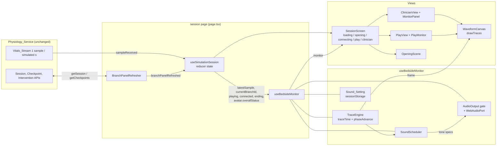
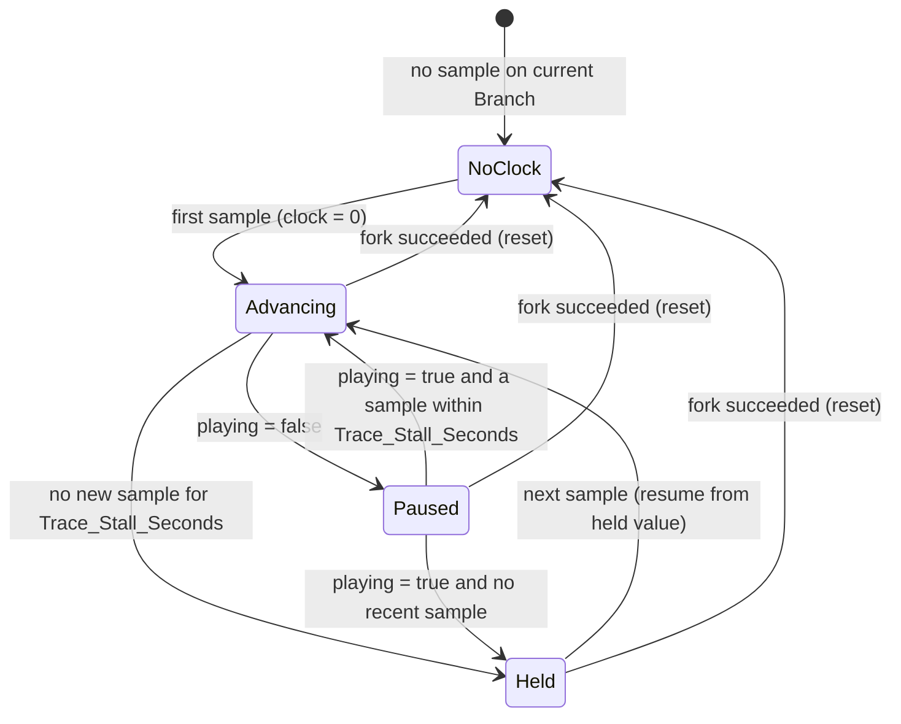

# Design Document: bedside-monitor

## Overview

The Web_App gets drawn bedside-monitor traces, a dark Monitor_Panel in the Clinician_View, a small Play_Monitor in the Play_View, optional synthesized sound, an Opening_Scene, and a fresh Timeline. Nothing changes under `services/physiology/`, and no runtime dependency is added: drawing uses the Canvas 2D API and sound uses the Web Audio API (oscillator and gain nodes).

The design has four layers:

1. **Pure functions** (`apps/web/src/lib/`): Phase_Advance, the shape functions, Trace_Time, Beep_Pitch, the event-count text and the drawing function. They read no clock, DOM, network or random value.
2. **Plain controllers** with injected clocks and ports: the Trace_Engine (phases and rate segments of the current Branch), the Sound_Scheduler (an Audio_Port and a clock) and the Branch_Panel_Refresher (an API seam and a clock). Tests drive them with FakeClock and recording doubles.
3. **Hooks** that wire the controllers to React: a new `useBedsideMonitor` at page level, a new `useReducedMotion`, and small changes to `useSimulationSession`.
4. **Components** that render static markup (canvas elements, readouts, texts) and draw into the canvas only in effects, so `renderToStaticMarkup` tests need no DOM.

Every trace shape is a fixed illustration. Only the heart rate, the respiratory rate and the EtCO2 plateau come from the Pulse_Engine samples. The alarm patterns are made up for this project and are not IEC 60601-1-8 signals.

### Key design decisions

| # | Decision | Rationale |
|---|---|---|
| D1 | The Trace_Engine lives in `useBedsideMonitor`, called once in the session page beside `useSimulationSession` and passed to `SessionScreen` as `monitor`. | The engine survives a view switch (Req 2.10, 6.4, decision 4 of the requirements) without growing the session reducer. The page is the only place both views share. |
| D2 | Trace drawing works on **rate segments**: each accepted sample opens a segment at the current Trace_Clock with the phases reached there and the rates of that sample. The value at any Trace_Clock time is the shape of the phase advanced inside its segment. | Phases stay continuous across rate changes (decision 1), each span of the trace uses the sample that was in effect (Req 2.9, 3.4), and the drawing is a pure function of the segment list. |
| D3 | `traceTime` counts only Wall_Clock_Time that lies within Trace_Stall_Seconds after some sample arrival, and only while playing. | One rule gives the stall freeze, the resume without a jump, the pause stop, and the monotonic and bounded property (Req 2.2 to 2.6). Playback_Speed is not an input. |
| D4 | The Sound_Scheduler uses a short look-ahead (100 ms) and schedules each Heartbeat_Beep at the predicted Wall_Clock_Time of its R peak. The prediction never goes past the stall horizon. Any change in the conditions cancels every unstarted tone at once. | The beep matches the drawn R peak (Req 7.1). Stopping is synchronous, well inside 200 ms (Req 7.7). |
| D5 | The Branch panel fix is a plain `createBranchPanelRefresher` controller plus one reducer action, `branchPanelRefreshed`, that applies the Session_Metadata and the Checkpoint lists together, and only if the current Branch is unchanged. | It is testable without a DOM (Req 14.9). A refresh is all-or-nothing, so a partial failure keeps the previous values (Req 12.5). The reducer guard and the epoch check together discard stale results (Req 12.6). |
| D6 | At `lg` widths and up, the Play_Monitor sits **beside** the Avatar, in a narrow column inside the patient column, with the Waveform_Note under it. Below `lg` it sits under the StatusLine. | The play-mode 1280 × 720 height arithmetic stays as it is. The Avatar only loses width: it is about 248 px wide instead of 257 px in the three-column exam layout (see Layout). Placing the monitor above or below the Avatar would take about 130 px of height. |
| D7 | Traces **sweep** left to right with a small erase gap ahead of the pen, as ward monitors do. Under `prefers-reduced-motion: reduce` they are still strips of the most recent Trace_Window, redrawn once per sample. | This looks like a monitor at rest. The reduced-motion path is Req 3.3. |
| D8 | The Opening_Scene is a new `SessionScreen` mode, `'opening'`, chosen from a new reducer field, `openingShown`. That field is set only by `caseLoaded`, from the computed view and the stored dismissal. The default 2x request waits until `openingShown` is false. | The Opening_Scene shows only on page open (decision 9). Play-mode 11.12 then fires at Start (Req 10.6). A view switch never shows it. |
| D9 | One alarm palette in `alarms.ts` (text, background and border classes, plus hex values) feeds `getAlarmColor`, `getAlarmBgColor` and a new `getAlarmBorderColor`. Trace_Colours live in `monitorTheme.ts`. | The Play_Monitor frame and the Clinician readouts share one colour definition (Req 5.4). The existing return values stay unchanged. |

## Architecture



### Data flow per sample

1. The socket message goes to `sessionReducer` through `sampleReceived` (unchanged). The reducer drops stale samples after a fork, as it does today.
2. A `useBedsideMonitor` effect keyed on `state.latestSample` (by identity) and `state.currentBranchId` calls `trace.onSample(sample, branchId, performance.now())`. If the branch_id differs from the engine's Branch, the engine resets first (Req 2.8). A failed fork dispatches nothing, so the engine keeps its state.
3. `onSample` first brings the Trace_Clock up to `now` with `traceTime`, then closes the open segment. It computes the phases at the current Trace_Clock with `phaseAdvance` and opens a new segment with the rates of the new sample. It then notifies its subscribers.
4. Each mounted `WaveformCanvas` draws `drawTraces(ctx, trace.frame(now), layout)` on animation frames while the engine is advancing. Under reduce, it draws once per notification.
5. The Sound_Scheduler ticks every 50 ms while sound is allowed. It reads `trace.clockAt(now)`, `trace.advancingUntilMs(now)` and `trace.rCrossings(from, to)`, and asks the Audio_Port for tones.

### Playback, pause and stall



No animation frame is requested in NoClock, Held or Paused, or while no canvas is mounted (Req 2.11). The canvas subscribes to the engine and restarts its frame loop on the next notification.

## Components and Interfaces

### New files

| File | Kind | Contents |
|---|---|---|
| `apps/web/src/lib/waveforms.ts` | pure | `phaseAdvance`, `ecgShape`, `plethShape`, `capnoShape`, `traceBaseline`, and the shape constants `R_PHASE` and `CAPNO_SCALE_MAX_MMHG` (`TODO(author)`, open question 1) |
| `apps/web/src/lib/traceTime.ts` | pure | `traceTime`, `TRACE_STALL_MS = 2000` |
| `apps/web/src/lib/traceEngine.ts` | controller | `createTraceEngine()`: segments, frame, crossings, subscribe |
| `apps/web/src/lib/traceDraw.ts` | pure + ctx | `TraceDrawContext`, `TraceLayout`, `drawTraces`, `traceValueAt`, and the Trace_Window constants |
| `apps/web/src/lib/monitorTheme.ts` | constants | `MONITOR_BG`, `TRACE_COLOURS`, `ALARM_HEX` re-export, `contrastRatio` (WCAG relative luminance) |
| `apps/web/src/lib/monitorText.ts` | constants | every new UI text, each with a `TODO(author)` comment (table below) |
| `apps/web/src/lib/soundScheduler.ts` | controller + pure | `AudioPort`, `ToneSpec`, `ToneHandle`, `SoundConditions`, `soundAllowed`, `beepPitch`, `WARNING_PATTERN`, `CRITICAL_PATTERN`, `createSoundScheduler`, and the gain, ramp and gap constants |
| `apps/web/src/lib/webAudioPort.ts` | browser seam | `createAudioOutput(factory)`: an Audio_Output gate with status `off \| waiting \| running \| unavailable`, and `webAudioPort(ctx, clock)`, the Audio_Port backed by an `AudioContext` |
| `apps/web/src/lib/soundSetting.ts` | pure + storage | `soundKey`, `readSoundSetting`, `writeSoundSetting` |
| `apps/web/src/lib/branchPanelRefresh.ts` | controller | `createBranchPanelRefresher`, `BRANCH_PANEL_REFRESH_MS = 10_000` |
| `apps/web/src/lib/eventCount.ts` | pure | `eventCountText(n)` |
| `apps/web/src/hooks/useBedsideMonitor.ts` | hook | Owns the Trace_Engine, the Audio_Output gate, the Sound_Scheduler and the Sound_Setting, and returns a `BedsideMonitor` |
| `apps/web/src/hooks/useReducedMotion.ts` | hook | `matchMedia('(prefers-reduced-motion: reduce)')`. It returns `false` during server rendering |
| `apps/web/src/components/WaveformCanvas.tsx` | component | One `<canvas aria-hidden="true">` with fixed attributes. It draws in effects only |
| `apps/web/src/components/WaveformNote.tsx` | component | `<p data-part="waveform-note">` with `WAVEFORM_NOTE_TEXT` at `text-base` (16 px) |
| `apps/web/src/components/MonitorPanel.tsx` | component | The Clinician_View monitor rows |
| `apps/web/src/components/PlayMonitor.tsx` | component | The Play_View monitor: ECG and Pleth canvases, the frame and the note |
| `apps/web/src/components/SoundToggle.tsx` | component | Button with `aria-pressed`, an icon and its state text |
| `apps/web/src/components/OpeningScene.tsx` | component | Night-ward panel with inline SVG art, `situationText` and the Start button |

### Changed files

| File | Change |
|---|---|
| `apps/web/src/types/index.ts` | `OpeningSection { situationText: string; references?: string[] }`; `PlaySection.opening?: OpeningSection` |
| `apps/web/src/lib/alarms.ts` | One `ALARM_PALETTE` record (`text`, `bg`, `border`, `hex` per state). `getAlarmColor` and `getAlarmBgColor` return the same strings as today. New `getAlarmBorderColor` |
| `apps/web/src/lib/sessionState.ts` | `openingShown: boolean`; `caseLoaded` gains `openingDismissed: boolean`; new actions `openingDismissed` and `branchPanelRefreshed { session, byBranch }`; `viewSelected` to `'clinician'` also clears `openingShown` |
| `apps/web/src/hooks/useSimulationSession.ts` | `openingKey`, `readOpeningDismissed` and `markOpeningDismissed` helpers; `shouldSendDefaultSpeed(..., openingShown = false)` returns false while `openingShown`; `actions.dismissOpening()`; refresher wiring (triggers listed under "Branch panel fix"); `fetchLineageCheckpoints` gains an optional dispatch-free mode for the refresher; fork start bumps a fork epoch |
| `apps/web/src/components/SessionScreen.tsx` | New mode `'opening'` (after `'loading'`, before `'connecting'`); optional prop `monitor?: BedsideMonitor`, passed to both views; `ViewSwitcher` shown in the opening mode |
| `apps/web/src/components/ClinicianView.tsx` | The two `VitalSign` grids become `<MonitorPanel>`; a `<SoundToggle>` sits in the playback row; the trend chart, `InterventionPanel`, `Timeline`, `EndingBanner` and header stay |
| `apps/web/src/components/PlayView.tsx` | Patient column: the Avatar and the `<PlayMonitor>` sit side by side at `lg`+ and stack below it; a `<SoundToggle>` goes in `play-toolbar`; the `AVATAR_WRAPPER_STYLE` width cap subtracts the monitor column at `lg`+; the layout comment is updated |
| `apps/web/src/components/VitalSign.tsx` | Optional `variant: 'tile' \| 'monitor'` (default `'tile'`, unchanged markup) and `normalColour?: string`. The monitor variant is compact. In `normal` it uses `style={{ color: normalColour }}`, and in `warning` or `critical` it uses `getAlarmColor` and `getAlarmBgColor` |
| `apps/web/src/components/Timeline.tsx` | `{eventCountText(branch.event_count)}` instead of `{branch.event_count} events` |
| `apps/web/src/app/session/[sessionId]/page.tsx` | `const monitor = useBedsideMonitor(sessionId, sim.state)`; `<SessionScreen sim={sim} monitor={monitor} />` |
| `apps/web/src/app/globals.css` | `@keyframes sp-monitor-flash` (1 s period, one flash per second); `.sp-monitor-flash`; under `prefers-reduced-motion: reduce`, `.sp-monitor *, .sp-monitor { animation: none !important }` |
| `cases/case-schema.json` | `play.properties.opening: { "$ref": "#/definitions/openingSection" }` and the new `openingSection` definition. `variantOverrides` is unchanged, so `opening` is not an Override_Target (Req 9.3) |
| `cases/adult-tension-pneumothorax.yaml` | Adds only a `play.opening` block with `situationText` and the `TODO(author)` comment line above it |
| `apps/web/src/lib/caseContent.test.ts` | Opening checks per Resolved_Case (Req 9.3 to 9.5, 14.10); `OPENING_MARK = 'bedside-monitor spec'` and the pattern `^play\.opening\.situationText$` join the TODO-marker rules, as `SPEECH_MARK` does |
| `apps/web/src/components/sideSymmetry.test.tsx` | Renders with a `monitor` built from a test Trace_Engine, and covers the Opening_Scene mode (Req 11.3) |

The Physiology_Service validates cases against `cases/case-schema.json` and returns the Resolved_Case through the Case_API, so `play.opening` reaches `CaseData.play.opening` with no service change, as it did for play-mode 2.13 and patient-speech 1.6. The implementation task confirms this with `scripts/validate-case.py` in a one-off container (Req 9.6).

### Pure waveform functions (`waveforms.ts`)

```ts
export interface PhaseStep { phase: number; cycles: number }
/** Req 1.2, 1.3: frac/int of p + dt*r/60; unchanged phase and 0 cycles for r <= 0 or non-finite r (or non-finite dt). */
export function phaseAdvance(phase: number, dtS: number, ratePerMin: number): PhaseStep;
export function ecgShape(phase: number): number;          // [-1, 1]
export function plethShape(phase: number): number;        // [0, 1]
export function capnoShape(phase: number, etco2Displayed: number | null | undefined): number | null;
export function traceBaseline(kind: TraceKind): number;   // ecg 0, pleth 0, capno 0
export type TraceKind = 'ecg' | 'pleth' | 'capno';
```

The shapes are built from **raised-cosine bumps** with compact support. A bump is `bump(x, c, w, a) = a·(1 + cos(π(x−c)/w))/2` for `|x−c| < w`, and 0 elsewhere. Supports do not overlap, so at any phase at most one bump is non-zero, and the range is the range of the amplitudes. Every bump is zero at phases 0 and 1, so cycles join without a step. The constants below are illustrative drafts (`TODO(author)`, open question 1):

| Shape | Parts (centre c, half-width w, amplitude a), phase in [0, 1) |
|---|---|
| ECG | P (0.14, 0.05, 0.12); Q (0.27, 0.015, −0.12); R (`R_PHASE` = 0.30, 0.015, 1.0); S (0.33, 0.015, −0.25); T (0.56, 0.08, 0.30); baseline 0 elsewhere |
| Pleth | Foot at 0.36. Rise `(1−cos)/2` from 0.36 to the peak 1.0 at 0.48. Fall by a cosine from 1.0 at 0.48 to 0 at 0.95, with a small dicrotic bump (0.66, 0.04, 0.08) whose sum with the fall stays ≤ 1, because the fall is below 0.75 there. Zero from 0.95 to 1 and from 0 to 0.36. The pulse rises after `R_PHASE`, as Req 1.5 requires |
| Capno | Value `h·f(phase)`, where `h = clamp(etco2Displayed / CAPNO_SCALE_MAX_MMHG, 0, 1)`. `f` is 0 on [0, 0.40) (inspiration), a raised-cosine upstroke on [0.40, 0.48), 1 on [0.48, 0.85] (plateau), a raised-cosine downstroke on (0.85, 0.92), and 0 on [0.92, 1). `null` when `etco2Displayed` is missing or not finite |

`CAPNO_SCALE_MAX_MMHG` is a display scale constant with the draft value 60 (`TODO(author)`, open question 1). It is not a threshold.

### Trace_Time (`traceTime.ts`)

```ts
export interface TraceClock { branchId: string; clockS: number; atMs: number }
export interface TraceTimeInput {
  nowMs: number;
  branchId: string;
  arrivalsMs: readonly number[];   // arrival Wall_Clock_Times of the current Branch's samples, ascending
  playing: boolean;
  previous: TraceClock | null;
}
export function traceTime(input: TraceTimeInput): TraceClock | null;
```

The rules, in order:

- No arrivals: return `null` (Req 2.7).
- `previous` is null or belongs to another Branch: return `{ branchId, clockS: 0, atMs: nowMs }` (Req 2.8).
- `nowMs <= previous.atMs`: return `previous` unchanged (no backwards step).
- Not playing: return `{ ...previous, atMs: nowMs }` (Req 2.3).
- Otherwise: `clockS = previous.clockS + |[previous.atMs, nowMs] ∩ ⋃ₖ [aₖ, aₖ + TRACE_STALL_MS]| / 1000` (Req 2.2, 2.4, 2.5).

`playbackSpeed` is not an input (Req 2.1). The Trace_Engine calls `traceTime` before every state change, including a `setPlaying` change, with the old `playing` value. Each span is therefore counted under the state it really had.

### Trace_Engine (`traceEngine.ts`)

```ts
export interface TraceSegment {
  startClockS: number;
  heartRate: number;            // raw (readVital), NaN when missing
  respiratoryRate: number;      // raw, NaN when missing
  etco2Displayed: number | null; // displayedValue('etCO2', …)
  cardiacPhase0: number;        // Cardiac_Phase at startClockS
  respiratoryPhase0: number;    // Respiratory_Phase at startClockS
}
export interface TraceFrame {
  branchId: string;
  clockS: number;
  segments: readonly TraceSegment[];  // ascending startClockS; pruned to the longest Trace_Window
  sampleSeq: number;                  // increases by one per accepted sample
}
export interface TraceEngine {
  onSample(sample: VitalSigns, branchId: string, nowMs: number): void;
  setPlaying(playing: boolean, nowMs: number): void;
  reset(): void;
  frame(nowMs: number): TraceFrame | null;
  clockAt(nowMs: number): number | null;
  /** Wall time up to which the clock keeps advancing without a new sample; null when paused or without a clock. */
  advancingUntilMs(nowMs: number): number | null;
  /** Trace_Clock times in (fromS, toS] at which the Cardiac_Phase passes R_PHASE, using the segments' rates. */
  rCrossings(fromS: number, toS: number): number[];
  subscribe(listener: () => void): () => void;
}
```

Rates use the raw values, as the Avatar's periods do (`avatarMapper.ts` reads `readVital` for rates). The capnogram level uses the EtCO2 Displayed_Value (Req 1.6). The engine keeps arrival times only within `TRACE_STALL_MS` of the latest arrival. It keeps segments only while they overlap the longest Trace_Window.

### Drawing (`traceDraw.ts`, `WaveformCanvas.tsx`)

```ts
export interface TraceDrawContext {
  canvas?: { width: number; height: number };
  clearRect(x: number, y: number, w: number, h: number): void;
  fillRect(x: number, y: number, w: number, h: number): void;
  beginPath(): void; moveTo(x: number, y: number): void; lineTo(x: number, y: number): void; stroke(): void;
  strokeStyle: string; fillStyle: string; lineWidth: number;
}
export interface TraceRowLayout { kind: TraceKind; windowS: number; colour: string; y: number; height: number }
export interface TraceLayout { width: number; height: number; background: string; rows: TraceRowLayout[]; mode: 'sweep' | 'strip' }
/** null = gap. Uses the segment in effect at t; rate <= 0 gives the baseline; non-finite rate or level gives null. */
export function traceValueAt(segments: readonly TraceSegment[], kind: TraceKind, tS: number): number | null;
export function drawTraces(ctx: TraceDrawContext, frame: TraceFrame | null, layout: TraceLayout): void;
```

- `frame === null`: the function clears the canvas to the background and strokes no path (Req 2.7).
- One point per device-pixel column. A `null` value ends the sub-path, and the next finite value starts a new one with `moveTo` (Req 3.4).
- **Sweep** (motion allowed): the column for time `t` is `x = ((t mod W) / W)·width`. The function draws the window `[clock − W, clock]` and clears an erase gap of 4 % of the width ahead of the pen.
- **Strip** (reduce): `x = ((t − (clock − W)) / W)·width`. `WaveformCanvas` calls `drawTraces` only when `frame.sampleSeq` changes (Req 3.3).
- Trace_Window drafts (UI constants): ECG and Pleth 6 s in the Monitor_Panel and 4 s in the Play_Monitor; Capno 12 s.

`WaveformCanvas` props are `{ engine?: TraceEngine; rows; widthCss; heightCss; reducedMotion }`. Its markup is a fixed `<canvas>` element whose `width`, `height` and class depend only on its layout props (Req 3.8). It sets the device-pixel size in an effect. It runs a `requestAnimationFrame` loop only while `engine.advancingUntilMs(now) > now` and is otherwise idle until the engine notifies it (Req 2.11). It has no text inside the canvas (Req 5.2).

### Monitor_Panel (`MonitorPanel.tsx`)

Props are `{ state: SessionUiState; engine?: TraceEngine; reducedMotion: boolean }`. The panel has `bg-[#030712]` (`MONITOR_BG`, near-black), rounded corners, and the rows below. Each row is a grid: the canvas on the left, the readouts on the right in a fixed `12rem` column.

| Row | Canvas row | Readouts (label, unit, colour in `normal`) |
|---|---|---|
| ECG | ECG_Trace | Heart Rate, bpm, `TRACE_COLOURS.ecg` |
| Pleth | Pleth_Trace | SpO₂, %, `TRACE_COLOURS.pleth` |
| CO₂ | Capno_Trace | EtCO₂, mmHg, and Resp Rate, br/min, both `TRACE_COLOURS.capno` |
| Readouts | — | MAP, mmHg, and Tidal Volume, mL, both `TRACE_COLOURS.readout` |

The labels and units are today's strings from `ClinicianView.tsx`. Every readout is a `VitalSign variant="monitor"` whose `alarmState` comes from `clinicianAlarmState` (moved unchanged, Req 4.3 and 4.5). The `WaveformNote` sits under the rows. The row labels "ECG", "Pleth" and "CO₂" come from `monitorText.ts`.

### Play_Monitor (`PlayMonitor.tsx`)

Props are `{ engine?: TraceEngine; overallStatus: AlarmState; reducedMotion: boolean }`. The markup is a `<figure data-part="play-monitor" className="sp-monitor …">` that holds a framed `<div role="img" aria-label={PLAY_MONITOR_NAME}>` with one `WaveformCanvas` (ECG row above the Pleth row) and the `WaveformNote` below. The frame class is `getAlarmBorderColor(overallStatus)`. It adds `sp-monitor-flash` only when `overallStatus !== 'normal' && !reducedMotion` (Req 5.4 to 5.6). The element has no `aria-live` (Req 5.7). The props carry no case, Variant or record data (Req 5.8, 11.1).

### Sound (`soundScheduler.ts`, `webAudioPort.ts`, `soundSetting.ts`)

```ts
export interface ToneSpec { frequencyHz: number; startMs: number; durationMs: number; gain: number; channel: 'beep' | 'alarm' }
export interface ToneHandle { cancel(): void }            // drops an unstarted tone; ramps a started one down within RAMP_MS
export interface AudioPort { tone(spec: ToneSpec): ToneHandle }
export interface SoundConditions {
  soundOn: boolean; audioRunning: boolean; playing: boolean; connected: boolean;
  hasSample: boolean; ending: Ending; overallStatus: AlarmState;
  spo2Displayed: number | null; heartRate: number;
}
export function soundAllowed(c: SoundConditions): boolean;   // Req 7.6
export function beepPitch(spo2Displayed: number): number;     // Req 7.2, 7.3
export function createSoundScheduler(deps: {
  clock: Pick<EngineClock, 'now' | 'setTimeout' | 'clearTimeout'>;
  port: AudioPort;
  trace: Pick<TraceEngine, 'clockAt' | 'advancingUntilMs' | 'rCrossings' | 'frame'>;
}): { update(c: SoundConditions): void; dispose(): void };
```

**Scheduler loop.** While `soundAllowed` holds, a timer ticks every `SOUND_TICK_MS = 50`. Each tick does the following:

- **Heartbeat.** With `now`, `c0 = clockAt(now)` and the horizon `h = min(now + LOOKAHEAD_MS (100), advancingUntilMs(now))`, the tick takes every crossing `x` in `(lastScheduledS, c0 + (h − now)/1000]`. Each crossing is due at `now + (x − c0)·1000`. A crossing that falls within `MIN_BEEP_GAP_MS = 150` of the previous beep is dropped (Req 7.5). The tick asks for a beep tone with `beepPitch` of the latest finite SpO2. Without a finite SpO2 it uses the last pitch, or `BEEP_PITCH_MAX_HZ` when there is none (Req 7.4). If `!(heartRate > 0)` or `h <= now`, the tick schedules no beep (Req 7.8). `lastScheduledS` resets when `frame().branchId` changes.
- **Alarm.** When `overallStatus` is `warning` or `critical` and differs from the playing pattern's status, the scheduler cancels every alarm handle and starts the new pattern at `now`. Back at `normal`, it cancels and plays nothing (Req 8.1, 8.2, 8.4). Repeats are scheduled when their start falls within the look-ahead. Beep and alarm handles are tracked separately, so the beep goes on during an alarm (Req 8.6).
- **New sample.** The scheduler subscribes to the engine. When a sample arrives, it cancels every unstarted beep, sets `lastScheduledS` to `clockAt(now)` and ticks at once. A beep that was predicted with the old rate is therefore never played at the wrong time.
- **`update(c)`** stores the conditions. If `soundAllowed(c)` is false, it cancels every handle and clears the timer synchronously (Req 7.7). If it is true and no timer runs, it ticks at once.

The scheduler reads `overallStatus` from `state.avatar.overallStatus`, so it computes no Alarm_State of its own (Req 8.5). It reads no Variant, side or record (Req 11.1).

**Draft sound constants** (UI constants, not clinical values, each `TODO(author)`):

| Constant | Draft | Note |
|---|---|---|
| `BEEP_PITCH_MIN_HZ` / `BEEP_PITCH_MAX_HZ` | 330 / 880 | open question 3 |
| `beepPitch` mapping | linear in the SpO2 Displayed_Value over the display span `BEEP_SPO2_SPAN = [50, 100]` %, clamped | open question 3; a mapping span, not a threshold |
| Beep length, gain, ramp | 60 ms, `MAX_GAIN = 0.15`, `RAMP_MS = 5` | Req 7.9 |
| `WARNING_PATTERN` | 2 tones of 660 Hz, 150 ms each, 120 ms apart; repeat every 5 s | open question 4; illustrative, not IEC 60601-1-8 |
| `CRITICAL_PATTERN` | 3 tones of 880 Hz, 120 ms each, 80 ms apart; repeat every 2 s | open question 4; illustrative, not IEC 60601-1-8 |

**Audio_Output gate** (`createAudioOutput`). It takes a `factory: () => AudioContextLike | null`, where `null` means no Web Audio. Its status is `off | waiting | running | unavailable`. `activate()` is the only method that creates or resumes a context. The hook calls it from the Sound_Toggle click handler and from the one-shot `click`, `keydown` and `touchend` listeners on `document` that are installed while the status is `waiting` (Req 6.5, 6.6). If the factory returns null, creation throws or `resume()` rejects, the status becomes `unavailable` (Req 6.7). The gate creates no context while the Sound_Setting is off. `webAudioPort(ctx, clock)` maps `startMs` to `ctx.currentTime + (startMs − clock.now())/1000`. It plays each tone with one `OscillatorNode` and one `GainNode`, with linear ramps of `RAMP_MS` (Req 6.8, 7.9).

**Sound_Setting.** `soundKey(id) = 'stitched-patient:sound:' + id`. The stored values are `'on'` and `'off'`. A missing or unreadable value, or any other value, reads as off (Req 6.2, 6.3).

**`useBedsideMonitor(sessionId, state)`** returns:

```ts
export interface BedsideMonitor {
  engine: TraceEngine;
  sound: { on: boolean; status: 'off' | 'waiting' | 'running' | 'unavailable'; toggle(): void };
  reducedMotion: boolean;
}
```

The hook holds one engine, one gate and one scheduler per page in refs. It calls `engine.onSample`, `engine.setPlaying` and `engine.reset` from effects keyed on `latestSample`, `playing` and `currentBranchId`. It calls `scheduler.update` on every change of a `SoundConditions` input. The view does not affect any of these (Req 2.10, 6.4).

### Sound_Toggle (`SoundToggle.tsx`)

Props are `{ on: boolean; status; onToggle }`. It renders a `<button type="button" aria-pressed={on} disabled={status === 'unavailable'}>` with an inline SVG speaker icon (`aria-hidden`) and visible `text-base` text:

| `status` | Text |
|---|---|
| `off` | `SOUND_OFF_TEXT` |
| `running` | `SOUND_ON_TEXT` |
| `waiting` | `SOUND_ON_TEXT` followed by `SOUND_WAITING_TEXT` |
| `unavailable` | `SOUND_UNAVAILABLE_TEXT` |

It uses the play-mode focus ring classes (Req 6.9). The toggle needs no live region; `aria-pressed` carries the state.

### Opening_Scene (`OpeningScene.tsx`)

Props are `{ situationText: string; onStart(): void }`. It renders a `<section data-part="opening-scene">` with a dark background, an inline SVG night ward (moon, window, a dim bed outline and a monitor glow; no blood, wounds, bone, fangs or skulls, and nothing that shows a side), the `situationText` in a `<p className="text-xl">`, and `<button autoFocus>` with `OPENING_START_TEXT`. An effect also calls `.focus()` on mount (Req 10.5). `SessionScreen` renders `SafetyNotice` above it and the `ViewSwitcher` with it (Req 10.9, 13.4).

`actions.dismissOpening()` calls `markOpeningDismissed(storage, sid)` and dispatches `openingDismissed`. `selectView('clinician')` while `openingShown` also stores the dismissal (Req 10.7). The key is `'stitched-patient:opening-dismissed:' + id`. An unreadable key reads as not dismissed.

### Branch panel fix (`branchPanelRefresh.ts`, hook, reducer)

```ts
export interface BranchPanelRefresher {
  /** Starts one refresh unless one is pending. */
  refresh(): void;
  /** Periodic refresh on (Clinician_View shown and playing) or off. */
  setPeriodic(on: boolean): void;
  /** A fork started or the current Branch changed: results of pending refreshes are discarded. */
  invalidate(): void;
  dispose(): void;
}
export function createBranchPanelRefresher(deps: {
  clock: Pick<EngineClock, 'setTimeout' | 'clearTimeout'>;
  load(): Promise<{ session: SessionMetadata; byBranch: Record<string, CheckpointMetadata[]> }>; // all-or-nothing
  currentBranchId(): string | null;
  apply(result: { session: SessionMetadata; byBranch: Record<string, CheckpointMetadata[]> }): void;
}): BranchPanelRefresher;
```

- **`load`** (hook) calls `api.getSession(sid, { timeoutMs: CHECKPOINTS_TIMEOUT_MS })`, then `getCheckpoints` for every Branch of `lineageBranchIds(session)`, each with `CHECKPOINTS_TIMEOUT_MS`. It rejects if any call fails or times out (Req 12.5).
- **`refresh`** does nothing while a refresh is pending (Req 12.3). Otherwise it records the epoch and the `currentBranchId()` at the start. On success it calls `apply` only if the epoch is unchanged, `currentBranchId()` is unchanged, and `session.current_branch_id` equals that Branch (Req 12.6). A failure does nothing and shows nothing (Req 12.5).
- **`apply`** (hook) dispatches `branchPanelRefreshed`. The reducer checks `session.current_branch_id === state.currentBranchId` again (or returns `state`), merges `byBranch` as `checkpointsLoaded` does, recomputes `lineage`, and passes the result through `withSides` and `withRescueGate` (play-mode 6.23). It changes no current branch_id, sample, history, Ending, record or Speech_State (Req 12.6).
- **Triggers** (hook):
  - Right after `interventionSucceeded` is dispatched in `applyIntervention`, for both views (Req 12.1).
  - An effect on `[state.view, state.session !== null]` runs `refresh()` when the view becomes `'clinician'`, also on page open into the Clinician_View (Req 12.2).
  - An effect calls `setPeriodic(view === 'clinician' && playing)`. The periodic timer re-arms every `BRANCH_PANEL_REFRESH_MS` and skips a tick while a refresh is pending (Req 12.3).
  - `fork` calls `invalidate()` before its request, and an effect on `currentBranchId` calls it too (Req 12.6).
- **`eventCountText(n)`** returns `n === 1 ? '1 event' : `${n} events`` (Req 12.7). `RewindPanel` is unchanged (Req 12.8).

The refresher calls no Playback_API, Intervention_API or Fork_API, so play-mode 1.5 holds.

### Layout

**Clinician_View at 1280 × 720.** Below the 56 px Safety_Notice there are 664 px. The fixed parts are `p-6` (48), the switcher (40), the header (52), the playback row with the Sound_Toggle (74) and three `space-y-6` gaps (72), so 286 px in total. That leaves 378 px for the Monitor_Panel: three trace rows of 64 px, the readout row of 56 px, the note (one 24 px line in the 8/12 column), `p-3` padding (24) and three `gap-2` (24), so 312 px ≤ 378. The `VitalSign` monitor variant uses `text-4xl` values and `text-sm` labels so that a value fits a 64 px row. The Intervention buttons stay at the top of the right column. The trend chart and the Timeline sit below and can be reached by scrolling (Req 4.8). This is checked by manual inspection.

**Play_View at 1280 × 720 (D6).** The patient column becomes `grid lg:grid-cols-[auto_9rem] gap-2`: the Avatar wrapper, then the Play_Monitor column (144 px). The Play_Monitor has two 44 px traces, `p-1` and a 2 px frame, about 100 px. The note at 16 px in 144 px wraps to at most 6 lines (144 px). Together that is about 250 px, below the Avatar's 496 px, so the column height does not change. `AVATAR_WRAPPER_STYLE` caps the Avatar width with `calc(100% - 9rem - 0.5rem)` at `lg`+:

| Layout | Patient column | Avatar width now | Avatar width after |
|---|---|---|---|
| Exam (5fr of 1280) | 400 px | 257 px (height bound) | ≈ 248 px |
| Two columns | ≈ 500 px | 257 px | 257 px (unchanged) |

The StatusLine and the Speech_Bubble_Slot keep their places, and the Play_Monitor is outside the Avatar's SVG (Req 5.3). The Sound_Toggle goes into `play-toolbar`, which has the same height as the 74 px playback row. Below `lg`, the monitor stacks under the StatusLine at full width. At a 320 px width, its canvases use `width: 100%` and the note wraps, so there is no horizontal scroll (Req 5.10).

**Opening_Scene.** It is a centred panel with `min-h-[calc(100vh-var(--notice-h)-<switcher>)]`, an SVG with `max-h-[40vh]`, the text and the button. At 1280 × 720 everything fits without scrolling. At 320 px the SVG scales down with `w-full` (Req 10.11).

### New UI texts (`monitorText.ts`, each `// TODO(author): bedside-monitor spec draft`)

`WAVEFORM_NOTE_TEXT`, `SOUND_OFF_TEXT`, `SOUND_ON_TEXT`, `SOUND_WAITING_TEXT`, `SOUND_UNAVAILABLE_TEXT`, `OPENING_START_TEXT`, `MONITOR_ROW_LABELS = { ecg: 'ECG', pleth: 'Pleth', capno: 'CO₂' }` and `PLAY_MONITOR_NAME`. The values are the drafts from the requirements table. `WAVEFORM_NOTE_TEXT` has no digit, no Side_Word and no Diagnosis_Term (Req 3.7).

## Data Models

### Case file

```jsonc
// case-schema.json, definitions
"openingSection": {
  "type": "object",
  "additionalProperties": false,
  "required": ["situationText"],
  "properties": {
    "situationText": { "type": "string", "minLength": 1, "maxLength": 120 },
    "references": { "type": "array", "minItems": 1, "items": { "type": "string", "minLength": 1 } }
  }
}
```

```yaml
# cases/adult-tension-pneumothorax.yaml, inside play: (the only diff)
  opening:
    # TODO(author): bedside-monitor spec draft, review the situation line
    situationText: "It's 3 a.m. Your patient can't breathe."
```

### Session state additions (`SessionUiState`)

| Field | Type | Set by |
|---|---|---|
| `openingShown` | `boolean` | `caseLoaded` sets it to `view === 'play' && caseData.play?.opening !== undefined && !openingDismissed`. `openingDismissed` and `viewSelected('clinician')` set it to `false`. It starts as `false` |

New actions:

- `{ type: 'openingDismissed' }`
- `{ type: 'branchPanelRefreshed'; session: SessionMetadata; byBranch: Record<string, CheckpointMetadata[]> }`

`caseLoaded` gains `openingDismissed: boolean`.

`sessionScreenMode` order: `'loading'`, then `'opening'` (`openingShown && view === 'play' && caseData?.play?.opening !== undefined`), then `'connecting'`, `'play'`, `'clinician'`.

### Storage keys (sessionStorage, per tab)

| Key | Values |
|---|---|
| `stitched-patient:sound:<session_id>` | `'on'` or `'off'` |
| `stitched-patient:opening-dismissed:<session_id>` | `'1'` |

### Monitor theme

| Name | Value | Contrast on `MONITOR_BG #030712` |
|---|---|---|
| `TRACE_COLOURS.ecg` | `#4ade80` (green-400) | > 10:1 |
| `TRACE_COLOURS.pleth` | `#22d3ee` (cyan-400) | > 10:1 |
| `TRACE_COLOURS.capno` | `#e5e7eb` (gray-200) | > 15:1 |
| `TRACE_COLOURS.readout` | `#c4b5fd` (violet-300) | > 10:1 |
| warning / critical (`ALARM_PALETTE.hex`) | `#eab308` / `#ef4444` | differ from every Trace_Colour |

The ECG colour equals today's `normal` alarm green. Req 4.6 forbids only the `warning` and `critical` colours. A unit test computes every contrast ratio with `contrastRatio`.

## Correctness Properties

*A property is a characteristic or behavior that should hold true across all valid executions of a system-essentially, a formal statement about what the system should do. Properties serve as the bridge between human-readable specifications and machine-verifiable correctness guarantees.*

Reflection on redundancy: the Phase_Advance definition (1.2), its invalid-rate rule (1.3) and additivity (1.9) are one property. The Trace_Time rules 2.2 to 2.6 are one model-based property, because the measure formula implies monotonicity, boundedness, the pause stop, the freeze and the resume. The rules on Min_Beep_Gap, gain and the sound gate (7.5, 7.6, 7.9) share one scheduler run and are one property. Requirements 3.4 and 3.5 are one property about `traceValueAt`. Requirements 4.3 to 4.5 are one property about the readouts. Requirement 10.10 is a case of 10.1.

### Property 1: Phase_Advance is additive and ignores invalid rates

*For any* Trace_Phase `p` in [0, 1), steps `dt1, dt2` in [0, 3600] s and rate `r`, `phaseAdvance` returns a phase in [0, 1) and a whole number of cycles `≥ 0`. For `r` in (0, 400], `cycles + phase` of `phaseAdvance(p, dt1 + dt2, r)` equals, within 1e-9, the sum of the cycles of the two single steps plus the phase of the second step. For `r ≤ 0`, NaN or ±Infinity, the result is `{ phase: p, cycles: 0 }`.

**Validates: Requirements 1.2, 1.3, 1.9**

### Property 2: Cardiac shapes stay in range and join across cycles

*For any* phase in [0, 1), `ecgShape` is in [−1, 1] and `plethShape` is in [0, 1]. For all ε in (0, 1e-6], `ecgShape(1 − ε)` is within 1e-6 of `ecgShape(0)`, which is the baseline, and the same holds for `plethShape`.

**Validates: Requirements 1.4, 1.5**

### Property 3: The capnogram is monotone in EtCO2 and peaks at the plateau height

*For any* phase and finite EtCO2 values `a ≤ b`, `capnoShape(phase, a) ≤ capnoShape(phase, b)`. The value is 0 on the inspiratory part. The maximum over a dense grid of one cycle equals `clamp(b / CAPNO_SCALE_MAX_MMHG, 0, 1)`. For a missing or non-finite EtCO2 the result is `null`.

**Validates: Requirements 1.6, 1.7, 1.10**

### Property 4: Trace_Time matches the covered-time model

*For any* ascending arrival list, sequence of increasing evaluation times and playing flags on one Branch, folding `traceTime` gives, at every step, `clockS = previous.clockS + |[previous.atMs, nowMs] ∩ ⋃[aₖ, aₖ + TRACE_STALL_MS]| / 1000` while playing, and `previous.clockS` while paused. The value never decreases, and its increase over any span is at most the Wall_Clock_Time elapsed. The same arrival times give the same clock whatever Playback_Speed produced them.

**Validates: Requirements 2.2, 2.3, 2.4, 2.5, 2.6**

### Property 5: Phases are continuous across samples

*For any* sample sequence and arrival times on one Branch, each segment's `cardiacPhase0` and `respiratoryPhase0` equal the previous segment's phases advanced with `phaseAdvance` from its `startClockS` to the new `startClockS` at that segment's rates.

**Validates: Requirements 2.9**

### Property 6: Gaps only for missing values, baselines at rate zero

*For any* segment list and time `t` covered by a segment, `traceValueAt` returns `null` exactly when the segment in effect has a non-finite rate for that trace, or (Capno only) a non-finite EtCO2. It returns `traceBaseline(kind)` when that rate is finite and ≤ 0, and the shape value otherwise. For a `t` before the first segment it returns `null`.

**Validates: Requirements 3.4, 3.5**

### Property 7: Monitor markup does not depend on sample values

*For any* two VitalSigns samples, the static markup of `WaveformCanvas`, `PlayMonitor` (for a fixed Overall_Status) and the `MonitorPanel` without its readout text nodes is identical.

**Validates: Requirements 3.8**

### Property 8: Readouts use Display_Precision and the colour rule

*For any* sample and the case thresholds, each Monitor_Panel readout shows `formatVital(vital, raw)`. Its Alarm_State is `clinicianAlarmState(alarms, vital, raw)`. When that state is `normal` the readout carries its row's Trace_Colour and no alarm class; otherwise it carries exactly `getAlarmColor(state)` and `getAlarmBgColor(state)`.

**Validates: Requirements 4.3, 4.4, 4.5**

### Property 9: Sound_Setting storage round trip

*For any* session_id and setting, `readSoundSetting` after `writeSoundSetting` returns that setting under `soundKey(session_id)`. For any other stored string, a missing key or a throwing storage, it returns `off`.

**Validates: Requirements 6.2, 6.3**

### Property 10: Beep_Pitch is monotone and bounded

*For any* finite SpO2 values `a ≤ b`, `beepPitch(a) ≤ beepPitch(b)`, and both lie in [`BEEP_PITCH_MIN_HZ`, `BEEP_PITCH_MAX_HZ`].

**Validates: Requirements 7.3**

### Property 11: Scheduler tones respect the gate, the gap and the gain

*For any* sequence of samples, Overall_Status values, condition changes and FakeClock advances, every tone the recording Audio_Port receives starts at a time at which `soundAllowed` held and was not cancelled before that time. Every tone has `gain ≤ MAX_GAIN`. No two beep tones start less than `MIN_BEEP_GAP_MS` apart.

**Validates: Requirements 7.5, 7.6, 7.9**

### Property 12: Beeps fall on the drawn R peaks

*For any* constant-rate sample sequence with heart rate in (0, 300] per minute and arrivals within Trace_Stall_Seconds of each other, the start times of the beep tones equal, within one `SOUND_TICK_MS`, the Wall_Clock_Times at which the Trace_Engine's Cardiac_Phase passes `R_PHASE`, after dropping crossings closer than `MIN_BEEP_GAP_MS`. They are identical whether the samples carry Simulation_Times 1, 2 or 4 s apart.

**Validates: Requirements 7.1**

### Property 13: Sound side symmetry

*For any* sample sequence, playback states, Overall_Status sequence and FakeClock schedule, the Audio_Port calls of a scheduler fed from the `left` Resolved_Case's session equal those fed from the `right` one.

**Validates: Requirements 11.2**

### Property 14: Screen symmetry with the monitor

*For any* generated action sequence of the existing bedside-exam symmetry test, the static markup of both views (with a `monitor` from a test Trace_Engine) and of the Opening_Scene mode is equal for the `left` and the `right` Resolved_Case.

**Validates: Requirements 11.3**

### Property 15: Opening_Scene selection rule

*For any* case with or without `play.opening`, stored view (`play`, `clinician`, none) and dismissal flag, after `caseLoaded`, `openingShown` is true exactly when the computed view is `play`, the case has an Opening_Section and the flag is false. A following `viewSelected` or `openingDismissed` never sets it back to true.

**Validates: Requirements 10.1, 10.7, 10.10**

### Property 16: A Branch_Panel_Refresh changes only the Branch panel data

*For any* reachable session state and refresh result, `branchPanelRefreshed` returns the state unchanged when `session.current_branch_id !== state.currentBranchId`. Otherwise it changes only `session`, `checkpointsByBranch`, `lineage` and the fields that `withSides` and `withRescueGate` derive from them. `currentBranchId`, `latestSample`, `history`, `ending`, `interventionRecord`, `examRecord`, `hintRecord` and `speech` stay equal.

**Validates: Requirements 12.4, 12.6**

### Property 17: Event-count text

*For any* whole number `n ≥ 0`, `eventCountText(n)` is `"1 event"` when `n = 1` and `` `${n} events` `` otherwise.

**Validates: Requirements 12.7**

### Property 18: Pure functions are deterministic

*For any* generated inputs, calling `phaseAdvance`, `ecgShape`, `plethShape`, `capnoShape`, `traceTime`, `traceValueAt`, `beepPitch` and `eventCountText` twice gives deep-equal results. Calling `drawTraces` twice gives the same recorded call list.

**Validates: Requirements 1.1**

## Error Handling

| Situation | Behaviour |
|---|---|
| Sample field missing or not finite | The segment stores NaN or `null` for it. The trace draws a gap for that span (Req 3.4). The beep keeps the previous pitch (Req 7.4) or stops for a missing heart rate (Req 7.8) |
| Rate 0 or negative | Phase_Advance holds the phase. The trace draws a flat baseline and no beep plays |
| Stream stalls more than 2 s | The Trace_Clock holds, frames stop, beeps stop, and the alarm pattern keeps following the Overall_Status while sound is allowed. When the next sample arrives, everything resumes without a jump |
| Stream disconnects | `connected` becomes false, so sound stops (Req 7.6). The traces freeze through the stall rule |
| Fork fails | No action is dispatched. Engine, clock and traces stay as they were (Req 2.8) |
| No Web Audio, context creation throws, or `resume()` rejects | The gate status becomes `unavailable`, the toggle is disabled with its text, and nothing else is shown (Req 6.7) |
| sessionStorage throws | Sound_Setting reads as off and Opening dismissal as not dismissed. Writes are skipped silently, as `persistViewSelection` does |
| Canvas `getContext('2d')` returns null | `WaveformCanvas` draws nothing. The Waveform_Note stays |
| Branch_Panel_Refresh fails or times out (`CHECKPOINTS_TIMEOUT_MS`) | The previous Session_Metadata and lists are kept, with no message (Req 12.5) |
| Refresh result arrives after a fork or Branch change | It is discarded by the epoch check and by the reducer guard (Req 12.6) |
| Case without `play.opening` | No Opening_Scene. Play-mode 1.1 and 1.9 apply unchanged (Req 10.10) |

## Testing Strategy

All tests run with `npx vitest --run` from `apps/web/`, in Node with no DOM, no service, no network and no real `AudioContext` (Req 14.1). Property tests use fast-check with `PBT_PARAMS` (100 runs, fixed seed). Each property is implemented by a single property test, tagged with a comment `// Feature: bedside-monitor, Property <n>: <title>`. No new runtime dependency is added. fast-check and Vitest are already dev dependencies.

### Property tests

| File | Properties |
|---|---|
| `src/lib/waveforms.test.ts` | 1, 2, 3 |
| `src/lib/traceTime.test.ts` | 4 |
| `src/lib/traceEngine.test.ts` | 5 |
| `src/lib/traceDraw.test.ts` | 6 |
| `src/components/monitorMarkup.test.tsx` | 7, 8 |
| `src/lib/soundSetting.test.ts` | 9 |
| `src/lib/soundScheduler.test.ts` | 10, 11, 12, 13 (13 uses `CASE_LEFT` and `CASE_RIGHT`) |
| `src/components/sideSymmetry.test.tsx` | 14 (extended) |
| `src/lib/sessionState.test.ts` | 15, 16 (added cases) |
| `src/lib/eventCount.test.ts` | 17 |
| `src/lib/monitorDeterminism.test.ts` | 18 |

The generators come from `src/test/generators.ts`, extended with phase, rate (including 0, negative and non-finite), arrival-list and condition generators.

### Unit and example tests

- **Waveform functions** (Req 14.2): wrap at 1; several cycles in one step; rate 0, negative and non-finite; ECG maximum at `R_PHASE` and baseline at 0 and near 1; Pleth range and equal ends; Capno 0 in inspiration, plateau height, clamping above `CAPNO_SCALE_MAX_MMHG`, and missing EtCO2. A source-text test checks the `TODO(author)` comment that names open question 1 (Req 1.11).
- **Trace_Time** (Req 14.4): the advance equals the elapsed time while samples arrive; the same clock for 1x, 2x and 4x arrival patterns; a freeze after 2 s; a resume with no jump; frozen while paused; `null` without a sample; reset after a fork; unchanged after a failed fork.
- **Sound_Scheduler** with FakeClock and a recording Audio_Port (Req 14.5): no call while off; one beep per R peak at the same times at 1x, 2x and 4x; no beep while the clock is held; pitch from the SpO2 Displayed_Value; stop within 200 ms on pause, disconnect and a `lost` Ending; the Warning_Pattern, the Critical_Pattern, and a stop within 1 s at `normal`; beeps during an alarm; the two patterns differ in tone count (Req 8.3).
- **Audio gate and Sound_Setting** (Req 14.6): no context outside `activate()`; status `waiting` after a restore of on; `unavailable` with a null factory, a throwing constructor or a rejected `resume()`. `webAudioPort` is tested with a fake `AudioContextLike` that records the nodes and the ramps.
- **Drawing** (Req 14.7): `drawTraces` with a recording `TraceDrawContext`: no stroke for a `null` frame; a `moveTo` after a gap; a flat line at rate 0; under strip mode one redraw per `sampleSeq` change (the canvas effect logic is factored into `shouldRedraw(prevSeq, frame, mode)`, a pure function). No `fillText` is ever recorded (Req 5.2). The frame loop gate `shouldAnimate(engine, now, mounted)` is tested for paused, held and unmounted (Req 2.11).
- **Static markup** (`renderToStaticMarkup`, Req 14.8): Monitor_Panel rows in order with each of the six readouts once; Play_Monitor without digits, with `role="img"` and its name, frame class per Overall_Status, and no `sp-monitor-flash` with `reducedMotion`; the Waveform_Note in both views; the Sound_Toggle `aria-pressed` and its four texts; the Opening_Scene with `situationText`, the autofocused Start button and the Safety_Notice through `SessionScreen`; the `'opening'` mode order in `sessionScreenMode`; `VitalSign` tile variant markup unchanged.
- **Theme and texts**: `contrastRatio` ≥ 4.5 for every Trace_Colour on `MONITOR_BG`; Trace_Colours differ from the warning and critical hex values; `WAVEFORM_NOTE_TEXT` has no digit, Side_Word or Diagnosis_Term; every `monitorText.ts` constant has a `TODO(author)` comment; no file of this spec contains "IEC 60601" except as a negation (Req 8.7, 13.3). A CSS test checks that `sp-monitor-flash` has a period of at least 1 s and is disabled under `prefers-reduced-motion`.
- **Branch panel** (Req 14.9), with `createBranchPanelRefresher`, FakeClock and a mocked `load`: one refresh after an Intervention success, both through the hook's exported trigger helper and through the controller; one on a switch to the Clinician_View; one every 10 s while periodic is on, and none while one is pending; `Timeline` markup showing "1 event" and the new Checkpoint after `branchPanelRefreshed`; unchanged state after a rejected `load`; a result discarded after `invalidate()`.
- **Opening helpers**: `openingKey` and the read and mark helpers with memory and throwing storage; `shouldSendDefaultSpeed` is false while `openingShown` and true after dismissal (Req 10.6); dismissal on a Clinician switch (Req 10.7).
- **Case content** (Req 14.10, in `caseContent.test.ts`): `play.opening` exists in the Base_Case and in each Resolved_Case and is deep-equal across them; no Variant's `overrides` has `opening`, and the `variantOverrides` schema has no `opening` property; `situationText` has no Side_Word and no Diagnosis_Term; its `TODO(author)` marker contains "bedside-monitor spec". Each check fails, naming the Variant_Id, the path and the text, when `play.opening` is missing.

### Integration and manual checks

- `python scripts/validate-case.py cases/adult-tension-pneumothorax.yaml` in a one-off physiology container, as patient-speech 11.6 describes (Req 9.6). The `case-check.json` hook also runs it on save.
- Manual checks at 1280 × 720 and at a 320 px width for both views and the Opening_Scene (Req 4.8, 5.9, 5.10, 10.11). A listening check of the beep, its pitch drop and both alarm patterns in Chrome and Safari.
- `npx tsc --noEmit` and `npx vitest --run` pass at the end of every task (Req 13.5).

PBT does not cover rendering looks, layout or real audio output. Those use static-markup tests and manual checks.
