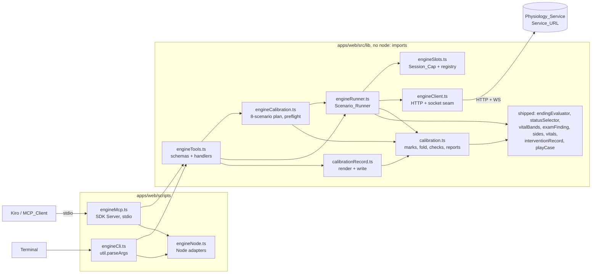

# Design Document: Engine MCP

## Overview

Engine MCP lets the Kiro agent, or a person at a terminal, run the real Pulse_Engine through the running Physiology_Service and see what the Play_View would derive from each sample. One Scenario_Runner does the work. Two thin front ends call it through the same SDK-free tool handlers:

- the **Engine_MCP_Server** (`apps/web/scripts/engineMcp.ts`), a stdio MCP server with the tools `list_cases`, `run_scenario` and `run_calibration`;
- the **Engine_CLI** (`apps/web/scripts/engineCli.ts`), with the subcommands `list-cases`, `run-scenario` and `calibrate`.

The spec also adds four Kiro hooks with their scripts, the MCP_Config, two steering files, documentation, the Requirement 14 pointer lines in play-mode and bedside-exam, and one recorded Calibration_Record of the shipped case.

This document covers Requirements 1 to 18 of `.kiro/specs/engine-mcp/requirements.md` (approved at commit `1f607f6`). Run A writes Overview, Architecture, and Components and Interfaces. Data Models, Correctness Properties, Error Handling and Testing Strategy follow in run B.

### Scope and constraints (Requirement 18)

- **No service change.** Nothing under `services/physiology/` changes (18.1). Every engine interaction uses the existing HTTP and WebSocket API listed in the requirements.
- **No container control.** No tool, CLI command, hook or task runs `docker compose up`, `down`, `stop` or `restart`, or builds the image (18.5). Hooks use one-off `docker compose run -T --rm --no-deps` containers, which publish no ports and do not touch the port-8000 container.
- **Dev dependencies only.** `@modelcontextprotocol/sdk`, `zod` and `vite-node` go into `devDependencies` (18.2, D20). Only `apps/web/scripts/engineMcp.ts` imports the SDK. Under `apps/web/src/`: (a) no non-test module imports `@modelcontextprotocol/sdk` or `vite-node`; (b) the only non-test module that imports `zod` is `src/lib/engineTools.ts`; (c) no non-test module outside the engine modules (`engineClient`, `engineSlots`, `calibration`, `engineRunner`, `engineCalibration`, `calibrationRecord`, `engineTools`) imports any engine module, so nothing the Next.js app loads can reach `zod` or the SDK; (d) the engine modules import no `node:` module (18.3, D17).
- **No case-content change.** No file under `cases/` changes, and no `TODO(author)` marker is removed (18.4). The Calibration_Record quotes case sentences and engine numbers only.
- **Files under `apps/web/src/`.** Only new runner, tool, record and test modules and `apps/web/src/lib/calibration.ts` are added (18.4). No existing source module is edited.
- **Small plan.** The plan has 8 tasks plus checkpoints, each ending with `npx vitest --run` passing in `apps/web/` (18.6). The planned split is in "Planned task split" below so that the Requirement 14 pointers can name tasks.

### Verified facts

These facts come from a read-only check of the installed Kiro, the repository and the npm registry on 2026-11-22. The design builds on them.

| # | Fact | Evidence | Design consequence |
|---|---|---|---|
| F1 | Kiro 1.5.11's stdio MCP server schema accepts an optional `cwd` string. Without it Kiro uses the MCP client's own working directory (`u=t.cwd\|\|n`), which is probably the workspace root but is not confirmed. kiro.dev does not document `cwd`. | Bundle fragment `command:...,args:...,env:...,cwd:b.string().optional()` in `extensions/kiro.kiro-agent/dist/extension.js` | The MCP_Config uses a command that works from any directory inside the repository and sets no `cwd` (D19). Task 7 verifies that the server starts in Kiro. |
| F2 | The Python_Test_Hook command below runs the fast suite and leaves no file behind: `138 passed, 10 deselected, 30 warnings in 33.17s`; `git status --short services/physiology` and `git status --short --ignored services/physiology` printed nothing afterwards. | Real run on the development Mac | The Python_Test_Hook uses exactly this command (D22). |
| F3 | Why F2 works: the Dockerfile copies the source to `/app` (`COPY . /app`, `WORKDIR /app`, `PYTHONPATH=/pulse/python:/pulse/bin`); compose mounts `./cases:/app/cases:ro`; `case_loader.py` hard-codes `CASES_DIR = Path("/app/cases")`; `-w /src` puts the mounted current source first on `sys.path`, ahead of the stale `/app` copy; `compose run` publishes no ports. | `services/physiology/Dockerfile`, `docker-compose.yml`, `case_loader.py` | New Python dependencies still need an image rebuild by the user. If the image is missing, compose might build it, so each hook script checks `docker image inspect stitched-patient-physiology` first and fails with a message instead (D22). |
| F4 | Physiology_Service API: `GET /cases` returns `string[]`. `POST /sessions {case_id, variant_id?}` returns SessionMetadata `{session_id, case_id, variant_id, created_at, current_branch_id, branches}`, with 404 for a case-load error and 400 for a bad `variant_id`. `GET /sessions/{id}`. `DELETE /sessions/{id}` returns `{"status":"deleted"}`. `GET /sessions/{id}/case` returns the Resolved_Case. `POST /sessions/{id}/playback {playing?, speed?: "1x"\|"2x"\|"4x"}` returns `{playing, speed, simulation_time}`. `POST /sessions/{id}/interventions {intervention_id, parameters?}` returns `{"status":"applied","intervention_id"}` and **no Checkpoint**. `GET /sessions/{id}/branches/{branch_id}/checkpoints` returns `[{checkpoint_id, simulation_time, created_at, is_automatic, description}]`. `WS /sessions/{id}/vitals` is subscribe-only; each message is a flat VitalSigns object `{simulation_time, heart_rate, respiratory_rate, spo2, mean_arterial_pressure, systolic_pressure?, diastolic_pressure?, etco2, tidal_volume}` or `{"error": "Simulation error: <msg>"}`. An unknown session closes the socket with code 1008. When the last subscriber leaves, the service sets `playing = False`. | `services/physiology/main.py`, `models.py` | The Actual_Time is read from the new manual Checkpoint on `current_branch_id` after the call (D2). The runner keeps its socket open for the whole Scenario (D1). |
| F5 | Node v22.23.4 has a global `WebSocket` (`typeof WebSocket === 'function'`). The `ws` package is not installed and is not added. The Web_App builds the stream URL as `PHYSIOLOGY_URL.replace(/^http/, 'ws') + '/sessions/' + id + '/vitals'` (`apps/web/src/lib/api.ts`). Existing hook tests fake the API with `vi.mock('@/lib/api')` and fake timers (`useSimulationSession.test.ts`). | `node -e`, `apps/web/package.json`, `api.ts` | The runner takes injected `fetch`-like and `WebSocket`-factory seams that default to the Node globals. Tests use an in-memory Fake_Service behind both seams and a fake clock (D17). |
| F6 | `vite-node` 1.6.1 is installed as a dependency of Vitest 1.6.1 (`apps/web/node_modules/.bin/vite-node`) but is not a direct dependency. npm registry latest: `@modelcontextprotocol/sdk` 1.32.2, `zod` 4.6.7. `apps/web/package.json` has no `engines` field. `apps/web/vitest.config.ts` defines the `@` alias and includes only `src/**/*.test.ts(x)`. | `npm view`, `package.json`, `vitest.config.ts` | `vite-node` becomes a pinned devDependency (D20). Tests live under `src/` so the existing include covers them. Imports use `zod/v4` (D16). |
| F7 | Kiro hooks on disk are `.kiro/hooks/<id>.json` with `{"version":"v1","hooks":[{"name","description?","trigger","matcher?","action":{"type":"command","command"},"timeout"}]}`. Triggers are PascalCase (`PostFileSave`, `PreToolUse`). Legacy `*.kiro.hook` files still load but are converted. PostFileSave stdin JSON has `file_path`; whether it is absolute or workspace-relative is not verified. PreToolUse stdin JSON has `tool_name` and `tool_input`. The shell tool is `execute_bash` (`execute_pwsh` on Windows), and its command text is `tool_input.command`. Exit code 2 blocks the call and shows stderr to the agent. | Kiro 1.5.11 bundle, kiro.dev `/docs/hooks/` | Hook scripts are Node `.mjs` files under `scripts/hooks/`. They read stdin JSON, resolve `file_path` both ways and filter by path themselves (D21). Task 7 verifies the matcher syntax in the installed app. |
| F8 | No per-server tool-call timeout is read from the IDE MCP_Config. The server schema also has an optional `timeout` number, but it is the connect timeout (default 60 s, capped at 600 s, used for `client.connect`), not a tool-call timeout. The IDE calls tools with `callTool(..., {timeout: 864e5})`. Re-checked in task 7.3 (O5). | Kiro 1.5.11 bundle (re-checked in task 7.3), kiro.dev MCP configuration page | Requirement 16.4 does not apply. The MCP_Config sets no timeout field (D14). |

### Design decisions

Decisions D1 to D14 implement the decisions of the same number in the requirements. D15 onward are design choices.

**D1. Time advance and sampling (requirements decision 1).** The runner opens the Vitals_Stream before the first play request and keeps it open until the Scenario ends, because the service pauses when the last subscriber leaves (F4). It plays at `4x` and keeps the first sample for each distinct `simulation_time`. A sample whose time is not greater than the last kept time is ignored: this drops the paused re-sends and any out-of-order message. The sample at Simulation_Time 0 is the paused re-send of the new Session.

**D2. Applying a Planned_Intervention (requirements decision 2).** For Requested_Time T > 0 the runner pauses on the first kept sample with `simulation_time ≥ T`, applies every pending Planned_Intervention whose Requested_Time is at most that time, in plan order, and resumes. For each call it lists the Checkpoints of `current_branch_id` before and after the Intervention_API call. The Actual_Time is the `simulation_time` of the one manual Checkpoint (`is_automatic: false`) that is new and whose `description` is `After <label>`, with `<label>` the Intervention's `label` in the Resolved_Case. No such Checkpoint is an error. The before-list costs one extra request per Intervention. In exchange the match never picks up an older Checkpoint with the same description. For T = 0 the same procedure runs before the first play request.

**D3. Rescue gate (requirements decision 3).** The runner keeps a Runner_Intervention_Record with one `InterventionRecordEntry` per successful Intervention_API call, built with the shipped `buildInterventionEntry(intervention, actualTime, branchId)`. One fold object, `createOutcomeFold` in `calibration.ts`, owns the Ending: before it evaluates a Mark_Sample at time m, it applies, in record order, every gate change from entries with Actual_Time ≤ m, using `setRescueGate(ctx, state, rescueGateTime(requiredInterventions(play), entriesSoFar))`. The runner pushes Mark_Samples into the fold only after any Intervention application in progress has finished (see "Message loop"). The post-hoc `scenarioOutcome` uses the same fold, so the incremental result that drives `stop_at_ending` and the final result are equal by construction. (Since the author's decision of 2026-11-25, this gate computation uses play-mode's `rescueGateTime`, which counts only Gate_Entries as play-mode defines them, play-mode 6.25, 6.26 and 13.18; the fold gets this behaviour through that function and has no separate gate logic.)

**D4. Status_Sentences and Exam_Findings (requirements decision 4).** Each Mark_Sample is evaluated with the shipped `selectStatus`, `statusItemMatches`, `getVitalBand`, `thresholdsFor`, `overallStatus`, `examButtons` and `examFinding`, on the Resolved_Case from the Case_API. The Active_Interventions at time t are the Runner_Intervention_Record entries with Actual_Time ≤ t. A Scenario has one Branch, so `activeInterventions` with a one-segment lineage would give the same list. The runner filters by time directly and does not build a lineage. The record reports which Status_Rules matched using `statusItemMatches` on each rule's `when` items, so no matching logic is copied. (Since the author's decision of 2026-11-25, the Vital_Bands, the Overall_Status and the Status_Rule matches are computed from the Displayed_Values as play-mode defines them, play-mode 13.19 and 15.16, while the Mark_Sample values stay raw.)

**D5. Mark_Samples (requirements decision 5).** The Ending_Evaluator runs on Mark_Samples. Calibration uses a Sample_Interval of 10. `run_scenario` accepts 1 to 60.

**D6. Cancellation (requirements decision 6).** Every handler receives an `AbortSignal`. The Engine_MCP_Server passes the SDK's `extra.signal`. The Engine_CLI passes the signal of a process-wide `AbortController` that SIGINT and SIGTERM abort. The Engine_MCP_Server aborts every running call when stdin closes, the transport closes, or it receives SIGINT or SIGTERM. Then both entry points delete every Session still in the process's Session registry, waiting at most 10 s (6.3).

**D7. Session_Cap (requirements decision 7).** There is one FIFO slot queue per process, shared by all calls. A Scenario takes a slot before `POST /sessions` and gives it back after `DELETE` has settled. A queued waiter whose signal aborts leaves the queue without creating a Session (7.4).

**D8. Approval (requirements decision 8).** `autoApprove` is `["list_cases"]`.

**D9. Service_URL (requirements decision 9).** The URL comes from `--url`, else `PHYSIOLOGY_URL`, else `http://localhost:8000`, and is checked at startup (1.9). No tool takes a URL. The stream URL is the Service_URL with `http` replaced by `ws` (F5), so every connection goes to the Service_URL host (1.4).

**D10. `variant_id` is a required kebab-case string (requirements decision 10).**

**D11. "Calibrate the case" is a manual steering file (requirements decision 11).**

**D12. Determinism (requirements decision 12).** The Record_Body holds no session, branch or checkpoint id and no wall-clock value. Numbers use fixed decimals per field (12.2).

**D13. Compose guard (requirements decision 13).** The guard is described in "Compose_Guard_Hook".

**D14. Long calls (requirements decision 14).** The MCP_Config sets no timeout (F8). `run_calibration` sends progress notifications when the call carries a `progressToken`. The fallback is the Engine_CLI through a shell command with a timeout of at least 1,800,000 ms.

**D15. Low-level SDK `Server` with our own validation.** The server uses the SDK's low-level `Server` class with `ListToolsRequestSchema` and `CallToolRequestSchema` handlers, not `McpServer.registerTool`. With `registerTool`, a zod failure becomes either a JSON-RPC error or a tool result depending on the SDK version. Requirement 3.2 needs a tool result with `isError: true` that names every invalid field, before the Health_Check. So the handler validates the arguments with the same zod schema that produces the published JSON Schema, and returns the tool result itself. This also keeps the handlers free of SDK types, so the Engine_CLI calls the same functions (11.1, 11.6).

**D16. `zod/v4` import path.** All schema code imports `{ z } from 'zod/v4'`. That subpath exists in `zod` 3.25 and later and in every `zod` 4 release, so the code works whichever major version the SDK's peer range allows. `z.toJSONSchema` produces the published input and output schemas. Open item O1 checks the peer range at install time.

**D17. Module placement and seams.** The planned layout of the requirements is kept. Pure and injected modules live in `apps/web/src/lib/`, where the existing Vitest include covers their tests (F6). They import no `node:` module, no SDK, and no global `fetch`, `WebSocket`, clock or file system. Every effect comes through an injected `EngineDeps` object. The Node adapters (global `fetch`, `new WebSocket(url)`, `node:fs/promises`, `node:child_process` for `git`, timers, stderr) live in `apps/web/scripts/engineNode.ts`, which only the two entry points import.

**D18. Repository root.** The entry points compute the repository root from their own location, `fileURLToPath(new URL('../../../', import.meta.url))`, and do not use the working directory. The case file (`cases/<case_id>.yaml`) and `docs/calibration/` resolve against that root.

**D19. MCP_Config command form.** `bash -c 'cd "$(git rev-parse --show-toplevel)/apps/web" && exec ./node_modules/.bin/vite-node --config vitest.config.ts scripts/engineMcp.ts'`. This works whether Kiro starts the server in the workspace root or in any directory inside the repository, and needs no `cwd` field, whose path base is unverified (F1). `exec` makes the Node process receive SIGTERM directly. The direct bin path avoids `npx` resolution and install prompts. Rejected alternatives: `"cwd": "apps/web"` (relative base unverified), and an absolute `cwd` (not portable, and it would be committed).

**D20. `vite-node` as an explicit devDependency, pinned to `1.6.1`.** This matches the installed Vitest 1.6.1 (F6), so the MCP_Config and the CLI do not depend on a transitive bin that a Vitest upgrade could move or remove.

**D21. Hook scripts.** Each hook's `command` is `node "$(git rev-parse --show-toplevel)/scripts/hooks/<name>.mjs"`. The scripts read the stdin JSON, resolve `file_path` against the repository root when it is relative, check the repository-relative path against their own pattern, and do nothing when it does not match. This keeps them correct if the Kiro matcher is looser than expected (F7). They start child processes with argument arrays and no shell, so a file name cannot inject a command.

**D22. Python_Test_Hook command.** The hook uses the verified command of F2 unchanged, after an image presence check (F3). The Case_Check_Hook uses the command of Requirement 15.2 with `-T` (no TTY in a hook) and `-e PYTHONDONTWRITEBYTECODE=1`, and the same image check.

**D23. "The tension pneumothorax still develops" (9.6, 9.7).** The requirements need a yes-or-no statement but give no rule. This design uses a mechanical rule that works only on the case's own thresholds: in the `affected-side-early` Scenario, the tension pneumothorax counts as developing when at one or more Mark_Samples after the insult's `timeSeconds`, at least one vital sign with Case thresholds has an Alarm_State more severe (`normal < warning < critical`) than its Alarm_State at the last Mark_Sample at or before `timeSeconds`. (Since the author's decision of 2026-11-25, these Alarm_States are computed from the Displayed_Values as play-mode defines them, play-mode 13.19 and 15.16.) The record prints the rule next to the answer and the side-by-side values, and does not interpret it clinically. **The author must confirm this rule** (item A1 below). If the author rejects it, the record can state "not decided by the tool" instead, but then Requirement 9.7 cannot be checked automatically.

**D24. Git facts through read-only `git` commands.** The Record_Header needs the short commit id, whether `cases/` or `apps/web/src/lib/` differ from it, and whether `1e71454` is an ancestor (9.1). The Node adapter runs `git rev-parse --short HEAD`, `git status --porcelain -- cases apps/web/src/lib` and `git merge-base --is-ancestor 1e71454 HEAD` with `execFile` (no shell) in the repository root. Exit code 1 of `merge-base` means "no", and any other failure is reported as "unknown". This conflicts with the literal text of Requirement 1.8 ("SHALL start no process"); see "Conflicts with the requirements".

**D25. Clean stdout in the server.** The first import of `engineMcp.ts`, `scripts/engineStdout.ts`, points `console.log`, `console.info` and `console.debug` to stderr. Only the SDK's `StdioServerTransport` writes to stdout (1.3).

**D26. Approach speed.** Under requirements decision 2's latitude, the runner sets `1x` when a kept sample is within 4 simulated seconds before the next pending Requested_Time, and sets `4x` again after it resumes. At `1x` the next tick is about 1 s of wall-clock time away, far longer than a local pause request, so the Actual_Time normally equals T. This keeps runs repeatable (12.3) at a cost of at most about 4 s of wall-clock time per Intervention. The record states "4x, 1x within 4 s before each Decompression".

**D27. Order of checks in a call.** First argument validation (3.2), then local preflight (8.5, reading the case file), then the Health_Check (1.5), then Sessions. A bad input therefore fails even while the service is down, and no Session is created before every local check has passed.

### Open items to verify during implementation

| # | Item | How | Task |
|---|---|---|---|
| O1 | The SDK's `zod` peer range, and in SDK 1.32.2: the low-level `Server` export path, `extra.signal`, `extra.sendNotification`, `request.params._meta.progressToken`, and that no response is sent for a cancelled request. | `npm view @modelcontextprotocol/sdk@1.32.2 peerDependencies`, reading the installed `.d.ts`, and a Vitest test against the SDK's in-memory transport. If the peer range excludes `zod` 4, pin `zod@^3.25` and keep the `zod/v4` imports (D16). | 1, 5 |
| O2 | The PostFileSave `matcher` syntax and whether `file_path` is absolute in Kiro 1.5.11. | Save one matching file per hook through the agent's file-write tool and record it in the Hook_Verification_Log (15.13). | 7 |
| O3 | The Engine_MCP_Server starts in Kiro with the D19 command, and nothing but protocol messages reaches stdout. | Open the MCP panel, check the server is connected and lists 3 tools, call `list_cases`. | 7 |
| O4 | The PreToolUse matcher `^(execute_bash\|execute_pwsh)$` selects the shell tool. | The `echo docker compose down` and `echo docker compose ps` check of 15.14. | 7 |
| O5 | No per-server tool-call timeout field exists in the IDE MCP_Config (F8, 16.4). | Re-read the server schema in the installed bundle during O3. If one exists, set it to 3,600,000. | 7 |
| O6 | `vite-node` passes a leading `--` to `process.argv`. | The CLI parser drops one leading `--`. A CLI test covers both forms. | 5 |

### Items for the author

- **A1.** Confirm or replace the D23 rule for "the tension pneumothorax still develops".

### Conflicts with the requirements

- **C1. Requirement 1.8 versus 9.1.** Requirement 1.8 says the server, the CLI and the runner "SHALL start no process". Requirement 9.1 needs Git facts that only `git` can give without reimplementing Git's object store. Play-mode task 12.2 already planned `git merge-base --is-ancestor`. This design starts three short read-only `git` processes per `run_calibration` (D24) and no other process. Suggested wording for 1.8: "SHALL start no process other than the read-only `git` commands of the Record_Header".
- **C2. Hook command texts of 15.2 and 15.3.** The design adds `-T` and `-e PYTHONDONTWRITEBYTECODE=1` to the 15.2 command (D22). The mounts, the service, `--rm --no-deps` and the script are unchanged. It also adds `--passWithNoTests` to the 15.3 command, because Vitest exits 1 when a saved file has no related tests.
- **C3. `PHYSIOLOGY_URL` in the MCP_Config.** The run instructions asked for an `env` with `PHYSIOLOGY_URL` and `ENGINE_MCP_MAX_SESSIONS`. Requirement 16.3 forbids setting `PHYSIOLOGY_URL` there, so the MCP_Config has no `env` block. `docs/development.md` shows how a user adds one locally.

### Planned task split

The tasks document fixes the final text. Requirement 14's pointers use these numbers.

1. Dev dependencies, `engineClient.ts`, `engineSlots.ts`, the Fake_Service.
2. `calibration.ts` (supersedes play-mode task 12.1).
3. `engineRunner.ts`.
4. `engineCalibration.ts` and `calibrationRecord.ts`.
5. `engineTools.ts`, `scripts/engineNode.ts`, `scripts/engineMcp.ts`, `scripts/engineCli.ts` (with tasks 3 and 4, supersedes play-mode task 12.2). The task report lists the 18.3 build check commands; the reviewer runs them in a separate copy of `apps/web` (see "Commands" in Testing Strategy).
6. Hook scripts and hook files, MCP_Config, steering files, and the Kiro-file tests.
7. `tech.md`, `docs/development.md`, the Requirement 14 pointers, and the in-Kiro checks O2 to O5 with the Hook_Verification_Log.
8. The manual check of 17.8 and the recording run of Requirement 13 (supersedes play-mode task 12.3).

## Architecture



### Modules

New modules under `apps/web/src/lib/`. All of them are pure or take every effect as an argument (D17).

| Module | Role | Imports from shipped `src/lib/` |
|---|---|---|
| `engineClient.ts` | `PhysiologyClient` over an injected `FetchLike`. The `VitalsSocket` seam and `SocketFactory` type. `EngineError` and its kinds. Service_URL and Session_Cap parsing. The Unreachable_Error text. | none (types from `@/types`) |
| `engineSlots.ts` | `SessionSlots`, the FIFO Session_Cap semaphore with abortable waits. `SessionRegistry`, the Sessions this process created and has not deleted. | none |
| `calibration.ts` | Pure helpers: Mark_Samples, the outcome fold, lost cause, Calibration_Checks, the early comparison, Vital_Band and Overall_Status series, Status_Rule report, Exam_Finding report, side difference. This is the module that play-mode task 12.1 planned. | `endingEvaluator` (`buildEndingContext`, `initialEndingState`, `stepEnding`, `setRescueGate`, `rescueGateTime`, `requiredInterventions`, `conditionHolds`), `statusSelector` (`selectStatus`, `statusItemMatches`), `vitalBands` (`getVitalBand`, `thresholdsFor`, `overallStatus`), `examFinding` (`examButtons`, `examFinding`), `sides` (`affectedInsult`), `vitals` (`VITAL_NAMES`, `VITAL_FIELD`, `readVital`) |
| `engineRunner.ts` | The Scenario_Runner: one Scenario from `POST /sessions` to `DELETE`. The pure `buildScenarioResult`. | `interventionRecord` (`buildInterventionEntry`), `sides` (`affectedInsult`), `calibration` |
| `engineCalibration.ts` | Case-file facts from YAML text, `run_calibration` preflight, the 8-Scenario plan, Decompression choice per side role, Play_Section comparison with the case file, calibration evaluation. | `sides` (`DECOMPRESSION_ACTION`, `PNEUMOTHORAX_ACTION`, `affectedInsult`), `playCase` (`interventionSide`), `calibration`. YAML through the existing `yaml` devDependency. |
| `calibrationRecord.ts` | Record_Header and Record_Body rendering. Record file naming and writing with an injected `RecordFs` and a path guard. Calibration_Index update. | `calibration` |
| `engineTools.ts` | zod schemas (`zod/v4`), published JSON Schemas, tool descriptions, and the SDK-free handlers `listCases`, `runScenarioTool`, `runCalibrationTool` with the tool-result shape. | `engineClient`, `engineRunner`, `engineCalibration`, `calibrationRecord` |

New modules under `apps/web/scripts/`. Only these import Node modules, and only `engineMcp.ts` imports the SDK.

| Module | Role |
|---|---|
| `engineNode.ts` | Builds `EngineDeps` for Node: global `fetch`, `(url) => new WebSocket(url)`, `node:fs/promises` as `RecordFs`, `GitInfo` through `execFile('git', ...)`, the real clock, `process.stderr` logging, the repository root (D18), and `installShutdown` for signals and stdin close (6.3). |
| `engineStdout.ts` | Points `console.log`, `info` and `debug` at stderr; imported first by `engineMcp.ts` (D25). |
| `engineMcp.ts` | stdio server entry (D15, D25). |
| `engineCli.ts` | CLI entry (Requirement 11). |

Test-only modules under `apps/web/src/test/`: `fakePhysiologyService.ts` (the Fake_Service) and `fakeClock.ts`. Run B specifies them in detail. The Fake_Service implements both `FetchLike` and `SocketFactory` in memory, so no test opens a socket or port (17.7).

Files outside `apps/web/`:

- `scripts/hooks/hookLib.mjs`, `case-check.mjs`, `web-related-tests.mjs`, `python-tests.mjs`, `compose-guard.mjs`
- `.kiro/hooks/case-check.json`, `web-related-tests.json`, `python-tests.json`, `compose-guard.json`
- `.kiro/settings/mcp.json`
- `.kiro/steering/engine-calibration.md`, `.kiro/steering/calibrate-the-case.md`
- edits to `.kiro/steering/tech.md` and `docs/development.md`, and the pointer lines of Requirement 14
- `docs/calibration/<case_id>-<YYYY-MM-DD>-<short-sha>.md` and `docs/calibration/README.md` from the recording run

### One Scenario

```mermaid
sequenceDiagram
  autonumber
  participant H as Tool handler
  participant S as SessionSlots
  participant R as Scenario_Runner
  participant P as Physiology_Service
  participant F as Outcome fold (calibration.ts)
  H->>S: acquire(signal)
  S-->>R: slot
  R->>P: POST /sessions {case_id, variant_id}
  P-->>R: SessionMetadata (variant_id, current_branch_id)
  Note over R: registry.add(session_id); variant_id must match (3.5)
  R->>P: GET /sessions/{id}/case
  P-->>R: Resolved_Case
  Note over R: resolve plan, check intervention ids (3.3), beforePlay hook (8.10)
  R->>P: WS /sessions/{id}/vitals (open)
  P-->>R: paused re-send, simulation_time 0
  opt Planned_Interventions with Requested_Time 0
    R->>P: GET checkpoints, POST interventions, GET checkpoints
    Note over R: Actual_Time = new manual "After <label>" Checkpoint
  end
  R->>P: POST /playback {speed: 4x, playing: true}
  loop one tick = 1 simulated second
    P-->>R: VitalSigns (keep first per distinct time)
    alt within 4 s before next Requested_Time T
      R->>P: POST /playback {speed: 1x}
    end
    alt kept time ≥ T of a pending Planned_Intervention
      R->>P: POST /playback {playing: false}
      R->>P: GET checkpoints, POST interventions, GET checkpoints
      Note over R: add Runner_Intervention_Record entry (Actual_Time, branch_id)
      R->>P: POST /playback {speed: 4x, playing: true}
    end
    R->>F: addEntry(new entries), push(Mark_Samples up to kept time)
    F-->>R: Ending so far
    Note over R: stop if time ≥ Max_Time, or stop_at_ending and Ending ≠ none
  end
  R->>R: buildScenarioResult (bands, status, exam, Ending timeline)
  Note over R,P: finally
  R->>P: POST /playback {playing: false} (skipped after cancel)
  R->>P: close WS
  R->>P: DELETE /sessions/{id}
  Note over R: registry.remove(id); S.release()
```

### Message loop

The socket callbacks only append events (`sample`, `error`, `close`) to a queue and wake the loop. One async loop consumes the queue, so an Intervention application finishes before any later sample is processed. While the loop is paused for an Intervention, new samples wait in the queue. Their Mark_Samples reach the fold after the new entry and its gate change. This is how D3's "gate applied before the first Mark_Sample with time ≥ Actual_Time" holds: the Actual_Time is never earlier than the last kept sample, because the engine cannot be behind a sample it has already sent.

For each kept sample at time t the loop does this:

1. It records the sample and restarts the stall timer.
2. If a pending Requested_Time T satisfies `T - 4 ≤ t < T` and the speed is `4x`, it sets `1x` (D26).
3. If `t ≥ T` for the first pending Planned_Intervention, it pauses, applies all pending items with Requested_Time ≤ t in plan order, sets `4x`, and resumes.
4. It computes Mark_Samples for every Sample_Mark m ≤ t not yet covered: the kept sample at exactly m, or else this sample flagged as substituted for m. Each one goes to the fold.
5. It stops when `t ≥ Max_Time`, or when `stop_at_ending` is true and the fold's Ending is not `none`.

The stall timer runs only while playback is on. It is cleared during the pause of step 3 and while waiting for the sample at time 0. That wait has its own 30 s limit with the cause "no sample at Simulation_Time 0". A socket `close` or `error` event, or a message with an `error` field, ends the Scenario with an `EngineError` of kind `stream` that names the last kept Simulation_Time and the cause (4.9).

### Cleanup and cancellation

- **Per Scenario (6.1, 6.4, 6.5).** A `finally` block pauses playback (skipped after cancellation), closes the socket and sends `DELETE /sessions/{id}` for the Session this Scenario created, each with a 4 s request timeout. A failed DELETE is logged to stderr with the session_id and added to the result's `undeleted_sessions` (the error result, when the Scenario failed). The original error is then rethrown unchanged. The runner never sends a request for a session_id it did not create.
- **Per call (6.2).** The handler's `AbortSignal` is passed to the slot wait, every request and the message loop. On abort the loop rejects at once with kind `cancelled`. Cleanup skips the pause and sends only `DELETE` with a 4 s timeout, so every Scenario of the call has stopped and been deleted within 5 s. For `run_calibration`, the first Scenario error aborts a call-internal controller linked to the caller's signal, so the other Scenarios stop the same way (8.12). The Engine_MCP_Server returns nothing for a cancelled request, because the SDK drops the response of an aborted request (O1).
- **Per process (6.3).** `installShutdown(registry, client)` handles SIGINT, SIGTERM and stdin `end` or `close` in the server, and SIGINT and SIGTERM in the CLI. It aborts the process controller, then `DELETE`s every id still in the registry in parallel, waits at most 10 s in total, and exits: code 0 for the server after stdin close, code 1 otherwise (11.4).
- **SIGKILL.** Sessions are orphaned until the service restarts (known limitation).

### Progress notifications (8.13)

When the `tools/call` request carries `params._meta.progressToken`, the server starts a 5 s interval timer for the duration of the call. Each tick sends `notifications/progress` with:

- `progress`: the number of distinct samples kept so far across the call's Scenarios, plus 0.001 for each tick in which that count did not change, so the value increases on every notification as the MCP specification requires;
- `total`: the sum of the Scenarios' Max_Time plus one per Scenario (the samples a full run keeps);
- `message`: `"<k> of <n> scenarios completed"`.

The timer stops before the result is returned. `run_scenario` sends progress the same way when a token is present. That is not required, but it is the same code.

### Per-call flow of the tools

| Step | `list_cases` | `run_scenario` | `run_calibration` |
|---|---|---|---|
| 1 Validate arguments (3.2) | empty strict object | `RunScenarioInput` schema + `at_seconds ≤ max_seconds` | `RunCalibrationInput` schema |
| 2 Local preflight (D27) | none | none | read `cases/<case_id>.yaml`, `preflightCalibration` (8.3, 8.5) |
| 3 Health_Check (1.5, 1.6) | `GET /`, 3 s | `GET /`, 3 s | `GET /`, 3 s |
| 4 Work | `GET /cases` | one Scenario | 8 Scenarios through the slots, `evaluateCalibration`, render |
| 5 Effects | none | none | where `write`: `GitInfo` already read for the header, `writeCalibrationRecord` (10.2 to 10.6) |

`GitInfo` is read in step 4 before the Scenarios start, so a Git failure costs no engine time. Git failures make the header say "unknown" and do not fail the call.

## Components and Interfaces

Signatures are TypeScript. Types from `@/types` (`CaseData`, `Intervention`, `InterventionRecordEntry`, `SessionMetadata`, `CheckpointMetadata`, `PlaybackSpeed`, `PlaybackState`, `PlaySection`, `VitalSigns`, `VitalBand`, `AlarmState`, `AlarmThresholds`, `Side`) and `Sample`, `Ending` from `endingEvaluator.ts` are reused unchanged. Run B defines the full data shapes (`ScenarioResult`, `CalibrationEvaluation`, the record sections).

### Constants (tool constants, not clinical values)

```ts
export const DEFAULT_SERVICE_URL = 'http://localhost:8000';
export const DEFAULT_SESSION_CAP = 4;           // 1..8 (7.2)
export const HEALTH_TIMEOUT_MS = 3_000;         // Health_Check (glossary)
export const REQUEST_TIMEOUT_MS = 30_000;       // every other request
export const CREATE_SESSION_TIMEOUT_MS = 120_000; // engine load under emulation
export const CLEANUP_REQUEST_TIMEOUT_MS = 4_000;  // pause and DELETE in cleanup (6.2: 5 s budget)
export const SHUTDOWN_BUDGET_MS = 10_000;       // 6.3
export const STALL_TIMEOUT_MS = 30_000;         // Stall_Timeout (glossary)
export const FIRST_SAMPLE_TIMEOUT_MS = 30_000;  // wait for the sample at Simulation_Time 0
export const PROGRESS_INTERVAL_MS = 5_000;      // 8.13: at least once per 10 s
export const RUN_SPEED: PlaybackSpeed = '4x';
export const APPROACH_SPEED: PlaybackSpeed = '1x';
export const APPROACH_WINDOW_S = 4;             // D26
export const CALIBRATION_SAMPLE_INTERVAL = 10;  // 8.9, play-mode 13.2
export const DEFAULT_DEMO_DECOMPRESSION_TIME = 150;  // play-mode task 12.3
export const DEFAULT_EARLY_DECOMPRESSION_TIME = 20;  // play-mode task 12.3
export const DEMO_RESCUE_BOUND_SECONDS = 300;   // play-mode 13.5
export const DECOMPRESSION_CHECK_COMMIT = '1e71454'; // play-mode 13.1
export const KEBAB = /^[a-z0-9]+(?:-[a-z0-9]+)*$/;
```

### `engineClient.ts`

```ts
export type FetchLike = (url: string, init?: {
  method?: 'GET' | 'POST' | 'DELETE';
  headers?: Record<string, string>;
  body?: string;
  signal?: AbortSignal;
}) => Promise<{ ok: boolean; status: number; text(): Promise<string> }>;

/** The subset of the WHATWG WebSocket that the runner uses. */
export interface VitalsSocket {
  onopen: ((ev: unknown) => void) | null;
  onmessage: ((ev: { data: unknown }) => void) | null;
  onerror: ((ev: unknown) => void) | null;
  onclose: ((ev: { code: number; reason: string }) => void) | null;
  close(code?: number, reason?: string): void;
}
export type SocketFactory = (url: string) => VitalsSocket;

export type EngineErrorKind =
  | 'config' | 'input' | 'case' | 'unreachable' | 'http' | 'timeout'
  | 'variant' | 'plan' | 'checkpoint' | 'stream' | 'stall' | 'cancelled' | 'internal';

export class EngineError extends Error {
  constructor(
    readonly kind: EngineErrorKind,
    message: string,
    readonly details?: { endpoint?: string; status?: number; serviceMessage?: string },
  );
}

/** 1.9: absolute http(s) URL; trailing slash removed. Throws EngineError('config') naming the value. */
export function parseServiceUrl(raw: string | undefined): string;
/** 1.9, 7.2: whole number 1..8; undefined gives DEFAULT_SESSION_CAP. Throws EngineError('config') naming value and range. */
export function parseSessionCap(raw: string | undefined): number;
/** The Unreachable_Error text (glossary). */
export function unreachableMessage(serviceUrl: string): string;
/** `serviceUrl.replace(/^http/, 'ws') + '/sessions/' + encodeURIComponent(id) + '/vitals'` (F5). */
export function vitalsUrl(serviceUrl: string, sessionId: string): string;

export interface PhysiologyClient {
  readonly serviceUrl: string;
  health(signal: AbortSignal): Promise<void>;                                  // GET /
  listCases(signal: AbortSignal): Promise<string[]>;                           // GET /cases
  createSession(caseId: string, variantId: string, signal: AbortSignal): Promise<SessionMetadata>;
  getCase(sessionId: string, signal: AbortSignal): Promise<CaseData>;          // GET /sessions/{id}/case
  setPlayback(sessionId: string, body: { playing?: boolean; speed?: PlaybackSpeed },
              signal: AbortSignal, timeoutMs?: number): Promise<PlaybackState>;
  applyIntervention(sessionId: string, interventionId: string, signal: AbortSignal): Promise<void>;
  listCheckpoints(sessionId: string, branchId: string, signal: AbortSignal): Promise<CheckpointMetadata[]>;
  deleteSession(sessionId: string, signal: AbortSignal, timeoutMs?: number): Promise<void>;
}
export function createPhysiologyClient(opts: { serviceUrl: string; fetch: FetchLike }): PhysiologyClient;
```

Error mapping inside the client:

- A rejected `fetch` that was not caused by the caller's signal or a timeout (a network `TypeError` such as Node's `fetch failed`) becomes kind `unreachable` with `unreachableMessage(serviceUrl)` (1.6).
- A Health_Check timeout also becomes kind `unreachable` (1.6).
- Another request timeout becomes kind `timeout`, naming the endpoint.
- An abort from the caller's signal becomes kind `cancelled`.
- A non-2xx response becomes kind `http`. The message is `<METHOD> <path template> returned HTTP <status>: <detail>`, where `detail` is FastAPI's `detail` field, or the body text cut to 500 characters (1.7). The path template uses `{id}`, so error texts carry no session id.

Each request combines the caller's signal and `AbortSignal.timeout(ms)` with `AbortSignal.any`, available in Node 22. Responses are parsed from `text()` with `JSON.parse`. A parse failure becomes kind `http` with the status.

### `engineSlots.ts`

```ts
export interface SessionSlots {
  readonly cap: number;
  readonly held: number;
  readonly waiting: number;
  /** Resolves with a release function once a slot is free, in FIFO order (7.1, 7.3).
   *  Rejects with EngineError('cancelled') and leaves the queue if `signal` aborts first (7.4).
   *  Calling release twice is a no-op. */
  acquire(signal: AbortSignal): Promise<() => void>;
}
export function createSessionSlots(cap: number): SessionSlots;

export interface SessionRegistry {
  add(sessionId: string): void;
  remove(sessionId: string): void;
  ids(): readonly string[];
}
export function createSessionRegistry(): SessionRegistry;
```

### `calibration.ts`

```ts
export interface MarkSample { mark: number; sample: Sample; substituted: boolean }

/** One Mark_Sample per multiple of `interval` from 0 to the last kept time: the kept sample at the mark,
 *  else the next kept sample, flagged (4.8). `kept` is strictly increasing in simulation_time. */
export function markSamples(kept: readonly Sample[], interval: number): MarkSample[];

export type LostCause = number /* 1-based Lost_Condition group */ | 'Time_Limit';

export interface OutcomeFold {
  /** Records a Runner_Intervention_Record entry; its gate change applies before the first pushed
   *  Mark_Sample with mark >= entry.simulationTime (D3, 4.6). */
  addEntry(entry: InterventionRecordEntry): void;
  push(m: MarkSample): void;
  readonly ending: Ending;
  readonly endedAt: number | null;
  readonly lostCause: LostCause | null;
  /** Current Rescue_Gate_Time: -Infinity without Required_Interventions, null while closed. */
  readonly gate: number | null;
  /** The Ending after each pushed Mark_Sample, in push order (5.1). */
  readonly endingAfter: readonly Ending[];
}
/** Uses buildEndingContext, initialEndingState, stepEnding, setRescueGate, rescueGateTime,
 *  requiredInterventions from endingEvaluator.ts. Mark_Samples are evaluated with `simulation_time`
 *  set to their mark, so a substituted sample stands for its Sample_Mark.
 *  (Since the author's decision of 2026-11-25, the gate uses play-mode's rescueGateTime, which counts only
 *  Gate_Entries as play-mode defines them, play-mode 6.25, 6.26 and 13.18.) */
export function createOutcomeFold(rc: CaseData): OutcomeFold;

export interface ScenarioOutcome {
  ending: Ending; endedAt: number | null; lostCause: LostCause | null;
  finalGate: number | null; endingAfter: Ending[];
  /** Marks at which every rescue Vital_Condition held, ignoring the gate and the insult bound (13.15). */
  rescueHeldWithoutGate: number[];
}
/** Post-hoc fold; equal to the incremental fold for the same entries and marks (D3). */
export function scenarioOutcome(rc: CaseData, marks: readonly MarkSample[],
                                entries: readonly InterventionRecordEntry[]): ScenarioOutcome;

export type CheckId = 'affected-side-rescued' | 'other-side-only-lost' | 'no-intervention-lost';
export interface CheckResult {
  check: CheckId; variantId: string; pass: boolean;
  /** "rescued at 230 s; gate 150 s + hold 30 s = 180 s ≤ 230 s ≤ 300 s" style basis (9.5). */
  basis: string;
}
/** 13.5 + 13.14: rescued, endedAt <= DEMO_RESCUE_BOUND_SECONDS and endedAt >= gate + holdSeconds (gate finite). */
export function checkAffectedRescued(variantId: string, o: ScenarioOutcome, holdSeconds: number): CheckResult;
/** 13.6 / 13.7 + 13.15: never rescued, lost, endedAt <= limit. The basis names the lost cause and the gate. */
export function checkLostNeverRescued(check: 'other-side-only-lost' | 'no-intervention-lost', variantId: string,
  o: ScenarioOutcome, limit: { seconds: number; source: 'Time_Limit' | 'max_seconds' }): CheckResult;

export interface EarlyComparison {
  /** Marks after the insult's timeSeconds present in both Scenarios. */
  rows: { time: number; early: Sample; none: Sample }[];
  /** D23 rule. (Since the author's decision of 2026-11-25, its Alarm_States are computed from the
   *  Displayed_Values as play-mode defines them, play-mode 13.19 and 15.16.) */
  develops: boolean;
  firstWorseAt: number | null;
  worseVital: VitalName | null;
  /** 9.7: true when develops is false. */
  flagRequirement418: boolean;
}
export function compareEarlyWithNone(early: readonly MarkSample[], none: readonly MarkSample[],
  insultTime: number, alarms: AlarmThresholds): EarlyComparison;

/** 9.8 / 5.1, using getVitalBand, thresholdsFor and overallStatus.
 *  (Since the author's decision of 2026-11-25, these Vital_Bands and the Overall_Status are computed from the
 *  Displayed_Values as play-mode defines them, play-mode 13.19 and 15.16; the Mark_Sample values stay raw.) */
export function bandsOf(sample: Sample, alarms: AlarmThresholds): Partial<Record<VitalName, VitalBand>>;
export function overallStatusOf(sample: Sample, alarms: AlarmThresholds): AlarmState;
export interface StatusRuleReport {
  rules: { index: number; sentence: string; matchedAt: number[]; returnedAt: number[] }[]; // only rules that matched
  onlyDefault: boolean;
}
/** matchedAt: every `when` item passes statusItemMatches; returnedAt: selectStatus returned that sentence (9.8).
 *  (Since the author's decision of 2026-11-25, the Status_Rule matches are computed from the Displayed_Values
 *  as play-mode defines them, play-mode 13.19 and 15.16.) */
export function statusRuleReport(marks: readonly MarkSample[], alarms: AlarmThresholds, play: PlaySection): StatusRuleReport;

export interface ExamRow { actionId: string; side: Side | null; sentence: string; abnormal: boolean }
/** One row per Exam_Button in examButtons order, from examFinding with the entries whose
 *  simulationTime <= mark (5.2); [] without an Exam_Section (5.3). */
export function examRows(rc: CaseData, m: MarkSample, entries: readonly InterventionRecordEntry[]): ExamRow[];
/** 9.9: first mark per Exam_Button with an Abnormal_Finding, or null. */
export function firstAbnormal(perMark: readonly { mark: number; rows: readonly ExamRow[] }[]):
  { actionId: string; side: Side | null; firstAt: number | null }[];

/** 9.10: largest |left - right| per numeric VitalSigns field over marks present in both; null if none. */
export function sideDifference(left: readonly MarkSample[], right: readonly MarkSample[]):
  Partial<Record<keyof VitalSigns, number | null>>;
```

The fold evaluates a Mark_Sample as `{ ...m.sample, simulation_time: m.mark }`. For a sample that is not substituted, this changes nothing. For a substituted one, it keeps the Ending timeline at 10-second resolution, as play-mode 13.4 reports times.

### `engineRunner.ts`

```ts
export interface PlannedIntervention { interventionId: string; atSeconds: number }
export type PlanSource = readonly PlannedIntervention[] | ((rc: CaseData) => readonly PlannedIntervention[]);

export interface ScenarioRequest {
  caseId: string;
  variantId: string;
  plan: PlanSource;                 // a function lets calibration choose Decompressions from the Resolved_Case (8.4)
  maxSeconds: number;
  sampleIntervalSeconds: number;
  stopAtEnding: boolean;
  /** Runs after GET case and before the first play request; throws EngineError to fail (8.10, 8.11). */
  beforePlay?: (rc: CaseData) => void;
  /** Scenario name for errors and the record, e.g. "left / affected-side". */
  name?: string;
}

export interface EngineClock {
  now(): number;
  setTimeout(fn: () => void, ms: number): unknown;
  clearTimeout(handle: unknown): void;
}

export interface RunnerDeps {
  serviceUrl: string;
  client: PhysiologyClient;
  openSocket: SocketFactory;
  slots: SessionSlots;
  registry: SessionRegistry;
  clock: EngineClock;
  log(line: string): void;          // stderr in Node
}

export interface ScenarioHooks { onSampleKept?(): void }

/** 4.1 to 4.9, 6.1, 6.2, 6.4, 6.5, 7.x. Resolves with the result or rejects with an EngineError;
 *  the Session is deleted in both cases. */
export function runScenario(req: ScenarioRequest, deps: RunnerDeps, signal: AbortSignal,
                            hooks?: ScenarioHooks): Promise<ScenarioResult>;

/** 3.3 and 3.2's at_seconds <= max_seconds for internally built plans: unknown ids name the id and list valid ids. */
export function validatePlan(plan: readonly PlannedIntervention[], maxSeconds: number, rc: CaseData): void;

export interface AppliedIntervention {
  interventionId: string; requestedTime: number; actualTime: number; late: boolean;
}
export interface RawScenario {
  req: ScenarioRequest; rc: CaseData; kept: readonly Sample[];
  entries: readonly InterventionRecordEntry[]; applied: readonly AppliedIntervention[];
}
/** Pure: Mark_Samples, bands, Overall_Status, Status_Sentence, Exam rows, Ending timeline (5.1 to 5.6). */
export function buildScenarioResult(raw: RawScenario, serviceUrl: string): ScenarioResult;
```

`ScenarioResult` (snake_case, the tool's JSON) holds `case_id`, `variant_id`, `affected_side`, `sample_interval_seconds`, `max_seconds`, `stop_at_ending`, `last_time`, `service_url`, `alarm_thresholds`, `play_values` (`null` without a Play_Section), `interventions` (`intervention_id`, `requested_time`, `actual_time`, `late`), `rescue_gate_time` (`null` when closed; the string `"no-required-interventions"` for `-Infinity`, which JSON cannot hold), `ending` (`ending`, `first_time`, `lost_cause`, or `stayed_none: true`), `rescue_held_without_gate`, `status_rules`, `first_abnormal`, `marks` (`time`, `substituted`, `source_time`, `vitals`, `bands`, `overall_status`, `status_sentence`, `ending`, `exam`) and, only when a DELETE failed, `undeleted_sessions`. Run B gives the exact shape.

Actual_Time procedure (D2), per Planned_Intervention:

```ts
const before = new Set((await client.listCheckpoints(id, branchId, signal)).map((c) => c.checkpoint_id));
await client.applyIntervention(id, p.interventionId, signal);
const after = await client.listCheckpoints(id, branchId, signal);
const hit = after.filter((c) => !before.has(c.checkpoint_id) && !c.is_automatic
                                 && c.description === `After ${intervention.label}`);
// exactly one hit, else EngineError('checkpoint', 'no new "After <label>" Checkpoint ...')
entries.push(buildInterventionEntry(intervention, hit[0].simulation_time, branchId));
fold.addEntry(entries[entries.length - 1]);
```

`branchId` is `SessionMetadata.current_branch_id` from `POST /sessions`. A Scenario never forks, so it does not change.

### `engineCalibration.ts`

```ts
export type ScenarioKind = 'no-intervention' | 'affected-side' | 'other-side-only' | 'affected-side-early';
export const SCENARIO_KINDS: readonly ScenarioKind[] =
  ['no-intervention', 'affected-side', 'other-side-only', 'affected-side-early'];

export interface CalibrationInput {
  caseId: string; decompressAtSeconds: number; earlyDecompressAtSeconds: number;
  maxSeconds?: number; write: boolean;
}

/** 8.3: from cases/<case_id>.yaml, parsed with `yaml`. */
export interface CaseFileFacts {
  variantIds: string[];
  play: PlaySection | undefined;
  playLabels: Record<string /* intervention id */, string | undefined>;
  timeLimitSeconds: number | undefined;
  /** timeSeconds of the first SETensionPneumothorax Scheduled_Insult, or null. */
  pneumothoraxTimeSeconds: number | null;
}
export function readCaseFileFacts(yamlText: string): CaseFileFacts;

/** 8.5, before any Session. Throws EngineError('case') naming the failed condition.
 *  Returns the Max_Time of every calibration Scenario and the limit for the lost checks. */
export function preflightCalibration(input: CalibrationInput, facts: CaseFileFacts):
  { maxTime: number; limit: { seconds: number; source: 'Time_Limit' | 'max_seconds' } };

export interface PlannedScenario { variantId: string; kind: ScenarioKind; request: ScenarioRequest }
/** 8.2, 8.7 to 8.9: Variant order of the case file, then SCENARIO_KINDS order (this is also the queue order). */
export function planCalibration(input: CalibrationInput, facts: CaseFileFacts, maxTime: number): PlannedScenario[];

/** 8.4, 8.6: the first Intervention in Resolved_Case order with action SENeedleDecompression whose
 *  parameters.side (interventionSide) is the Affected_Side ('affected') or the Other_Side ('other').
 *  Throws EngineError('case') naming the Variant_Id and the side. */
export function decompressionFor(rc: CaseData, role: 'affected' | 'other', variantId: string): Intervention;

/** bedside-exam Override_Target paths inside the Play_Section. */
export const OVERRIDE_TARGET_PLAY_PATHS = ['endings.rescued.requiredInterventions', 'hints', 'sideRevealText'] as const;
/** 8.10: deep comparison of rc.play with facts.play outside OVERRIDE_TARGET_PLAY_PATHS, and of each
 *  Intervention's playLabel with the case file. Returns the first differing path
 *  (e.g. "play.endings.lost.groups[0].holdSeconds", "interventions[needle-decompression-left].playLabel") or null. */
export function comparePlayWithCaseFile(rc: CaseData, facts: CaseFileFacts): string | null;

/** 8.2 to 8.12: runs the plan through runScenario; the first error aborts the others and is rethrown
 *  with the failing Scenario's name. */
export function runCalibration(input: CalibrationInput, facts: CaseFileFacts, deps: RunnerDeps,
  signal: AbortSignal, hooks?: ScenarioHooks): Promise<Map<string, Record<ScenarioKind, ScenarioResult>>>;

/** Pure: Calibration_Checks, early comparison, 4.18 flag, side differences, status and exam reports (9.2 to 9.12). */
export function evaluateCalibration(input: CalibrationInput, facts: CaseFileFacts,
  limit: { seconds: number; source: 'Time_Limit' | 'max_seconds' },
  results: Map<string, Record<ScenarioKind, ScenarioResult>>): CalibrationEvaluation;
```

#### The eight calibration Scenarios (bedside-exam 13.2, 13.4)

Each Scenario has its own Session, created with `variant_id` equal to its Variant (8.2). Names use "affected side" and "other side". For `adult-tension-pneumothorax` the Variants are `left` (Affected_Side Left) and `right` (Affected_Side Right), in case-file order.

| # | Name | Decompression (chosen from the Resolved_Case, 8.4) | Requested_Time | `stop_at_ending` | Max_Time |
|---|---|---|---|---|---|
| 1 | `left` / `no-intervention` | none | none | true | Time_Limit, or `max_seconds` |
| 2 | `left` / `affected-side` | the `SENeedleDecompression` with side Left (`needle-decompression-left`) | Demo_Decompression_Time | true | same |
| 3 | `left` / `other-side-only` | the `SENeedleDecompression` with side Right (`needle-decompression-right`) | Demo_Decompression_Time | true | same |
| 4 | `left` / `affected-side-early` | the one with side Left | Early_Decompression_Time | false (8.8) | same |
| 5 | `right` / `no-intervention` | none | none | true | same |
| 6 | `right` / `affected-side` | the one with side Right (`needle-decompression-right`) | Demo_Decompression_Time | true | same |
| 7 | `right` / `other-side-only` | the one with side Left (`needle-decompression-left`) | Demo_Decompression_Time | true | same |
| 8 | `right` / `affected-side-early` | the one with side Right | Early_Decompression_Time | false | same |

The Sample_Interval is always 10 (8.9). The intervention ids in brackets are what the shipped case resolves to. The code picks by action and side, never by id. Each Scenario's `beforePlay` runs `comparePlayWithCaseFile` and fails with `EngineError('case', '<variant_id>: <path> differs from the case file')` (8.11). `affected-side-early` runs to the same Max_Time as the others of its Variant. Because Scenarios run in parallel, this is the Max_Time and not "the last time of the no-intervention Scenario". The early comparison uses the times present in both (play-mode 13.16, play-mode task 12.2).

#### Calibration_Checks per Variant (play-mode 13.5 to 13.7, 13.14, 13.15; bedside-exam 13.5)

| Check | Scenario | Pass when | Basis printed |
|---|---|---|---|
| `affected-side-rescued` | `affected-side` | Ending `rescued`, `endedAt ≤ 300`, Rescue_Gate_Time finite and `endedAt ≥ gate + endings.rescued.holdSeconds` | Ending time, gate, hold, the 300 s bound, Demo_Decompression_Time |
| `other-side-only-lost` | `other-side-only` | never `rescued`, Ending `lost`, `endedAt ≤ limit` | Ending time, lost cause (group number or `Time_Limit`), gate (`null` expected), marks where rescue held without the gate, label "answers open question 1, item c" |
| `no-intervention-lost` | `no-intervention` | same as above | same, without the label |

`limit` is the Time_Limit, or `max_seconds` when the Play_Section has no Time_Limit (8.5). When `max_seconds` is below the Time_Limit, the limit stays the Time_Limit, so a run cut short fails visibly. The D23 early comparison and the 4.18 flag are reported per Variant and are not Calibration_Checks (glossary).

### `calibrationRecord.ts`

```ts
export interface GitInfo {
  shortSha: string | 'unknown';
  casesDirty: boolean | 'unknown';
  libDirty: boolean | 'unknown';
  has1e71454: boolean | 'unknown';
}
export interface RecordHeader {
  caseId: string; date: string /* YYYY-MM-DD, host local time */; git: GitInfo; serviceUrl: string;
  sessionCap: number; demoTime: number; earlyTime: number;
}
export const SAFETY_NOTICE = 'Educational simulation, not for clinical use'; // equal to SAFETY_NOTICE_TEXT (test-checked)
export const NOT_ADVICE = 'Engine results for draft case values. Not clinical advice.';
export const NOT_CALIBRATED_LINE = 'Play_Section values NOT calibrated';
export const ALL_PASSED_LINE =
  'All calibration checks passed. The author reviews the values and their citations before removing any TODO(author) marker.';
/** Fixed decimals per field (12.2): rates and pressures 1, spo2 3, tidal_volume 0, times 0. */
export const DECIMALS: Readonly<Record<keyof VitalSigns, number>>;

export function renderRecordHeader(h: RecordHeader): string;            // 9.1
export function renderRecordBody(e: CalibrationEvaluation): string;     // 9.2 to 9.13, no ids or clock values (12.2)
export function renderCalibrationRecord(h: RecordHeader, e: CalibrationEvaluation): string;

export interface RecordFs {
  mkdir(path: string, opts: { recursive: true }): Promise<unknown>;
  readFile(path: string, enc: 'utf8'): Promise<string>;
  /** flag 'wx' fails with code EEXIST when the file exists (10.3). */
  writeFile(path: string, data: string, opts: { flag: 'wx' }): Promise<void>;
  appendFile(path: string, data: string): Promise<void>;
}
/** "<case_id>-<date>-<sha>.md", or "<case_id>-<date>-<sha>-<n>.md" for n >= 2 (10.2, 10.3). */
export function recordFileName(caseId: string, date: string, shortSha: string, n: number): string;
/** "- <date> | <sha> | <case_id> | [<file>](<file>) | calibrated" or "... | NOT calibrated" (10.2). */
export function indexLine(date: string, shortSha: string, caseId: string, file: string, calibrated: boolean): string;
/** Throws EngineError('internal') unless `path` is `${repoRoot}/docs/calibration/<name>` with a name
 *  matching /^[A-Za-z0-9._-]+$/ and not '.' or '..' (10.5). */
export function assertCalibrationPath(repoRoot: string, path: string): void;
/** 10.2 to 10.6: tries n = 1, 2, ... with flag 'wx'; creates README.md with "# Calibration records",
 *  a blank line and the SAFETY_NOTICE line when missing (10.4), then appends indexLine.
 *  Returns repository-relative paths. */
export function writeCalibrationRecord(args: {
  repoRoot: string; fs: RecordFs; caseId: string; date: string; shortSha: string;
  record: string; calibrated: boolean;
}): Promise<{ recordPath: string; indexPath: string }>;
```

The Record_Header holds, in order: a title `# Calibration record: <case_id>`, the Safety_Notice, the `NOT_ADVICE` sentence, and a list with the date, commit, the two "differ from the commit" answers, the `1e71454` answer, the Service_URL, `Playback speed: 4x, 1x within 4 s before each Decompression; the speed affects wall-clock time only`, the Session_Cap, the Demo_Decompression_Time and the Early_Decompression_Time (9.1). When Git gives no commit, `shortSha` is `unknown` and the file name uses `unknown`. Run B gives the body layout.

### `engineTools.ts`

```ts
import { z } from 'zod/v4';

const kebab = z.string().regex(KEBAB, 'must be a kebab-case string');
const whole = z.number().int().nonnegative();

export const ListCasesInput = z.object({}).strict();

export const RunScenarioInput = z.object({
  case_id: kebab,
  variant_id: kebab,                                   // required string, null rejected (D10)
  interventions: z.array(z.object({ intervention_id: kebab, at_seconds: whole }).strict())
                  .max(20).default([]),
  max_seconds: z.number().int().min(1).max(3600),
  sample_interval_seconds: z.number().int().min(1).max(60).default(10),
  stop_at_ending: z.boolean().default(false),
}).strict().superRefine((v, ctx) => v.interventions.forEach((p, i) => {
  if (p.at_seconds > v.max_seconds)
    ctx.addIssue({ code: 'custom', path: ['interventions', i, 'at_seconds'], message: 'must be <= max_seconds' });
}));

export const RunCalibrationInput = z.object({
  case_id: kebab,
  decompress_at_seconds: whole.default(DEFAULT_DEMO_DECOMPRESSION_TIME),
  early_decompress_at_seconds: whole.default(DEFAULT_EARLY_DECOMPRESSION_TIME),
  max_seconds: z.number().int().min(1).max(3600).optional(),
  write: z.boolean().default(false),
}).strict();

/** A zod object that mirrors ScenarioResult (Data Models); run_scenario's outputSchema is
 *  z.toJSONSchema(ScenarioResultSchema, { io: 'output' }). */
export const ScenarioResultSchema: z.ZodType<ScenarioResult>;

export interface ToolDefinition {
  name: 'list_cases' | 'run_scenario' | 'run_calibration';
  description: string;
  inputSchema: Record<string, unknown>;     // z.toJSONSchema(schema, { io: 'input' })
  outputSchema?: Record<string, unknown>;   // run_scenario: ScenarioResult; run_calibration: CalibrationSummary
}
export const TOOL_DEFINITIONS: readonly ToolDefinition[];

export interface ToolResult {
  content: { type: 'text'; text: string }[];
  structuredContent?: Record<string, unknown>;
  isError?: boolean;
}
export interface HandlerOutcome { result: ToolResult; errorKind?: EngineErrorKind; calibrated?: boolean }
export interface ToolCallContext {
  signal: AbortSignal;
  reportProgress?: (p: { progress: number; total: number; message: string }) => void;
}

export interface EngineDeps extends RunnerDeps {
  sessionCap: number;
  repoRoot: string;
  readCaseFile(caseId: string): Promise<string>;  // `${repoRoot}/cases/${caseId}.yaml`; caseId is kebab-checked
  gitInfo(): Promise<GitInfo>;
  today(): string;
  recordFs: RecordFs;
}

export interface EngineTools {
  list_cases(args: unknown, ctx: ToolCallContext): Promise<HandlerOutcome>;
  run_scenario(args: unknown, ctx: ToolCallContext): Promise<HandlerOutcome>;
  run_calibration(args: unknown, ctx: ToolCallContext): Promise<HandlerOutcome>;
}
export function createEngineTools(deps: EngineDeps): EngineTools;

/** Parsed RunScenarioInput to ScenarioRequest: caseId, variantId, plan (interventions mapped to
 *  { interventionId, atSeconds } in order), maxSeconds, sampleIntervalSeconds, stopAtEnding,
 *  name "<variant_id>" (Property 3). */
export function toScenarioRequest(input: z.output<typeof RunScenarioInput>): ScenarioRequest;

/** "Invalid input: max_seconds: must be <= 3600; interventions[0].at_seconds: must be <= max_seconds" (3.2). */
export function formatIssues(issues: readonly { path: readonly PropertyKey[]; message: string }[]): string;

/** Pure CLI parser (11.1, 11.5, 11.6); drops one leading "--" (O6). Numbers that are not /^\d+$/ are
 *  passed through as strings so the tool schema names the field. */
export type CliParse =
  | { ok: true; url?: string; maxSessions?: string;
      tool: 'list_cases' | 'run_scenario' | 'run_calibration'; args: Record<string, unknown> }
  | { ok: false; message: string };
export function parseCliArgs(argv: readonly string[]): CliParse;
export const CLI_USAGE: string;
/** 11.4: 2 for usage, 'input' or 'config' errors; 1 for any other isError; 3 for run_calibration with
 *  calibrated false; else 0. A signal-terminated run exits 1 through installShutdown. */
export function cliExitCode(tool: 'list_cases' | 'run_scenario' | 'run_calibration',
                            outcome: HandlerOutcome | { usage: true }): 0 | 1 | 2 | 3;
```

The CLI parser lives here and not in `scripts/`, because the Vitest include covers only `src/` (F6) and Requirement 17.4 needs a property test of it. It is hand-written, because the engine modules import no `node:` module, so `node:util` is not available (D17).

Tool results:

- **`list_cases`.** The text is the JSON array. `structuredContent` is `{ case_ids: string[] }` (2.1, 2.2).
- **`run_scenario`.** `structuredContent` is the ScenarioResult and the text is `JSON.stringify(result, null, 2)` (5.7).
- **`run_calibration`.** The text is the Calibration_Record markdown, followed by `Written: <recordPath>, <indexPath>` when `write` is true. `structuredContent` is `CalibrationSummary { case_id, calibrated, failing_scenarios: string[], requirement_4_18_flagged: boolean, record_path?, index_path?, undeleted_sessions?: string[] }` (10.6).
- **Errors.** `isError: true`, one text item with the message (1.6, 1.7, 3.2), and no `structuredContent`. `errorKind` is set for the CLI.

Tool descriptions (as published):

- `list_cases`: "List the case ids offered by the running Physiology_Service. Creates no Session and does not start the service."
- `run_scenario`: "Run one Scenario of one case Variant on the real Pulse engine through the running Physiology_Service. Creates one Session, applies each planned intervention at its simulated second, samples the vitals every sample_interval_seconds up to max_seconds, and returns per-sample vitals, Vital_Bands, Overall_Status, Status_Sentence, exam findings and the Ending. Deletes the Session afterwards. Engine results for training only, not clinical advice."
- `run_calibration`: "Run the four calibration Scenarios for every Variant of a case (eight for adult-tension-pneumothorax) and return the Calibration_Record in markdown. Writes the record under docs/calibration/ only when write is true. Can take many minutes. Engine results for draft case values, not clinical advice."

### `scripts/engineNode.ts`

```ts
export interface NodeConfig { serviceUrl: string; sessionCap: number }
/** Reads PHYSIOLOGY_URL and ENGINE_MCP_MAX_SESSIONS, overridden by CLI values; exits via EngineError('config') (1.9). */
export function loadConfig(env: NodeJS.ProcessEnv, overrides?: { url?: string; maxSessions?: string }): NodeConfig;
export const REPO_ROOT: string;                 // fileURLToPath(new URL('../../../', import.meta.url)) (D18)
export function createNodeDeps(config: NodeConfig): EngineDeps;  // global fetch, new WebSocket(url), fs/promises, git (D24)
/** 6.3: aborts `controller`, deletes registry ids in parallel within SHUTDOWN_BUDGET_MS, then process.exit(code). */
export function installShutdown(opts: { controller: AbortController; deps: EngineDeps; watchStdin: boolean }): void;
```

`gitInfo()` runs `execFile('git', args, { cwd: REPO_ROOT, timeout: 5000 })` for the three commands of D24.

### `scripts/engineMcp.ts`

```ts
import './engineStdout';   // D25, first import: for (const k of ['log','info','debug']) console[k] = console.error
import { Server } from '@modelcontextprotocol/sdk/server/index.js';
import { StdioServerTransport } from '@modelcontextprotocol/sdk/server/stdio.js';
import { CallToolRequestSchema, ListToolsRequestSchema } from '@modelcontextprotocol/sdk/types.js';

const config = loadConfig(process.env);                       // invalid value: stderr message, exit 1
const deps = createNodeDeps(config);
const tools = createEngineTools(deps);
const server = new Server({ name: 'stitched-patient-engine', version: '0.1.0' }, { capabilities: { tools: {} } });
server.setRequestHandler(ListToolsRequestSchema, async () => ({ tools: [...TOOL_DEFINITIONS] }));
server.setRequestHandler(CallToolRequestSchema, async (req, extra) => {
  const handler = tools[req.params.name as keyof EngineTools];
  if (!handler) return { isError: true, content: [{ type: 'text', text: `Unknown tool: ${req.params.name}` }] };
  const token = req.params._meta?.progressToken;
  const ctx: ToolCallContext = {
    signal: AbortSignal.any([extra.signal, processController.signal]),
    reportProgress: token === undefined ? undefined : (p) =>
      void extra.sendNotification({ method: 'notifications/progress', params: { progressToken: token, ...p } }),
  };
  return (await handler(req.params.arguments ?? {}, ctx)).result;
});
await server.connect(new StdioServerTransport());
installShutdown({ controller: processController, deps, watchStdin: true });
```

Because of ES module import hoisting, the console redirect sits in a tiny first module, `scripts/engineStdout.ts`, which `engineMcp.ts` imports first. The exact import paths are checked under O1.

### `scripts/engineCli.ts`

```text
vite-node --config vitest.config.ts scripts/engineCli.ts -- [--url URL] [--max-sessions N] <command> [flags]

  list-cases
  run-scenario --case ID --variant ID --max-seconds N [--intervention ID@SECONDS]...
               [--interval N] [--stop-at-ending]
  calibrate    --case ID [--decompress-at N] [--early-decompress-at N] [--max-seconds N] [--write]
```

| Flag | Tool argument |
|---|---|
| `--case` | `case_id` |
| `--variant` | `variant_id` |
| `--intervention <id>@<seconds>` (repeatable, in order) | `interventions[] = { intervention_id, at_seconds }` |
| `--max-seconds` | `max_seconds` |
| `--interval` | `sample_interval_seconds` |
| `--stop-at-ending` | `stop_at_ending: true` |
| `--decompress-at` | `decompress_at_seconds` |
| `--early-decompress-at` | `early_decompress_at_seconds` |
| `--write` | `write: true` |
| `--url`, `--max-sessions` (global) | `loadConfig` overrides |

Behaviour:

1. `parseCliArgs`. On failure, or on any schema error from the handler (`errorKind === 'input'`) or `loadConfig` error, print `CLI_USAGE` and the message to stderr and exit 2 (11.5). Schema validation and config checks happen before any request.
2. Build deps, install shutdown (SIGINT and SIGTERM), call the same handler as the tool (11.1).
3. On success, print the text content to stdout: the record for `calibrate` (11.2), the JSON for the others (11.3).
4. Exit codes (11.4): 0 on success, except that `calibrate` exits 3 when `calibrated` is false. 2 for invalid arguments. 1 for every other error, including the Unreachable_Error and termination by signal.

### Fake_Service (`apps/web/src/test/fakePhysiologyService.ts`)

```ts
export interface FakeServiceOptions {
  cases?: Record<string, { variants?: string[]; resolve(variantId: string | null): CaseData }>;
  vitals?: (variantId: string, t: number, applied: readonly { id: string; at: number }[]) => Partial<VitalSigns>;
  clock: FakeClock;                      // advances ticks at 1000 / speed ms while playing
  failures?: {
    unreachable?: boolean; healthDelayMs?: number;
    http?: { method: string; pathTemplate: string; status: number; detail: string; nth?: number }[];
    socketError?: { atTime: number }; socketClose?: { atTime: number }; stallAtTime?: number;
    deleteFails?: boolean; lateTicksAfterPause?: number; variantMismatch?: string;
  };
}
export interface FakeService {
  fetch: FetchLike;
  openSocket: SocketFactory;
  readonly calls: readonly { method: string; path: string; body?: unknown }[];
  readonly liveSessions: () => readonly string[];
  readonly maxConcurrentSessions: number;
  readonly deleted: readonly string[];
}
export function createFakeService(opts: FakeServiceOptions): FakeService;
```

The Fake_Service models the parts of F4 that the runner depends on: a paused re-send at 1 Hz with an unchanged `simulation_time`; one tick per simulated second at the speed's rate; pause on the last socket close; a manual Checkpoint `After <label>` at the current time for each Intervention; `variant_id` echo; 404 and 400 errors; close code 1008 for an unknown session. Run B specifies its scripted failures and the tests.

### Kiro files

#### `.kiro/settings/mcp.json` (16.1 to 16.4, D8, D19)

```json
{
  "mcpServers": {
    "stitched-patient-engine": {
      "command": "bash",
      "args": [
        "-c",
        "cd \"$(git rev-parse --show-toplevel)/apps/web\" && exec ./node_modules/.bin/vite-node --config vitest.config.ts scripts/engineMcp.ts"
      ],
      "disabled": false,
      "autoApprove": ["list_cases"]
    }
  }
}
```

There is no `env`, no `cwd` and no timeout field (16.3, F1, F8, C3). A user who wants the x86 machine or another cap adds `"env": { "PHYSIOLOGY_URL": "http://<host>:8000" }` or `ENGINE_MCP_MAX_SESSIONS` in their user-level MCP config, or locally without committing it. `docs/development.md` shows how.

#### Hooks (15.1 to 15.9, D21, D22)

Every hook file has `"version": "v1"` and one hook. Each command is `node "$(git rev-parse --show-toplevel)/scripts/hooks/<script>.mjs"`.

| File | `name` | `trigger` | `matcher` | Script | `timeout` (s) |
|---|---|---|---|---|---|
| `.kiro/hooks/case-check.json` | Check case files | `PostFileSave` | `(^\|/)cases/` | `case-check.mjs` | 180 |
| `.kiro/hooks/web-related-tests.json` | Run related web tests | `PostFileSave` | `(^\|/)apps/web/src/.+\.tsx?$` | `web-related-tests.mjs` | 300 |
| `.kiro/hooks/python-tests.json` | Run fast physiology tests | `PostFileSave` | `(^\|/)services/physiology/.+\.py$` | `python-tests.mjs` | 300 |
| `.kiro/hooks/compose-guard.json` | Block container start and stop | `PreToolUse` | `^(execute_bash\|execute_pwsh)$` | `compose-guard.mjs` | 10 |

Example (`case-check.json`):

```json
{
  "version": "v1",
  "hooks": [
    {
      "name": "Check case files",
      "description": "When a file under cases/ is saved, validate every case file in a one-off physiology container and run the case-content Vitest checks.",
      "trigger": "PostFileSave",
      "matcher": "(^|/)cases/",
      "action": { "type": "command", "command": "node \"$(git rev-parse --show-toplevel)/scripts/hooks/case-check.mjs\"" },
      "timeout": 180
    }
  ]
}
```

`scripts/hooks/hookLib.mjs`:

- `REPO_ROOT`, from `import.meta.url`.
- `readStdinJson()` returns the parsed object, or `{ raw }` when parsing fails.
- `savedRepoPath(input)` turns `file_path` into a repository-relative POSIX path. It takes an absolute path relative to `REPO_ROOT` and a relative one as is, and returns `null` when the path is outside the repository.
- `run(cmd, args, cwd)` uses `spawn` without a shell and collects stdout and stderr.
- `requireImage()` runs `docker image inspect stitched-patient-physiology`. On failure it writes "The physiology image is missing. Build it in your own terminal (docker compose build physiology); this hook does not build images." to stderr and exits 1.
- `failWith(output)` writes the output to stderr and exits 1 (15.9).

Scripts:

- **`case-check.mjs` (15.2).** If the saved path does not start with `cases/`, it exits 0. Otherwise it runs `requireImage()` and then, for each `cases/*.yaml` in sorted order: `docker compose run -T --rm --no-deps -v "<REPO_ROOT>:/repo:ro" -w /repo -e PYTHONDONTWRITEBYTECODE=1 physiology python3 scripts/validate-case.py cases/<file>`. Then it runs `npx vitest --run src/lib/caseContent.test.ts` in `apps/web/`. Every step runs even if an earlier one fails. Any failure ends in `failWith` with all failing outputs.
- **`web-related-tests.mjs` (15.3).** If the saved path does not match `^apps/web/src/.+\.tsx?$`, it exits 0. Otherwise it runs `npx vitest related --run --passWithNoTests <path relative to apps/web>` in `apps/web/`. `--passWithNoTests` keeps a file with no related tests from failing the hook (C2).
- **`python-tests.mjs` (15.4).** If the saved path does not match `^services/physiology/.+\.py$`, it exits 0. Otherwise it runs `requireImage()` and then the verified command of F2 in `REPO_ROOT`, with `$PWD` replaced by `REPO_ROOT`: `docker compose run -T --rm --no-deps -v "<REPO_ROOT>/services/physiology:/src:ro" -w /src -e PYTHONDONTWRITEBYTECODE=1 -e HYPOTHESIS_STORAGE_DIRECTORY=/tmp/hyp physiology python3 -m pytest -p no:cacheprovider -q -m "not pulse"`.
- **`compose-guard.mjs` (15.5 to 15.7, D13).** It reads `tool_input.command` from stdin. If the JSON does not parse, or the field is missing, it scans the raw stdin text instead, so a format change fails closed for blocked commands only. It calls `findBlockedCompose(text)`. On a hit it writes to stderr: "Blocked: `<hit>`. The agent does not start, stop or restart the containers in this project. Please run this command in your own terminal." Then it exits 2. Otherwise it writes nothing and exits 0. The module exports `findBlockedCompose` and runs `main` only when executed directly.

`findBlockedCompose(text): string | null`:

1. Replace the quote characters `"`, `'` and `` ` ``, and the separators `;`, `&`, `|`, `(`, `)`, `$(`, `{`, `}` and newlines, with spaces. Split on whitespace. Quoted text such as `echo "docker compose down"` is therefore scanned too (17.6).
2. For each index i where `tokens[i] === 'docker'` and `tokens[i+1] === 'compose'`, skip the compose global options:
   - options with a value: `-f`, `--file`, `-p`, `--project-name`, `--project-directory`, `--env-file`, `--profile`, `--ansi`, `--progress`, `--parallel`;
   - their `--opt=value` forms;
   - the flags `--dry-run`, `--compatibility`, `--all-resources`, `--verbose`.
3. If the next token is `up`, `down`, `stop` or `restart`, return `docker compose ... <sub>` as written.
4. Return `null` when nothing matched. `run`, `build`, `ps`, `logs`, `config` and every command without `docker compose` pass (15.6).

Not covered, per the glossary definition: the legacy `docker-compose` binary, Docker global options before `compose` (`docker --context x compose up`), and scripts that call compose internally (known limitation). The hooks pass neither `--build` nor `--service-ports` and contain no Blocked_Compose_Command (15.8). A test scans the hook scripts with `findBlockedCompose`, skipping the guard itself.

#### Steering files (16.5 to 16.7, 15.10 to 15.12)

`.kiro/steering/engine-calibration.md`:

```markdown
---
inclusion: fileMatch
fileMatchPattern: "cases/**"
---
# Engine calibration while editing cases
```

Its body tells the agent to:

- run `run_scenario`, or `run_calibration` with `write` false, whenever a change touches a threshold, a Scheduled_Insult, an Exam_Rule or a Status_Rule in `cases/`, and report the results to the author;
- start no service and run no Blocked_Compose_Command; if the Physiology_Service is not reachable, ask the user to start it in their own terminal;
- follow the clinical-safety steering rules: present engine results only, propose no clinical value or text, remove no `TODO(author)`;
- if an MCP call times out or the server is unavailable, run the Engine_CLI through `execute_bash` with a timeout of at least 1,800,000 ms, from `apps/web/`: `./node_modules/.bin/vite-node --config vitest.config.ts scripts/engineCli.ts -- calibrate --case <id>`, and ask the user to run it in their own terminal when it needs longer (15.12, 16.6).

`.kiro/steering/calibrate-the-case.md` (front matter `inclusion: manual`, run as `/calibrate-the-case`) has these numbered steps:

1. Call `list_cases` and stop with the Unreachable_Error advice if it fails.
2. Call `run_calibration` for the requested case (default `adult-tension-pneumothorax`) with `write` false, unless the user asked to keep the record.
3. Summarize per Variant: each Calibration_Check pass or fail with its basis; which Status_Rules fired and at which Simulation_Times; when each Exam_Button first shows an Abnormal_Finding; the early comparison and the 4.18 flag (15.10).
4. Present results only. Propose no threshold, Hold_Duration, Time_Limit or clinical text, edit no file under `cases/`, and remove no `TODO(author)` marker (15.11).
5. Use the CLI fallback of 15.12, with the same command as above.

#### `.kiro/steering/tech.md` addition (16.8)

A new section `## Engine MCP server and CLI (engine-mcp)` is appended after the Pulse sections, which stay unchanged. It has these bullets:

- the start command (the MCP_Config entry and the CLI command line);
- that the Physiology_Service must already be running and the tools never start it;
- `PHYSIOLOGY_URL` (default `http://localhost:8000`);
- `ENGINE_MCP_MAX_SESSIONS` (default 4, 1 to 8);
- approval: only `list_cases` is auto-approved;
- the CLI fallback with a timeout of at least 1,800,000 ms;
- the hooks, in one line each.

#### `docs/development.md` addition (16.9)

A new section `## Engine tools (engine-mcp)` has these subsections:

- "Prerequisite: a running Physiology_Service" (started by the user, for example `docker compose up physiology` in their own terminal, or `PHYSIOLOGY_URL` for the x86 machine);
- "MCP server" (the MCP_Config, approval prompts, how to add a local `env`);
- "Command line" (the usage block and exit codes above);
- "Hooks" (what each hook runs, the image requirement, and that hooks fire on agent saves);
- "Calibrate the case" (`/calibrate-the-case`, `write` true to keep the record, where records go);
- "Hook verification", the Hook_Verification_Log. It has one entry per check, each with: date, Kiro version, hook, file saved or command tried, whether Kiro ran the hook, and a fenced block with the first 20 lines of the hook's output (15.13 to 15.15).

#### Requirement 14 pointer lines (exact text)

Each edit adds exactly one line and changes no other line (14.4). Each line is given in a text block, with its leading spaces.

**14.1.** In `.kiro/specs/play-mode/requirements.md`, below the user story of Requirement 13, insert this line between the existing blank line and `#### Acceptance Criteria`. An ATX heading ends the quote, so no second blank line is needed.

```text
> Note (engine-mcp): this calibration is implemented for both Variants, as bedside-exam Requirement 13 requires, by the engine-mcp `run_calibration` tool and the Engine_CLI `calibrate` (`.kiro/specs/engine-mcp/`).
```

**14.2.** In `.kiro/specs/play-mode/tasks.md`, the first sub-bullet of task 12.1, 12.2 and 12.3 respectively:

```text
    - Superseded by engine-mcp task 2 (`.kiro/specs/engine-mcp/tasks.md`); mark this task done only when that task is done
    - Superseded by engine-mcp task 5 (`.kiro/specs/engine-mcp/tasks.md`); mark this task done only when that task is done
    - Superseded by engine-mcp task 8 (`.kiro/specs/engine-mcp/tasks.md`); mark this task done only when that task is done
```

**14.3.** In `.kiro/specs/bedside-exam/requirements.md`, directly below the glossary term Calibration_Run:

```text
  - Since engine-mcp: "the play-mode calibration script" and play-mode task 12.3 here mean the engine-mcp `run_calibration` tool and the Calibration_Record of engine-mcp Requirement 13.
```

In `.kiro/specs/play-mode/tasks.md`, the first sub-bullet of task 13.1:

```text
    - Since engine-mcp: references in this task to the calibration script or to task 12.3 mean the engine-mcp `run_calibration` tool and the Calibration_Record of engine-mcp Requirement 13
```

## Data Models

JSON that leaves the process (tool results, CLI stdout) uses snake_case field names. Internal TypeScript types use camelCase. Every list has a fixed order, so `JSON.stringify` of equal inputs gives equal text. Vital sign values in JSON are the values the Vitals_Stream sent, unrounded. Only the Calibration_Record rounds them (`DECIMALS`).

### Mark rows (`engineRunner.ts`)

```ts
import type { VitalName } from './vitals';

/** One Exam_Button at one Mark_Sample (5.2). Converted from calibration.ts `ExamRow`. */
export interface ExamRowJson { action_id: string; side: Side | null; sentence: string; abnormal: boolean }

/** One Mark_Sample (4.8, 5.1, 5.2, 5.3). */
export interface MarkRow {
  time: number;                 // the Sample_Mark, simulated seconds
  substituted: boolean;         // true when no kept sample had simulation_time === time
  source_time: number;          // simulation_time of the sample used; equals time unless substituted
  vitals: Partial<Omit<VitalSigns, 'simulation_time'>>;  // every field the Vitals_Stream sent
  bands: Partial<Record<VitalName, VitalBand>>;          // only vitals with Case thresholds, VITAL_NAMES order
  overall_status: AlarmState;
  // (Since the author's decision of 2026-11-25, `bands` and `overall_status` are computed from the Displayed_Values
  //  as play-mode defines them, play-mode 13.19 and 15.16, while `vitals` stays raw.)
  status_sentence: string | null;  // selectStatus on this sample; null without a Play_Section
  ending: Ending;                  // the Ending after this Mark_Sample (OutcomeFold.endingAfter)
  exam: ExamRowJson[];             // examButtons order; [] without an Exam_Section (5.3)
}
```

### Scenario_Result (`engineRunner.ts`, the `run_scenario` output)

```ts
export interface PlayValuesJson {             // 9.3, from the Resolved_Case
  rescue: { conditions: VitalCondition[]; hold_seconds: number; required_interventions: string[] };
  lost_groups: { conditions: VitalCondition[]; hold_seconds: number }[];
  time_limit_seconds: number | null;
}
export interface StatusRuleReportJson {       // 9.8, from statusRuleReport
  rules: { index: number /* 0-based in play.status.rules */; sentence: string;
           matched_at: number[]; returned_at: number[] }[];   // only rules that matched
  only_default: boolean;
  default_sentence: string | null;
}
export interface FirstAbnormalJson { action_id: string; side: Side | null; first_at: number | null }  // 9.9

export type GateJson = number | null | 'no-required-interventions';  // null: closed; string: -Infinity
export type EndingTimelineJson =                                        // 5.4
  | { ending: 'none'; stayed_none: true; until: number }
  | { ending: 'rescued'; stayed_none: false; first_time: number }
  | { ending: 'lost'; stayed_none: false; first_time: number; lost_cause: number | 'Time_Limit' };

export interface AppliedInterventionJson {    // 5.5
  intervention_id: string; requested_time: number; actual_time: number; late: boolean;
}

export interface ScenarioResult {
  case_id: string;
  variant_id: string;
  affected_side: Side | null;            // affectedInsult(rc); null without a pneumothorax insult
  sample_interval_seconds: number;
  max_seconds: number;
  stop_at_ending: boolean;
  last_time: number;                     // last kept simulation_time
  service_url: string;                   // 5.6
  alarm_thresholds: AlarmThresholds;     // of the Resolved_Case, as returned by the Case_API
  play_values: PlayValuesJson | null;    // null without a Play_Section
  interventions: AppliedInterventionJson[];   // Intervention_Plan order
  rescue_gate_time: GateJson;            // final value
  // (Since the author's decision of 2026-11-25, this is `null` for `affected-side-early`, because its early
  //  Decompression is not a Gate_Entry as play-mode defines them, play-mode 13.16 and 13.18.)
  ending: EndingTimelineJson;
  rescue_held_without_gate: number[];    // marks where every rescue condition held, gate ignored (13.15 basis)
  status_rules: StatusRuleReportJson;
  first_abnormal: FirstAbnormalJson[];   // examButtons order
  marks: MarkRow[];                      // Sample_Mark order
  undeleted_sessions?: string[];         // only when a DELETE failed (6.4); never rendered in the Record_Body
}
```

The fields before `marks` are written in this order. `ScenarioResultSchema`, a zod object in `engineTools.ts` that mirrors this type, gives the published `outputSchema` (`z.toJSONSchema(ScenarioResultSchema, { io: 'output' })`). Without a Play_Section, `play_values` is `null`, every `status_sentence` is `null`, the Ending stays `none`, `rescue_gate_time` is `null` and `status_rules.rules` is empty.

`evaluateCalibration` works on `ScenarioResult` values only. It rebuilds `MarkSample[]` as `{ mark: row.time, sample: { ...row.vitals, simulation_time: row.source_time }, substituted: row.substituted }` and a `ScenarioOutcome` from `ending`, `rescue_gate_time` and `rescue_held_without_gate`. It uses `alarm_thresholds` for `compareEarlyWithNone`. So the record needs nothing that the tool result does not show.

### Calibration evaluation (`engineCalibration.ts`)

```ts
export interface VariantEvaluation {
  variantId: string;
  affectedSide: Side;
  play: PlayValuesJson;                              // from the Variant's affected-side Scenario (9.3)
  scenarios: Record<ScenarioKind, ScenarioResult>;
  checks: CheckResult[];                             // order: affected-side-rescued, other-side-only-lost, no-intervention-lost
  early: EarlyComparison;                            // D23, 9.6, 9.7
}
export interface CalibrationEvaluation {
  caseId: string;
  limit: { seconds: number; source: 'Time_Limit' | 'max_seconds' };
  insultTimeSeconds: number;
  demoTime: number;
  earlyTime: number;
  variants: VariantEvaluation[];                     // case-file order
  /** 9.10, SCENARIO_KINDS order; null when the case has no Variants `left` and `right`. */
  sideDifference: { kind: ScenarioKind; maxAbs: Partial<Record<keyof VitalSigns, number | null>> }[] | null;
  calibrated: boolean;                               // every CheckResult of every Variant passes
  failing: { scenario: string; check: CheckId; outcome: string }[];  // 9.11; scenario = "<variant_id> / <kind>"
  requirement418Flagged: boolean;                    // some Variant has early.flagRequirement418
}

/** The run_calibration structuredContent (the exact type of the shape listed under engineTools.ts). */
export interface CalibrationSummary {
  case_id: string; calibrated: boolean; failing_scenarios: string[]; requirement_4_18_flagged: boolean;
  record_path?: string; index_path?: string; undeleted_sessions?: string[];
}
```

### Record_Header

`RecordHeader` and `GitInfo` are defined in `calibrationRecord.ts` above. Rendered:

```markdown
# Calibration record: adult-tension-pneumothorax

> Educational simulation, not for clinical use

Engine results for draft case values. Not clinical advice.

- Date: <YYYY-MM-DD>
- Commit: <short-sha | unknown>
- Files under cases/ differ from the commit: <yes | no | unknown>
- Files under apps/web/src/lib/ differ from the commit: <yes | no | unknown>
- Commit 1e71454 is an ancestor of the commit: <yes | no | unknown>
- Service_URL: <url>
- Playback speed: 4x, 1x within 4 s before each Decompression; the speed affects wall-clock time only
- Session_Cap: <n>
- Demo_Decompression_Time: <n> s
- Early_Decompression_Time: <n> s
```

The header is the only part with a date, a commit or a URL. The Record_Body starts at the first `## ` heading after it.

### Record_Body layout

Headings and tables, in this order. `<v>` is a Variant_Id, `<kind>` a Scenario_Kind, and a Scenario is named `` `<v>` / <kind> ``. Sides appear as "affected side" and "other side" (9.2).

```markdown
## Result

All calibration checks passed. The author reviews the values and their citations before removing any TODO(author) marker.
  -- or --
Play_Section values NOT calibrated
- `<v>` / <kind>: <check id> failed: <outcome>

Requirement 4.18 flag: <"play-mode Requirement 4.18 flagged for revision: the early Decompression prevented the tension pneumothorax in Variant(s) <v>" | "not raised">

## Variant `<v>` (Affected_Side: <Left|Right>)

### Play_Section values used
| Item | Value |                      rescue conditions, rescue Hold_Duration, each lost group with its
                                       Hold_Duration, Time_Limit, Required_Interventions (9.3)

### Calibration_Checks
| Check | Scenario | Result | Basis |   one row per CheckId; Result is "pass" or "fail" (9.5)

### Scenario `<v>` / <kind>            four times, SCENARIO_KINDS order
Interventions: | Intervention | Side | Requested_Time (s) | Actual_Time (s) | Late |   or "none"
Rescue_Gate_Time: <n s | closed | open from the start (no Required_Interventions)>
Ending: <rescued at <t> s | lost at <t> s (cause: Lost_Condition group <n> | Time_Limit) | stayed none up to <t> s>

#### Vital signs
| Time (s) | Substituted | <each vital referenced by a rescue or lost condition, VITAL_NAMES order> | Overall_Status | Ending |

#### Vital_Bands at Simulation_Time 0
| Vital | Alarm_State | Direction |   (Since the author's decision of 2026-11-25, these Vital_Bands and the Overall_Status
                                       column above are computed from the Displayed_Values as play-mode defines them,
                                       play-mode 13.19 and 15.16; the vital sign values stay raw.)

#### Status_Rules
| Rule | Sentence | Matched at (s) | Returned at (s) |   or "Only the defaultSentence was returned: "<sentence>""

#### Exam_Findings
| Exam_Button | Side | First Abnormal_Finding (s) |      "never" when null (9.9)
| Time (s) | <one column per Exam_Button, examButtons order> |   cell: the sentence, prefixed "**abnormal:** " when abnormal

### Early Decompression compared with no intervention
| Time (s) | <vital> early | <vital> none | ... |   marks after the insult's timeSeconds present in both
Rule: <the D23 rule text>   (Since the author's decision of 2026-11-25, the rule's Alarm_States are computed
                               from the Displayed_Values as play-mode defines them, play-mode 13.19 and 15.16.)
The tension pneumothorax still develops after the early Decompression: <yes, first at <t> s (<vital>) | no>
The early Scenario's Ending is not evidence for play-mode open question 1, item d.

## Difference between Variants `left` and `right`
| Scenario_Kind | <each numeric VitalSigns field> |   largest absolute difference (9.10), or the line
                                                   "Not computed: the case has no Variants left and right."
```

Rules for the body (12.1, 12.2, 9.13):

- Numbers use `DECIMALS` per VitalSigns field. Times are whole seconds. A missing value is `n/a`.
- The Exam_Button "Side" column shows "affected side", "other side", or `n/a` for a button without a side, by comparing the button's side with the Variant's Affected_Side.
- The Intervention "Side" column uses the same words, from `interventionSide`.
- Sentences (Status_Sentences, Exam_Finding sentences, `defaultSentence`) are quoted exactly as the Resolved_Case holds them. A `|` inside a sentence is escaped as `\|` so the table stays intact. The text is not otherwise changed.
- The body contains no session_id, branch_id, checkpoint_id, wall-clock value, date, commit or Service_URL. `undeleted_sessions` goes to stderr and to the tool result outside the record.
- The fixed texts are `ALL_PASSED_LINE`, `NOT_CALIBRATED_LINE`, the D23 rule sentence, the open-question sentence of 9.6, and the table headings above. The record holds no other prose.

### Calibration_Index (`docs/calibration/README.md`)

Created when missing (10.4):

```markdown
# Calibration records

Educational simulation, not for clinical use

```

Each written record appends one line (10.2), with the link relative to `docs/calibration/`:

```text
- 2026-11-22 | abc1234 | adult-tension-pneumothorax | [adult-tension-pneumothorax-2026-11-22-abc1234.md](adult-tension-pneumothorax-2026-11-22-abc1234.md) | NOT calibrated
```

### Tool inputs and outputs

| Tool | Input (JSON) | `structuredContent` | Text content |
|---|---|---|---|
| `list_cases` | `{}` | `{ "case_ids": string[] }` | the JSON array |
| `run_scenario` | `RunScenarioInput` | `ScenarioResult` | `JSON.stringify(result, null, 2)` |
| `run_calibration` | `RunCalibrationInput` | `CalibrationSummary` | the Calibration_Record, then `Written: <record>, <index>` when `write` is true, then `Sessions not deleted: <ids>` when any |
| any, on error | (as above) | none | one item with the error message; `isError: true` |

Example `run_scenario` input after defaults:

```json
{
  "case_id": "adult-tension-pneumothorax",
  "variant_id": "left",
  "interventions": [{ "intervention_id": "needle-decompression-left", "at_seconds": 150 }],
  "max_seconds": 600,
  "sample_interval_seconds": 10,
  "stop_at_ending": true
}
```

The handler turns a parsed `RunScenarioInput` into a `ScenarioRequest` with `toScenarioRequest(input)`: `caseId`, `variantId`, `plan` (`interventions` mapped to `{ interventionId, atSeconds }` in order), `maxSeconds`, `sampleIntervalSeconds`, `stopAtEnding`, `name: "<variant_id>"`. Property 3 compares these values.

### CLI options

`parseCliArgs` returns `CliParse` (above). For example, `-- --url http://host:8000 run-scenario --case adult-tension-pneumothorax --variant left --intervention needle-decompression-left@150 --max-seconds 600 --stop-at-ending` gives `{ ok: true, url: 'http://host:8000', tool: 'run_scenario', args: { case_id: 'adult-tension-pneumothorax', variant_id: 'left', interventions: [{ intervention_id: 'needle-decompression-left', at_seconds: 150 }], max_seconds: 600, stop_at_ending: true } }`. Absent flags are absent keys, so the tool schema supplies the same defaults for both front ends (11.6). An `--intervention` value without exactly one `@` is a parse error.

The exit code is a pure function next to `parseCliArgs` in `engineTools.ts`, so Vitest covers 11.4 without spawning a CLI that would open a connection:

```ts
/** 11.4: 2 for usage, 'input' or 'config' errors; 1 for any other isError; 3 for run_calibration with
 *  calibrated false; else 0. A signal-terminated run exits 1 through installShutdown. */
export function cliExitCode(tool: 'list_cases' | 'run_scenario' | 'run_calibration',
                            outcome: HandlerOutcome | { usage: true }): 0 | 1 | 2 | 3;
```

### Kiro files as data

The Kiro-file tests parse these files into the following shapes. The values are in "Kiro files" above.

```ts
interface McpConfig {
  mcpServers: Record<string, {
    command: string; args: string[]; disabled: boolean; autoApprove: string[];
    env?: Record<string, string>;               // absent in the committed file (16.3)
  }>;
}
interface HookFile {
  version: 'v1';
  hooks: [{
    name: string; description: string;
    trigger: 'PostFileSave' | 'PreToolUse';
    matcher: string;                            // a JavaScript RegExp source
    action: { type: 'command'; command: string };
    timeout: number;                            // seconds
  }];
}
/** Hook stdin (F7). Unknown extra fields are ignored. */
interface PostFileSaveInput { hook_event_name: 'PostFileSave'; file_path: string }
interface PreToolUseInput { hook_event_name: 'PreToolUse'; tool_name: string; tool_input: { command?: string } }
```

### Hook_Verification_Log entry (`docs/development.md`)

````markdown
#### <YYYY-MM-DD>: <hook name>
- Kiro version: 1.5.11
- File saved or command tried: `cases/adult-tension-pneumothorax.yaml` (byte-identical rewrite)
- Kiro ran the hook: yes | no (what was tried)
- Output (first 20 lines):
```text
<hook output>
```
````

### Test doubles (`apps/web/src/test/`)

```ts
/** fakeClock.ts: implements EngineClock with virtual time. */
export interface FakeClock extends EngineClock {
  /** Runs due timers in time order and awaits pending microtasks between them. */
  advance(ms: number): Promise<void>;
  /** Advances in 250 ms steps until `p` settles; rejects after `limitMs` virtual ms (default 3,600,000). */
  runUntilSettled<T>(p: Promise<T>, limitMs?: number): Promise<T>;
}
export function createFakeClock(startMs?: number): FakeClock;
```

The Fake_Service (`createFakeService`, above) schedules its ticks and its 1 Hz paused re-sends on this clock. Its default `vitals` function is a deterministic formula of `(variantId, t, applied)` chosen by each test. The tests use synthetic numbers only, and no case value is derived from them.

## Correctness Properties

*A property is a characteristic or behavior that should hold true across all valid executions of a system, essentially a formal statement about what the system should do. Properties serve as the bridge between human-readable specifications and machine-verifiable correctness guarantees.*

Properties 1 to 6 are property-based tests with fast-check. Properties 1 to 3 are the ones Requirement 17.4 names. Properties 4 to 6 test pure functions whose input space is larger than a handful of examples can cover, at less cost than examples would take. Every property test calls `fc.assert(..., PBT_PARAMS)` from `apps/web/src/test/pbt.ts` (`{ seed: 20261031, numRuns: 100 }`). The test starts with the comment `// Feature: engine-mcp, Property N: <title>`.

Properties 7 to 10 are stated for all inputs but are checked by example tests. Requirements 17.1, 17.2 and 17.5 ask for examples there, and the inputs fall into a few classes that the examples list one by one.

### Property 1: Invalid input fails before any request

*For any* tool argument object that violates `RunScenarioInput` or `RunCalibrationInput` (wrong type, missing required field, non-kebab id, `null` `variant_id`, a number out of range or not whole, more than 20 Planned_Interventions, an unknown field, or an `at_seconds` above `max_seconds`), the handler returns `isError: true` with a message that names every invalid field path. The Fake_Service also records zero calls, including no Health_Check, and no Session.

**Validates: Requirements 3.1, 3.2, 8.1, 1.5**

Test: property, `apps/web/src/lib/engineTools.test.ts`. The generator starts from a valid input and applies one to three mutations. The expected field paths are the mutated ones.

### Property 2: The Session_Cap holds and every created Session is deleted

*For any* number of Scenarios from 1 to 12, started at once across one to three tool calls, any Session_Cap from 1 to 8, and any mix of scripted outcomes per Scenario (success, Intervention_API error, socket close, DELETE failure, cancellation of its call), the following hold:

- Sessions the runner created and has not yet tried to delete never exceed the cap; the service's own count may exceed it only by the failed DELETEs;
- Scenarios start in queue order;
- every Session the runner created gets a DELETE request;
- after all calls settle, every Session is deleted, except those with a scripted DELETE failure, and those appear in `undeleted_sessions` or on the log;
- no request names a session_id that the runner did not create.

**Validates: Requirements 7.1, 7.3, 6.1, 6.4, 6.5**

Test: property, `apps/web/src/lib/engineRunner.cap.test.ts`, with `fc.asyncProperty`, the Fake_Service and the fake clock. Max_Time is 1 to 5 s per Scenario to keep each run short.

### Property 3: CLI flags and tool arguments give equal Scenario requests

*For any* valid `run_scenario` or `run_calibration` argument object, rendering it as Engine_CLI flags (in any order of the flags, keeping `--intervention` order) and passing them through `parseCliArgs` and the same schema yields the same parsed input as passing the object to the tool. For `run_scenario`, `toScenarioRequest` of both gives equal `ScenarioRequest` values. For `run_calibration`, both give an equal `CalibrationInput`.

**Validates: Requirements 11.1, 11.6**

Test: property, `apps/web/src/lib/engineCli.test.ts`. Optional fields are omitted at random, so the defaults are compared too. With or without a leading `--` (O6).

### Property 4: Mark_Samples cover every Sample_Mark

*For any* strictly increasing list of kept samples whose first `simulation_time` is 0, and any Sample_Interval from 1 to 60, `markSamples` returns exactly one Mark_Sample per multiple of the interval from 0 to the last kept time, in order. Each one is the kept sample at that time with `substituted: false` when one exists. Otherwise it is the first kept sample after that time, with `substituted: true`.

**Validates: Requirements 4.8, 5.1**

Test: property, `apps/web/src/lib/calibration.test.ts`, with gaps generated in the kept times.

### Property 5: The incremental outcome fold equals the post-hoc fold

*For any* Resolved_Case fixture (`CASE_LEFT`, `CASE_RIGHT`), any sequence of Mark_Samples, and any Runner_Intervention_Record whose entries have Actual_Times that do not decrease, `createOutcomeFold` gives the same Ending, Ending time, lost cause, final Rescue_Gate_Time and per-mark Endings as `scenarioOutcome`. In the fold, each entry is added at any point before the first Mark_Sample with a mark at or after its Actual_Time. The result also equals a reference evaluation that, before each Mark_Sample at mark m, calls `setRescueGate` with `rescueGateTime` over the entries with Actual_Time ≤ m. (Since the author's decision of 2026-11-25, `rescueGateTime` is play-mode's function, which counts only Gate_Entries as play-mode defines them, play-mode 6.25, 6.26 and 13.18.)

**Validates: Requirements 4.6, 4.7, 5.4, 5.5**

Test: property, `apps/web/src/lib/calibration.test.ts`, using `arbSampleSequence` from `src/test/generators.ts` and entries for the fixture's Required_Interventions and other Interventions.

### Property 6: The Compose_Guard_Hook blocks exactly the Blocked_Compose_Commands

*For any* shell command built from a random prefix (none, `echo`, `cd x &&`, `FOO=1`), `docker compose`, any sequence of the compose global options of the guard (with values, in `--opt=value` form, and as flags), a subcommand, random arguments, optional quoting of the whole compose part, and a random suffix (`; ls`, `| cat`), `findBlockedCompose` returns a non-null hit exactly when the subcommand is `up`, `down`, `stop` or `restart`. For commands with no `docker compose` pair, it returns `null`.

**Validates: Requirements 15.5, 15.6**

Test: property, `apps/web/src/lib/kiroFiles.test.ts`, importing `findBlockedCompose` from `scripts/hooks/compose-guard.mjs`. The process-level exit codes are checked by the examples of Requirement 17.6 in the same file.

### Property 7: Every Scenario ends with its Session deleted and the original outcome

*For any* way a Scenario ends, the Scenario_Runner sends `DELETE /sessions/{id}` for its Session and returns the original result or error, and the Session_Cap slot is released. The ways a Scenario ends are: success, `stop_at_ending`, an HTTP error of the Intervention_API, a Vitals_Stream close, a Vitals_Stream error message, the Stall_Timeout, an exception in `buildScenarioResult`, and cancellation through the `AbortSignal`. After cancellation every DELETE is sent within 5 s of fake time. A Scenario cancelled while queued creates no Session.

**Validates: Requirements 6.1, 6.2, 6.4, 7.4, 4.9**

Test: example, `apps/web/src/lib/engineRunner.test.ts`, one test per way of ending (17.2).

### Property 8: Equal Fake_Service scripts give equal Scenario_Results

*For any* Fake_Service script and `ScenarioRequest`, running the Scenario twice on two fresh Fake_Services built from the same script gives deep-equal Scenario_Results, and `JSON.stringify` of both is identical.

**Validates: Requirements 4.2, 12.3**

Test: example, `apps/web/src/lib/engineRunner.test.ts`, on the scripts of the 17.1 tests (17.1, last item). The real-service part of 12.3 is the manual check (a).

### Property 9: The Record_Body is deterministic and free of ids and clock values

*For any* `CalibrationEvaluation` and `RecordHeader`, `renderCalibrationRecord` gives identical text on two calls. The Record_Body contains none of the following: the session_ids, branch_ids, checkpoint_ids and `undeleted_sessions` values present in the inputs, the date, the commit or the Service_URL. Every vital sign value in it has the decimals of `DECIMALS`.

**Validates: Requirements 12.1, 12.2, 9.13**

Test: example, `apps/web/src/lib/calibrationRecord.test.ts`, with synthetic Scenario_Results that carry marker ids such as `SESSION-MARKER` (17.5).

### Property 10: Record writes stay in `docs/calibration/` and never overwrite

*For any* existing set of record files, `writeCalibrationRecord` writes a new file whose name is the first free one of `<base>.md`, `<base>-2.md`, `<base>-3.md` and so on. It leaves every existing file unchanged and appends exactly one Calibration_Index line. `assertCalibrationPath` rejects every path outside `<repoRoot>/docs/calibration/`, including `..` segments, absolute paths elsewhere, nested directories and empty names.

**Validates: Requirements 10.2, 10.3, 10.4, 10.5**

Test: example, `apps/web/src/lib/calibrationRecord.test.ts`, with an in-memory `RecordFs`.

## Error Handling

Every failure inside a tool call becomes an `EngineError` with a kind. The handler turns it into one tool result with `isError: true` and the message as its only text. Messages name endpoints by path template (`/sessions/{id}/...`), so they carry no session id. The exception is the "not deleted" report of 6.4, which needs the id. `<url>` is the Service_URL and `<t>` the last kept Simulation_Time.

The Unreachable_Error text (`unreachableMessage`, glossary, 1.6) is exactly:

```text
The Physiology_Service at <url> is not reachable. Start it in your own terminal (for example: docker compose up physiology) or set PHYSIOLOGY_URL to its address. This tool does not start the service.
```

### HTTP client (`engineClient.ts`)

| Condition | Kind | Message | Cleanup guarantee |
|---|---|---|---|
| `fetch` rejects with a network error (not the caller's abort, not a timeout) | `unreachable` | the Unreachable_Error | The runner sends no further request except the DELETE of its own Sessions (1.6). |
| Health_Check gets no answer within 3 s, or a non-2xx answer | `unreachable` | the Unreachable_Error | No Session exists yet (D27). |
| Another request rejects with `TimeoutError` | `timeout` | `<METHOD> <path template> did not answer within <n> s` | Runner cleanup runs. |
| The caller's signal aborts | `cancelled` | `Cancelled` (not sent to the MCP_Client, 6.2) | Runner cleanup runs, DELETE only. |
| Non-2xx answer | `http` | `<METHOD> <path template> returned HTTP <status>: <detail>` (1.7) | Runner cleanup runs. |
| 2xx answer whose body is not JSON | `http` | `<METHOD> <path template> returned HTTP <status>: the response is not JSON` | Runner cleanup runs. |

Timeouts are recognised by the rejection's `name === 'TimeoutError'`, as `AbortSignal.timeout` produces. The Fake_Service rejects with the same name, so the tests need no real 3 s wait.

### Vitals_Stream (`engineRunner.ts` message loop)

| Condition | Kind | Message | Cleanup guarantee |
|---|---|---|---|
| Socket `error` event | `stream` | `Vitals_Stream error at Simulation_Time <t> s` | Pause, close, DELETE. |
| Socket `close` before the Scenario ends | `stream` | `Vitals_Stream closed (code <c>[: <reason>]) at Simulation_Time <t> s`, with `; the service does not know the Session` added for code 1008 | Pause, DELETE. |
| Message with an `error` field | `stream` | `Vitals_Stream sent an error at Simulation_Time <t> s: <error>` | Pause, close, DELETE. |
| Message that is not JSON or has no finite `simulation_time` | none | ignored, one stderr line `Ignored a Vitals_Stream message without simulation_time`; it does not reset the stall timer | none needed |
| No sample at Simulation_Time 0 within 30 s | `stall` | `No sample at Simulation_Time 0 within 30 s` | Close, DELETE. |
| No new distinct sample for 30 s while playing | `stall` | `No new sample for 30 s at Simulation_Time <t> s (Stall_Timeout)` (4.9) | Pause, close, DELETE. |

### Scenario_Runner (`engineRunner.ts`)

| Condition | Kind | Message | Cleanup guarantee |
|---|---|---|---|
| `variant_id` in the Session_Metadata differs | `variant` | `The Session has variant_id "<got>", but "<requested>" was requested` (3.5) | DELETE before returning. |
| Unknown `intervention_id` | `plan` | `Unknown intervention_id "<id>". Valid ids: <ids in Resolved_Case order>` (3.3) | DELETE, no play request sent. |
| Not exactly one new manual `After <label>` Checkpoint | `checkpoint` | `Expected one new "After <label>" Checkpoint after applying <id>, found <n>` | Pause, close, DELETE. |
| Exception while building the result | `internal` | `Internal error while building the Scenario_Result: <message>` | DELETE already sent by the `finally` (17.2). |
| Pause request fails during cleanup | none | stderr line; cleanup continues with close and DELETE | DELETE still sent. |
| DELETE fails or times out (4 s) | none | stderr `Session <session_id> was not deleted: <message>`; id added to `undeleted_sessions` (6.4) | Id stays in the registry, so process shutdown retries it once (6.3). |

The original error is always rethrown after cleanup. A cleanup failure never replaces it (6.1).

### Calibration (`engineCalibration.ts`)

All rows except the last two fail before any Session is created (8.5, D27).

| Condition | Kind | Message |
|---|---|---|
| `cases/<case_id>.yaml` missing | `case` | `Case file cases/<case_id>.yaml not found` |
| YAML parse error | `case` | `Case file cases/<case_id>.yaml is not valid YAML: <parser message>` |
| No Variants | `case` | `Case <case_id> has no Variants` |
| No Play_Section | `case` | `Case <case_id> has no Play_Section` |
| No Time_Limit and no `max_seconds` | `case` | `The Play_Section of <case_id> has no Time_Limit and max_seconds is not given` |
| No `SETensionPneumothorax` Scheduled_Insult | `case` | `Case <case_id> has no SETensionPneumothorax Scheduled_Insult` |
| `early_decompress_at_seconds` ≥ insult `timeSeconds` | `case` | `early_decompress_at_seconds (<n>) must be less than the SETensionPneumothorax timeSeconds (<t>)` |
| No Decompression for a needed side (8.6) | `case` | `<variant_id>: no SENeedleDecompression Intervention for the affected side` (or `other side`) |
| Play_Section or Play_Label differs (8.11) | `case` | `<variant_id>: <path> differs from the case file` |

When any Scenario fails, `runCalibration` aborts the call-internal controller. The other Scenarios then stop and delete their Sessions, and queued ones never start. The call returns `Scenario <variant_id> / <kind> failed: <message>` with no Calibration_Record (8.12). A `git` failure is not an error: the header field says `unknown` (D24).

### Record writer (`calibrationRecord.ts`)

| Condition | Kind | Message | Guarantee |
|---|---|---|---|
| `write` is false | none | none | No `RecordFs` call (10.1). |
| Target path outside `docs/calibration/` | `internal` | `Refusing to write outside docs/calibration/: <path>` | Nothing written (10.5). |
| `EEXIST` on `writeFile` with `wx` | none | none | Next suffix is tried. After `-99`: `internal`, `Too many records named <base> on one day`. |
| Other error writing the record | `internal` | `Could not write <relative path>: <code>` | The index is not touched. |
| Error creating or appending the index after the record was written | `internal` | `Wrote <record path> but could not update docs/calibration/README.md: <code>` | The record file stays. The message names it. |

### Engine_MCP_Server (`scripts/engineMcp.ts`)

| Condition | Behaviour |
|---|---|
| Invalid `PHYSIOLOGY_URL` or `ENGINE_MCP_MAX_SESSIONS` at startup | stderr `Invalid PHYSIOLOGY_URL "<value>": it must be an absolute http or https URL` or `Invalid ENGINE_MCP_MAX_SESSIONS "<value>": it must be a whole number from 1 to 8`. Exit 1 before connecting (1.9). |
| Unknown tool name | `isError: true`, `Unknown tool: <name>`. |
| Handler throws something that is not an `EngineError` | Caught in the handler wrapper: `isError: true`, `Internal error: <message>`. The runner's `finally` has already deleted the Sessions. |
| Request cancelled by the MCP_Client | No response (6.2, O1). Sessions deleted within 5 s. |
| A progress notification fails to send | stderr line. The call goes on. |
| stdin closes, or SIGINT or SIGTERM | `installShutdown`: abort all calls, DELETE every registry id within 10 s, exit 0 after stdin close and 1 after a signal (6.3). |
| Any `console.log`, `info` or `debug` | Goes to stderr (D25, 1.3). |

### Engine_CLI (`scripts/engineCli.ts`)

| Condition | stderr | Exit (11.4) |
|---|---|---|
| `parseCliArgs` fails, a schema error (`input`), or a config error | `CLI_USAGE`, then the message | 2, before any request (11.5) |
| Tool error, including the Unreachable_Error | the message | 1 |
| `calibrate` succeeds with "NOT calibrated" | nothing extra; the record goes to stdout | 3 |
| Success | nothing | 0 |
| SIGINT or SIGTERM | `Interrupted; deleting <n> Session(s)` | 1 after cleanup (6.3) |

### Hooks (`scripts/hooks/*.mjs`)

| Condition | Behaviour | Exit |
|---|---|---|
| Saved path outside the repository or not matching the script's pattern | no output | 0 |
| File hook stdin is not JSON or has no `file_path` | stderr `Hook input has no file_path; nothing was checked.` | 1 |
| Physiology image missing (`requireImage`) | stderr message of `hookLib.mjs` above; no build | 1 |
| `docker` or `npx` not found (`ENOENT`) | stderr `<program> was not found on PATH; the hook could not run its checks.` | 1 |
| Any check fails | `failWith` writes every failing output to stderr (15.9) | 1 |
| Kiro hook timeout reached | Kiro stops the hook. A running `docker compose run --rm` container finishes and removes itself. | (Kiro) |
| Guard: command contains a Blocked_Compose_Command | stderr `` Blocked: `<hit>`. The agent does not start, stop or restart the containers in this project. Please run this command in your own terminal. `` (15.5) | 2 |
| Guard: no Blocked_Compose_Command | nothing on stdout or stderr (15.6) | 0 |
| Guard: stdin is not JSON or has no `tool_input.command` | scans the raw stdin text instead (fails closed for blocked commands only) | 2 or 0 |

## Testing Strategy

### Rules for the automated tests (17.7)

- Every engine test uses the Fake_Service behind the `FetchLike` and `SocketFactory` seams, and the fake clock. No test opens a socket, listens on a port, reaches the Physiology_Service or starts a Pulse_Engine. The suite passes while the service is stopped.
- No test runs `docker`. The hook tests spawn `node scripts/hooks/compose-guard.mjs`, which never runs a child process. They spawn the three file hooks only with stdin whose `file_path` does not match, so each script exits at its path filter before `requireImage()` or any check.
- Tests that need the shipped case read it through `src/test/caseFixtures.ts` (`CASE_TEXT`, `CASE_LEFT`, `CASE_RIGHT`). Expected values come from the case file or from the test's own synthetic numbers. No test hard-codes a clinical value.
- Test files live under `apps/web/src/`, so the existing Vitest include (`src/**/*.test.ts(x)`) picks them up (F6). Test files may import `node:` modules and the SDK. `engineBoundaries.test.ts` checks the boundary rule of D17 and 18.3: (a) no non-test module under `src/` imports `@modelcontextprotocol/sdk` or `vite-node`; (b) the only non-test module under `src/` that imports `zod` is `src/lib/engineTools.ts`; (c) no non-test module under `src/` outside the engine modules (`engineClient`, `engineSlots`, `calibration`, `engineRunner`, `engineCalibration`, `calibrationRecord`, `engineTools`) imports any engine module, so nothing the Next.js app loads can reach `zod` or the SDK; (d) the engine modules import no `node:` module.

### Example and property balance

The example tests follow the lists in Requirements 17.1 to 17.6. Property tests are used only for Properties 1 to 6: the three that 17.4 names, and three pure functions where generated inputs are cheaper than examples (Mark_Samples, the outcome fold, the compose guard).

Each property test:

- uses `fc.assert(fc.property(...) /* or fc.asyncProperty */, PBT_PARAMS)` with `PBT_PARAMS = { seed: 20261031, numRuns: 100 }` from `apps/web/src/test/pbt.ts`, so every run sees the same 100 inputs;
- starts with `// Feature: engine-mcp, Property N: <title>`;
- implements exactly one property.

### Test files

| File | Task | Covers | Kind |
|---|---|---|---|
| `src/lib/engineClient.test.ts` | 1 | `parseServiceUrl` and `parseSessionCap` accept and reject values (1.9, 7.2); `unreachableMessage` text; `vitalsUrl`; error mapping of the client table (1.6, 1.7, timeouts by `TimeoutError`); every request URL starts with the Service_URL (1.4) | example |
| `src/lib/engineSlots.test.ts` | 1 | FIFO order, release twice is a no-op, abort while queued leaves the queue (7.3, 7.4) | example |
| `src/lib/calibration.test.ts` | 2 | Properties 4 and 5. Examples: the three Calibration_Checks pass and fail with their basis text (9.5); `compareEarlyWithNone` with and without a worse Alarm_State (D23, 9.6, 9.7); `statusRuleReport` matched versus returned and `onlyDefault`; `examRows` and `firstAbnormal`, `[]` without an Exam_Section (5.2, 5.3, 9.9); `sideDifference` (9.10) | property + example |
| `src/lib/engineRunner.test.ts` | 3 | The 17.1 list: `variant_id` sent and mismatch; Planned_Interventions at 0, later, at the same time, late (`lateTicksAfterPause`); Actual_Time from the Checkpoint list; repeated paused samples ignored; a substituted Mark_Sample; `stop_at_ending`; the gate applied at the right sample; start order of 4.1 from the call log; result fields of 5.1 to 5.6 and the `outputSchema` check. Property 7 (17.2) and Property 8 | example |
| `src/lib/engineRunner.cap.test.ts` | 3 | Property 2 | property |
| `src/lib/engineCalibration.test.ts` | 4 | `readCaseFileFacts(CASE_TEXT)`; each preflight error with zero Fake_Service calls (8.5); `planCalibration` gives the 8-row table (8.2, 8.7 to 8.9); `decompressionFor` for both roles and Variants, and the missing-side error (8.4, 8.6); `comparePlayWithCaseFile` gives `null` for both fixtures, the path for one changed field, and ignores Override_Targets (8.10, 8.11); the first Scenario error stops the others and every Session is deleted (8.12); `evaluateCalibration` on synthetic results | example |
| `src/lib/calibrationRecord.test.ts` | 4 | The 17.5 list: each item of Requirement 9 on synthetic results; "NOT calibrated" only on failure; the 4.18 flag only when the early Scenario shows no worsening; `SAFETY_NOTICE === SAFETY_NOTICE_TEXT`. Properties 9 and 10 | example |
| `src/lib/engineTools.test.ts` | 5 | Property 1. Examples: `TOOL_DEFINITIONS` has the three tools with descriptions and schemas (1.1); each tool returns the Unreachable_Error with only the `GET /` call recorded (17.3); `list_cases` order and no Session (2.1, 2.2); `run_scenario` structured and text content are equal (5.7); `run_calibration` with `write` false makes no `RecordFs` call, and with `write` true returns both paths (10.1, 10.6); progress callbacks at least once per 10 s of fake time with increasing `progress` (8.13) | property + example |
| `src/lib/engineCli.test.ts` | 5 | Property 3. Examples: each subcommand and flag of 11.1; a bad `--intervention`; a leading `--` (O6); `cliExitCode` for every row of the CLI table (11.4); usage on invalid input (11.5) | property + example |
| `src/lib/engineMcpSdk.test.ts` | 5 | O1 against SDK 1.32.2 with `InMemoryTransport.createLinkedPair()`: a low-level `Server` with `createEngineTools` over the Fake_Service lists 3 tools; `tools/call` returns `isError` results; `extra.signal` aborts on `notifications/cancelled` and no response arrives; `_meta.progressToken` reaches the handler and `notifications/progress` arrive. This checks the SDK behaviour the server relies on. The handler wiring of `engineMcp.ts` itself is checked in Kiro (O3). | example |
| `src/lib/engineBoundaries.test.ts` | 5 | (a) No non-test module under `src/` imports `@modelcontextprotocol/sdk` or `vite-node`. (b) The only non-test module under `src/` that imports `zod` is `src/lib/engineTools.ts`. (c) No non-test module under `src/` outside the engine modules (`engineClient`, `engineSlots`, `calibration`, `engineRunner`, `engineCalibration`, `calibrationRecord`, `engineTools`) imports any engine module, so nothing the Next.js app loads can reach `zod` or the SDK. (d) The engine modules import no `node:` module (D17, 18.3). `apps/web/package.json` lists the SDK, `zod` and `vite-node` only under `devDependencies` (18.2). | example |
| `src/lib/kiroFiles.test.ts` | 6 | Parses `.kiro/settings/mcp.json` (16.1 to 16.3: command and args as above, `disabled: false`, `autoApprove` exactly `["list_cases"]`, no `env`, no timeout field) and every `.kiro/hooks/*.json` (15.1: `version`, fields, triggers, matchers compile as RegExp and match their example paths and tool names). The scripts contain no `--build`, `--service-ports` or Blocked_Compose_Command, found with `findBlockedCompose` (guard excluded) (15.8). Steering front matter (16.5, 16.7). Property 6. Spawned guard: exit 2 with the 15.5 message for `docker compose up`, `down`, `stop`, `restart`, for `docker compose -f x.yml down` and for `echo docker compose down`; exit 0 with empty stdout for `docker compose run`, `build`, `ps` and `ls -la`, each as `{ tool_name: 'execute_bash', tool_input: { command } }` (17.6). Spawned file hooks with non-matching paths (`apps/web/src/a.css`, `casesx/a.yaml`, `services/physiology/a.txt`, a path outside the repository): exit 0 with no output. `savedRepoPath` for absolute, relative and outside paths. | property + example |

#### Fake_Service scripts used

| `failures` option | Used by |
|---|---|
| `unreachable`, `healthDelayMs` (rejects with `TimeoutError`) | `engineTools.test.ts` (17.3), `engineClient.test.ts` |
| `http` (for example `POST /sessions/{id}/interventions` 422) | Property 7, `engineClient.test.ts` (1.7) |
| `socketClose`, `socketError`, `stallAtTime` | Property 7, 4.9 |
| `deleteFails` | Property 2, 6.4 |
| `lateTicksAfterPause` | Late_Intervention example (4.5) |
| `variantMismatch` | 3.5 example |
| none, with `vitals` formulas per Variant | Properties 2 and 8, 17.1 examples, `engineCalibration.test.ts` runs |

### Commands (from `apps/web/`)

```sh
npx tsc --noEmit > /tmp/sp-tsc.log 2>&1; echo "exit $?"
npx vitest --run 2>&1 | tee /tmp/sp-vitest.log
```

Every task ends with both commands passing (18.6).

No task and no test runs `npx next build` inside the repository, because the build rewrites `apps/web/.next/`, which the dev server uses. The reviewer runs the build check of 18.3 in a separate copy of `apps/web`. The task 5 report only lists the commands. `next build` opens no connection to the Physiology_Service. In the copy:

```sh
npx next build > /tmp/sp-next.log 2>&1; echo "exit $?"
grep -rl --exclude-dir=cache --exclude=package.json "modelcontextprotocol" .next/; echo "grep exit $? (1 means no match)"
```

The check passes when the build exits 0 and the grep finds no match. The grep skips the build cache (`.next/cache/`, which holds the type-check build info covering `scripts/` and the test files and webpack snapshots of `package.json`) and copies of `package.json` (such as `.next/standalone/package.json`, which lists the SDK under devDependencies), because these name the SDK without being compiled output, so the check looks only at compiled output.

Each task report also shows `git status --short services/physiology cases` printing nothing (18.1, 18.4).

### Manual checks

| Check | Physiology_Service running? | What and where |
|---|---|---|
| (a) Real-service tool run (17.8, 12.3), task 8 | **yes**, started by the user | `list_cases`; one `run_scenario` per Variant with a Decompression on the Affected_Side at the Demo_Decompression_Time; a repeat of one of them, compared within 0.001 when the Actual_Times are equal; one `/calibrate-the-case` run with `write` false. Outcomes go into the task report. |
| (b) Hook and server verification in the installed Kiro (15.13 to 15.15, O2 to O5), task 7 | no for the hooks. The Case_Check_Hook and the Python_Test_Hook need the `stitched-patient-physiology` image, which the user builds. `list_cases` in O3 needs the service; listing the tools does not. | The agent saves byte-identical copies of `cases/adult-tension-pneumothorax.yaml`, one `apps/web/src/lib/*.ts` file and one `services/physiology/*.py` file through its file-write tool. It runs `echo docker compose down` (expect blocked) and `echo docker compose ps` (expect run). Each outcome goes into the Hook_Verification_Log in `docs/development.md`. A hook that does not fire is recorded and reported, and no manual run counts (15.15). |
| (c) The one calibration run (Requirement 13), task 8 | **yes** | `run_calibration` (or the CLI `calibrate`) with `write` true on `adult-tension-pneumothorax` with default times. The record and the index line are kept in `docs/calibration/`. If the Health_Check fails, stop and ask the user to start the service or give another Service_URL (13.2). A "NOT calibrated" record is kept as the expected result and the failing Scenarios are reported to the author (13.3). |

None of the manual checks runs a Blocked_Compose_Command or changes a file under `cases/` or `services/physiology/`.

### Run order

The engine-mcp tasks run before play-mode task group 12 is retired. Engine-mcp tasks 2, 5 and 8 implement what play-mode tasks 12.1, 12.2 and 12.3 planned. The Requirement 14 pointer edits are made in engine-mcp task 7. A play-mode task 12.x is marked done only when its superseding engine-mcp task is done (14.2), so play-mode task group 12 closes after engine-mcp task 8.
