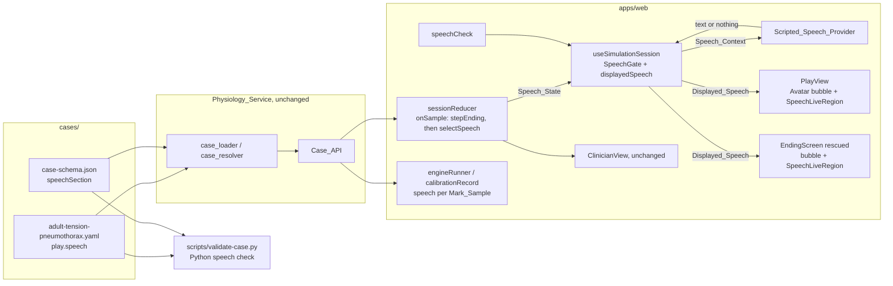
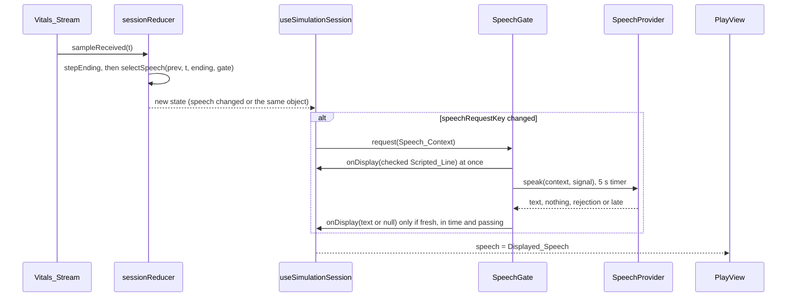

# Design Document: Patient speech

## Overview

Patient speech fills the Avatar's Speech_Bubble_Slot with short pre-written lines from the case file. The design has five parts:

1. **Case data.** `play.speech` in `cases/adult-tension-pneumothorax.yaml`, described by a new `speechSection` definition in `cases/case-schema.json`. The Physiology_Service passes it through unchanged.
2. **Speech_Check.** One rule list (a) to (f), implemented once in TypeScript (`apps/web/src/lib/speechCheck.ts`) and copied once in Python (`scripts/validate-case.py`), with the same patterns and the same failure messages.
3. **Speech_Selector.** A pure fold step (`apps/web/src/lib/speechSelector.ts`) that the session reducer runs on every accepted VitalSigns sample, and that the Scenario_Runner runs on every Mark_Sample.
4. **Speech_Provider seam.** An async interface, the Scripted_Speech_Provider, and a small controller (`speechGate.ts`) that shows the checked scripted line at once and accepts a provider result only when it passes the Speech_Check, is not stale and arrives within 5 s.
5. **Display.** The Play_View passes the Displayed_Speech into the Avatar and into one polite live region. The rescued Ending_Screen shows the bubble with a changed layout. The Clinician_View does not change.

This document covers Requirements 1 to 12 of `.kiro/specs/patient-speech/requirements.md` (accepted). It builds on the play-mode, bedside-exam and engine-mcp designs and edits none of them. The only edits to other specs are the four pointer lines of Requirement 10.

### Scope boundary

Files changed or added:

- `cases/case-schema.json` (one new property, two new definitions), `cases/adult-tension-pneumothorax.yaml` (an added `play.speech` block only), `scripts/validate-case.py` (the Python Speech_Check).
- `apps/web/src/types/index.ts`, `apps/web/src/lib/` (`speechCheck.ts`, `speechSelector.ts`, `speechProvider.ts`, `speechGate.ts` new; `sessionState.ts`, `calibration.ts`, `engineRunner.ts`, `engineTools.ts`, `calibrationRecord.ts` changed), `apps/web/src/hooks/useSimulationSession.ts`, `apps/web/src/components/` (`SpeechLiveRegion.tsx` new; `PlayView.tsx`, `EndingScreen.tsx` changed), and their tests.
- One new Calibration_Record under `docs/calibration/` and its index line.
- The four pointer lines of Requirement 10.

Not changed: every file under `services/physiology/` (11.1), `ClinicianView.tsx` (7.8), `StitchedPatient.tsx` (the bubble already renders any `speech` text, play-mode 3.9 to 3.11), `docker-compose.yml`, the Dockerfile, `apps/web/package.json` (11.3), and every existing value, text and comment of the case file (11.2).

### Findings from the current code

These facts come from reading `main` at commit `6aa4277`:

| Fact | Source | Consequence |
|---|---|---|
| `selectStatus(sample, alarms, play)` returns a Status_Rule `sentence` or `defaultSentence` unchanged and keeps no state. | `statusSelector.ts` | The Speech_Selector calls it and looks up the returned string (4.3). |
| `stepEnding` ignores non-finite and non-increasing `simulation_time`, and stops changing state once the Ending is set. | `endingEvaluator.ts` | The reducer applies the same time rule to the speech fold, with its own last time, so speech keeps folding after an Ending (5.7). |
| `EndingContext.rescueGateTime` is `-Infinity` without Required_Interventions, `null` while closed, else a time. `withRescueGate` updates it after each Intervention and fork. | `endingEvaluator.ts`, `sessionState.ts` | The reducer passes `state.endingCtx.rescueGateTime` to the Speech_Selector. `-Infinity` counts as open, so `early` never shows in a case without Required_Interventions (decision 4). |
| `onFork` resets `latestSample`, `history` and the Ending state. | `sessionState.ts` | `onFork` also resets the Speech_State to `null` (5.5). |
| The Vitals_Stream messages carry no branch_id. The reducer's stale guard drops old-Branch samples by time. | `sessionState.ts` | The Speech_State's branch_id is the reducer's `currentBranchId` when the sample is accepted. |
| `StitchedPatient` takes `speech?: string` and renders a bubble only for non-blank text, inside a fixed 8.5rem band. | `StitchedPatient.tsx` | No Avatar change is needed (7.1, 7.2). |
| The Ending_Screen pulls the empty speech band up behind its heading with `margin-top: calc(-1 * SPEECH_BAND_HEIGHT)`. | `EndingScreen.tsx` | The rescued screen with speech drops the negative margin and budgets the band (7.3, decision 15). |
| The web tests run in the Node environment with `renderToStaticMarkup`; there is no DOM and no React Testing Library. | `vitest.config.ts`, component tests | The provider handling is a plain controller that tests drive with the existing `FakeClock`; the components are tested as static markup. |
| `fast-check` 3.23 is a dev dependency, with shared settings `PBT_PARAMS = { seed: 20261031, numRuns: 100 }` and generators such as `arbSample` and `arbSampleSequence`. | `package.json`, `src/test/pbt.ts`, `src/test/generators.ts` | Property tests use fast-check; no dependency is added. |
| `createOutcomeFold` applies Intervention entries with Actual_Time at or before each mark, then steps the Ending. It exposes only the final gate. | `calibration.ts` | The fold also records the gate in force at each mark (`gateAt`), so the speech fold sees the same gate as the Ending (9.1). |
| `MarkRow` already holds `status_sentence` and `ending` per Mark_Sample, and `run_scenario`'s output schema is a zod mirror of `ScenarioResult`. | `engineRunner.ts`, `engineTools.ts` | Two fields are added to `MarkRow` and its zod schema; one flag is added to `ScenarioResult`. |
| The case-content test's `checkTodoMarkers` collects Play_Section scalars by path pattern and accepts a marker on the value's line or the comment-only line above. `sideWordsIn` uses `\b(left|right)\b`. | `caseContent.test.ts` | The speech marker check is one more pattern group with its own required text, "patient-speech spec" (2.5). |
| `validate-case.py` imports `case_resolver` from `services/physiology/` and validates the Base_Case and every Resolved_Case. | `scripts/validate-case.py` | The speech check reuses `case_resolver.resolve_variant` and needs no service change. |
| `case_loader.py` reads `cases/case-schema.json` and the case file on each load; compose mounts `./cases` read-only. | `case_loader.py`, `docker-compose.yml` | The running service serves the new `play.speech` without a restart or a rebuild (1.6). |

### Design decisions

- **D1. Speech_State lives in the session reducer.** `SessionUiState` gains `speech: SpeechState | null` and `speechLastTime: number | null`. `onSample` steps it after `stepEnding`, so the Ending used is the Ending after this sample (decision 7 and Requirement 9.1 use the same order). Keeping it in the reducer makes it survive view switches (5.9) and makes the screen symmetry test cover it without extra wiring (8.4).
- **D2. Same acceptance rule as the Ending_Evaluator, separate last time.** A sample is folded into the Speech_State when the stale guard accepts it, its `simulation_time` is finite, and it is greater than `speechLastTime`. This is the 6.8 rule. A separate `speechLastTime` is needed because `EndingState.lastTime` freezes when the Ending is set. `onFork` sets both fields to `null`.
- **D3. The Speech_Selector is a step, not a matcher.** `selectSpeech(input)` computes the target Speech_Key (`targetSpeechKey`, exported for tests) and then applies the hold and rotation rules against the previous Speech_State. It reads `earliestInsultTime(caseData)` from the Case_Definition. It never reads `variants`, Scheduled_Insult sides or Intervention sides (8.2).
- **D4. Speech_Key string form.** `'silent' | 'early' | 'rescued' | \`status:${sentence}\``. Two Status_Rules with the same sentence share one Status_Speech_Entry, which matches how the Status_Selector already treats them.
- **D5. The Displayed_Speech lives in the hook, outside the reducer.** Provider results are asynchronous and must not enter the reducer, because the Ending, the Status_Sentence and the Avatar must never depend on them (6.10). `useSimulationSession` owns one `SpeechGate` and a `displayedSpeech` state, and returns `speech: string | null` next to `statusSentence`.
- **D6. A plain controller for the provider handling.** `createSpeechGate({ provider, clock, timeoutMs, current, onDisplay })` holds the request counter, the `AbortController`, the timeout handle and the staleness rules. It has no React dependency, so the Node test environment can drive it with `FakeClock` (12.5).
- **D7. Request trigger as a key string.** `speechRequestKey(currentBranchId, speech)` joins the current branch_id with the Speech_State's branch_id, Speech_Key, line index and `since`. The hook's request effect depends only on that string, so a sample that leaves the Speech_State unchanged, and a view switch, issue no Speech_Request (6.4).
- **D8. One live region at a time.** The Play_View renders a `SpeechLiveRegion` while the Ending is `none`; the Ending_Screen renders its own inside the dialog while an Ending is shown. The Play_View's region and the Ending_Screen are never mounted together, so there is exactly one speech live region (7.5, 7.7).
- **D9. The Ending_Screen region fills after mount.** A live region that already holds text when it mounts is not reliably announced. The Ending_Screen's `SpeechLiveRegion` renders empty and sets its text in an effect after mount, so the rescued line is a content change inside an existing region (7.7). The Play_View's region renders its text directly, because it stays mounted while lines change.
- **D10. Rescued Ending_Screen layout.** With a non-blank Displayed_Speech on the `rescued` screen, the Avatar wrapper drops the negative margin, the overhead grows by `SPEECH_BAND_HEIGHT`, and the bubble is widened past the Avatar to `min(28rem, 100vw - 2rem)` with an arbitrary-variant selector on the wrapper (see "Layout"). The `lost` screen keeps its markup and style exactly (7.4).
- **D11. One rule list, two copies.** The Python copy in `validate-case.py` uses the same regular expressions, written without look-behind so that they behave the same in Python and in every browser, and the same failure message texts (decision 14).
- **D12. Calibration speech values.** `MarkRow` gains `speech` (the Scripted_Line or `null`, 9.1) and `speech_key` (the record form `silent`, `early`, `rescued` or `play.status.rules[<i>]`). `ScenarioResult` gains `has_speech_section`. The Record_Body's speech table is built from these fields only, so `calibrationRecord.ts` needs no Resolved_Case.
- **D13. No PBT library added.** fast-check is already a dev dependency and is used for the properties below.

### Calibration run path (user note, Requirement 9.6)

Kiro restarted and started a fresh Engine_MCP_Server process. This spec's tasks change `apps/web/src/lib/`, which the MCP server loads when its process starts. A server process that started before the last code commit of this spec would run the old Scenario_Runner, without the speech values.

This design reads Requirement 9.6 ("while the Engine_MCP_Server is disconnected") as follows:

- **The Engine_CLI is the default.** From `apps/web/`: `./node_modules/.bin/vite-node --config vitest.config.ts scripts/engineCli.ts -- calibrate --case adult-tension-pneumothorax`, first without `--write`, then exactly once with `--write`, each through `execute_bash` with a timeout of at least 1,800,000 ms.
- **The MCP tool `run_calibration` is allowed only** when the Engine_MCP_Server is connected and its process started after the last code commit of this spec. Otherwise the server counts as disconnected for 9.6 and the CLI is used.

The final task decides the path and states it in its report:

1. Take the last code commit time of this spec: `git log -1 --format=%cI -- apps/web/src apps/web/scripts cases scripts`.
2. Find the MCP server process: `pgrep -f scripts/engineMcp.ts`, then `ps -o lstart= -p <pid>`.
3. Use MCP only when a process exists, the `stitched-patient-engine` tools respond, and the process start time is later than the commit time. In every other case use the CLI.
4. Report the path used, both times, the CLI exit code (CLI path) or the tool result status (MCP path), and the speech table of each of the eight Scenarios of the new Calibration_Record (9.7).

The Physiology_Service must already run. The run starts, stops and restarts nothing and runs no Blocked_Compose_Command. If the service is not reachable, the task asks the user to start it in their own terminal. Because `case_loader.py` reads the case file and the schema on each load, the running service needs no restart after the case-file change.

## Architecture



### One sample, end to end



### Modules

| Module | Kind | Responsibility | Requirements |
|---|---|---|---|
| `lib/speechCheck.ts` | new, pure | Speech_Check rules (a) to (f), Forbidden_Speech_Terms, shared patterns and message texts | 2.1, 4.7, 6.6, 6.8 |
| `lib/speechSelector.ts` | new, pure | `SPEECH_HOLD_SECONDS`, `SPEECH_ROTATE_SECONDS`, `targetSpeechKey`, `selectSpeech`, `foldSpeech`, `checkedScriptedLine`, `speechRequestKey` | 4, 5.1 to 5.4, 5.10, 8.2, 8.3 |
| `lib/speechProvider.ts` | new | `SpeechProvider`, `SpeechContext`, `scriptedSpeechProvider`, `buildSpeechContext` | 6.1 to 6.3 |
| `lib/speechGate.ts` | new | `PROVIDER_TIMEOUT_MS`, `createSpeechGate` | 6.4 to 6.9 |
| `lib/sessionState.ts` | changed | `speech` and `speechLastTime` fields; step in `onSample`; reset in `onFork` | 5.5 to 5.9 |
| `hooks/useSimulationSession.ts` | changed | owns the gate and `displayedSpeech`; returns `speech` | 5.6, 5.9, 6.3 to 6.5 |
| `components/SpeechLiveRegion.tsx` | new | the polite speech live region | 7.5 to 7.7 |
| `components/PlayView.tsx` | changed | passes `speech` to the Avatar and the region; passes it to the Ending_Screen | 7.1, 7.2, 7.5, 7.6, 7.9 |
| `components/EndingScreen.tsx` | changed | rescued bubble and layout; region inside the dialog | 7.3, 7.4, 7.7 |
| `lib/calibration.ts` | changed | `gateAt` per pushed mark | 9.1 |
| `lib/engineRunner.ts`, `lib/engineTools.ts` | changed | `speech`, `speech_key` per `MarkRow`; `has_speech_section` | 9.1, 9.5 |
| `lib/calibrationRecord.ts` | changed | speech table per Scenario | 9.2 to 9.4 |
| `scripts/validate-case.py` | changed | Python copy of rules (a) to (f) over the Base_Case and every Resolved_Case | 1.7, 2.3, 11.6 |

## Components and Interfaces

### File layout

```
apps/web/src/
├── types/index.ts                 # SpeechSection, SpeechStatusEntry; PlaySection.speech?
├── lib/
│   ├── speechCheck.ts             # new
│   ├── speechCheck.test.ts        # new (12.1, property test 1)
│   ├── speechSelector.ts          # new
│   ├── speechSelector.test.ts     # new (12.2, 12.3, Properties 2 to 6)
│   ├── speechProvider.ts          # new
│   ├── speechGate.ts              # new
│   ├── speechGate.test.ts         # new (12.5, property test 7)
│   ├── sessionState.ts            # speech fields, onSample, onFork
│   ├── sessionState.test.ts       # speech fold through the reducer (5.5 to 5.9)
│   ├── caseContent.test.ts        # speech content checks (12.7)
│   ├── calibration.ts             # gateAt
│   ├── engineRunner.ts            # MarkRow.speech, speech_key; has_speech_section
│   ├── engineTools.ts             # zod fields
│   ├── calibrationRecord.ts       # speech table
│   └── calibrationRecord.test.ts  # speech table tests (12.8, property test 8)
├── hooks/useSimulationSession.ts  # gate, displayedSpeech, speech
└── components/
    ├── SpeechLiveRegion.tsx       # new
    ├── PlayView.tsx               # speech wiring
    ├── PlayView.test.tsx          # 12.6
    ├── EndingScreen.tsx           # rescued bubble layout, region
    ├── EndingScreen.test.tsx      # 12.6
    ├── ClinicianView.test.tsx     # equal markup with and without speech (7.8)
    └── sideSymmetry.test.tsx      # bedside-exam property test 17 with speech (8.4)
```

### `speechCheck.ts` (Speech_Check)

```ts
export const SPEECH_MAX_CODE_POINTS = 200;

/** Whole-word, case-insensitive. No look-behind, so Python and every browser agree (D11). */
export const SIDE_WORD_PATTERN = /(^|[^A-Za-z0-9_])(left|right)(?=$|[^A-Za-z0-9_])/gi;
export const THIRD_PERSON_PATTERN = /(^|[^A-Za-z0-9_])(he|his|him|himself)(?=$|[^A-Za-z0-9_])/gi;

/** Rule message texts, identical in validate-case.py. */
export const SPEECH_RULE_TEXT = {
  blank: 'is empty or contains only whitespace',
  tooLong: 'has more than 200 characters',
  diagnosis: (term: string) => `contains Diagnosis_Term "${term}"`,
  side: (word: string) => `contains Side_Word "${word}"`,
  forbidden: (term: string) => `contains Forbidden_Speech_Term "${term}"`,
  thirdPerson: (word: string) => `contains Third_Person_Word "${word}"`,
} as const;

/** speech.forbiddenTerms, every Intervention label and Play_Label, every Exam_Button text. Non-blank, without repeats, in that order. */
export function forbiddenSpeechTerms(caseData: CaseData): string[];

/** One message per broken rule (a) to (f); [] when the text passes. Pure. */
export function speechCheck(text: string, caseData: CaseData): string[];
```

Rules, in order:

- (a) `text.trim() === ''` gives `blank`, and no other rule is checked for that text.
- (b) `[...text].length > 200` gives `tooLong` (code points, as JSON Schema `maxLength` counts).
- (c) For each non-blank `play.diagnosisTerms` entry, `text.toLowerCase().includes(term.toLowerCase())` gives `diagnosis(term)` (substring, as play-mode 2.19).
- (d) Each distinct lower-cased match of `SIDE_WORD_PATTERN` gives `side(word)`. "alright" passes, "all right" fails.
- (e) For each term of `forbiddenSpeechTerms`, a case-insensitive substring match gives `forbidden(term)`.
- (f) Each distinct lower-cased match of `THIRD_PERSON_PATTERN` gives `thirdPerson(word)`. "the", "here" and "them" pass; "he's" fails, because the apostrophe is not a word character.

The function reads only `play.diagnosisTerms`, `play.speech.forbiddenTerms`, `interventions[].label`, `interventions[].playLabel` and the Exam_Button texts (`examButtons` from `examFinding.ts` already lists them in order). Without a Play_Section, rules (c) and (e) use empty lists.

### `speechSelector.ts` (Speech_Selector)

```ts
/** UI display constants, not clinical values (decision 6, 5.10). */
export const SPEECH_HOLD_SECONDS = 10;
export const SPEECH_ROTATE_SECONDS = 30;

export type SpeechKey = 'silent' | 'early' | 'rescued' | `status:${string}`;

export interface SpeechState {
  branchId: string;
  key: SpeechKey;
  index: number;        // line index in the key's list; 0 for silent
  since: number;        // Simulation_Time from which this line has shown
  line: string | null;  // the Speech_Line, or null for silence
}

export interface SpeechInput {
  sample: Partial<VitalSigns> | null;
  caseData: CaseData;
  ending: Ending;
  simulationTime: number;
  branchId: string;
  rescueGateTime: number | null;   // -Infinity: no Required_Interventions (always open)
  previous: SpeechState | null;
}

export function speechLines(speech: SpeechSection | undefined, key: SpeechKey): readonly string[];
export function targetSpeechKey(input: Omit<SpeechInput, 'branchId' | 'previous'>): SpeechKey;
export function selectSpeech(input: SpeechInput): SpeechState;
```

`targetSpeechKey` applies Requirement 4.2 in order:

1. Ending `rescued`: `rescued` if `speech.rescued` has a line, else `silent`.
2. Ending `lost`: `silent`.
3. No sample, or no `play.speech`: `silent`.
4. `earliestInsultTime(caseData)` defined and `simulationTime` less than it: `silent`.
5. `s = selectStatus(sample, caseData.alarms, caseData.play)`. If `s !== play.status.defaultSentence`: `status:<s>` if some Status_Speech_Entry has `sentence === s`, else `silent`.
6. `s` is the `defaultSentence`, `speech.early` has a line, and `rescueGateTime === null || rescueGateTime > simulationTime`: `early`.
7. Otherwise `silent`.

Step 5 compares with the `defaultSentence` first. If an author ever wrote a Status_Rule sentence equal to the `defaultSentence`, the case-content test of 2.4 already fails on its Status_Speech_Entry, so the order of steps 5 and 6 never hides an entry.

`selectSpeech` then applies Requirement 5, with `t = simulationTime`, `target = targetSpeechKey(...)` and `fresh(key) = { branchId, key, index: 0, since: t, line: speechLines(...)[0] ?? null }`:

```
prev = input.previous
if prev is null or prev.branchId !== branchId or prev.since > t:  return fresh(target)        // 5.4
if target !== prev.key:
  if ending !== 'none':                                           return fresh(target)        // 5.2
  if t - prev.since < SPEECH_HOLD_SECONDS:                         return prev                 // 5.1, held
  return fresh(target)                                                                         // 5.1
lines = speechLines(speech, prev.key)
if lines.length > 1 and t - prev.since >= SPEECH_ROTATE_SECONDS:
  next = (prev.index + 1) % lines.length
  return { ...prev, index: next, since: t, line: lines[next] }                                 // 5.3
return prev                                                                                    // 5.3, unchanged
```

Returning `prev` itself when nothing changes lets the reducer keep its state object, so React and the request key see no change.

The hold applies to every key change, including a change to `silent`. A held line therefore stays up to 10 s after the patient's state no longer matches it. A previous index beyond the current list (a list that got shorter) cannot happen within one Session, because the Case_Definition is fixed; `speechLines(...)[index] ?? null` guards it anyway.

Other exports:

```ts
/** Fold of selectSpeech over ordered steps; used by the reducer tests and the Scenario_Runner. */
export interface SpeechStep { sample: Partial<VitalSigns>; simulationTime: number; ending: Ending; rescueGateTime: number | null; }
export function foldSpeech(caseData: CaseData, branchId: string, steps: readonly SpeechStep[]): SpeechState[];

/** The Scripted_Line when it passes the Speech_Check, else null (4.7). */
export function checkedScriptedLine(state: SpeechState | null, caseData: CaseData | null): string | null;

/** Changes exactly when a Speech_Request is due (6.4, D7). */
export function speechRequestKey(currentBranchId: string | null, state: SpeechState | null): string;
```

`speechRequestKey` returns `JSON.stringify([currentBranchId, state?.branchId ?? null, state?.key ?? null, state?.index ?? null, state?.since ?? null])`. `since` is part of the key because a Speech_State restarted by 5.4 is a new state even when key and index repeat.

### `speechProvider.ts` (Speech_Provider seam)

```ts
export interface SpeechContext {
  branchId: string;
  requestNumber: number;
  caseData: CaseData;
  sample: VitalSigns | null;
  simulationTime: number | null;
  ending: Ending;
  rescueGateTime: number | null;
  speechState: SpeechState | null;
  scriptedLine: string | null;            // the raw Scripted_Line, before the Speech_Check
  activeInterventions: InterventionRecordEntry[];  // newest 5 or fewer
  activeExamEntries: ExamRecordEntry[];            // newest 5 or fewer
}

export interface SpeechProvider {
  speak(context: SpeechContext, signal: AbortSignal): Promise<string | null | undefined>;
}

/** The only provider of this spec: resolves with the Scripted_Line and calls nothing else (6.3). */
export const scriptedSpeechProvider: SpeechProvider = {
  speak: (context) => Promise.resolve(context.scriptedLine),
};

/** Builds the context from the reducer state (6.2). `requestNumber` is filled in by the gate. */
export function buildSpeechContext(state: SessionUiState): Omit<SpeechContext, 'requestNumber'> | null;
```

`buildSpeechContext` returns `null` before the case and the current Branch are known. The newest 5 entries are the last 5 of `activeInterventions(record, lineage)` and `activeExamEntries(record, lineage)`, which are in recording order. No setting, environment variable or key selects another provider; the hook imports `scriptedSpeechProvider` directly (6.3, 6.11).

### `speechGate.ts` (check-then-fallback gate)

```ts
export const PROVIDER_TIMEOUT_MS = 5000;   // UI constant

export interface SpeechClock { setTimeout(fn: () => void, ms: number): unknown; clearTimeout(handle: unknown): void; }

export interface SpeechGateOptions {
  provider: SpeechProvider;
  clock?: SpeechClock;                 // default: globalThis timers; tests pass FakeClock
  timeoutMs?: number;                  // default PROVIDER_TIMEOUT_MS
  /** Current Branch and Ending, read when a result arrives (Stale_Result). */
  current: () => { branchId: string | null; ending: Ending };
  onDisplay: (text: string | null) => void;
}

export interface SpeechGate {
  request(context: Omit<SpeechContext, 'requestNumber'>): void;
  dispose(): void;
}

export function createSpeechGate(options: SpeechGateOptions): SpeechGate;
```

`request(context)`:

1. Abort the previous request's `AbortController` and clear its timer (6.4).
2. `n = ++counter`; `issued = { branchId: context.branchId, ending: context.ending }`.
3. `fallback = checkedScriptedLine(context.speechState, context.caseData)`; call `onDisplay(fallback)` synchronously (6.5, 4.7).
4. Start the timer: on expiry, mark request `n` as timed out and abort its signal. The fallback stays (6.8).
5. Call `provider.speak({ ...context, requestNumber: n }, signal)` inside `try`. A synchronous throw counts as a rejection.
6. On settlement, discard the result when any of these holds: `n !== counter`, request `n` timed out, `current().branchId !== issued.branchId`, `current().ending !== issued.ending` (6.9). Otherwise clear the timer and:
   - `null` or `undefined`: `onDisplay(null)` (6.7);
   - a string with `speechCheck(text, caseData)` empty: `onDisplay(text)` (6.6);
   - a string that fails, any other value, or a rejection: no call; the fallback stays (6.8).

The gate shows no error to the learner and logs nothing. `dispose()` aborts the pending request and clears its timer; the hook calls it on unmount.

With the Scripted_Speech_Provider the result equals the raw Scripted_Line. When that line passes, step 6 shows the same text again; when it fails, step 6 keeps the fallback `null`. So the shipped behaviour equals the scripted fold.

### `sessionState.ts`

New fields and their initial values: `speech: null`, `speechLastTime: null`.

In `onSample`, after step 4 (`stepEnding`) and before the return:

```ts
// 7. Speech_State (patient-speech 5.7, D1, D2): same time rule as 6.8, own last time.
let speech = state.speech;
let speechLastTime = state.speechLastTime;
const t = sample.simulation_time;
if (caseData !== null && state.currentBranchId !== null && Number.isFinite(t) &&
    (speechLastTime === null || t > speechLastTime)) {
  speech = selectSpeech({
    sample, caseData, ending: ending.ending, simulationTime: t,
    branchId: state.currentBranchId, rescueGateTime: state.endingCtx.rescueGateTime,
    previous: state.speech,
  });
  speechLastTime = t;
}
```

`onFork` sets `speech: null` and `speechLastTime: null` (5.5). `caseLoaded` sets both to `null`. No other action reads or writes them, so `viewSelected`, `playbackChanged`, `hintRevealed`, `examPerformed` and Intervention actions leave them unchanged (5.8, 5.9). A failed fork dispatches no action (5.6).

The rescue gate passed is the one in `endingCtx` when the sample arrives; `withRescueGate` updates it on `interventionSucceeded` before later samples. That is the same gate `stepEnding` uses for the sample.

Speed, pause and replay: the fold depends only on the accepted samples and their Simulation_Times, the Ending sequence and the gate sequence. Playback_Speed changes how fast samples arrive, not their values, so the same sequence gives the same lines at every speed (5.7). While paused no sample arrives and nothing changes (5.8). After a rewind, the new Branch starts with `speech: null`, and the first sample computes a fresh Speech_State with no previous (5.4, 5.5).

### `useSimulationSession.ts`

```ts
const [displayedSpeech, setDisplayedSpeech] = useState<string | null>(null);
const gateRef = useRef<SpeechGate | null>(null);
// created once on mount with scriptedSpeechProvider,
// current: () => ({ branchId: stateRef.current.currentBranchId, ending: stateRef.current.ending.ending }),
// onDisplay: (text) => { if (mountedRef.current) setDisplayedSpeech(text) }; disposed on unmount.

const requestKey = speechRequestKey(state.currentBranchId, state.speech);
useEffect(() => {
  const context = buildSpeechContext(stateRef.current);
  if (context !== null) gateRef.current?.request(context);
}, [requestKey]);
```

`SimulationSession` gains `speech: string | null` (the Displayed_Speech). The effect runs right after the render that committed the new Speech_State, so the scripted line shows well within 500 ms of the sample (6.5). The hook is above both views, so a view switch keeps the gate and `displayedSpeech` (5.9). The hook's signature stays `useSimulationSession(sessionId)`; no option selects a provider.

### `SpeechLiveRegion.tsx` (new)

```tsx
export interface SpeechLiveRegionProps {
  text: string | null;
  /** Render empty first and set the text after mount (D9). */
  fillAfterMount?: boolean;
}
export function SpeechLiveRegion({ text, fillAfterMount = false }: SpeechLiveRegionProps) {
  const [mounted, setMounted] = useState(!fillAfterMount);
  useEffect(() => setMounted(true), []);
  const shown = mounted && text !== null && /\S/.test(text) ? text : null;
  return (
    <div data-part="speech-live" className="sr-only" aria-live="polite" aria-atomic="true">
      {shown !== null && <p>{shown}</p>}
    </div>
  );
}
```

The region holds only the Displayed_Speech. A repeated sample with the same text renders the same content, so assistive technology announces nothing new. A new text replaces the content and is announced once. Silence empties the region (7.6). The region is separate from the StatusLine's region and from `exam-live` (7.5).

### `PlayView.tsx`

- `PlayViewProps.sim` becomes `Pick<SimulationSession, 'state' | 'statusSentence' | 'speech' | 'actions' | 'notices'>`.
- The Avatar gets `speech={sim.speech ?? undefined}` (7.1, 7.2). Its `statusSentence` prop, and so its accessible name, is unchanged (7.9).
- While `ending === 'none'`, a `<SpeechLiveRegion text={sim.speech} />` follows the `exam-live` region (7.5, 7.6).
- `<EndingScreen ... speech={sim.speech} />` (7.3, 7.7).
- Nothing else in the markup changes, so a session without `play.speech` renders the same markup as before (`speech` is always `null` then, and the region is empty).

Every test that builds a PlayView `sim` (at least `PlayView.test.tsx`, `sideSymmetry.test.tsx` and `SessionScreen.test.tsx`; the task finds the rest with a search for `<PlayView`) passes `speech: checkedScriptedLine(state.speech, state.caseData)`, the value the hook shows with the Scripted_Speech_Provider.

### `EndingScreen.tsx`

New optional prop `speech?: string | null`.

- `showSpeech = ending === 'rescued' && speech is non-blank`.
- With `showSpeech`: the Avatar gets `speech={speech}`; the wrapper style is `{ width: min(22rem, calc((100vh - var(--notice-h) - <overhead> - SPEECH_BAND_HEIGHT) * 200 / 280)) }` with no `marginTop`, where `<overhead>` is `ENDING_OVERHEAD_WITH_SIDE` or `ENDING_OVERHEAD` as today. The wrapper class adds `[&_[data-part=speech-bubble]]:left-1/2 [&_[data-part=speech-bubble]]:right-auto [&_[data-part=speech-bubble]]:w-[min(28rem,calc(100vw-2rem))] [&_[data-part=speech-bubble]]:max-w-none [&_[data-part=speech-bubble]]:-translate-x-1/2`, and drops `pointer-events-none` on the band.
- Without `showSpeech` (every `lost` screen, and a `rescued` screen without speech): markup and style exactly as today (7.4).
- As the last child of the dialog container (outside the centred flex column): `<SpeechLiveRegion text={showSpeech ? speech : null} fillAfterMount />` (7.7). On the `lost` screen this region stays empty.
- The file comment "never shows speech" is replaced by the rescued rule above.

### `ClinicianView.tsx`

No change. `SessionScreen` passes the Clinician_View the same props as today, and the Clinician_View never receives `speech` (7.8).

### Layout

**Play_View (7.10).** The speech band is already reserved in the Play_View at 8.5rem, and play-mode sized it for a 200-character bubble with a `clamp(0.75rem, 2.5vw, 1rem)` font. This spec adds no element to the patient column, so the play-mode 11.7 and 11.8 arithmetic in the `PlayView.tsx` file comment is unchanged. The live region is `sr-only` and takes no space. A 200-character bubble at 1280 × 720 is part of the manual acceptance check.

**Rescued Ending_Screen with speech (7.3).** At 1280 × 720, 664 px remain below the 56 px Safety_Notice.

| Item | Height (px) |
|---|---|
| `p-4` top and bottom | 32 |
| Heading `text-2xl` | 32 |
| "He's breathing again." | 24 |
| Side_Reveal_Text, two-line budget | 48 |
| Speech band (`SPEECH_BAND_HEIGHT`) | 136 |
| Drawing: width (664 − 236 − 136) × 200 / 280 = 208.6, height 292 | 292 |
| Button row | 44 |
| Four `gap-3` gaps between the five flex children | 48 |
| **Total** | **656** |

The overhead constant `ENDING_OVERHEAD_WITH_SIDE` (14.75rem = 236 px) already holds the padding, heading, sentence, side text, button row, four gaps and an 8 px margin. The band adds 136 px and the drawing gets the rest, so the content is 656 px and fits in 664 px without scrolling. The `sr-only` live region is a child of the dialog container, outside the flex column, so it adds no gap. The Avatar is 208.6 px wide instead of 305.7 px; this is the cost of keeping the bubble clear of the heading.

The widened bubble is 448 px wide (28rem, inside the 480 px content width of `max-w-lg` minus `p-4`), so its text width is 424 px. At 1280 px the font is 16 px with a 21.6 px line height. The bubble sits in the band's lower 124 px (`bottom-3`), which holds 5 lines after `py-2`. With about 50 characters per line, a 200-character line takes 4 lines, and the shipped 37-character `rescued` line takes 1. The bubble is anchored to the band's bottom and grows upward inside the band, so it overlaps neither the Side_Reveal_Text above nor the controls below. These are estimates from the CSS; the manual acceptance check at 1280 × 720 decides (7.3).

Below 1280 × 720 the overlay scrolls, as play-mode already allows.

### Case-content test additions (`caseContent.test.ts`)

- `SPEECH_MARK = 'patient-speech spec'` and `SPEECH_ITEM_PATTERNS`: `/^play\.speech\.status\[\d+\]\.lines\[\d+\]$/`, `/^play\.speech\.(early|rescued)\[\d+\]$/`, `/^play\.speech\.forbiddenTerms\[\d+\]$/`. They join `TEXT_ITEM_PATTERNS`; a marker on these paths must contain `TODO(author)` and `SPEECH_MARK` (2.5). `coveringReferencesPaths` returns `[['play', 'speech', 'references']]` for paths under `play.speech.`.
- `checkSpeechLines(c)`: `speechCheck` on every Speech_Line, failures as `<path> "<line>": <rule>`, run through `perVariant` so each failure carries the Variant_Id (2.2).
- `checkSpeechSentences(c)`: each entry `sentence` equals some Status_Rule `sentence`, differs from `defaultSentence`, and appears once (2.4).
- `checkSpeechShape(c)`: one entry per Status_Rule in Status_Rule order with 1 or 2 lines, Early_Lines with 1 or 2 lines starting with "I... can't... get a breath in. My chest-", Rescued_Lines with 1 line, a non-empty `forbiddenTerms` (3.1).
- `checkSpeechInBaseOnly`: no Variant's `overrides` has `speech`, and the Base_Case has `play.speech` (3.4).
- `checkSpeechEqualAcrossVariants`: `differences(left.play.speech, right.play.speech)` is empty, naming the first differing path (8.1).
- A missing `play.speech` makes each of these checkers return `play.speech is missing` (2.6).
- Schema test: `case-schema.json` `definitions.variantOverrides.properties` has no `speech` key and `additionalProperties` is `false` (1.5).

### `scripts/validate-case.py`

```python
import re

SPEECH_MAX_CODE_POINTS = 200
SIDE_WORD = re.compile(r"(^|[^A-Za-z0-9_])(left|right)(?=$|[^A-Za-z0-9_])", re.IGNORECASE)
THIRD_PERSON_WORD = re.compile(r"(^|[^A-Za-z0-9_])(he|his|him|himself)(?=$|[^A-Za-z0-9_])", re.IGNORECASE)
# Rule texts: identical to SPEECH_RULE_TEXT in apps/web/src/lib/speechCheck.ts.

def forbidden_speech_terms(case: dict) -> list: ...
def speech_check(text: str, case: dict) -> list: ...           # rules (a) to (f), same order
def speech_lines(case: dict) -> list: ...                       # [(path, text)], status, early, rescued
def speech_problems(case: dict, prefix: str) -> list: ...       # ["<prefix><path> \"<text>\": <rule>"]
def validate_speech(case_data: dict) -> bool: ...
```

`validate_speech` runs after the schema checks pass, on both code paths of `validate_case`:

- the Base_Case with prefix `""`;
- each Resolved_Case, built with `case_resolver.resolve_variant(case_data, variant)`, with prefix `variant '<id>': `.

It prints `✗ <problem>` per failure and returns `False`, or prints `✓ Every Speech_Line passes the speech checks` when the case has a Speech_Section and nothing fails. A case without `play.speech` prints nothing more. `main` exits with 1 when either the schema or the speech check fails (2.3). Python's `len` counts code points, and `str.lower` equals JavaScript's `toLowerCase` for the ASCII text of these cases.

Verification, from the repository root, in a one-off physiology container (11.6; the image is built beforehand by the user):

```bash
docker compose run -T --rm --no-deps -v "$PWD:/repo:ro" -w /repo -e PYTHONDONTWRITEBYTECODE=1 \
  physiology python3 scripts/validate-case.py cases/adult-tension-pneumothorax.yaml          # exit 0

# copy outside the repository with one line changed to contain "left"
docker compose run -T --rm --no-deps -v "$PWD:/repo:ro" -v "<copy>:/tmp/speech-side-word.yaml:ro" \
  -w /repo -e PYTHONDONTWRITEBYTECODE=1 \
  physiology python3 scripts/validate-case.py /tmp/speech-side-word.yaml                      # exit 1
```

### Calibration: `calibration.ts`, `engineRunner.ts`, `engineTools.ts`, `calibrationRecord.ts`

- `OutcomeFold` gains `readonly gateAt: readonly (number | null)[]`: the gate after the entries for that mark were applied and before `stepEnding`. `ScenarioOutcome` gains `gateAt`. No existing field changes (9.5).
- `buildScenarioResult` computes `foldSpeech(rc, 'calibration', marks.map((m, i) => ({ sample: { ...m.sample, simulation_time: m.mark }, simulationTime: m.mark, ending: outcome.endingAfter[i], rescueGateTime: outcome.gateAt[i] })))` and writes per row `speech: state.line` and `speech_key: recordKey(state.key, rc)`. `recordKey` maps `status:<s>` to `play.status.rules[<i>]` with `i` the first rule index whose sentence equals `s`.
- `ScenarioResult.has_speech_section = rc.play?.speech !== undefined`.
- `engineTools.ts`: `MarkRowSchema` gains `speech: z.string().nullable()` and `speech_key: z.string()`; `ScenarioResultSchema` gains `has_speech_section: z.boolean()`.
- `calibrationRecord.ts`: `speechChanges(marks)` returns the marks where `speech` differs from the previous mark's, plus the first mark. `scenarioSection` adds, after "Status_Rules":

```markdown
#### Speech

| Time (s) | Speech_Key | Line |
|---|---|---|
| 0 | silent | silent |
| 30 | early | I... can't... get a breath in. My chest- |
| ... | ... | ... |

Speech lines are computed on the Mark_Samples; the Web_App computes them on every received sample, so its line changes can come up to one Sample_Interval earlier or later.
```

When `has_speech_section` is false, the section is the single line `Speech: none (the case has no speech section)` (9.4). Lines go through the existing `cell()` escaping. No Calibration_Check, Ending or other block reads the speech fields (9.5).

### Pointer lines (Requirement 10)

A doc-only task adds exactly the four lines of Requirements 10.1 to 10.4, copied character for character, directly under bedside-exam 10.8, the play-mode glossary entry **Speech_Bubble_Slot**, engine-mcp 5.1 and engine-mcp 9.4. The task changes no other line of those files (10.5). It runs `git diff --stat` and `git diff` on the three files to show four added lines and nothing else.

### What does not change (giveaway review)

- The Speech_Section is in the Base_Case only and is no Override_Target, so both Resolved_Cases carry the same lines (8.1).
- The Speech_Selector reads no Variant_Id, Affected_Side, Scheduled_Insult side or Intervention side; only `earliestInsultTime` reads the insults, and only their times (8.2).
- The Speech_Check rejects any line with "left" or "right" (2.1 d).
- The `early` lines stop when the Rescue_Gate_Time opens. This is feedback on the player's own correct needle, which bedside-exam 10 allows (Known limitations in the requirements).

## Data Models

### TypeScript types (`src/types/index.ts`)

```ts
export interface SpeechStatusEntry {
  sentence: string;   // equals one Status_Rule sentence
  lines: string[];    // 1 to 3
}

export interface SpeechSection {
  status?: SpeechStatusEntry[];
  early?: string[];
  rescued?: string[];
  forbiddenTerms?: string[];
  references?: string[];
}

export interface PlaySection {
  // ...existing fields unchanged
  /** Patient speech (patient-speech Requirement 1). Absent means silence. */
  speech?: SpeechSection;
}
```

`SpeechKey`, `SpeechState`, `SpeechInput`, `SpeechStep`, `SpeechContext`, `SpeechProvider` and `SpeechGate` live in their modules (see above).

### State ownership

| State | Owner | Reset | Read by |
|---|---|---|---|
| `speech: SpeechState \| null` | `sessionReducer` | `caseLoaded`, `forkSucceeded` | hook (request key, context), tests |
| `speechLastTime: number \| null` | `sessionReducer` | `caseLoaded`, `forkSucceeded` | `onSample` only |
| `displayedSpeech: string \| null` | `useSimulationSession` | set by the gate; not stored | PlayView, EndingScreen |
| request counter, controller, timer | `SpeechGate` | per request | the gate only |

Nothing is persisted; a reload restarts the speech (Known limitations in the requirements).

### JSON Schema changes (`cases/case-schema.json`)

In `properties.play.properties`:

```json
"speech": { "$ref": "#/definitions/speechSection" }
```

In `definitions`:

```json
"speechLineList": {
  "type": "array",
  "minItems": 1,
  "maxItems": 3,
  "items": { "type": "string", "minLength": 1, "maxLength": 200 }
},
"speechSection": {
  "type": "object",
  "additionalProperties": false,
  "properties": {
    "status": {
      "type": "array",
      "minItems": 0,
      "maxItems": 20,
      "items": {
        "type": "object",
        "additionalProperties": false,
        "required": ["sentence", "lines"],
        "properties": {
          "sentence": { "type": "string", "minLength": 1, "maxLength": 80 },
          "lines": { "$ref": "#/definitions/speechLineList" }
        }
      }
    },
    "early": { "$ref": "#/definitions/speechLineList" },
    "rescued": { "$ref": "#/definitions/speechLineList" },
    "forbiddenTerms": {
      "type": "array",
      "minItems": 1,
      "maxItems": 30,
      "items": { "type": "string", "minLength": 1, "maxLength": 60 }
    },
    "references": { "$ref": "#/definitions/citationList" }
  }
}
```

`additionalProperties: false` on the section and on each entry rejects `lost`, `beforeInsult` and any other key (1.2, 1.4). `variantOverrides` is not touched: it already has `additionalProperties: false`, so `speech` in `overrides` is rejected by the schema, and by the Case_Resolver's `OVERRIDE_KEYS` check when the schema file is missing (1.5). `citationList` is the existing definition.

### Case file addition (`cases/adult-tension-pneumothorax.yaml`)

Inserted at the end of the `play` mapping, after the `exam` block and before the blank line and the `# Author's game-rule decision ...` comment that precedes `variants`. No existing line changes (11.2).

```yaml
  speech:
    status:
      - sentence: "His lips are turning blue and he is fighting for breath."
        lines:
          # TODO(author): speech line for critical SpO2 - draft from the patient-speech spec, pending author review
          - "Can't... breathe..."
          # TODO(author): speech line for critical SpO2 - draft from the patient-speech spec, pending author review
          - "Help... me..."
      - sentence: "He looks pale and is struggling to breathe."
        lines:
          # TODO(author): speech line for warning SpO2 - draft from the patient-speech spec, pending author review
          - "It's getting worse... I can't catch my breath."
          # TODO(author): speech line for warning SpO2 - draft from the patient-speech spec, pending author review
          - "Why can't I breathe properly?"
      - sentence: "His heart is racing and he looks frightened."
        lines:
          # TODO(author): speech line for critical high heart rate - draft from the patient-speech spec, pending author review
          - "My heart... it's pounding so hard..."
      - sentence: "His heart is beating fast and he looks uneasy."
        lines:
          # TODO(author): speech line for warning high heart rate - draft from the patient-speech spec, pending author review
          - "My heart's racing. What's happening to me?"
      - sentence: "He is breathing faster than normal."
        lines:
          # TODO(author): speech line for warning high respiratory rate - draft from the patient-speech spec, pending author review
          - "I can't... slow my breathing down."
      - sentence: "He looks clammy and a little faint."
        lines:
          # TODO(author): speech line for warning low mean arterial pressure - draft from the patient-speech spec, pending author review
          - "I feel dizzy... like I might pass out."
    early:
      # TODO(author): early speech line (requested, demo video shot 2) - draft from the patient-speech spec, pending author review
      - "I... can't... get a breath in. My chest-"
      # TODO(author): early speech line - draft from the patient-speech spec, pending author review
      - "It hurts... when I try to breathe in."
    rescued:
      # TODO(author): rescued speech line - draft from the patient-speech spec, pending author review
      - "Oh... I can breathe again. Thank you."
    # TODO(author): Forbidden_Speech_Terms list (still open question 9) - draft from the patient-speech spec, pending author review
    forbiddenTerms: ["needle", "decompress", "drain", "chest tube", "trapped air", "let the air out", "oxygen", "listen", "stethoscope", "windpipe", "trachea", "neck vein"]
```

The `sentence` values copy the Status_Rule sentences character for character and need no marker of their own (2.5 covers lines and `forbiddenTerms` only). The comment above each line is a comment-only line directly above the value, which `checkTodoMarkers` accepts. The flow list keeps all `forbiddenTerms` on one source line, so the comment-only line above covers each entry, as for `diagnosisTerms`. The lines and terms are drafts from the requirements table, not clinical claims; this design adds none of its own.

### `MarkRow` and `ScenarioResult` additions (`engineRunner.ts`)

```ts
export interface MarkRow {
  // ...existing fields unchanged
  speech: string | null;   // Scripted_Line of the speech fold at this Mark_Sample, null for silence (9.1)
  speech_key: string;      // 'silent' | 'early' | 'rescued' | 'play.status.rules[<i>]'
}

export interface ScenarioResult {
  // ...existing fields unchanged
  has_speech_section: boolean;  // rc.play?.speech !== undefined (9.4)
}
```

## Correctness Properties

*A property is a characteristic or behavior that should hold true across all valid executions of a system-essentially, a formal statement about what the system should do. Properties serve as the bridge between human-readable specifications and machine-verifiable correctness guarantees.*

Reflection before writing the list: determinism (4.6), purity (4.1), the same lines at every Playback_Speed (5.7), pause (5.8) and view switches (5.9) are one property over the reducer fold. Line membership (4.5) includes the index rule (4.4). Side symmetry (8.3) covers "reads no side" (8.2). The rules of 4.2, the Ending override (5.2), rotation (5.3), fork handling (5.5, 5.6) and the rendering criteria are example tests, because each is one branch with a fixed expected result.

### Property 1: The Speech_Check reports exactly the broken rules

*For any* text built from clean fragments (words that contain no Diagnosis_Term, Side_Word, Forbidden_Speech_Term or Third_Person_Word of the case) with zero or more inserted pieces, each piece taken from one rule (a Diagnosis_Term, a Side_Word as a whole word, a Forbidden_Speech_Term from the case list, an Intervention label, a Play_Label or an Exam_Button text, a Third_Person_Word as a whole word, or padding past 200 code points), and *for any* blank text, `speechCheck(text, CASE_LEFT)` returns a failure for exactly the rules of the inserted pieces (only rule (a) for a blank text), and a text with no inserted piece of at most 200 code points returns `[]`.

**Validates: Requirements 2.1**

### Property 2: Every returned line is a case line at its index

*For any* sample (or none), Ending, Simulation_Time, branch_id, Rescue_Gate_Time (`null`, `-Infinity` or a time) and previous Speech_State (none, or generated with any key, index, branch_id and `since`), `selectSpeech` on the shipped Resolved_Case returns a Speech_State whose `line` is `null` exactly when the key is `silent`, and otherwise equals `speechLines(play.speech, key)[index]`, which is character-for-character one Speech_Line of the case.

**Validates: Requirements 4.4, 4.5**

### Property 3: The speech fold is deterministic and ignores non-sample actions

*For any* sequence of VitalSigns samples, `interventionSucceeded` entries, `playbackChanged` and `viewSelected` actions, folding `sessionReducer` over it twice gives the same sequence of `speech` values, and removing every `playbackChanged` and `viewSelected` action gives the same sequence of `speech` values at each sample; calling `selectSpeech` twice with deep-equal inputs gives deep-equal results.

**Validates: Requirements 4.1, 4.6, 5.7, 5.8, 5.9**

### Property 4: Key changes on one Branch are at least the hold apart

*For any* strictly increasing sample sequence on one Branch with the Ending `none` throughout and any fixed Rescue_Gate_Time, in the Speech_States of `foldSpeech`, any two consecutive Speech_Key changes are at least `SPEECH_HOLD_SECONDS` of Simulation_Time apart, and the first change after the first sample is at least `SPEECH_HOLD_SECONDS` after that sample.

**Validates: Requirements 5.1**

### Property 5: A previous Speech_State from another Branch or the future is ignored

*For any* input, and *for any* previous Speech_State whose branch_id differs from the current one or whose `since` is greater than the Simulation_Time, `selectSpeech` returns the same Speech_State as with no previous Speech_State, and that state has line index 0 and `since` equal to the Simulation_Time.

**Validates: Requirements 5.4**

### Property 6: Speech is the same on both sides

*For any* sample (or none), Ending, Simulation_Time, branch_id, Rescue_Gate_Time and previous Speech_State, `selectSpeech` returns deep-equal Speech_States for `CASE_LEFT` and `CASE_RIGHT`, and `foldSpeech` over any sample sequence gives deep-equal sequences for both.

**Validates: Requirements 8.2, 8.3**

### Property 7: The Displayed_Speech is never stale, late or unchecked

*For any* sequence of Speech_Requests, each with a generated Scripted_Line, and *for any* provider outcome per request (resolve with passing text, resolve with `null` or `undefined`, resolve with text that fails a generated rule, reject, throw synchronously, resolve after `PROVIDER_TIMEOUT_MS`, or resolve after a newer request, a Branch change or an Ending change), driven by `FakeClock`, after every step the Displayed_Speech is one of: the checked Scripted_Line of the newest request, `null`, or a passing text that the newest request's provider resolved within the timeout while its Branch and Ending were still current; it never fails the Speech_Check; and `fetch` is never called.

**Validates: Requirements 6.5, 6.6, 6.7, 6.8, 6.9, 6.11**

### Property 8: The speech table compresses the per-mark speech without loss

*For any* non-empty sequence of Mark rows with generated `speech` and `speech_key` values, `speechChanges(marks)` starts with the first mark, contains a mark exactly when its `speech` differs from the previous mark's, and expanding the rows (each row's line repeated until the next row's time) reproduces the `speech` value of every mark.

**Validates: Requirements 9.2**

### Property 9: Screen symmetry holds with speech (extends bedside-exam Property 17)

*For any* action sequence of the bedside-exam Property 17 generator, now with sample times that cross the insult time and the hold, both views render the same markup for the `left` and the `right` Resolved_Case, including the speech bubble and the speech live region, with the PlayView `speech` taken from `checkedScriptedLine(state.speech, state.caseData)`.

**Validates: Requirements 8.4**

## Error Handling

| Situation | Behaviour | Requirement |
|---|---|---|
| Case file with a malformed `play.speech` | Schema failure with path; `validate-case.py` exits 1; the Case_Loader refuses the case with its existing error | 1.7 |
| `speech` in a Variant's `overrides` | Rejected by the schema, or by `OVERRIDE_KEYS` without the schema | 1.5 |
| A Speech_Line breaks a rule (a) to (f) | `validate-case.py` exits 1 and names path, line and rule; the case-content test fails | 2.2, 2.3 |
| A case loaded without schema validation has a failing line | `checkedScriptedLine` returns `null`; the bubble stays empty | 4.7 |
| No `play.speech`, no sample, or no current Branch | Silence; the reducer leaves `speech` at `null` | 4.2, 4.8 |
| Non-finite or non-increasing sample time | Not folded (same rule as 6.8) | 5.7 |
| Out-of-order previous state (`since` later than the sample) | Ignored; fresh state | 5.4 |
| Fork succeeds | `speech` and `speechLastTime` reset; no speech until the first new-Branch sample | 5.5 |
| Fork fails | No action; Speech_State and Displayed_Speech unchanged | 5.6 |
| Provider rejects, throws, times out or returns failing text | Scripted fallback stays; no message to the learner | 6.8 |
| Provider resolves with nothing | Bubble empty | 6.7 |
| Stale provider result | Discarded | 6.9 |
| Hook unmounts with a pending request | `dispose()` aborts it and clears the timer; `onDisplay` is not called after unmount | 6.4 |
| Case without a speech section in a calibration run | `Speech: none (the case has no speech section)` per Scenario | 9.4 |
| Physiology_Service not reachable for the calibration run | The run stops with the Engine_CLI's existing error; the task asks the user to start the service | 9.6 |

## Testing Strategy

All web tests run in the existing Vitest Node environment with no Physiology_Service, no Pulse_Engine and no HTTP or WebSocket connection (11.5). `npx tsc --noEmit` and `npx vitest --run` from `apps/web/` pass at the end of every task (11.4).

### Property tests

- Library: fast-check, already a dev dependency. No library is added.
- Every property test passes `PBT_PARAMS` (`seed: 20261031`, `numRuns: 100`), so each runs at least 100 generated inputs from a fixed seed (12.4).
- Each correctness property is one property test, tagged with a comment `// Feature: patient-speech, Property <n>: <title>`.
- Generators reuse `arbSample` and `arbSampleSequence` from `src/test/generators.ts`. New small generators in the same file: `arbEnding`, `arbGate` (`null`, `-Infinity`, or a time from a grid around 30, 150 and 220 s), `arbSpeechState` (any key of the shipped case or `silent`, any index from 0 to 3, any branch_id from a small set, any `since`), and `arbProviderOutcome` for Property 7.

| Property | Test file |
|---|---|
| 1 | `speechCheck.test.ts` |
| 2, 4, 5, 6 | `speechSelector.test.ts` |
| 3 | `sessionState.test.ts` |
| 7 | `speechGate.test.ts` |
| 8 | `calibrationRecord.test.ts` |
| 9 | `sideSymmetry.test.tsx` (extends the existing Property 17 test) |

### Example and unit tests

- `speechCheck.test.ts` (12.1): one failing text per rule (a) to (f); 200 and 201 code points (with an astral character, to show code points and not UTF-16 units are counted); "alright" passes and "all right" fails; a Forbidden_Speech_Term taken from an Intervention `label`, a Play_Label and an Exam_Button text; a passing text; every shipped draft line passes.
- `speechSelector.test.ts` (12.2, 12.3): each rule of 4.2 with fixed inputs, including silence at 29 s and `early` at exactly 30 s; a Status_Rule sentence without an entry; the `defaultSentence` with the gate `null`, greater than, equal to and less than the time, and `-Infinity`; `rescued` with and without Rescued_Lines; `lost`; no sample; no Speech_Section. Hold at 9 s held and at 10 s not; an Ending overriding the hold; rotation at 30 s and wrap from the last line to the first; a one-line list never rotating; another Branch and a later `since` ignored. The engine-facts sequence of the `left` affected-side Scenario (default sentence 0 to 100 s, Status_Rules from 110 s, gate 150 s, default sentence at 220 s, `rescued` at 230 s, 10 s steps) gives silence before 30 s, the first `early` line from 30 s, silence at 220 s and the Rescued_Lines line at 230 s. `speechRequestKey` changes on key, index, `since` and Branch changes and not otherwise.
- `sessionState.test.ts`: the reducer steps speech after the Ending on the same sample; `forkSucceeded` resets speech and the first new-Branch sample gives a fresh state (5.5); a non-increasing sample is not folded; `viewSelected` and `playbackChanged` return the same `speech` object.
- `speechGate.test.ts` (12.5): with `FakeClock` and `vi.spyOn(globalThis, 'fetch')`: valid text, `null`, failing text per rule, reject, synchronous throw, resolution after 5 s, after a fork, after an Ending change and after a newer request; the previous signal is aborted on a new request; the Scripted_Speech_Provider shows the checked Scripted_Line.
- `PlayView.test.tsx`, `EndingScreen.test.tsx`, `ClinicianView.test.tsx` (12.6): the bubble shows the Displayed_Speech; no bubble for `null`; exactly one `data-part="speech-live"` region, holding the text or empty; the same markup for a repeated sample and new content for a changed line; on the Ending_Screen the region is inside the `role="dialog"` element and renders empty in static markup (`fillAfterMount`); no bubble on the `lost` screen, and the `lost` screen's Avatar wrapper style unchanged; the rescued screen with speech has no negative margin and contains the bubble; the Avatar `aria-label` equals the Status_Sentence; the Clinician_View markup is equal with and without `play.speech`.
- `caseContent.test.ts` (12.7): the checkers listed under "Case-content test additions", each also run on a broken copy to show it names the failing path, and the `variantOverrides` schema test.
- `calibrationRecord.test.ts`, `engineRunner.test.ts`, `engineTools.test.ts` (12.8): fixed Mark_Samples give the expected `speech` and `speech_key` per row; `has_speech_section`; the speech table and its fixed sentence; the `Speech: none ...` line; the zod schemas accept the new fields; the existing record tests stay green, so nothing else in the Record_Body changed (9.5).

### Python and container checks (no pytest, decision 14)

The two `validate-case.py` runs of 11.6 in a one-off physiology container, as listed under "`scripts/validate-case.py`". The `case-check` hook runs the first one automatically on a save under `cases/`. No run uses the host Python or a Blocked_Compose_Command.

### Calibration run (9.6, 9.7)

The final task follows "Calibration run path" above: it decides between the Engine_CLI (default) and MCP by comparing the MCP server process start time with the last code commit time of this spec, runs without `--write` and then once with `--write`, and reports the path, the exit code and the speech table of each Scenario. It edits no case value because of the result and removes no `TODO(author)` marker.

### Manual checks during acceptance

These checks are visual or need assistive technology, which the Node test environment does not have (as in the bedside-exam design):

- At 1280 × 720, 100% zoom: a 200-character Displayed_Speech in the Play_View, with play-mode 11.7 and 11.8 still true (7.10).
- At 1280 × 720, 100% zoom: the rescued Ending_Screen with the shipped line and with a 200-character line, the bubble clear of the heading, "He's breathing again.", the Side_Reveal_Text and the controls, all visible without scrolling (7.3).
- With VoiceOver on macOS: each new line is announced once in the Play_View, and the rescued line is announced inside the Ending_Screen dialog (7.6, 7.7).
