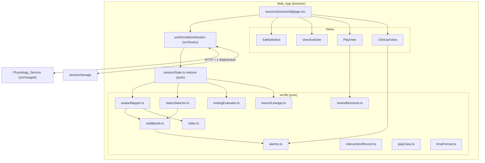
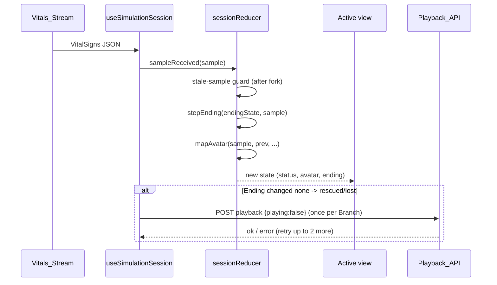

# Design Document: Play Mode

## Overview

Play mode adds a second presentation of one running Session: a friendly cartoon stitched patient, one plain-language status sentence, a goal with an ending, up to three hints, plain intervention labels and a Rewind button. The existing bedside monitor becomes the Clinician_View. Both views read one shared client-side session state, so switching views never touches the network.

The design changes three areas:

1. **Web app (`apps/web/`)**: new pure logic modules in `src/lib/`, one session hook that owns all session state, new Play components, and a refactor of `src/app/session/[sessionId]/page.tsx` that moves the current monitor body into a `ClinicianView` component.
2. **Case files (`cases/`)**: an optional `play` section and optional `playLabel` fields in `adult-tension-pneumothorax.yaml`, and matching definitions in `case-schema.json`, including the `SENeedleDecompression` parameter restriction (Requirement 2.20).
3. **Docs (`docs/`)**: a calibration record produced by a web-side script that drives the existing Physiology_Service API (Requirement 13).

Nothing under `services/physiology/` changes. `GET /sessions/{id}/case` already returns the whole case dictionary, so new optional fields reach the browser as they are.

### Design goals

- **Presentation only.** Every Play cue is derived in the browser from data the service already sends: VitalSigns from the Vitals_Stream, the Case_Definition, Session and Branch metadata, and Checkpoint lists.
- **Pure, testable logic.** Alarm bands, avatar mapping, status selection, ending evaluation, rewind selection, side handling and record storage are pure TypeScript functions with no React, network or clock access. React components only render their results.
- **One source of truth per session.** A single `useSimulationSession` hook owns the Vitals_Stream connection and a pure reducer holds the VitalSigns history, Ending state, Hint_Record, Intervention_Record, playback state and the selected view.
- **No invented clinical content.** Every clinical number, hint text and status sentence in the case file is drafted by the author and marked `TODO(author)` or cited. This design shows them only as placeholders.

### Research findings that shape the design

These facts come from reading the current code at commit `1e71454` (HEAD of `main`):

| Finding | Source | Design consequence |
|---|---|---|
| The Vitals_Stream sends the current Branch's vitals about once per second, also while paused, so consecutive samples can carry the same `simulation_time`. | `services/physiology/main.py`, `vitals_stream` | The Ending_Evaluator ignores samples whose time does not increase (Requirement 6.8). Duplicate samples are harmless. |
| Vitals_Stream messages carry no `branch_id`. | `main.py`, `VitalSigns` model | After a fork, the client resets branch state when the Fork_API responds and applies a stale-sample guard (see "Fork handling"). |
| The Playback_API accepts a speed but the current WebSocket loop advances exactly one 1-second tick per wall-clock second and ignores speed until the core-simulation-loop clock task lands. | `main.py` comment "speed is ignored until the clock task replaces this loop" | The 2x default (Requirement 11.12) is sent as specified; its visible effect depends on the other spec. Calibration runs take about as long in wall-clock time as in Simulation_Time. |
| Automatic Checkpoints are taken every 30 s of Simulation_Time; a Checkpoint "Initial state" exists at 0 s; each accepted Intervention creates a manual Checkpoint "After {label}" at the Intervention's Simulation_Time. | `session_manager.py`, `CHECKPOINT_INTERVAL = 30.0`, `apply_intervention` | Rewind_Moments come from these lists. The "After …" Checkpoint gives the calibration script the exact Simulation_Time of each Decompression. |
| A fork copies the source Checkpoint into the new Branch under a new `checkpoint_id` at the same Simulation_Time, and copies Event_Log entries with `simulation_time <= checkpoint time`. | `session_manager.py`, `fork_branch` | The Branch_Lineage can contain two Checkpoints with the same Simulation_Time; rewind selection keeps one. Active_Interventions use `<=` like the server (Requirement 10.9). |
| `getAlarmState` returns `normal` between `warning.low` and `normal.low`. | `apps/web/src/lib/alarms.ts` | Rewritten under Requirement 15 (see "Alarm_Function change"). |
| `vitest` 1.6.1 is installed; `fast-check` and a direct YAML parser are not dependencies. `js-yaml` is present only as a transitive dependency of ESLint. Node is v22, which has a global `WebSocket` and `fetch`. `vite-node` ships with Vitest. | `apps/web/package.json`, `node_modules` | Add `fast-check` and `yaml` as dev dependencies. Run the calibration script with `vite-node`, so no extra runner is needed. |
| `scripts/validate-case.py` already prints the failing field path (`e.path`) and exits 1 on failure; `case_loader.py` validates with `jsonschema.validate`, which uses the Draft-07 validator named in the schema's `$schema`. | `scripts/validate-case.py`, `services/physiology/case_loader.py` | Requirements 2.17 and 2.18 need only schema changes. Draft-07 `if`/`then` is available for conditional rules. |

### Scope boundary

Changed code and data: `apps/web/**`, `cases/adult-tension-pneumothorax.yaml`, `cases/case-schema.json`. New documentation only: calibration records under `docs/calibration/` (required by Requirement 13) and a manual acceptance checklist `docs/play-mode-acceptance.md`. Not changed: `services/physiology/**`, `scripts/validate-case.py`, `docker-compose.yml`, existing `docs/` files.

Out of scope: the talking patient (the Speech_Bubble_Slot stays empty), scoring, debrief beyond the Ending_Screen, new cases, accounts, any Physiology_Service change.

## Architecture

### Component structure



The page calls `useSimulationSession(sessionId)` once. The hook opens the only Vitals_Stream connection and keeps it for the life of the page. `PlayView` and `ClinicianView` are siblings that receive the same state object and the same action callbacks. Switching views dispatches one `viewSelected` action and writes one sessionStorage key. It sends no request and does not touch the WebSocket, because neither the hook nor the WebSocket effect depends on the view.

### State ownership

| State | Owner | Lifetime | Reset on fork |
|---|---|---|---|
| Vitals_Stream connection | `useSimulationSession` effect keyed by `sessionId` only | page load | no |
| Latest VitalSigns sample, history (last 300 samples for the trend chart) | reducer | page load | yes, cleared |
| Ending state (incremental, O(1) size) and `endingSnapshot` | reducer | per Branch | yes, `none` |
| Avatar_Parameters (previous sample's parameters are kept for missing values) | reducer | per Branch | yes |
| First positive tidal volume of the Session | reducer | page load | no |
| Hint_Record and revealed count | reducer | page load (Requirement 9.4) | no |
| Intervention_Record | reducer, mirrored to sessionStorage | browser tab | no (filtered by lineage) |
| Branch_Lineage and lineage Checkpoint lists | reducer | refreshed after load and fork | recomputed |
| Playing flag, Playback_Speed | reducer | page load | no |
| Selected view | reducer, mirrored to sessionStorage | browser tab | no |
| Rewind_Panel open/loading/error | `PlayView` local state | while mounted | panel closes |

The Ending is never recomputed from the 300-sample history. It is kept as reducer state that each new sample advances, so the 300-sample cap cannot change it (Requirement 6.13).

### Sample flow



### Fork flow

```mermaid
sequenceDiagram
    participant U as Learner
    participant RP as RewindPanel
    participant H as useSimulationSession
    participant F as Fork_API
    participant S as GET /sessions/{id}
    participant C as Checkpoint lists

    U->>RP: select Rewind_Moment
    RP->>H: fork(checkpointId, forkTime)
    H->>F: POST /fork {checkpoint_id}  (timeout 30 s)
    alt success
        F-->>H: BranchMetadata
        H->>S: load Session metadata
        H->>H: dispatch forkSucceeded: clear history, Ending none, hold stretches 0, stale guard armed
        H->>C: reload lineage Checkpoints (async, non-blocking)
        H-->>RP: close panel; Ending_Screen closes because Ending is none
    else error or timeout
        H-->>RP: "Couldn't rewind. Please try again." and re-enable moments
    end
```

### Design decisions

**D1. One hook and a pure reducer for session state.** Alternatives were React context with several `useState` hooks, or an external store. A `useReducer` with a pure reducer keeps all transitions (sample, fork, intervention, hint) in one testable function, which Requirement 12.4 needs for fork handling tests. The hook stays the only place that performs I/O.

**D2. The Ending is an incremental reducer.** `stepEnding(state, sample)` is the only evaluation logic. `evaluateEnding(samples)` is defined as `samples.reduce(stepEnding, initialEndingState(ctx))`. The property test for Requirement 6.13 compares arbitrary chunkings of the same sequence and also compares against an independent reference model written in the test, so the equivalence is checked against more than the fold definition.

**D3. Avatar_Parameters are computed in the reducer, not during render.** The mapper needs the previous parameters for missing values (Requirement 4.25) and the first positive tidal volume (Requirement 4.9). Keeping these in the reducer makes the mapper pure and its inputs explicit (Requirement 4.22).

**D4. Side handling is a separate pure module.** `computeSides` gives Swollen_Sides and Decompressed_Sides; `sideGeometry` gives SVG coordinates for each Anatomical_Side. The mapper uses the first, the Avatar uses the second, and both are tested directly (Requirement 12.2).

**D5. Reduced motion is CSS-only.** All animation runs through CSS keyframes in one stylesheet. A `prefers-reduced-motion: reduce` media query turns animation off and shows the static rate icons. No JavaScript reads the media query, so server and client markup are identical and the Avatar markup stays deterministic (Requirement 3.12).

**D6. The calibration script lives in the web app.** `apps/web/scripts/calibratePlayMode.ts` imports the real `endingEvaluator.ts`, so the calibration record states the Ending that the shipped evaluator returns (Requirement 13.4). Placing it in `apps/web/` keeps the scope boundary: no new file under `scripts/` or `services/`.

**D7. `yaml` (eemeli/yaml) rather than `js-yaml` for case-content tests.** `yaml` exposes comments on AST nodes, which lets a test check the `TODO(author)` rule in Requirement 2.15 precisely. `js-yaml` drops comments, and it is only a transitive dependency today.

## Components and Interfaces

### File layout

```
apps/web/
├── vitest.config.ts                      # new: node env, @ alias, automatic JSX
├── scripts/
│   └── calibratePlayMode.ts              # new: Requirement 13 calibration run
└── src/
    ├── app/
    │   ├── globals.css                   # + Play palette, focus ring, avatar keyframes
    │   └── session/[sessionId]/page.tsx  # refactored: hook + SafetyNotice + ViewSwitcher + views
    ├── hooks/
    │   ├── useSimulationSession.ts       # new: I/O, WebSocket, timers, sessionStorage
    │   └── useFocusTrap.ts               # new: Tab wrap, Escape, focus return
    ├── lib/
    │   ├── alarms.ts                     # changed: Requirement 15 semantics
    │   ├── api.ts                        # changed: optional per-request timeout
    │   ├── vitals.ts                     # new: vital name <-> VitalSigns field map
    │   ├── vitalBands.ts                 # new: Vital_Band, Overall_Status
    │   ├── avatarMapper.ts               # new
    │   ├── sides.ts                      # new: Swollen/Decompressed sides, side geometry
    │   ├── statusSelector.ts             # new
    │   ├── endingEvaluator.ts            # new
    │   ├── branchLineage.ts              # new: lineage, Active_Interventions
    │   ├── rewindMoments.ts              # new: selection + labels
    │   ├── interventionRecord.ts         # new: sessionStorage persistence
    │   ├── playCase.ts                   # new: play button text, condition disjointness
    │   ├── timeFormat.ts                 # new: M:SS, remaining time
    │   ├── sessionState.ts               # new: pure reducer
    │   └── *.test.ts                     # Vitest unit and property tests
    ├── test/
    │   └── pbt.ts                        # shared fast-check seed and run count
    ├── components/
    │   ├── ClinicianView.tsx             # new: current monitor body moved here
    │   ├── PlayView.tsx                  # new
    │   ├── ViewSwitcher.tsx              # new
    │   ├── SafetyNotice.tsx              # new: sticky top bar
    │   ├── StitchedPatient.tsx           # new: SVG Avatar + Speech_Bubble_Slot
    │   ├── StatusLine.tsx                # new: Overall_Status badge + live Status_Sentence
    │   ├── GoalBar.tsx                   # new: Goal_Text + remaining-time bar
    │   ├── HintPanel.tsx                 # new
    │   ├── RewindPanel.tsx               # new
    │   ├── EndingScreen.tsx              # new
    │   ├── EndingBanner.tsx              # new: Clinician_View banner (Requirement 7.8)
    │   ├── Toast.tsx                     # new: timed plain-language messages
    │   ├── PlaybackControls.tsx          # reused; small prop additions
    │   ├── InterventionPanel.tsx         # reused; label function and disabled text
    │   ├── VitalSign.tsx                 # reused; accepts no alarm state (neutral)
    │   ├── VitalsTrendChart.tsx          # unchanged
    │   └── Timeline.tsx                  # unchanged
    └── types/index.ts                    # + Play types, timeline in CaseData
```

`src/hooks/` is new. The repository has no hooks folder yet, and keeping hooks out of `src/lib/` keeps `lib` free of React and I/O.

### Pure logic modules (`src/lib/`)

All functions below are synchronous and side-effect free unless stated. None reads `Date`, `window`, `fetch` or storage. Wall-clock values enter as arguments.

#### `vitals.ts`

```ts
export const VITAL_NAMES = ['heartRate', 'respiratoryRate', 'spO2',
  'meanArterialPressure', 'etCO2', 'tidalVolume'] as const;
export type VitalName = typeof VITAL_NAMES[number];

// Case vital name -> VitalSigns field (units as the Vitals_Stream reports; SpO2 is a fraction)
export const VITAL_FIELD: Record<VitalName, keyof VitalSigns> = {
  heartRate: 'heart_rate', respiratoryRate: 'respiratory_rate', spO2: 'spo2',
  meanArterialPressure: 'mean_arterial_pressure', etCO2: 'etco2', tidalVolume: 'tidal_volume',
};

/** Finite number or undefined. Missing, null, NaN and ±Infinity all give undefined. */
export function readVital(sample: Partial<VitalSigns> | null, vital: VitalName): number | undefined;
```

#### `alarms.ts` — Alarm_Function change (Requirement 15)

Before (current code): critical is checked, then warning, then `normal` is returned. The `normal` bounds are never read, so a value between `warning.low` and `normal.low` is `normal`.

After:

```ts
const below = (v: number, b?: number) => b !== undefined && v < b;   // strict (15.4)
const above = (v: number, b?: number) => b !== undefined && v > b;

export function getAlarmState(value: number, t: AlarmThreshold): AlarmState {
  const c = t.critical, w = t.warning, n = t.normal;            // any may be absent (15.5)
  if (below(value, c?.low) || above(value, c?.high)) return 'critical';            // 15.1
  if (below(value, n?.low) || above(value, n?.high) ||
      below(value, w?.low) || above(value, w?.high)) return 'warning';             // 15.2
  return 'normal';                                                                  // 15.3
}
```

`getAlarmColor` and `getAlarmBgColor` are unchanged. `AlarmThreshold.normal` becomes optional in the type so the function can handle a missing `normal` object (15.5). The schema still requires it. Callers never pass a non-finite value: the view code and `vitalBands.ts` treat missing values before calling.

Effect on the current case thresholds (values chosen only to show the band change; not clinical claims):

| Value | Before | After |
|---|---|---|
| SpO2 0.93 (`warning.low` 0.92, `normal.low` 0.95) | normal | warning |
| HR 110 (`normal.high` 100, `warning.high` 120) | normal | warning |
| MAP 105 (`normal.high` 100, `warning.high` 110) | normal | warning |
| RR 12 (`normal.low` 12) | normal | normal (strict comparison) |
| Baseline HR 72, RR 12, SpO2 0.974, MAP 95, EtCO2 36, TV 535 | normal | normal (15.9) |

**Coordination with core-simulation-loop.** This changes the colours of that spec's Monitor_UI (its Requirements 8.3 and 8.4): readouts between the normal and warning limits turn amber. The play-mode spec owns `getAlarmState`, as recorded in the requirements ("Dependencies and confirmed decisions", item 3). The core-simulation-loop session must not edit `alarms.ts` except through Requirement 15, and the alarm task in this spec should land as one small commit so the other session can rebase onto it. The `ClinicianView` and the Play logic both import this one function (Requirement 15.7).

#### `vitalBands.ts`

```ts
export type Direction = 'low' | 'high' | 'none';
export interface VitalBand { state: AlarmState; direction: Direction }

export function getVitalBand(value: number, t: AlarmThreshold): VitalBand;
export function thresholdsFor(alarms: AlarmThresholds, vital: VitalName): AlarmThreshold | undefined;
export function overallStatus(bands: Partial<Record<VitalName, VitalBand>>): AlarmState;
```

`getVitalBand` sets `state = getAlarmState(value, t)`. If `state` is `normal`, direction is `none`. Otherwise direction is `low` when the value is below any present `critical.low`, `warning.low` or `normal.low`, and `high` otherwise; the value must then be above a present high bound, because a non-`normal` state requires crossing some bound. If a malformed threshold object makes a value both below a low bound and above a high bound, `low` wins (documented tie rule). `overallStatus` returns the maximum by `normal < warning < critical`, and `normal` for an empty map.

#### `avatarMapper.ts`

```ts
export type SkinTone = 'healthy' | 'pale' | 'cyanotic';
export type Side = 'Left' | 'Right';

// UI display constants (not clinical values)
export const BREATH_DEPTH_MIN = 0.25;
export const BREATH_DEPTH_MAX = 1.75;
export const BREATH_DEPTH_DEFAULT = 1.0;
export const DEFAULT_BREATH_PERIOD_S = 4;     // shown until a respiratory rate arrives
export const DEFAULT_BEAT_PERIOD_S = 1;       // shown until a heart rate arrives

export interface AvatarInput {
  sample: Partial<VitalSigns> & { simulation_time: number };
  alarms: AlarmThresholds;
  play: PlaySection;
  scheduledInsults: ScheduledInsult[];
  activeInterventions: InterventionRecordEntry[];
  previous: AvatarParameters | null;          // previous sample on the current Branch
  firstPositiveTidalVolumeMl: number | null;  // first sample of the Session with TV > 0
}

export function mapAvatar(input: AvatarInput): AvatarParameters;
```

Rules, in order:

| Field | Rule | Requirement |
|---|---|---|
| `bands[v]` for each vital with thresholds | `getVitalBand(value)` if `readVital` gives a number; else `previous.bands[v]`; else `{normal, none}` | 4.1, 4.2, 4.25 |
| `skinTone` | from `bands.spO2.state`: normal → `healthy`, warning → `pale`, critical → `cyanotic` | 4.3–4.5 |
| `breathing` | RR > 0 → `{stopped:false, periodS: 60/RR}`; RR ≤ 0 → `{stopped:true, periodS: previous or default}`; RR missing → previous or `{false, DEFAULT_BREATH_PERIOD_S}` | 4.6, 4.7, 4.25 |
| `breathing.depth` | `clamp(TV / ref, MIN, MAX)` where `ref = play.avatar.referenceTidalVolumeMl` if defined, else `firstPositiveTidalVolumeMl`; `BREATH_DEPTH_DEFAULT` while no reference exists; previous depth when TV is missing | 4.8, 4.9, 4.25 |
| `heartbeat` | HR > 0 → `{stopped:false, periodS: 60/HR}`; HR ≤ 0 → stopped; missing → previous or default | 4.10, 4.24, 4.25 |
| `sweating` | `bands.meanArterialPressure.state !== 'normal' || bands.heartRate.state === 'critical'` | 4.11, 4.12 |
| `swollenSides`, `decompressedSides` | `computeSides(sample.simulation_time, scheduledInsults, activeInterventions)` | 4.13–4.18 |
| `overallStatus` | `overallStatus(bands)` | 4.19 |

The mapper takes no Playback_Speed input, so periods are in wall-clock seconds and identical at 1x, 2x and 4x (Requirements 4.6, 4.10). When the first positive tidal volume is not yet known, the reducer passes `null`; it then records the first sample with TV > 0 before calling the mapper for that sample, so that sample's depth is 1.0 clamped.

#### `sides.ts`

```ts
export function computeSides(
  simulationTime: number,
  insults: ScheduledInsult[],
  active: InterventionRecordEntry[],
): { swollenSides: Side[]; decompressedSides: Side[] };   // each sorted ['Left','Right'] order, no duplicates

export type ViewerHalf = 'viewerLeft' | 'viewerRight';
export function viewerHalf(side: Side): ViewerHalf;      // Left -> 'viewerRight', Right -> 'viewerLeft'

export interface SideGeometry {               // SVG user units in a 200 x 280 viewBox, centre x = 100
  chest: { x: number; y: number; width: number; height: number };
  swollenChest: { x: number; y: number; width: number; height: number };
  needle: { x1: number; y1: number; x2: number; y2: number };
  bandage: { x: number; y: number; width: number; height: number };
}
export function sideGeometry(side: Side): SideGeometry;
```

- A `SETensionPneumothorax` insult with `simulationTime >= timeSeconds` adds its `parameters.side` to Swollen_Sides unless `active` contains an `SENeedleDecompression` entry with the same side and `simulationTime >= insult.timeSeconds` (4.13, 4.14, 4.16, 4.18).
- Decompressed_Sides are the sides of all `SENeedleDecompression` entries in `active` (4.15). `active` is already limited to the Branch_Lineage by `branchLineage.ts`.
- `sideGeometry('Left')` returns rectangles whose x ranges lie in `[100, 200]`; `sideGeometry('Right')` in `[0, 100]` (3.7). Every side-specific SVG element in `StitchedPatient` is placed only through `sideGeometry`. The swollen chest rectangle is wider and taller than the normal chest rectangle on the same side and stays in the same half (4.17).

Requirement 4.18 is kept as written until the Requirement 13.11 calibration scenario answers open question 1, item d. If that scenario shows the early Decompression prevents the pneumothorax, the rule changes in one place, `computeSides`.

#### `statusSelector.ts`

```ts
export function selectStatus(
  sample: Partial<VitalSigns> | null,
  alarms: AlarmThresholds,
  play: PlaySection,
): string;
```

- `sample === null` → `play.status.defaultSentence` (5.6).
- For each rule in Case_Definition order, the rule matches when every `when` item matches. An item matches when the named vital has thresholds and a finite value, `getVitalBand(...).state === item.band`, and `item.direction` is absent or equals the band's direction (5.2–5.4).
- The first matching rule's `sentence` is returned unchanged; otherwise `defaultSentence` (5.5, 5.7).

Unlike the Avatar_Mapper, the selector does not carry previous values: a missing vital makes the condition not match (5.4).

#### `endingEvaluator.ts`

```ts
export type Ending = 'none' | 'rescued' | 'lost';

export interface EndingContext {
  play: PlaySection | undefined;
  rescueFromTime: number;        // earliest Scheduled_Insult timeSeconds, or 0 if none (6.3)
}

export interface EndingState {
  ending: Ending;
  endedAt: number | null;        // Simulation_Time of the sample that changed the Ending
  lastTime: number | null;       // last accepted sample time
  rescueStart: number | null;    // start of the current rescue stretch
  lostStarts: (number | null)[]; // one per Lost_Condition group
}

export function buildEndingContext(caseData: CaseData): EndingContext;
export function initialEndingState(ctx: EndingContext): EndingState;
export function stepEnding(ctx: EndingContext, s: EndingState, sample: Partial<VitalSigns> & { simulation_time: number }): EndingState;
export function evaluateEnding(ctx: EndingContext, samples: Sample[]): EndingState; // = fold of stepEnding
export function conditionHolds(c: VitalCondition, sample: Partial<VitalSigns>): boolean;
```

`stepEnding` algorithm:

1. If `ctx.play` is undefined or `s.ending !== 'none'`, return `s` (6.2, 6.10).
2. Let `t = sample.simulation_time`. If `t` is not finite, or `s.lastTime !== null && t <= s.lastTime`, return `s` unchanged (6.8).
3. `lastTime = t`.
4. Rescue: `holds = t >= ctx.rescueFromTime && all(rescued.conditions, c => conditionHolds(c, sample))`. If `holds`, `rescueStart = rescueStart ?? t`, else `rescueStart = null` (6.3, 6.6). `rescued = rescueStart !== null && t - rescueStart >= rescued.holdSeconds` (6.7).
5. Lost groups: for each group `i`, the same pattern with `lostStarts[i]`; `lostHit` if any group's stretch is at least its `holdSeconds` (6.4, 6.6).
6. `timeHit = timeLimitSeconds !== undefined && t >= timeLimitSeconds` (6.5).
7. `ending = rescued ? 'rescued' : (lostHit || timeHit) ? 'lost' : 'none'`, so rescue wins on the same sample (6.9). If the ending changes, `endedAt = t`.

`conditionHolds` compares `readVital(sample, c.vital)` with `c.value` using `c.op`; a missing or non-finite value gives `false` (6.15, 6.16). A one-sample stretch measures 0 s, and `holdSeconds > 0` is enforced by the schema, so a single sample never completes a hold.

#### `branchLineage.ts`

```ts
export interface LineageSegment {
  branchId: string;
  upperBound: number;              // Infinity for the current Branch; fork time of the child otherwise
  forkCheckpointId?: string;       // checkpoint this Branch was forked from
  forkTime?: number;               // simulation_time of that checkpoint
}

export function buildLineage(
  branches: BranchMetadata[],
  currentBranchId: string,
  checkpointsByBranch: Record<string, CheckpointMetadata[]>,
): LineageSegment[];               // current first, then parent, grandparent, ...

export function activeInterventions(
  record: InterventionRecordEntry[],
  lineage: LineageSegment[],
): InterventionRecordEntry[];      // entries whose branchId is in the lineage and simulationTime <= that segment's upperBound
```

The fork time of a Branch is the `simulation_time` of the Checkpoint named by its `forked_from_checkpoint`, looked up in the parent's list. If that Checkpoint is missing from the list, the earliest Checkpoint of the child is used, since the service copies the fork Checkpoint into the child at the same Simulation_Time. A cycle or a missing parent stops the walk (defensive). Before the Checkpoint lists load, the lineage is the current Branch alone.

Active_Interventions use `<=` at the fork time, matching the service, which copies Event_Log entries with `simulation_time <= checkpoint time` into the new Branch (Requirement 10.9).

#### `rewindMoments.ts`

```ts
export interface LineageCheckpoint { checkpoint: CheckpointMetadata; branchId: string; depth: number } // depth 0 = current
export interface RewindMoment { checkpointId: string; simulationTime: number; label: string }

export function selectRewindCheckpoints(args: {
  checkpoints: LineageCheckpoint[];          // already limited to each segment's upperBound
  latestSampleTime: number | null;
  timeLimitSeconds?: number;
  lineageInterventions: InterventionRecordEntry[];
}): LineageCheckpoint[];

export function labelRewindMoment(
  checkpoint: CheckpointMetadata,
  lineageInterventions: InterventionRecordEntry[],
  interventions: Intervention[],
): string;
```

`selectRewindCheckpoints`:

1. Return `[]` if `latestSampleTime` is `null` (10.12).
2. Eligible: `simulation_time < latestSampleTime` and, if defined, `< timeLimitSeconds` (10.2, 10.3).
3. Remove duplicates: first by `checkpoint_id`, then by equal `simulation_time`, keeping the copy with the lowest `depth` (closest to the current Branch). Two Checkpoints with the same time in one lineage are the fork copy and its source, which hold the same saved state, so listing both would show the learner two identical moments.
4. Sort by `simulation_time` descending; ties by `depth` then `checkpoint_id` for a stable order.
5. Take the first 5.
6. If `lineageInterventions` is non-empty, let `I` be the largest entry `simulationTime`. Find the newest eligible Checkpoint with `simulation_time < I`. If it is not in the 5, replace the last (oldest) of the 5 with it. The list stays sorted because that Checkpoint is older than all others kept (10.4).

`labelRewindMoment` uses `formatMSS` and the first matching rule of Requirement 10.5. For the "before you chose" rule, it picks the earliest lineage entry with `simulationTime > checkpoint.simulation_time` and shows `playButtonText(intervention)`, which falls back to the clinical `label` when the Play_Label is missing or blank.

#### `timeFormat.ts`

```ts
export function formatMSS(seconds: number): string;  // floor; minutes unpadded; seconds 2 digits; negative -> "0:00"
export function remainingSeconds(timeLimitSeconds: number, latestTime: number | null): number; // max(0, limit - (latest ?? 0))
```

The existing `PlaybackControls` and `Timeline` keep their own formatter; they may switch to `formatMSS` because the output is identical.

#### `interventionRecord.ts`

```ts
export interface InterventionRecordEntry {
  interventionId: string; action: string; side?: Side; simulationTime: number; branchId: string;
}
export const recordKey = (sessionId: string) => `stitched-patient:intervention-record:${sessionId}`;
export function serializeRecord(record: InterventionRecordEntry[]): string;   // {"v":1,"entries":[...]}
export function parseRecord(raw: string | null): InterventionRecordEntry[];   // [] for null, bad JSON, wrong version, or any invalid entry
export function loadRecord(storage: Pick<Storage, 'getItem'>, sessionId: string): InterventionRecordEntry[];
export function saveRecord(storage: Pick<Storage, 'setItem'>, sessionId: string, record: InterventionRecordEntry[]): void;
```

`loadRecord` and `saveRecord` catch storage exceptions (private mode, quota) and fall back to `[]` or to an in-memory record only (8.14). `parseRecord` validates every field and drops the whole record if any entry is invalid, so a partially corrupted record cannot produce wrong sides.

#### `playCase.ts`

```ts
export function playButtonText(i: Intervention): string;            // playLabel if it has a non-whitespace char, else label (8.2, 8.3)
export function conditionsDisjoint(a: VitalCondition, b: VitalCondition): boolean; // same vital and no number satisfies both (6.14)
export function interventionSide(i: Intervention): Side | undefined;
```

`conditionsDisjoint` treats each condition as a half-line. A lower-bounded condition (`>`, `>=`) and an upper-bounded one (`<`, `<=`) are disjoint when the lower value is above the upper value, or the values are equal and at least one operator is strict. Two conditions bounded in the same direction are never disjoint.

#### `sessionState.ts` — the reducer

```ts
export type View = 'play' | 'clinician';

export interface SessionUiState {
  caseStatus: 'loading' | 'loaded' | 'failed';
  caseData: CaseData | null;
  caseError: string | null;
  session: SessionMetadata | null;
  currentBranchId: string | null;
  lineage: LineageSegment[];
  checkpointsByBranch: Record<string, CheckpointMetadata[]>;
  connected: boolean;
  latestSample: VitalSigns | null;          // latest accepted sample on the current Branch
  history: VitalSigns[];                    // last 300, for the trend chart
  staleGuard: { maxTime: number } | null;   // armed after a fork
  firstPositiveTidalVolumeMl: number | null;
  avatar: AvatarParameters;
  endingCtx: EndingContext;
  ending: EndingState;
  endingSnapshot: AvatarParameters | null;  // Avatar at the sample that changed the Ending (7.3)
  hintsRevealed: number;
  hintRecord: HintRecordEntry[];
  interventionRecord: InterventionRecordEntry[];
  playing: boolean;
  speed: PlaybackSpeed;
  view: View;
}

export type SessionAction =
  | { type: 'caseLoaded'; caseData: CaseData; storedView: View | null }
  | { type: 'caseFailed'; message: string }
  | { type: 'sessionLoaded'; session: SessionMetadata }
  | { type: 'checkpointsLoaded'; byBranch: Record<string, CheckpointMetadata[]> }
  | { type: 'connectionChanged'; connected: boolean }
  | { type: 'sampleReceived'; sample: VitalSigns }
  | { type: 'interventionRecordRestored'; record: InterventionRecordEntry[] }
  | { type: 'interventionSucceeded'; entry: InterventionRecordEntry }
  | { type: 'forkSucceeded'; session: SessionMetadata; newBranchId: string; forkTime: number }
  | { type: 'hintRevealed'; wallClockTime: string }
  | { type: 'viewSelected'; view: View }
  | { type: 'playbackChanged'; playing?: boolean; speed?: PlaybackSpeed };

export function sessionReducer(state: SessionUiState, action: SessionAction): SessionUiState;
export function initialSessionState(): SessionUiState;
```

Key transitions:

- **`caseLoaded`**: stores the case, builds `endingCtx`, and sets `view` to `storedView` if one exists and the case has a Play_Section, to `clinician` if the case has no Play_Section, and to `play` otherwise (1.1, 1.2, 1.9).
- **`caseFailed`**: `view = 'clinician'`, `caseStatus = 'failed'`; session, branch and connection fields are untouched (1.11).
- **`sampleReceived`**:
  1. If `staleGuard` is armed and `sample.simulation_time > staleGuard.maxTime`, drop the sample. Otherwise disarm the guard.
  2. Set `latestSample`, append to `history` (keep the last 300).
  3. Record `firstPositiveTidalVolumeMl` if still `null` and TV > 0.
  4. `avatar = mapAvatar({ previous: state.avatar, ... })`.
  5. `ending = stepEnding(...)`. If it changed from `none`, set `endingSnapshot` to the `avatar` computed in step 4 for this sample.
- **`interventionSucceeded`**: appends the entry, then recomputes only the side fields of `avatar` with `computeSides(latestSample time, ...)`, so a Decompression shows without waiting for the next sample (4.14, 4.20).
- **`forkSucceeded`**: sets `session`, `currentBranchId`, and recomputes `lineage` with the known `forkTime`. It clears `latestSample` and `history`, resets `ending` to `initialEndingState`, clears `endingSnapshot`, and arms `staleGuard = { maxTime: forkTime + STALE_TOLERANCE_S }`. It sets `avatar = mapAvatar({ sample: { simulation_time: forkTime }, previous: null, ... })`, which gives default vital-derived fields and correct sides for the fork point (4.15, 4.20). Hint state, Intervention_Record, playback state and view are kept (6.11, 9.4, 10.8).
- **`hintRevealed`**: if `hintsRevealed < hints.length`, increments it and appends `{ hintIndex: hintsRevealed + 1, branchId, wallClockTime, simulationTime }`, where `simulationTime` is `latestSample.simulation_time`, else the current Branch's `forkTime`, else 0 (9.2, 9.5).
- A failed fork has no action, so state stays identical (6.17).

`STALE_TOLERANCE_S = 5` is a UI constant. It drops Vitals_Stream messages that the service sent for the old Branch but that arrive after the Fork_API response. A new-Branch sample starts at the fork time, and the first one usually arrives within one tick. The guard is disarmed by the first accepted sample, so it cannot hide a long run on the new Branch.

### Session hook (`src/hooks/useSimulationSession.ts`)

```ts
export function useSimulationSession(sessionId: string): {
  state: SessionUiState;
  activeInterventions: InterventionRecordEntry[];         // memoised
  statusSentence: string | null;                          // null when no Play_Section
  actions: {
    selectView(view: View): void;                         // no network (1.5)
    setPlaying(playing: boolean): Promise<void>;
    setSpeed(speed: PlaybackSpeed): Promise<void>;
    applyIntervention(id: string): Promise<'ok' | 'error'>;
    revealHint(): void;
    loadLineageCheckpoints(): Promise<'ok' | 'error'>;    // used by the Rewind_Panel
    fork(checkpointId: string, forkTime: number): Promise<'ok' | 'error'>;
  };
  notices: { pauseFailed: boolean };
}
```

Effects and their dependencies:

| Effect | Dependencies | Behaviour |
|---|---|---|
| Load case | `sessionId` | `api.getCaseData(sessionId, { timeoutMs: 10_000 })` → `caseLoaded` with `storedView` from sessionStorage key `stitched-patient:view:{sessionId}`, or `caseFailed`. |
| Load session | `sessionId` | `api.getSession` → `sessionLoaded`, then `loadLineageCheckpoints()`. |
| Restore record | `sessionId` | `loadRecord(sessionStorage, sessionId)` → `interventionRecordRestored`, before Active_Interventions are first used (8.13). |
| Vitals_Stream | `sessionId` | Opens one WebSocket; dispatches `connectionChanged` and `sampleReceived`; closes on unmount. It does not depend on `view`, so a view switch cannot reconnect (1.4, 1.5). |
| Pause on Ending | `ending.ending`, `currentBranchId` | When the Ending leaves `none`, and `pausedBranchRef.current !== currentBranchId`, sets the ref and calls `controlPlayback(sessionId, false)` with a 5 s timeout; on error or timeout, retries at most 2 more times 2 s apart; on success dispatches `playbackChanged({playing:false})`; if all fail sets `notices.pauseFailed` (7.1, 7.10). The ref makes the request happen once per Branch, also under React Strict Mode double effects. |
| Default 2x | `view`, `caseStatus` | When `view === 'play'`, the case is loaded and sessionStorage has no `stitched-patient:default-speed-sent:{sessionId}`, writes that key first, then sends `controlPlayback(sessionId, undefined, '2x')` with a 5 s timeout. On success dispatches `playbackChanged({speed:'2x'})`; on failure keeps the earlier speed and does not retry (11.12, 11.13). Writing the key first means later view switches and failures never resend. |

`applyIntervention` keeps `pendingRef` true while a request is in flight. It calls the Intervention_API with the same `intervention_id` and no extra parameters, which is what the Clinician_View sends today (8.5). Timeout is 10 s. On success, it builds the entry from the case Intervention (`action`, `side`), the latest sample's Simulation_Time and the current branch_id, dispatches `interventionSucceeded`, and saves the record to sessionStorage (8.6, 8.12). Both views use this action, so Clinician_View interventions also appear on the Avatar.

The retry and once-only rules live in two small pure helpers exported from the hook module, `runPauseWithRetry(send, sleep)` and `shouldSendDefaultSpeed(storage, sessionId, view, caseStatus)`, so they can be tested with mocks and fake timers without a DOM.

`fork` sends the Fork_API request with a 30 s timeout. On success it loads Session metadata, dispatches `forkSucceeded`, then reloads lineage Checkpoints without blocking. Intervention buttons are disabled while a fork is pending, so a new Intervention_Record entry always carries the branch_id that the Intervention_API applied it to.

### API client change (`src/lib/api.ts`)

`fetchApi` gains an optional `timeoutMs`. It uses an `AbortController` and throws `ApiError(0, 'timeout')` when the timer fires. The function signatures gain an optional trailing `{ timeoutMs }` argument; existing callers keep working.

| Call | Timeout | Source |
|---|---|---|
| `getCaseData` | 10 s | 1.11 |
| `applyIntervention` | 10 s | 8.8 |
| `forkBranch` | 30 s | 10.10 |
| `controlPlayback` (pause after Ending, default 2x) | 5 s | 7.10, 11.13 |
| `getCheckpoints` (Rewind_Panel) | 10 s | UI constant |

### Session page refactor

`src/app/session/[sessionId]/page.tsx` becomes:

```tsx
export default function SessionPage() {
  const { sessionId } = useParams() as { sessionId: string };
  const sim = useSimulationSession(sessionId);
  return (
    <>
      <SafetyNotice />                                    {/* sticky, z-50, never covered (1.8) */}
      <main className="pt-[var(--notice-h)] ...">
        <ViewSwitcher view={sim.state.view} playAvailable={...} playUnavailableReason={...}
                      disabled={sim.state.caseStatus === 'loading'} onSelect={sim.actions.selectView} />
        {sim.state.caseStatus === 'loading' ? <LoadingIndicator />                      /* 1.10 */
          : sim.state.view === 'play' ? <PlayView sim={sim} />
          : <ClinicianView sim={sim} />}
      </main>
    </>
  );
}
```

- **`ClinicianView`** holds the current header, playback controls, vitals grid, trend chart, intervention panel and Timeline unchanged, but reads all data from `sim`. It adds `EndingBanner` when the Ending is not `none` (7.8). When `caseData` is `null` because loading failed, it shows the six readouts in a neutral style with no alarm colour and replaces the intervention panel with "The case could not be loaded." (1.11). `VitalSign` gets an optional `alarmState`; when absent it uses the neutral grey style.
- The existing "Connecting to simulation..." screen shown while the WebSocket is not open stays as it is. It replaces only the view content, not the hook, so no state is lost while it shows.
- The header warning chip in the current page is replaced by `SafetyNotice`, so the notice appears exactly once at the top in both views.

### View switcher (`ViewSwitcher.tsx`)

A two-option segmented control (`role="radiogroup"`, options "Play" and "Clinician", `aria-checked` on the selected one, visible text plus an underline icon for the selected state).

- No Play_Section: the Play option stays visible with `aria-disabled="true"` and the text "Play mode is not available for this case". Activating it does nothing (1.2).
- Case load failed: the Play option is disabled with "Play mode is unavailable: the case could not be loaded." (1.11).
- While the case is loading, both options are disabled (1.10).
- `selectView` dispatches `viewSelected` and writes `stitched-patient:view:{sessionId}`. React renders the other view from state already in memory, well within 500 ms (1.6).

### Play view (`PlayView.tsx`)

Layout at 1280×720 (Requirement 11.7). The Safety_Notice bar is about 40 px tall; the view uses a two-column grid inside `height: calc(100vh - var(--notice-h))` with `overflow: hidden` at widths ≥ 1024 px. Below 1024 px the columns stack and the page scrolls; the Safety_Notice stays sticky.

```
┌──────────────────────────── Safety_Notice (sticky) ────────────────────────────┐
│ [Play | Clinician]                                        ▶ Pause   1x 2x 4x   │
├─────────────────────────────────┬──────────────────────────────────────────────┤
│  (speech-bubble headroom)       │  Goal: <Goal_Text>                           │
│        StitchedPatient          │  [■■■■■■□□□□] 3:20 left   (if Time_Limit)    │
│                                 │  What can you do?                            │
│  [▲ Worried]  <Status_Sentence> │  [ <Play_Label left> ] [ <Play_Label right> ]│
│  (HR/RR static icons, reduced   │  [ Hint (3 left) ]   [ ⟲ Rewind ]            │
│   motion only)                  │  Hint 1 … Hint 3 (revealed, in order)        │
└─────────────────────────────────┴──────────────────────────────────────────────┘
```

Focus order follows this visual order: View_Switcher, play/pause, speeds, Intervention buttons, Hint button, Rewind button (11.2). Visual order and DOM order are the same, so the default Tab order is correct without `tabindex` values.

Elements:

- **Patient column**: `StitchedPatient` with `params = state.avatar` and `statusSentence`; then `StatusLine`.
- **`StatusLine`**: an Overall_Status badge outside the live region (circle with check "OK", triangle "Worried", octagon "Danger"; 4.19, 11.1), and a `<p aria-live="polite">` that contains only the Status_Sentence text (5.11). React only updates the text node when the string changes, so an unchanged sentence is not announced again (5.13). The sentence wraps; no `truncate` or `line-clamp` (5.1).
- **`GoalBar`**: Goal_Text in full (5.14), and when `timeLimitSeconds` exists, a `<progress>` with a visible `M:SS left` label from `remainingSeconds` (5.15).
- **Playback controls**: the existing `PlaybackControls` with a new `variant="play"` prop for the Play palette. It already shows text labels ("Pause"/"Play") and highlights the selected speed; the selected speed button also gets `aria-pressed` and a check mark so the state does not rely on colour (11.9).
- **Intervention buttons**: the existing `InterventionPanel` with two new optional props, `getLabel` (Play uses `playButtonText`; the Clinician_View keeps `label`, 8.2–8.4) and `disabledReason`. Buttons are disabled while disconnected, while an Intervention or fork request is pending, or while the Ending is not `none` (7.7, 8.9, 8.10). Disabled buttons show a lock icon and the text "Not available right now" (11.11).
- **`Toast`**: success "Done: <button text>." for 3 s (8.7); error "That didn't work. Please try again." for 3 s (8.8); "The simulation could not be paused." while `notices.pauseFailed` (7.10). Toasts use `role="status"` and do not take focus.
- **`HintPanel`** and **`RewindPanel`**: below.
- **`EndingScreen`**: rendered when `ending !== 'none'` and the view is Play (7.2, 7.11).

### Stitched patient Avatar (`StitchedPatient.tsx`)

```tsx
interface StitchedPatientProps {
  params: AvatarParameters;
  statusSentence: string;                 // accessible name (3.8)
  speech?: string;                        // Speech_Bubble_Slot; empty for this spec
  variant?: 'live' | 'rescued' | 'lost';
}
```

**Structure.** A wrapper `<div class="sp-avatar">` with a fixed aspect ratio contains:

1. A speech-bubble headroom band at the top, always reserved and always the same height. When `speech` has a non-whitespace character, an HTML bubble with a tail is absolutely positioned inside the band. Text wraps with `overflow-wrap: anywhere` and is never clipped (3.9). When `speech` is empty or whitespace, nothing renders in the band, so layout and size do not change (3.10). The face and chest sit below the band, so the bubble's box cannot overlap them (3.11). The band height is set so 200 characters fit at the narrowest supported width (320 px) with a `clamp()` font size; this is checked manually at 320 px and 1280 px.
2. Exactly one `<svg role="img" aria-label={statusSentence} viewBox="0 0 200 280">` with no `<image>`, no `href` to files or URLs, and no `id`/`url(#…)` references. Two Avatars can be on screen at once (Play_View and Ending_Screen), so ids would collide (3.1).
3. The HR and RR static rate icons ("slow", "normal", "fast" from the Vital_Band direction), hidden by CSS unless `prefers-reduced-motion: reduce` (4.21).

**Artwork (original, drawn for this project; 3.2, 3.4, 3.5, 3.6).**

- A small, round-headed patchwork person: rounded head (not flat-topped), large friendly eyes, small smile, a tuft of hair.
- Skin made of 3–4 patches in soft warm tones, separated by seams with at least three visible cross-stitch marks (`×` pairs).
- Exactly two short rounded bolts, one on each side of the neck.
- A light blue hospital gown (`#A9D6F5`) covering the torso, with a small stitched-heart patch on the chest that pulses with the heartbeat.
- No blood, wounds, bone, fangs or skulls in any state. Skin is never green and the head is never flat, to stay clear of the 1931 Universal design; the acceptance reviewer records this confirmation (3.6).

**Palette (UI constants).** Background deep purple `#2E1A47`, accent pumpkin orange `#FF7A1A`, text off-white `#FFF7EC`, focus ring `#FFD166` (3.3). Orange on purple and purple on orange both have a contrast ratio of about 6:1 (≥ 4.5:1 for text, 11.8).

| Skin_Tone | Patch fill | Lips |
|---|---|---|
| `healthy` | warm peach tones | rose |
| `pale` | desaturated beige-grey tones | pale pink |
| `cyanotic` | the `pale` tones | blue `#5B7BD5` |

**Parameter-driven drawing.**

| Parameter | Drawing |
|---|---|
| `breathing` | Chest group class `sp-breathe` with style `--sp-breath-period: {periodS}s; --sp-breath-depth: {depth}`; class `sp-breath-stopped` when stopped. |
| `heartbeat` | Heart patch class `sp-beat` with `--sp-beat-period: {periodS}s`; `sp-beat-stopped` when stopped. |
| `sweating` | Three sweat drops on the forehead (static shapes; a slow drip animation when motion is allowed). |
| `swollenSides` | For each side, the chest half uses `sideGeometry(side).swollenChest` instead of `.chest`: a larger outline (4.17). |
| `decompressedSides` | A small needle line and a bandage rectangle from `sideGeometry(side)` (4.23). |
| `overallStatus` | Shown by `StatusLine`, next to the sentence (4.19, 11.1). |
| `variant='lost'` | Patch groups get `sp-unstitch`, which moves them a few units apart over at most 3 s and holds the last frame (7.4). |

Every side-specific element carries `data-side="Left"` or `data-side="Right"` and takes its coordinates from `sideGeometry`, which the side-mirroring property test reads from the markup (Property 8). Breathing and heartbeat periods are applied as CSS `animation-duration` from custom properties, in wall-clock seconds. The render function is a pure function of its props: identical props give identical markup (3.12).

**Animation stylesheet (in `globals.css`).**

```css
.sp-breathe { transform-box: fill-box; transform-origin: center bottom;
  animation: sp-breathe var(--sp-breath-period, 4s) ease-in-out infinite; }
@keyframes sp-breathe { 50% { transform: scale(calc(1 + 0.05 * var(--sp-breath-depth, 1))); } }
.sp-beat { transform-box: fill-box; transform-origin: center;
  animation: sp-beat var(--sp-beat-period, 1s) ease-out infinite; }
@keyframes sp-beat { 15% { transform: scale(1.15); } 30% { transform: scale(1); } }
.sp-breath-stopped, .sp-beat-stopped { animation: none; }
.sp-unstitch { animation: sp-unstitch 2.5s ease-out forwards; }
.sp-rate-static { display: none; }

@media (prefers-reduced-motion: reduce) {
  .sp-avatar *, .sp-ending * { animation: none !important; transition: none !important; }
  .sp-unstitch { transform: var(--sp-unstitch-final); }   /* stitches already apart (7.12) */
  .sp-rate-static { display: flex; }                        /* slow / normal / fast icons (4.21) */
}
```

### Expressions and dress-up (Requirements 3.13–3.33)

This extends the Avatar drawn in task 10.1. The props stay exactly as above, and `AvatarParameters` gains no field (3.31). Everything below is chosen from `params.overallStatus`, `params.decompressedSides`, `params.skinTone` and `variant` with plain conditionals. Nothing reads `Math.random`, `Date` or timers, so identical props still give identical markup (3.12). All new artwork lives inside the one inline `<svg>`, uses flat fills and strokes only, and has no `id`, gradient, `<pattern>`, `<clipPath>`, `<mask>`, `<filter>`, `<defs>`, `<image>`, `href` or `url(` (3.1, 3.30).

**Expression helper.** `StitchedPatient.tsx` exports a pure helper that the component and the tests both use:

```ts
export type Expression = 'calm' | 'worried' | 'alarmed' | 'joyful' | 'sleepy';
export function expressionFor(
  overallStatus: AlarmState,
  variant: 'live' | 'rescued' | 'lost',
): Expression;
```

Precedence: `variant === 'rescued'` → `joyful`; else `variant === 'lost'` → `sleepy`; else (`live`) `normal` → `calm`, `warning` → `worried`, `critical` → `alarmed` (3.14–3.18). The face group is `<g data-part="face" data-expression={expression}>`, and it contains the eyes (`data-part="eyes"`), brows (`data-part="brows"`), mouth (`data-part="mouth"`) and, for `sleepy` only, the tear (3.13).

| Input | `data-expression` | Eyes | Brows | Mouth | Extras |
|---|---|---|---|---|---|
| `live`, Overall_Status `normal` | `calm` | open: whites r 9 at (84, 70) and (116, 70), pupils r 4; class `sp-blink` | gentle arcs above the eyes | the current small smile: the existing lips path (`data-part="lips"`), fill = lips colour | — |
| `live`, `warning` | `worried` | open, as `calm`; class `sp-blink` | short strokes slanting so the inner ends (near x = 100) are lower than the outer ends | small frown: a downward curve centred at (100, 92), drawn as the `lips` element with stroke = lips colour, stroke width at least 2.5, fill `none` | — |
| `live`, `critical` | `alarmed` | wide: whites r 11 at the same centres, pupils r 3; class `sp-blink` | raised arcs, higher than `calm` | small open "o": a lips-coloured ring, the `lips` element (ellipse rx 5, ry 6 at (100, 91), fill = lips colour; spans x 95–105, y 85–97), with a smaller dark inner ellipse rx 3, ry 4 at (100, 91), fill `#2E1A47`, drawn on top of it | — |
| `rescued` (any status) | `joyful` | crescents: upward-curving strokes over each eye centre, no whites | raised arcs | big grin: a filled half-moon from (88, 86) to (112, 86) with control point (100, 100); the grin path is the `lips` element, fill = lips colour; optionally a small `#FFF7EC` tooth strip on top, a plain rounded `rect` (about x 94–106, y 86–89, rx 1), no fangs | three four-point sparkles (`data-part="sparkle"`), about 10 units across, centred at (46, 52), (154, 52) and (64, 14), outside the face group |
| `lost` (any status) | `sleepy` | closed, drooping: downward-curving lid strokes over each eye centre | outer ends lower than inner ends (sad) | small sad curve centred at (100, 92), drawn as the `lips` element with stroke = lips colour, stroke width at least 2.5, fill `none` | one tear (`data-part="tear"`): a small drop at about (80, 85), 6 × 8 units, fill `#BFE6FF`, outline `#6FA8DC` (the sweat colours) |

Every Expression draws exactly one `data-part="lips"` element inside the `mouth` group, coloured with `SKIN_PALETTES[skinTone].lips`, so the Skin_Tone cue at the mouth survives every Expression (3.33, 4.5); the `mouth` group keeps `data-part="mouth"`. Every mouth shape stays inside `FACE_FEATURE_BOX` (x 72–128, y 52–100): the `alarmed` ring spans y 85–97 and the `joyful` grin, control point included, spans x 88–112, y 86–100.

Eyes and brows are drawn with `circle`, `ellipse` and `path` only. The face group contains no `<line>` element, so no Expression can show crossed strokes or X eyes (3.19). No cross-stitch mark has its centre inside an eye white's bounding box: the closest existing stitch, (118, 56), lies above the `alarmed` eye box (y from 59 to 81).

**Layout constants (UI constants, not clinical values).** Exported from `StitchedPatient.tsx`, in viewBox units. Each rectangle is `{ x, y, width, height }`; the ranges below are inclusive.

| Constant | x range | y range | Contents |
|---|---|---|---|
| `FACE_FEATURE_BOX` (Face_Feature_Region) | 72–128 | 52–100 | eyes, brows, mouth and tear of every Expression. Head circle: centre (100, 64), r 42. |
| `CHEST_REGION` (Chest_Region) | 40–160 | 112–184 | both chest halves and swollen outlines from `sideGeometry` (Left swollen x 101–157, y 115–181; Right mirrored x 43–99), needles (y 124–136) and bandages (y 134–142) |
| `HAT_BOX` | 100–148 | 0–34 | the pumpkin hat |
| `BAT_BOXES[0]` | 6–40 | 8–30 | bat on the viewer's upper left |
| `BAT_BOXES[1]` | 158–194 | 62–86 | bat on the viewer's right, beside the head |
| `SPARK_BOXES[0]` | 64–77 | 101–111 | sparks at the viewer's-left bolt (bolt x 78–90, y 106–114) |
| `SPARK_BOXES[1]` | 123–136 | 101–111 | sparks at the viewer's-right bolt (bolt x 110–122) |

Every hat, bat and spark box is disjoint from `FACE_FEATURE_BOX` and from `CHEST_REGION`: the hat and the right bat are separated by y or x, the left bat lies left of x = 40, and the spark boxes lie between y = 100 and y = 112 (3.21). The hat box also clears the sweat-drop positions (the nearest, (124, 40), starts at y = 35), so the sweat cue stays visible. The animations keep the drawn geometry inside these boxes plus a small margin: sparks change only opacity, bats move at most 3 units (their boxes are at least 26 units from both protected regions), and the head tilt moves the hat by at most about 4 units, which keeps it above y = 52.

**Dress-up parts (3.20).** None carries `data-side` (3.21), and none has a `transform` attribute; the tilt of the hat is drawn into its coordinates.

| Part | `data-part` | Drawing |
|---|---|---|
| Pumpkin hat | `hat` (one group) | A small pumpkin sitting on the upper right of the head, tilted about 15° clockwise, inside `HAT_BOX`: an orange `#FF7A1A` body with two darker rib curves, a short brown stem in the seam colour `#6B4A3A` and a curled brown tendril. The right part of the hair tuft is behind it. No face carved into it. |
| Bats | `bat` (exactly two groups) | Small friendly bats inside `BAT_BOXES`: an oval body and two scalloped wings in `#4A2F6E` with a `#FFF7EC` outline of 0.8, and two tiny `#FFD166` eye dots. No teeth or fangs. Bat 0 has class `sp-bat`, bat 1 has `sp-bat sp-bat-delay`. |
| Bolt sparks | `spark` (exactly two groups) | Three short `#FFD166` strokes (stroke width at most 1.5) radiating outward from each bolt's outer end, inside `SPARK_BOXES`. Spark 0 has class `sp-spark`, spark 1 has `sp-spark sp-spark-delay`. |

**Craft details (3.29).**

| Part | `data-part` | Drawing |
|---|---|---|
| Blush | `blush` (exactly two) | Ellipses rx 6, ry 3.5 at (72, 86) and (128, 86). Their outer edge is at most about 40.9 units from the head centre (100, 64), inside the head circle (r 42). Fill from a new `blush` entry in `SKIN_PALETTES`: `#F59AB0` for `healthy`, a faint `#E9C9CF` for `pale` and `cyanotic`, so rosy cheeks do not hide the Skin_Tone cue. |
| Freckles | `freckle` (six) | Circles r 1.2, fill `#C98A6B`, at (66, 72), (63, 76), (68, 79) and the mirrored (134, 72), (137, 76), (132, 79). |
| Sticking plaster | `plaster` (one group) | A rounded strip about 12 × 5 units drawn as a path (no transform) from about (60, 57) to (69, 46) on the viewer's-left side of the head, fill `#FFF7EC`, outline `#C98A6B`, with a slightly darker centre pad and two rows of tiny dots. Nothing under it: no wound, no red, no stitches. It lies inside x 56–70, y 44–60, clear of the face box and the sweat drops. |
| Checked patch | `fabric-check` (inside the forehead Patch group) | Thin lines in the seam colour with `strokeOpacity` 0.35: verticals (116, 36)–(116, 54) and (126, 36)–(126, 52), horizontals (108, 42)–(132, 42) and (110, 50)–(136, 50). Every endpoint lies inside the forehead patch outline, so no clipping is needed. |
| Striped patch | `fabric-stripe` (inside the hands Patch group) | Three horizontal lines across each hand circle (centres (45, 184) and (155, 184), r 10), at y = 180, 184 and 188, ending 1 unit inside the circle edge. Same stroke as the checks. |

**Group structure.** Side-specific elements stay direct children of `<svg>`, outside the head-tilt group and every other group, as in task 10.1 (3.24, Property 8):

```
<svg role="img" …>
  <g data-part="torso" class="sp-breathe">…</g>
  <g data-part="head-tilt" class="sp-tilt">            ← class only when variant is live or rescued (3.23)
    <Patch head>  neck, bolts, head circle, hair, face group </Patch>
    <Patch forehead>  outline, fabric-check </Patch>
    <Patch cheek>  outline </Patch>
    head-area cross-stitch marks (the first five STITCHES)
    blush, freckles, plaster
    sweat drops (when sweating)
    hat
    sparkles (joyful only)
  </g>
  <Patch hands>  hands, fabric-stripe </Patch>
  hand cross-stitch marks (the last two STITCHES)
  spark groups ×2, bat groups ×2
  chest halves (data-side)                  ← direct children of <svg>
  needle and bandage per decompressed side (data-side)
  <g data-part="heart-hop" class="sp-celebrate-heart">   ← class only when decompressedSides is non-empty
    heart path (sp-beat)
  </g>
</svg>
```

The bolts get `sp-celebrate-bolt` when `decompressedSides` is non-empty (3.26, 3.27). The heart keeps its `sp-beat` class on the path; the hop sits on the wrapper group so the two animations do not replace each other. The eyes group gets `sp-blink` for `calm`, `worried` and `alarmed` only (3.22). In the `lost` variant the Patch groups keep `sp-unstitch` (7.4), and the face group drifts with the head Patch.

**One-time celebration.** The celebration needs no state and no timer. The two celebration classes appear in the markup in the render where `decompressedSides` first becomes non-empty. The browser starts a CSS animation when a class adds it to an element, and `animation-iteration-count: 1` makes it run once. Later renders keep the same class on the same element, so the animation does not restart when a second side is decompressed. After a fork to a moment before the Decompression, the classes are removed, and a new Decompression plays the celebration again. When the Avatar is mounted again (a view switch, or the Ending_Screen's Avatar) with decompressed sides, it plays once on mount. This is accepted.

**Animation stylesheet additions (in `globals.css`, after the existing Avatar rules).** All periods are wall-clock seconds. The existing rules stay unchanged.

```css
.sp-blink { transform-box: fill-box; transform-origin: center;
  animation: sp-blink 5s ease-in-out infinite; }
@keyframes sp-blink { 0%, 94%, 100% { transform: scaleY(1); } 97% { transform: scaleY(0.1); } }

.sp-tilt { transform-box: view-box; transform-origin: 100px 106px;   /* neck */
  animation: sp-tilt 9s ease-in-out infinite; }
@keyframes sp-tilt { 0%, 70%, 100% { transform: rotate(0deg); }
  80% { transform: rotate(-2deg); } 90% { transform: rotate(2deg); } }

.sp-spark { animation: sp-spark 6s linear infinite; }
.sp-spark-delay { animation-delay: -3s; }
@keyframes sp-spark { 0%, 86%, 100% { opacity: 0; } 90% { opacity: 1; } 94% { opacity: 0.4; } }

.sp-bat { animation: sp-bat 7s ease-in-out infinite; }
.sp-bat-delay { animation-delay: -3.5s; }
@keyframes sp-bat { 0%, 100% { transform: translate(0, 0); } 25% { transform: translate(2px, -2px); }
  50% { transform: translate(0, -1px); } 75% { transform: translate(-2px, -2px); } }

.sp-celebrate-bolt { animation: sp-celebrate-bolt 0.8s ease-out;
  animation-iteration-count: 1; }
@keyframes sp-celebrate-bolt { 0%, 100% { fill: #9A98A8; } 40% { fill: #FFD166; } }

.sp-celebrate-heart { transform-box: fill-box; transform-origin: center bottom;
  animation: sp-celebrate-heart 0.8s ease-out; animation-iteration-count: 1; }
@keyframes sp-celebrate-heart { 0%, 100% { transform: translateY(0); } 40% { transform: translateY(-6px); } }
```

Negative delays start the second spark and bat mid-cycle, so the pairs never move together and no element waits in its base style. The periods meet 3.22 (5 s), 3.23 (9 s, ±2°) and 3.25 (6 s and 7 s, bats at most 2.9 units, sparks opacity only). Each celebration lasts 0.8 s (3.26).

**Reduced motion (3.28).** Every new element sits inside the `.sp-avatar` wrapper, so the existing rule in the `prefers-reduced-motion: reduce` block, `.sp-avatar *, .sp-ending * { animation: none !important; transition: none !important; }`, already stops all of them. No new selector is needed in that block. With the animations off, every element shows its base style: eyes open, head upright, sparks fully visible, bats at their drawn positions, bolts grey and the heart in place. The test reads `globals.css` as text and checks that the reduced-motion block contains this rule and that the six new classes are defined, with `animation-iteration-count: 1` on the two celebration classes.

**Testing the non-covering rule.** The markup test computes a conservative bounding box for each hat, bat and spark group from its descendant shapes. These shapes are limited to `rect`, `circle`, `ellipse`, `line`, `polygon` and `path` with the absolute commands `M`, `L`, `H`, `V`, `Q`, `C` and `Z`. For a path, the test takes every coordinate pair, including control points; a Bézier curve lies inside the convex hull of its control points, so the box can only be too large. The test then checks that each box lies inside its `HAT_BOX`, `BAT_BOXES` or `SPARK_BOXES` entry and is disjoint from `FACE_FEATURE_BOX` and `CHEST_REGION`. It also checks that every eye, brow, mouth and tear shape lies inside `FACE_FEATURE_BOX` and every `data-side` element lies inside `CHEST_REGION`. Because the real features are checked against the regions, moving a constant cannot hide an overlap. Whether the hat, bats and sparks look clear of the face and chest is also part of the manual artwork review (3.32).

### Hint panel (`HintPanel.tsx`)

- Hidden entirely if `play.hints` is missing or empty (9.9).
- A `<button>` "Hint (N left)" where N = `hints.length - hintsRevealed` (9.1). Native buttons already handle Enter and Space (9.2, 11.3).
- Activation calls `actions.revealHint()` with no network call (9.6). Revealed Hints render in an ordered list in Case_Definition order (9.3).
- When N = 0 the button is disabled and reads "No hints left" (9.3, 11.11).

### Rewind panel (`RewindPanel.tsx`)

- The Rewind button is always present in the Play_View and on the Ending_Screen (10.1).
- Opening calls `actions.loadLineageCheckpoints()`. On error it shows "Couldn't load earlier moments. Please try again." and lists nothing until the next open (10.11).
- It then calls `selectRewindCheckpoints` and `labelRewindMoment` and lists the result as buttons, or "No earlier moments yet." (10.2–10.5, 10.12).
- Selecting a moment calls `actions.fork(checkpointId, simulationTime)` once; all moments are disabled and "Rewinding…" shows while it is pending (10.6, 10.7). On error: "Couldn't rewind. Please try again." and moments re-enabled (10.10).
- It is a modal dialog (`role="dialog"`, `aria-modal="true"`) positioned below the Safety_Notice. `useFocusTrap` moves focus to its first control on open, wraps Tab and Shift+Tab, closes on Escape, and returns focus to the Rewind button when it closes without a fork (11.5, 11.6, 11.10).

### Ending screen (`EndingScreen.tsx`)

- An overlay over the Play_View starting below the Safety_Notice (`top: var(--notice-h)`, `z-index` below the notice), so the notice is never covered (1.8, 7.9).
- Dark background with an original moon, bats and a corner cobweb drawn as inline SVG (7.3, 7.4).
- Heading `<h2>` "Rescued" or "Lost" (11.11).
- `rescued`: the text "He's breathing again." and `StitchedPatient` with `params = endingSnapshot`, `variant="rescued"` (7.3).
- `lost`: `StitchedPatient` with `variant="lost"` and a "Rewind and try again" button visible from the first frame (7.4).
- Both endings: a Rewind control ("Rewind and try again" for `lost`, "Rewind" for `rescued`) that opens the Rewind_Panel on top while the Ending_Screen stays (7.5, 7.6), and "Show the monitor", which calls `selectView('clinician')` (7.6).
- Focus moves to the first control on open and is trapped while open (11.5, 11.10).
- The screen disappears when the Ending returns to `none` after a successful fork (10.8).

### Ending banner (`EndingBanner.tsx`)

Shown in the Clinician_View while the Ending is not `none`: "Ending: Rescued" or "Ending: Lost", and a button "Open Play view" that calls `selectView('play')`. The Play_View then shows the Ending_Screen because the Ending is still set (7.8, 7.11).

### Accessibility details (Requirement 11)

- Focus ring: `outline: 3px solid #FFD166; outline-offset: 2px` on `:focus-visible` for every Play control. Yellow on deep purple is well above 3:1 (11.4).
- Text in the Play_View and Ending_Screen uses at least `1rem` (16 px) at 1280×720 (11.8).
- Overall_Status, play state, selected speed, disabled buttons and the Ending all have text or shape in addition to colour (11.1, 11.9, 11.11).

### Case file additions

#### Proposed YAML shape (`cases/adult-tension-pneumothorax.yaml`)

`<…>` marks values the author drafts. The implementation task writes the structure and comments; it must not choose clinical numbers or clinical text. The case file cannot validate until the author supplies the drafted values, so the task that edits the case file is gated on the author's input.

```yaml
interventions:
  - id: needle-decompression-left
    label: "Needle decompression - left"
    playLabel: "Let the trapped air out - left side (needle)"   # from Requirement 2.14
    action: SENeedleDecompression
    parameters:
      side: Left
      state: "On"
  - id: needle-decompression-right
    label: "Needle decompression - right"
    playLabel: "Let the trapped air out - right side (needle)"
    action: SENeedleDecompression
    parameters:
      side: Right
      state: "On"

play:
  goalText: "<plain-language goal, max 120 chars>"   # TODO(author): write goal text
  diagnosisTerms: ["pneumothorax", "tension"]        # Requirement 2.16
  avatar:
    # TODO(author): choose reference tidal volume for the breathing-depth display and cite it
    referenceTidalVolumeMl: <number>
  endings:
    rescued:
      conditions:
        # TODO(author): rescue SpO2 threshold, calibrate (Requirement 13) and cite
        - { vital: spO2, op: ">=", value: <fraction 0-1> }
        # TODO(author): add further rescue conditions only if clinically justified (1 to 6 in total)
      holdSeconds: <number>   # TODO(author): rescue hold duration, calibrate and cite
    lost:
      groups:
        - conditions:
            # TODO(author): lost SpO2 threshold, must be disjoint from the rescue SpO2 condition (6.14)
            - { vital: spO2, op: "<", value: <fraction 0-1> }
          holdSeconds: <number>   # TODO(author): lost hold duration, calibrate and cite
      timeLimitSeconds: <number>  # TODO(author): time limit, later than the calibrated rescue time (14.3)
  hints:
    - text: "<where on the patient to look>"            # TODO(author): hint 1 text, review
    - text: "<the affected side is the patient's left, drawn on your right>"  # TODO(author): hint 2 text
    - text: "<names the action; must contain the left Play_Label>"         # TODO(author): hint 3 text
  status:
    defaultSentence: "<how he looks when no rule matches>"   # TODO(author): review sentence
    rules:
      # TODO(author): review each sentence; describe the patient only, no instructions (5.10)
      - when: [ { vital: spO2, band: critical }, { vital: respiratoryRate, band: critical, direction: high } ]
        sentence: "<…>"
      - when: [ { vital: spO2, band: warning } ]
        sentence: "<…>"
      - when: [ { vital: heartRate, band: warning, direction: high } ]
        sentence: "<…>"
  # references:    # TODO(author): add citations; until then every covered item keeps its TODO(author)
  #   - "<guideline or textbook citation>"
```

The rule list above shows the shape only. The author decides which band combinations get a sentence and the sentence text. The schema requires 1 or more items when a Play `references` field is present (2.11), so the file either omits the field or lists real citations; an item is exempt from its `TODO(author)` marker only when a non-empty `references` array covers it (2.15).

**Calibration evidence, not thresholds.** The engine measurements recorded in the requirements (left Decompression at 150 s: SpO2 0.919 at 150 s, 0.953 at 180 s, 0.967 at 210 s; untreated fork: SpO2 0.898 at 210 s, 0.855 at 300 s) show that the rescue and lost paths separate within about 60 s of Decompression. They are Pulse_Engine output. They inform the calibration run and the author's draft; they are not chosen thresholds.

#### JSON Schema fragments (`cases/case-schema.json`)

New `definitions` (Draft-07):

```json
"vitalName": { "enum": ["heartRate", "respiratoryRate", "spO2", "meanArterialPressure", "etCO2", "tidalVolume"] },
"citationList": { "type": "array", "minItems": 1, "items": { "type": "string", "minLength": 1 } },
"vitalCondition": {
  "type": "object", "additionalProperties": false,
  "required": ["vital", "op", "value"],
  "properties": {
    "vital": { "$ref": "#/definitions/vitalName" },
    "op": { "enum": ["<", "<=", ">=", ">"] },
    "value": { "type": "number", "minimum": 0 }
  },
  "if": { "properties": { "vital": { "const": "spO2" } } },
  "then": { "properties": { "value": { "maximum": 1 } } }
},
"conditionGroup": {
  "type": "object", "additionalProperties": false,
  "required": ["conditions", "holdSeconds"],
  "properties": {
    "conditions": { "type": "array", "minItems": 1, "maxItems": 6, "items": { "$ref": "#/definitions/vitalCondition" } },
    "holdSeconds": { "type": "number", "exclusiveMinimum": 0 }
  }
},
"statusWhen": {
  "type": "object", "additionalProperties": false,
  "required": ["vital", "band"],
  "properties": {
    "vital": { "$ref": "#/definitions/vitalName" },
    "band": { "enum": ["normal", "warning", "critical"] },
    "direction": { "enum": ["low", "high"] }
  },
  "if": { "properties": { "band": { "const": "normal" } } },
  "then": { "not": { "required": ["direction"] } }
}
```

New optional top-level property `play`:

```json
"play": {
  "type": "object", "additionalProperties": false,
  "required": ["goalText", "endings", "hints", "status", "diagnosisTerms"],
  "properties": {
    "goalText": { "type": "string", "minLength": 1, "maxLength": 120 },
    "diagnosisTerms": { "type": "array", "minItems": 1, "maxItems": 10,
      "items": { "type": "string", "minLength": 1, "maxLength": 40 } },
    "avatar": { "type": "object", "additionalProperties": false,
      "properties": { "referenceTidalVolumeMl": { "type": "number", "exclusiveMinimum": 0 } } },
    "references": { "$ref": "#/definitions/citationList" },
    "endings": {
      "type": "object", "additionalProperties": false, "required": ["rescued", "lost"],
      "properties": {
        "rescued": {
          "type": "object", "additionalProperties": false, "required": ["conditions", "holdSeconds"],
          "properties": {
            "conditions": { "type": "array", "minItems": 1, "maxItems": 6, "items": { "$ref": "#/definitions/vitalCondition" } },
            "holdSeconds": { "type": "number", "exclusiveMinimum": 0 },
            "references": { "$ref": "#/definitions/citationList" }
          }
        },
        "lost": {
          "type": "object", "additionalProperties": false,
          "properties": {
            "groups": { "type": "array", "minItems": 0, "maxItems": 5, "items": { "$ref": "#/definitions/conditionGroup" } },
            "timeLimitSeconds": { "type": "number", "exclusiveMinimum": 0 },
            "references": { "$ref": "#/definitions/citationList" }
          },
          "anyOf": [
            { "required": ["groups"], "properties": { "groups": { "minItems": 1 } } },
            { "required": ["timeLimitSeconds"] }
          ]
        }
      }
    },
    "hints": { "type": "array", "minItems": 1, "maxItems": 3, "items": {
      "type": "object", "additionalProperties": false, "required": ["text"],
      "properties": { "text": { "type": "string", "minLength": 1, "maxLength": 160 },
                      "references": { "$ref": "#/definitions/citationList" } } } },
    "status": {
      "type": "object", "additionalProperties": false, "required": ["rules", "defaultSentence"],
      "properties": {
        "defaultSentence": { "type": "string", "minLength": 1, "maxLength": 80 },
        "rules": { "type": "array", "minItems": 0, "maxItems": 20, "items": {
          "type": "object", "additionalProperties": false, "required": ["when", "sentence"],
          "properties": {
            "when": { "type": "array", "minItems": 1, "maxItems": 6, "items": { "$ref": "#/definitions/statusWhen" } },
            "sentence": { "type": "string", "minLength": 1, "maxLength": 80 } } } }
      }
    }
  }
}
```

`endings.lost.groups` is optional. The `anyOf` accepts an `endings.lost` with at least one group, or with a `timeLimitSeconds`, or both, and rejects one with neither (2.5). `buildEndingContext` treats a missing `groups` as `[]`.

Intervention item additions:

```json
"playLabel": { "type": "string", "minLength": 1, "maxLength": 80 }
```

and on the Intervention item (Requirement 2.20):

```json
"allOf": [{
  "if": { "properties": { "action": { "const": "SENeedleDecompression" } }, "required": ["action"] },
  "then": {
    "required": ["parameters"],
    "properties": { "parameters": {
      "type": "object", "required": ["side", "state"],
      "properties": { "side": { "enum": ["Left", "Right"] }, "state": { "enum": ["On", "Off"] } } } }
  }
}]
```

A YAML `state: On` loads as boolean `true` and fails the `enum`, so both `case_loader.py` (existing `CaseLoadError` path) and `validate-case.py` reject it with the path `interventions.N.parameters.state` (2.17, 2.18, 2.20). Because `play` and `playLabel` are optional, a case without them validates as before, apart from this rule (2.2). Interventions keep `additionalProperties` open, as today.

### Calibration run (Requirement 13)

**Tool.** `apps/web/scripts/calibratePlayMode.ts`, run from `apps/web/`:

```
npx vite-node scripts/calibratePlayMode.ts -- \
  --url http://localhost:8000 --case ../../cases/adult-tension-pneumothorax.yaml \
  --decompress-at <s> --early-decompress-at <s> [--max-seconds <s>]
```

It uses Node 22's global `fetch` and `WebSocket`, the `yaml` parser, and the shipped `endingEvaluator.ts`. It talks only to the existing endpoints: `POST /sessions`, `POST /sessions/{id}/playback`, `POST /sessions/{id}/interventions`, `GET /sessions/{id}/branches/{branch}/checkpoints`, `WS /sessions/{id}/vitals`, and `DELETE /sessions/{id}`. The service can run locally under emulation or on the x86 machine via `--url`.

**Preconditions checked by the script.**

- `git merge-base --is-ancestor 1e71454 HEAD` succeeds for the repository the script runs from; otherwise it stops (13.1). The record also states the service host and asks the operator to confirm that the service runs the same commit when it is remote.
- The case's Play_Section exists and has a Time_Limit, or `--max-seconds` is given.
- `--early-decompress-at` is less than the `timeSeconds` of the left `SETensionPneumothorax` insult (13.3).

**Scenarios.** Each scenario creates a new Session from the unchanged case (13.1):

| Scenario | Intervention |
|---|---|
| no-intervention | none |
| left | `needle-decompression-left` at `--decompress-at` |
| right-only | `needle-decompression-right` at `--decompress-at` (same time as left; 13.3) |
| left-before-insult | `needle-decompression-left` at `--early-decompress-at` |

**Procedure per scenario.**

1. Create the Session, open the Vitals_Stream, send `playing: true`.
2. Keep every sample. When a sample reaches the Decompression time, send `playing: false`, apply the Intervention, read the Checkpoint list, and take the Simulation_Time of the newest "After …" Checkpoint as the actual Decompression time (13.3). Then send `playing: true`.
3. Stop when the Ending of the recorded samples is not `none`, or Simulation_Time reaches the Time_Limit or `--max-seconds` (13.1). Pause and delete the Session.
4. The recorded samples are those at each multiple of 10 s of Simulation_Time from 0 to the end (13.2). Ticks are exactly 1 s since core-simulation-loop task 3.1. If a multiple is missing, the next sample is used and flagged.

Scenarios can run in parallel as separate Sessions. Speed is ignored by the current service loop, so one run takes about as many wall-clock seconds as simulated seconds.

**Record.** The script writes `docs/calibration/play-mode-<YYYY-MM-DD>-<short-sha>.md` and appends a line to `docs/calibration/README.md` (index). Each record contains:

- commit, date, service URL, and the drafted Play_Section values used: every Vital_Condition, Hold_Duration and the Time_Limit (13.3);
- per scenario, a table of the 10-s samples with Simulation_Time and every vital referenced by the Rescue_Condition or Lost_Condition (13.2), the Decompression Simulation_Time, and the Ending from `evaluateEnding` over the recorded samples with the time it first left `none` (13.4);
- checks with pass or fail: left scenario rescued at ≤ 300 s, with the chosen demo Decompression time stated (13.5); right-only scenario lost at or before the Time_Limit, naming the Lost_Condition group or "Time_Limit", never rescued, labelled "answers open question 1, item c" (13.6); no-intervention scenario lost at or before the Time_Limit with no rescue before (13.7);
- the left-before-insult scenario: its Ending and time, a side-by-side comparison with the no-intervention samples after the insult time, and a statement whether the pneumothorax still develops, labelled "answers open question 1, item d". If it does not develop, the record flags Requirement 4.18 for revision (13.11, 13.12);
- if any check fails: the failing scenarios and their outcomes, and the line "Play_Section values NOT calibrated" (13.8).

The script never edits the case file. The author reviews the record, revises values, and removes `TODO(author)` markers only after a passing record exists for the current values and a citation has been added (13.8–13.10). Any later change to a threshold, Hold_Duration, Time_Limit, Scheduled_Insult or the demo Decompression time needs a new record (13.9). The calibration script is excluded from the Vitest `include` pattern, so `vitest --run` opens no network connection (12.11).

## Data Models

### Type additions (`src/types/index.ts`)

```ts
export type Side = 'Left' | 'Right';
export type ComparisonOp = '<' | '<=' | '>=' | '>';

export interface VitalCondition { vital: VitalName; op: ComparisonOp; value: number }
export interface ConditionGroup { conditions: VitalCondition[]; holdSeconds: number }

export interface StatusWhen { vital: VitalName; band: AlarmState; direction?: 'low' | 'high' }
export interface StatusRule { when: StatusWhen[]; sentence: string }

export interface Hint { text: string; references?: string[] }

export interface PlaySection {
  goalText: string;
  diagnosisTerms: string[];
  avatar?: { referenceTidalVolumeMl?: number };
  endings: {
    rescued: ConditionGroup & { references?: string[] };
    lost: { groups?: ConditionGroup[]; timeLimitSeconds?: number; references?: string[] };
  };
  hints: Hint[];
  status: { rules: StatusRule[]; defaultSentence: string };
  references?: string[];
}

export interface ScheduledInsult {
  timeSeconds: number;
  action: string;
  parameters: { side?: Side; type?: 'Closed' | 'Open'; severity?: number; [k: string]: unknown };
}

export interface Intervention {          // extended
  id: string; label: string; playLabel?: string; action: string; parameters?: Record<string, any>;
}

export interface CaseData {              // extended; the service already returns these fields
  id: string; title: string;
  patient: { age: number; sex: string; summary: string };
  timeline: { scheduledInsults: ScheduledInsult[] };
  alarms: AlarmThresholds;
  interventions: Intervention[];
  play?: PlaySection;
  references: Array<{ citation: string; url?: string }>;
}

export interface AlarmThreshold {        // `normal` becomes optional for the Alarm_Function (15.5)
  critical?: { low?: number; high?: number };
  warning?: { low?: number; high?: number };
  normal?: { low?: number; high?: number };
}
```

### Derived models

```ts
export interface VitalBand { state: AlarmState; direction: 'low' | 'high' | 'none' }

export interface AvatarParameters {
  skinTone: 'healthy' | 'pale' | 'cyanotic';
  breathing: { stopped: boolean; periodS: number; depth: number };   // depth in [0.25, 1.75]
  heartbeat: { stopped: boolean; periodS: number };
  sweating: boolean;
  swollenSides: Side[];        // sorted, unique
  decompressedSides: Side[];   // sorted, unique
  overallStatus: AlarmState;
  bands: Partial<Record<VitalName, VitalBand>>;   // only vitals with thresholds
}

export interface InterventionRecordEntry {
  interventionId: string; action: string; side?: Side; simulationTime: number; branchId: string;
}

export interface HintRecordEntry {
  hintIndex: number;           // 1-based
  branchId: string;
  simulationTime: number;
  wallClockTime: string;       // ISO 8601, passed in by the hook
}

export interface EndingState {
  ending: 'none' | 'rescued' | 'lost';
  endedAt: number | null;
  lastTime: number | null;
  rescueStart: number | null;
  lostStarts: (number | null)[];
}

export interface LineageSegment { branchId: string; upperBound: number; forkCheckpointId?: string; forkTime?: number }
export interface RewindMoment { checkpointId: string; simulationTime: number; label: string }
```

### Browser storage keys (sessionStorage, per tab)

| Key | Value | Written | Read |
|---|---|---|---|
| `stitched-patient:intervention-record:{sessionId}` | `{"v":1,"entries":[InterventionRecordEntry…]}` | after each accepted Intervention (8.12) | page open (8.13, 8.14) |
| `stitched-patient:view:{sessionId}` | `"play"` or `"clinician"` | on each view selection | page open (1.9) |
| `stitched-patient:default-speed-sent:{sessionId}` | `"1"` | before the default 2x request | before sending it (11.12) |

Hints are not stored (9.4).

### UI constants (not clinical)

| Constant | Value | Use |
|---|---|---|
| `BREATH_DEPTH_MIN`, `BREATH_DEPTH_MAX` | 0.25, 1.75 | breathing-depth display range (4.8, 4.9) |
| `BREATH_DEPTH_DEFAULT` | 1.0 | depth before a reference tidal volume exists (4.9) |
| `DEFAULT_BREATH_PERIOD_S`, `DEFAULT_BEAT_PERIOD_S` | 4, 1 | animation periods before the first value (4.25) |
| `HISTORY_LIMIT` | 300 | trend-chart samples (unchanged from today) |
| `STALE_TOLERANCE_S` | 5 | stale-sample guard after a fork |
| `TOAST_MS` | 3000 | confirmation and error messages (8.7, 8.8: 2–5 s) |
| `MAX_REWIND_MOMENTS` | 5 | 10.2 |
| Request timeouts | 10 s case, 10 s intervention, 30 s fork, 5 s playback | 1.11, 8.8, 10.10, 7.10, 11.13 |

### Per-vital test offsets (Requirement 12.6, 15.10)

| Vital | Offset | Smallest gap between distinct boundaries in the current case |
|---|---|---|
| heartRate | 0.5 | 10 |
| respiratoryRate | 0.5 | 2 |
| spO2 | 0.001 | 0.03 |
| meanArterialPressure | 0.5 | 10 (70 appears twice and counts once) |
| etCO2 | 0.5 | 5 |
| tidalVolume | 1 | 50 |

The test asserts each offset is smaller than half the smallest gap, so `boundary ± offset` never crosses another boundary even if the author later moves thresholds; if a move breaks this, the test fails and names the vital.

## Correctness Properties

*A property is a characteristic or behavior that should hold true across all valid executions of a system-essentially, a formal statement about what the system should do. Properties serve as the bridge between human-readable specifications and machine-verifiable correctness guarantees.*

### Property 1: Alarm_Function matches the band specification

*For any* threshold object (with any combination of absent `critical`, `warning` or `normal` objects and absent bounds) and any finite value, `getAlarmState` returns `critical` exactly when the value is strictly below a present `critical.low` or strictly above a present `critical.high`; otherwise `warning` exactly when it is strictly outside a present `normal` bound or a present `warning` bound; otherwise `normal`. Calling it twice gives the same result, and the (deep-frozen) threshold object is unchanged.

**Validates: Requirements 15.1, 15.2, 15.3, 15.4, 15.5, 15.6, 15.8**

### Property 2: Vital_Band agrees with the Alarm_Function

*For any* threshold object and finite value, `getVitalBand(value, t).state` equals `getAlarmState(value, t)`; the direction is `none` exactly when the state is `normal`; a `low` direction implies the value is below a present low bound; and a `high` direction implies the value is above a present high bound.

**Validates: Requirements 4.1, 4.2, 15.7, 12.6**

### Property 3: Avatar fields follow their vital bands and rates

*For any* sample with finite vitals, Case thresholds and Play_Section, `mapAvatar` returns: `skinTone` `healthy`/`pale`/`cyanotic` for SpO2 state `normal`/`warning`/`critical`; breathing period `60 / RR` when RR > 0 and stopped when RR ≤ 0; heartbeat period `60 / HR` when HR > 0 and stopped when HR ≤ 0; `sweating` equal to (MAP state ≠ `normal` or HR state = `critical`); and a breathing depth inside `[BREATH_DEPTH_MIN, BREATH_DEPTH_MAX]`, equal to the clamped ratio of tidal volume to the reference (`referenceTidalVolumeMl` if defined, else the first positive tidal volume), or `BREATH_DEPTH_DEFAULT` when no reference exists. The mapper has no Playback_Speed input, so these values do not depend on speed.

**Validates: Requirements 4.3, 4.4, 4.5, 4.6, 4.7, 4.8, 4.9, 4.10, 4.11, 4.12, 4.24**

### Property 4: Avatar_Mapper determinism

*For any* `AvatarInput`, calling `mapAvatar` twice with deep-equal inputs returns deep-equal Avatar_Parameters.

**Validates: Requirements 4.22**

### Property 5: Missing vitals keep the previous values

*For any* previous Avatar_Parameters and any sample in which some vitals are missing or non-finite, `mapAvatar` returns without throwing, and every field derived only from a missing vital (its band, and the breathing, heartbeat or depth field it drives) equals the previous value, or the design default when `previous` is `null`.

**Validates: Requirements 4.25, 12.14**

### Property 6: Swollen and decompressed sides follow insults and Decompressions

*For any* Simulation_Time, list of Scheduled_Insults and list of Active_Interventions, `computeSides` returns Swollen_Sides equal to the set of sides of `SETensionPneumothorax` insults with `timeSeconds <= time` for which no `SENeedleDecompression` on the same side has `simulationTime >= timeSeconds`, and Decompressed_Sides equal to the set of sides of all `SENeedleDecompression` entries. Both lists are sorted and without duplicates. As a consequence, adding a Decompression on a side that is not swollen leaves Swollen_Sides unchanged, and a Decompression earlier than its insult does not remove the side.

**Validates: Requirements 4.13, 4.14, 4.16, 4.18**

### Property 7: Active_Interventions are limited to the Branch_Lineage

*For any* Branch tree, current Branch and Intervention_Record, `activeInterventions(record, buildLineage(...))` returns exactly the entries whose `branchId` is in the lineage and whose `simulationTime` is less than or equal to that Branch's upper bound (Infinity for the current Branch, the child's fork time otherwise), in their original order. In particular, after a fork to a Checkpoint earlier than a Decompression, that Decompression is absent, so its side leaves Decompressed_Sides and returns to Swollen_Sides when its insult has been applied.

**Validates: Requirements 4.15, 10.9**

### Property 8: Patient's Left is drawn on the viewer's right

*For any* Avatar_Parameters, every element in the rendered Avatar markup tagged `data-side="Left"` has all x coordinates in `[100, 200]` and every element tagged `data-side="Right"` has all x coordinates in `[0, 100]`; for each side, the swollen chest outline is larger than the normal chest outline and lies in the same half.

**Validates: Requirements 3.7, 4.17, 4.23**

### Property 9: The Avatar renders one deterministic inline SVG

*For any* Avatar_Parameters, Avatar_Variant, Status_Sentence and Speech_Bubble_Slot text, `renderToStaticMarkup(<StitchedPatient …/>)` contains exactly one `<svg` element with `role="img"` and the Status_Sentence as `aria-label`, contains no `<image`, no `href`, no `url(`, no `id=` attribute, no `<pattern`, `<clipPath`, `<mask`, `<filter`, `<defs`, `<linearGradient` or `<radialGradient` element, and rendering again with deep-equal props gives an identical string.

**Validates: Requirements 3.1, 3.8, 3.12, 3.30, 3.31**

### Property 10: Status_Selector returns the first matching case sentence

*For any* sample (including missing and non-finite vitals), Case thresholds and Play_Section, `selectStatus` returns the `sentence` of the first Status_Rule whose every `when` item matches according to a reference matcher (band equals the Vital_Band state, direction absent or equal, vital has thresholds and a finite value), or `defaultSentence` if none matches. The returned string is therefore always character-for-character one of the Play_Section's sentences.

**Validates: Requirements 5.2, 5.3, 5.4, 5.5, 5.7**

### Property 11: Status_Selector determinism

*For any* sample, Case thresholds and Play_Section, two calls to `selectStatus` with deep-equal inputs return the same string.

**Validates: Requirements 5.8**

### Property 12: Ending matches the reference model

*For any* sample sequence (including non-finite and non-increasing Simulation_Times and missing vitals), Case and Play_Section, `evaluateEnding(...).ending` equals the Ending computed by a reference model in the test. The reference model first filters the accepted samples (finite time, strictly greater than the last accepted one), then finds the first accepted sample at which: the rescue conditions held at every accepted sample of an unbroken run that started at or after the earliest insult time and spans at least `holdSeconds`; or some lost group's conditions held over an unbroken run spanning at least its `holdSeconds`; or the time reached `timeLimitSeconds`. At that sample the result is `rescued` if the rescue part holds, else `lost`. Conditions use the sample value and the operator directly, and a missing or non-finite value never holds. With no Play_Section or no samples the result is `none`.

**Validates: Requirements 6.1, 6.2, 6.3, 6.4, 6.5, 6.6, 6.7, 6.8, 6.9, 6.15, 6.16**

### Property 13: The Ending is monotonic

*For any* sample sequence whose Ending is `rescued` or `lost`, and any further samples appended to it, the Ending of the longer sequence is the same, and `endedAt` is unchanged.

**Validates: Requirements 6.10, 6.12**

### Property 14: Incremental evaluation equals batch evaluation

*For any* sample sequence and any split of it into consecutive chunks, folding `stepEnding` one sample at a time, evaluating each chunk with `evaluateEnding` starting from the previous chunk's state, and evaluating the whole sequence at once all give the same `EndingState`.

**Validates: Requirements 6.13**

### Property 15: Condition disjointness is exact

*For any* two Vital_Conditions on the same vital, `conditionsDisjoint(a, b)` is true exactly when no value in a dense test set around both thresholds (both thresholds, ±ε, and their midpoint) satisfies both conditions.

**Validates: Requirements 6.14**

### Property 16: Rewind selection invariants

*For any* lineage Checkpoints, latest sample time, optional Time_Limit and lineage Intervention_Record entries, `selectRewindCheckpoints` returns at most 5 Checkpoints, sorted by Simulation_Time in strictly descending order, with no repeated `checkpoint_id` and no repeated Simulation_Time, each with a Simulation_Time below the latest sample time and below the Time_Limit when it is defined. When at least one entry exists and some eligible Checkpoint is older than the newest entry, the newest such Checkpoint is in the result. Every returned Checkpoint is one of the eligible inputs. With no latest sample the result is empty.

**Validates: Requirements 10.2, 10.3, 10.4, 10.12, 10.13**

### Property 17: Time labels and rewind labels follow the format rules

*For any* non-negative finite number of seconds `s`, `formatMSS(s)` matches `^\d+:\d{2}$` and parses back to `floor(s)` as minutes × 60 + seconds; `remainingSeconds(limit, t)` equals `max(0, limit − t)`. *For any* Checkpoint and lineage entries, `labelRewindMoment` returns `"<M:SS> - at the start"` when `floor(time)` is 0, else `"<M:SS> - before you chose: <text>"` with the button text of the earliest entry later than the Checkpoint when one exists, else exactly `"<M:SS>"`.

**Validates: Requirements 5.15, 10.5**

### Property 18: Play button text falls back to the clinical label

*For any* Intervention, `playButtonText` returns `playLabel` when it contains a non-whitespace character and `label` otherwise.

**Validates: Requirements 8.2, 8.3**

### Property 19: Intervention_Record storage round trip

*For any* valid Intervention_Record, `parseRecord(serializeRecord(record))` deep-equals `record`; *for any* arbitrary string or `null` that is not a valid serialized record, `parseRecord` returns `[]` without throwing.

**Validates: Requirements 8.12, 8.13, 8.14**

### Property 20: View switches and forks preserve session-scoped state

*For any* `SessionUiState`, `viewSelected` changes only the `view` field. *For any* `SessionUiState` and fork result, `forkSucceeded` keeps `hintsRevealed`, `hintRecord`, `interventionRecord`, `playing`, `speed`, `view` and `firstPositiveTidalVolumeMl`, and sets `latestSample` to `null`, `history` to `[]`, the Ending to `none` with all hold stretches cleared, and `currentBranchId` to the new Branch.

**Validates: Requirements 1.4, 6.11, 9.4, 10.8**

### Property 21: Hints reveal one at a time in order

*For any* Play_Section with 1–3 Hints and any number `k` of `hintRevealed` actions (interleaved with samples, view switches and forks), `hintsRevealed` equals `min(k, hints.length)`, the Hint_Record has that many entries with `hintIndex` values `1, 2, …` in order, and the remaining count shown is `hints.length − hintsRevealed`.

**Validates: Requirements 9.1, 9.2, 9.3, 9.5**

### Property 22: The Avatar's Expression and dress-up follow its props and keep clear of the face and chest

*For any* Avatar_Parameters and Avatar_Variant, the rendered Avatar markup has exactly one element with a `data-expression` attribute, and its value equals `expressionFor(params.overallStatus, variant)`: `joyful` for `rescued` and `sleepy` for `lost` whatever the Overall_Status, otherwise `calm`, `worried` or `alarmed` for `normal`, `warning` or `critical`. The face group contains no `<line` element and contains exactly one `tear` when the Expression is `sleepy` and none otherwise. The face group contains exactly one `lips` element, whose fill or stroke equals the Skin_Tone's lips colour. The eyes group carries `sp-blink` exactly when the Expression is `calm`, `worried` or `alarmed`, and the head-tilt group carries `sp-tilt` exactly when the variant is not `lost`. The markup has exactly one `hat`, exactly two `bat` and exactly two `spark` groups. None of them carries `data-side`, and the conservative bounding box of each lies inside its design box and is disjoint from `FACE_FEATURE_BOX` and `CHEST_REGION`. Every eye, brow, mouth and tear shape lies inside `FACE_FEATURE_BOX`. Every `data-side` element is a direct child of the `<svg>` element and lies inside `CHEST_REGION`. Exactly two elements carry `sp-celebrate-bolt` and exactly one carries `sp-celebrate-heart` when `decompressedSides` is non-empty, and none carries either class when it is empty.

**Validates: Requirements 3.13, 3.14, 3.15, 3.16, 3.17, 3.18, 3.19, 3.20, 3.21, 3.22, 3.23, 3.24, 3.26, 3.27, 3.33**

## Error Handling

All user-facing error text is plain language and never shows HTTP codes or stack traces in the Play_View. The Clinician_View keeps its current red error box for technical detail.

| Failure | Detection | Behaviour | Requirement |
|---|---|---|---|
| Case_Definition request fails or exceeds 10 s | `ApiError` or timeout from `getCaseData` | `caseFailed`: show the Clinician_View with neutral readouts, Play option disabled with "Play mode is unavailable: the case could not be loaded."; session, branch and Vitals_Stream unchanged. No automatic retry; a page reload retries. | 1.11 |
| Case has no Play_Section | `caseData.play` undefined | Clinician_View; Play option disabled with "Play mode is not available for this case". No Ending evaluation, no default-2x request. | 1.2 |
| Session metadata request fails | `ApiError` from `getSession` | Keep the existing behaviour of showing the error and the loading state; Play cannot run without a branch id. | (existing) |
| Intervention_API error or no response in 10 s | `ApiError` or timeout | Toast "That didn't work. Please try again." for 3 s; no Intervention_Record entry; branch and record unchanged; buttons re-enabled if connected. A late success after the timeout is ignored for the record; the next sample still shows the engine's response. | 8.8, 8.11 |
| Fork_API error or no response in 30 s | `ApiError` or timeout | Rewind_Panel shows "Couldn't rewind. Please try again." and re-enables the moments; current Branch, samples, hold stretches and Ending unchanged because no action is dispatched. | 6.17, 10.10 |
| Session reload after a successful fork fails | `ApiError` from `getSession` | Dispatch `forkSucceeded` with the previous session metadata plus the returned `BranchMetadata` appended, so the new Branch becomes current; retry the metadata load on the next Rewind_Panel open. | 10.8 |
| Checkpoint list request fails for a lineage Branch | any rejected `getCheckpoints` | Rewind_Panel shows "Couldn't load earlier moments. Please try again." and lists nothing until reopened; current Branch unchanged. Active_Interventions keep using the last loaded lineage. | 10.11 |
| Pause request after an Ending fails | `ApiError` or 5 s timeout | Retry up to 2 more times, 2 s apart; if all fail, keep the Ending and the Ending_Screen or banner and show "The simulation could not be paused." | 7.10 |
| Default 2x request fails | `ApiError` or 5 s timeout | Keep the previous speed, do not retry, keep the speed controls enabled. The sent flag is already stored, so it is not resent. | 11.13 |
| Vitals_Stream error or close | `onerror`, `onclose` | `connectionChanged(false)`; Intervention buttons disabled; the existing "Connecting to simulation..." screen shows. State in the hook is kept. | 8.9 |
| Vitals_Stream message with `error` field | parsed JSON | Show the message as today (Clinician box; Play toast "The simulation stopped. Please reload the page."). The sample is not passed to the reducer. | (existing) |
| Malformed or partial VitalSigns | non-finite or missing fields | Avatar_Mapper keeps previous values, Status_Selector treats conditions as not matching, Ending_Evaluator treats conditions as not held or ignores the sample when its time is invalid. Nothing throws. | 4.25, 5.4, 6.8, 6.16 |
| Stale old-Branch sample after a fork | time above `forkTime + 5 s` before the first accepted sample | Dropped by the stale-sample guard. | 6.11 |
| sessionStorage unavailable or corrupted | exception or `parseRecord` → `[]` | Start with an empty Intervention_Record and continue in memory; view preference and default-speed flag fall back to defaults. | 8.14 |
| Play_Section received without `hints` (schema skipped because the schema file is missing) | `!play.hints?.length` | Hide the Hint button and Hint_Panel. Other missing Play fields: the page treats the Play_Section as absent and shows the Clinician_View. | 9.9 |
| Invalid case file | `jsonschema` in `case_loader.py` or `validate-case.py` | Existing `CaseLoadError` and non-zero script exit with the field path. | 2.17, 2.18 |

## Testing Strategy

### Tooling

- **Vitest** (already present, 1.6.1). Add `apps/web/vitest.config.ts`: `environment: 'node'`, `include: ['src/**/*.test.ts', 'src/**/*.test.tsx']`, `resolve.alias` `@` → `./src`, `esbuild: { jsx: 'automatic' }`. The node environment has no DOM and the tests open no HTTP or WebSocket connection (12.11). `scripts/` is outside `include`.
- **fast-check** (add `fast-check@^3` to `devDependencies`) for property tests. `src/test/pbt.ts` exports `PBT_PARAMS = { seed: 20261031, numRuns: 100 }`, passed to every `fc.assert`, so every run uses the same generated inputs (12.10). A failing run prints the counterexample and the seed.
- **yaml** (add `yaml@^2` to `devDependencies`) for case-content tests. The tests read `path.resolve(__dirname, '../../../../cases/adult-tension-pneumothorax.yaml')` from `apps/web/src/lib/` and use `parseDocument` so comments are available for the `TODO(author)` check.
- **React server rendering** (`react-dom/server`, already a dependency) for markup tests of `StitchedPatient`, `StatusLine`, `ViewSwitcher` and `EndingScreen`. No jsdom or Testing Library dependency is needed.
- Add `"test:run": "vitest --run"` to `apps/web/package.json`. Run with `cd apps/web && npm run test:run`. The Play tests must finish within 30 s on an Apple Silicon laptop (12.12); 22 properties at 100 runs over pure functions take well under that.

### Why property-based testing applies

The core of this feature is pure functions over large input spaces: threshold objects with optional bounds, VitalSigns samples with missing or non-finite fields, ordered sample sequences, Branch lineages and Checkpoint lists. UI layout, artwork, timing and the calibration run are covered by example tests, manual acceptance checks and the calibration record instead.

Shared generators (in `src/test/generators.ts`):

- `arbThreshold`: `critical`, `warning` and `normal` objects each present or absent, each bound present or absent, values from a small integer grid plus fractions, so equal and crossing bounds occur.
- `arbSample`: VitalSigns with each vital present, absent, `NaN`, `±Infinity`, zero, negative, or a value near a boundary.
- `arbSampleSequence`: Simulation_Times mostly increasing by 1 s, with injected repeats, decreases and non-finite times.
- `arbPlaySection`: 1–6 rescue conditions, 0–5 lost groups, optional Time_Limit, 0–20 Status_Rules with optional directions.
- `arbLineage`: 1–4 Branches in a parent chain with fork times, Checkpoints per Branch (including the fork copy at the same time), and Intervention_Record entries on those Branches.

Each property test carries a tag comment in this format:

```ts
// Feature: play-mode, Property 14: Incremental evaluation equals batch evaluation
```

Each correctness property is implemented by exactly one `fc.assert` test.

### Test files

| File | Unit tests (fixed inputs) | Properties |
|---|---|---|
| `alarms.test.ts` | each bound of each vital in the case: at, just inside, just outside with the per-vital offset (15.10); omitted `low`, `high` and `warning` (15.11); baseline vitals all `normal` (15.9, 15.12); offset-gap assertion | 1 |
| `vitalBands.test.ts` | boundary values, ±offset and ≥100 evenly spaced values from 50% of the lowest to 150% of the highest boundary per vital (12.6) | 2 |
| `avatarMapper.test.ts` | all cases in 12.1 and 12.13; samples without `systolic_pressure`/`diastolic_pressure` and with one case vital missing (12.14) | 3, 4, 5 |
| `sides.test.ts` | Left insult before/at/after `timeSeconds`; Left Decompression; Right-only Decompression keeps Left swollen; Left → viewer right (12.2); early Decompression (4.18) | 6 |
| `branchLineage.test.ts` | fork-time lookup, missing fork Checkpoint fallback, Active_Interventions after fork (12.2, 10.9) | 7 |
| `StitchedPatient.test.tsx` | default sentence as accessible name; speech text up to 200 chars present; empty and whitespace speech render no bubble; Overall_Status labels; one test per Expression with variant precedence; dress-up and craft parts present; celebration classes with and without Decompressed_Sides; reduced-motion CSS-text check of `globals.css` (12.15) | 8, 9, 22 |
| `statusSelector.test.ts` | first of two matching rules; partial match of a multi-condition rule; no-direction condition matches both directions; default when none match (12.3); null sample; missing vital (12.14) | 10, 11 |
| `endingEvaluator.test.ts` | every case listed in 12.4: exact-hold rescue and one sample short; pre-insult samples add no time; exact-hold for each lost group; restart after one failing sample; equal and decreasing times; sample at and below `timeLimitSeconds`; simultaneous rescue and lost → `rescued`; missing vitals (12.14) | 12, 13, 14 |
| `playCase.test.ts` | `conditionsDisjoint` examples for each operator pair | 15, 18 |
| `rewindMoments.test.ts` | ≤5 newest first; below latest sample; below Time_Limit; inclusion rule when the required Checkpoint is older than the 5 newest; empty result; the three label rules with the clinical-label fallback; "0:00", "1:30", "10:05" (12.5) | 16, 17 |
| `interventionRecord.test.ts` | missing key, bad JSON, wrong version, storage that throws | 19 |
| `sessionState.test.ts` | `caseLoaded` view choice (1.1, 1.2, 1.9); `caseFailed` (1.11); fork resets the new Branch's Ending to `none` and old samples add no hold time (6.11); failed fork leaves state unchanged (6.17); stale-sample guard; hint simulation-time fallbacks (9.5); intervention entry fields (8.6) | 20, 21 |
| `useSimulationSession.test.ts` | with mocked `api` and fake timers: one pause request per Branch and the 2-retry policy (7.1, 7.10); default 2x sent once and not retried (11.12, 11.13); view switch sends no request (1.5). Runs the hook's effect logic through extracted pure helpers (`runPauseWithRetry`, `shouldSendDefaultSpeed`) so no DOM is needed. | — |
| `caseContent.test.ts` | Requirement 12.7 checks with failing text in the message (12.8); fails when the Play_Section is missing (12.9); 2.14 Play_Label rules; 2.15 `TODO(author)` or covering `references`; 2.16 diagnosis terms; 9.7 exactly 3 Hints; 9.8 last Hint contains a Play_Label | — |

### Schema checks

The schema is validated by the existing Python tooling, not by Vitest. The implementation task runs `python scripts/validate-case.py cases/adult-tension-pneumothorax.yaml` (2.12) and the same script against temporary copies that break one rule each: unquoted `state: On`, an extra property inside `play`, four Hints, SpO2 `value` 1.2, `direction` on a `normal` band, and `endings.lost` with neither groups nor Time_Limit. Each must exit non-zero and print the field path (2.17, 2.20). The temporary copies are not committed.

### Integration and manual checks

- **Service round trip (2.13):** with `docker compose up`, create a Session and compare `GET /sessions/{id}/case` `play` and `playLabel` values with the YAML.
- **Calibration (Requirement 13):** run `calibratePlayMode.ts` after the author drafts the values; commit the record under `docs/calibration/`.
- **Manual acceptance checklist** in the new file `docs/play-mode-acceptance.md`: artwork review and the no-franchise confirmation (3.2–3.6), including the new expressions, dress-up and craft details (3.32); speech-bubble placement at 320 px and 1280 px (3.11); Safety_Notice at 320–1920 px and over overlays (1.8, 7.9); 1280×720 fit with 0–3 Hints, 16 px text, contrast (11.7, 11.8); keyboard order, focus ring, focus trap and Escape (11.2–11.6, 11.10); reduced motion on macOS (4.21, 7.12); screen-reader announcement of status changes (5.11, 5.13); the timed behaviours (1.6, 4.20, 5.12, 7.2); and the stakeholder demonstration in Requirement 14.

### Why some criteria have no automated test

Visual design (3.2–3.6), layout fit (11.7), focus behaviour in a real browser (11.2–11.6), animation timing and the human demonstration (Requirement 14) depend on rendering and people. They are checked manually against the checklist above. The calibration (Requirement 13) depends on the running Pulse_Engine and is recorded, not unit-tested.

## Requirement Coverage

| Requirement | Main design elements |
|---|---|
| 1 Two views | `useSimulationSession`, `sessionReducer` (`viewSelected`, `caseLoaded`, `caseFailed`), `ViewSwitcher`, `SafetyNotice`, `ClinicianView` |
| 2 Case file | YAML shape, schema fragments, `caseContent.test.ts`, existing `validate-case.py` and `case_loader.py` |
| 3 Avatar | `StitchedPatient`, `sideGeometry`, palette, Speech_Bubble_Slot headroom band, `expressionFor`, Expressions and dress-up layout constants, new animation classes (Properties 8, 9, 22) |
| 4 Avatar follows vitals | `avatarMapper.ts`, `vitalBands.ts`, `sides.ts`, CSS custom-property animation |
| 5 Status | `statusSelector.ts`, `StatusLine`, `GoalBar`, `timeFormat.ts` |
| 6 Ending evaluation | `endingEvaluator.ts`, reducer fork handling, stale-sample guard |
| 7 Ending screen | `EndingScreen`, `EndingBanner`, pause-on-Ending effect |
| 8 Interventions | `InterventionPanel` (`getLabel`), `playButtonText`, `applyIntervention`, `interventionRecord.ts`, `Toast` |
| 9 Hints | `HintPanel`, reducer `hintRevealed` |
| 10 Rewind | `RewindPanel`, `rewindMoments.ts`, `branchLineage.ts`, `fork` action |
| 11 Accessibility and layout | Play layout grid, focus ring, `useFocusTrap`, shape-plus-text status, default-2x effect |
| 12 Automated tests | Testing Strategy |
| 13 Calibration | `apps/web/scripts/calibratePlayMode.ts`, `docs/calibration/` |
| 14 Acceptance demo | manual checklist in `docs/play-mode-acceptance.md`, calibration record |
| 15 Alarm bands | `alarms.ts` rewrite, coordination note |
